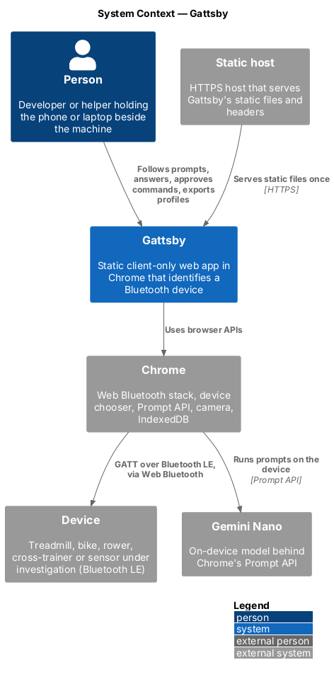
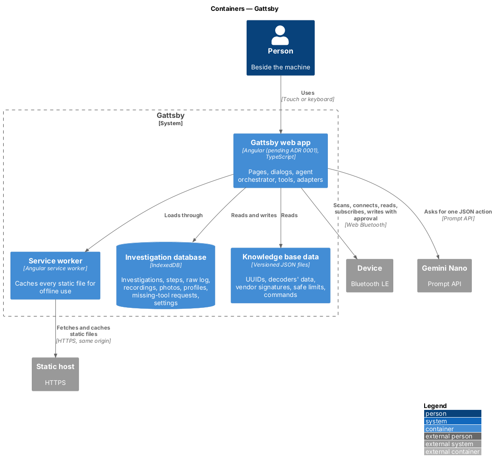
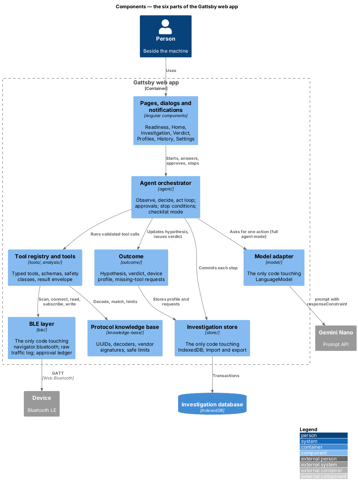

# Gattsby detailed designs

## Overview

Gattsby identifies an unknown Bluetooth fitness or IoT device from the browser. An on-device agent
drives a library of pre-written Bluetooth tools while the person beside the machine follows its
prompts, and the investigation ends with a verdict and a device profile. This folder holds the
detailed design of each feature, written against the level-1 (L1) requirements in
[`docs/specs/L1.md`](../specs/L1.md) and the level-2 (L2) requirements in
[`docs/specs/L2.md`](../specs/L2.md), and drawn to match the mocks in [`docs/mocks/`](../mocks/).

The designs are greenfield: no product code exists yet. They name the components the
implementation introduces, using the words of [`AGENTS.md`](../../AGENTS.md#words). The frontend
stack defaults to an Angular workspace in `frontend/`; ADR 0001 records that choice when the
workspace is created. Every user-facing string quoted in a design is provisional until the
*Gattsby: Behavior Description* is added (A-01, OQ-06).

## Description

Each feature is a vertical slice: one capability the person sees, cut through the UI, the agent
orchestrator, the tools and the adapter that reaches the browser API it needs. Each feature folder
holds a `README.md` with four sections (Overview, Description, Requirements, Diagrams) and a
`diagrams/` folder with PlantUML sources and their rendered images.

Gattsby is one static web app with six parts. The model chooses; deterministic code executes and
decodes.

| Part | Folder | Owns |
|---|---|---|
| Agent orchestrator | `frontend/src/app/agent/` | The observe → decide → act loop, approvals, stop conditions, checklist mode |
| Model adapter | `frontend/src/app/model/` | The only code that touches `LanguageModel` |
| Tool registry | `frontend/src/app/tools/` | Typed tools, schemas, safety classes, the result envelope |
| BLE layer | `frontend/src/app/ble/` | The only code that touches `navigator.bluetooth`; the raw traffic log; the approval ledger |
| Protocol knowledge base | `frontend/src/app/knowledge-base/`, `frontend/src/knowledge-base/` | Versioned data: UUIDs, decoders, vendor signatures, safe limits |
| Investigation store | `frontend/src/app/store/` | The only code that touches IndexedDB; import and export |

Two further folders hold deterministic helpers that the six parts share: `analysis/` (byte-level
analysis of recordings) and `outcome/` (hypothesis, verdict, device profile and missing-tool
requests).

To regenerate the images after editing a `.puml` file:

```bash
python .claude/skills/writing-software-design-documents/scripts/render_puml.py docs/detailed-designs
```

Rendering needs Java, `plantuml.jar` (found through `$PLANTUML_JAR`) and Graphviz.

### Features

| Subsystem | Feature | L2 requirements |
|---|---|---|
| environment | [Check capabilities](environment/check-capabilities/README.md) | FR-001, FR-002, FR-003, NFR-016, NFR-021, NFR-026, TOOL-001 |
| environment | [Choose the operating mode](environment/choose-operating-mode/README.md) | FR-004, FR-005, FR-006 |
| investigation | [Ask the person](investigation/ask-the-person/README.md) | FR-050, FR-051, FR-052, TOOL-025, TOOL-026 |
| investigation | [Follow the investigation](investigation/follow-the-investigation/README.md) | FR-048, NFR-009, NFR-010, NFR-011 |
| investigation | [Start an investigation](investigation/start-an-investigation/README.md) | FR-007, FR-008, FR-010 |
| investigation | [Stop, pause and resume](investigation/stop-pause-and-resume/README.md) | FR-009 |
| discovery | [Conclude not connectable](discovery/conclude-not-connectable/README.md) | FR-014, TOOL-034 |
| discovery | [Scan for the device](discovery/scan-for-the-device/README.md) | FR-011, FR-012, FR-067, TOOL-002, TOOL-003 |
| discovery | [Tell candidates apart](discovery/tell-candidates-apart/README.md) | FR-013, TOOL-004, TOOL-005 |
| connection | [Connect to the device](connection/connect-to-the-device/README.md) | FR-015, FR-017, TOOL-006, TOOL-032 |
| connection | [Log raw traffic](connection/log-raw-traffic/README.md) | FR-073, NFR-003, NFR-005 |
| connection | [Recover a dropped connection](connection/recover-a-dropped-connection/README.md) | FR-016, TOOL-007 |
| connection | [Release the connection](connection/release-the-connection/README.md) | FR-018, TOOL-008 |
| identification | [Enumerate the GATT layout](identification/enumerate-the-gatt-layout/README.md) | FR-019, FR-023, TOOL-009, TOOL-011 |
| identification | [Match known profiles](identification/match-known-profiles/README.md) | FR-021, TOOL-012, TOOL-020 |
| identification | [Read a model plate photo](identification/read-a-model-plate-photo/README.md) | FR-022, NFR-017, TOOL-027 |
| identification | [Read device information](identification/read-device-information/README.md) | FR-020, TOOL-010 |
| standard-protocol | [Confirm with a physical action](standard-protocol/confirm-with-a-physical-action/README.md) | FR-025, TOOL-033 |
| standard-protocol | [Decode standard data](standard-protocol/decode-standard-data/README.md) | FR-024, TOOL-013, TOOL-015 |
| standard-protocol | [Determine readable metrics](standard-protocol/determine-readable-metrics/README.md) | FR-027, TOOL-031 |
| standard-protocol | [Show live metrics](standard-protocol/show-live-metrics/README.md) | FR-026 |
| proprietary-protocol | [Detect framing](proprietary-protocol/detect-framing/README.md) | FR-031, TOOL-019 |
| proprietary-protocol | [Guess field encodings](proprietary-protocol/guess-field-encodings/README.md) | FR-030, TOOL-017, TOOL-018 |
| proprietary-protocol | [Record and find varying fields](proprietary-protocol/record-and-find-varying-fields/README.md) | FR-028, FR-029, TOOL-014, TOOL-016 |
| proprietary-protocol | [Unlock vendor data safely](proprietary-protocol/unlock-vendor-data-safely/README.md) | FR-032, FR-033, TOOL-023 |
| device-control | [Approve a command](device-control/approve-a-command/README.md) | FR-034, FR-035, NFR-018 |
| device-control | [Emergency stop](device-control/emergency-stop/README.md) | FR-039, TOOL-024 |
| device-control | [Keep commands conservative](device-control/keep-commands-conservative/README.md) | FR-036, NFR-019 |
| device-control | [Request control](device-control/request-control/README.md) | FR-037, TOOL-021 |
| device-control | [Test one command](device-control/test-one-command/README.md) | FR-038, FR-040, TOOL-022 |
| agent | [Apply heuristics first](agent/apply-heuristics-first/README.md) | FR-046, NFR-001 |
| agent | [Ask the model](agent/ask-the-model/README.md) | FR-042, FR-047, NFR-002 |
| agent | [Build the decision state](agent/build-the-decision-state/README.md) | FR-041, FR-044, NFR-020 |
| agent | [End the loop](agent/end-the-loop/README.md) | FR-045 |
| agent | [Run checklist mode](agent/run-checklist-mode/README.md) | FR-049 |
| agent | [Validate every action](agent/validate-every-action/README.md) | FR-043 |
| verdict-and-profile | [Build the device profile](verdict-and-profile/build-the-device-profile/README.md) | FR-055, FR-056 |
| verdict-and-profile | [Issue the verdict](verdict-and-profile/issue-the-verdict/README.md) | FR-054, FR-057, TOOL-030 |
| verdict-and-profile | [Record missing-tool requests](verdict-and-profile/record-missing-tool-requests/README.md) | FR-058, FR-059, TOOL-029 |
| verdict-and-profile | [Track the hypothesis](verdict-and-profile/track-the-hypothesis/README.md) | FR-053, TOOL-028 |
| persistence | [Browse and delete history](persistence/browse-and-delete-history/README.md) | FR-061, FR-065 |
| persistence | [Export profiles and records](persistence/export-profiles-and-records/README.md) | FR-062, FR-063 |
| persistence | [Import profiles and records](persistence/import-profiles-and-records/README.md) | FR-064, NFR-015, NFR-024 |
| persistence | [Save as the investigation runs](persistence/save-as-the-investigation-runs/README.md) | FR-060, NFR-007, NFR-008 |
| knowledge-base | [Maintain the knowledge base](knowledge-base/maintain-the-knowledge-base/README.md) | FR-066, FR-068, FR-069 |
| tool-registry | [Register and list tools](tool-registry/register-and-list-tools/README.md) | FR-070, FR-071, NFR-022 |
| tool-registry | [Return a result envelope](tool-registry/return-a-result-envelope/README.md) | FR-072, NFR-025 |
| platform | [Render untrusted text](platform/render-untrusted-text/README.md) | NFR-013 |
| platform | [Run a model on phones](platform/run-a-model-on-phones/README.md) | FR-074 |
| platform | [Serve offline and private](platform/serve-offline-and-private/README.md) | NFR-004, NFR-006, NFR-012, NFR-014, FR-075 |
| platform | [Simulate devices and the model](platform/simulate-devices-and-model/README.md) | NFR-023 |

### Requirement coverage

The 51 features cover 135 of the 135 L2 requirements.
Every L2 requirement belongs to at least one feature.

## Requirements

This index realizes no requirement of its own. Each feature's README lists the L2
requirements it realizes, with the L1 requirement each refines and the requirement text
quoted from [`docs/specs/L2.md`](../specs/L2.md).

## Diagrams

### System context

The person uses Gattsby in Chrome; Chrome reaches the device over Bluetooth LE and runs
Gemini Nano on the same machine. The static host serves the files once, and nothing else
leaves the device.



### Containers

The web app loads through the service worker, reads the bundled knowledge base, and keeps
every investigation in IndexedDB.



### Components

Inside the web app the orchestrator drives the loop: it asks the model adapter for one
action, runs validated tools that reach the device only through the BLE layer, and commits
each step through the investigation store.


