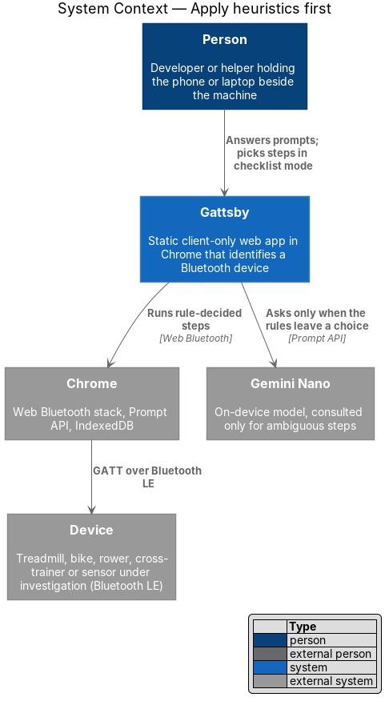
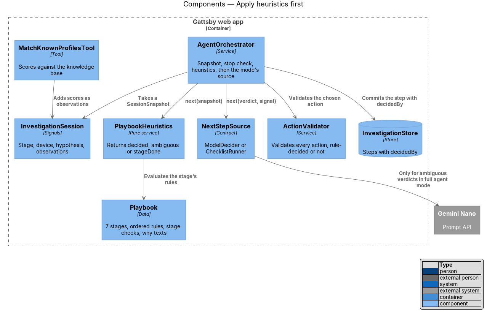
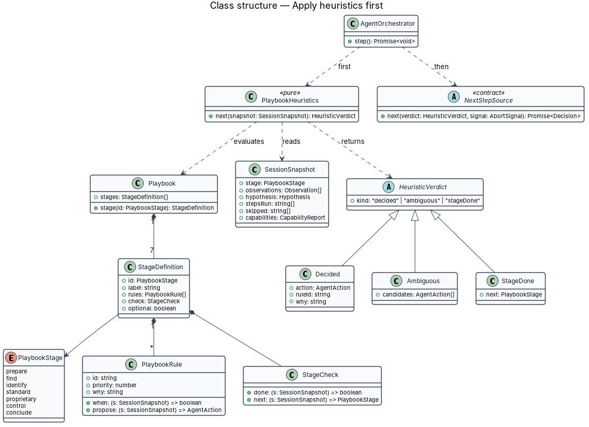
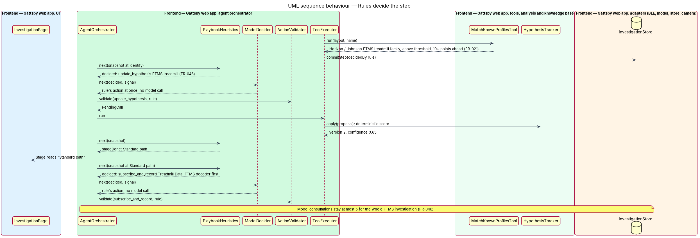
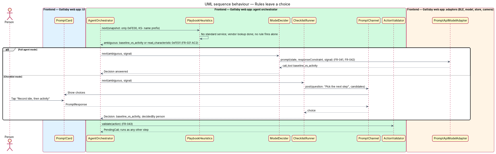

# Apply heuristics first

## Overview

Most of an investigation does not need a model. A device that advertises the Fitness Machine
service (`0x1826`) with Treadmill Data is an FTMS treadmill, and its next step is to record and
decode Treadmill Data; no reasoning is needed to see that. This feature is the deterministic part of
the decide step: before every step, the orchestrator applies the playbook's rules, and only when
they leave more than one reasonable next step does it ask the model (full agent mode) or the person
(checklist mode). It belongs to the agent subsystem and runs at every playbook stage.

**playbook** — ordered strategy of 7 stages: Prepare, Find, Identify, Standard path, Proprietary
path, Control and Conclude

**playbook rule** — deterministic condition over the investigation's observations that names one
next step, with the reason shown to the person

**heuristic verdict** — result of applying the rules to one snapshot: one decided step, a set of
candidate steps, or the end of the stage

**stage check** — condition that says a stage's work is done, so the orchestrator moves to the next
stage

The design serves two purposes. It keeps the small model out of decisions it would get wrong or
make slowly, so an FTMS investigation consults the model at most 5 times (FR-046) and reaches its
verdict in under 3 minutes (NFR-001). It also makes checklist mode possible: the same rules drive the
checklist, so the treadmill reaches the same verdict without a model.

On screen a rule-decided step needs nothing from the person when it is read-only: in full agent mode
the step runs at once, for example "Reading the maker and model" with "Read-only, takes about a second.
Nothing for you to do." (`docs/mocks/pages/investigation/identify.html`). The rule's reason is the
"Why:" line under each prompt, such as "Most machines talk to one device at a time. If something else
holds the connection, I won't see it." (`docs/mocks/pages/investigation/default.html`). In checklist
mode the rule's step is the recommended choice ("Recommended: read device information. It's
read-only and takes a second.", `docs/mocks/pages/investigation/checklist.html`).

## Description

The design introduces these building blocks in the Angular (pending ADR 0001) workspace under
`frontend/src/app/`:

- **`Playbook`** (`agent/playbook.ts`) — data: the 7 `PlaybookStage`s in order, each with its
  ordered `PlaybookRule`s and its `StageCheck`. Each rule has an `id`, a `when` predicate over a
  `SessionSnapshot`, the action it proposes, a `priority` and a `why` text (wording provisional,
  OQ-06). Rules name tools by registry name only; adding a tool or a vendor changes the registry or
  the knowledge base, not the orchestrator (NFR-022).
- **`PlaybookHeuristics`** (`agent/playbook-heuristics.ts`) — pure service.
  `next(snapshot)` returns a `HeuristicVerdict`: `stageDone` when the stage check holds;
  `decided` when exactly one rule of the highest firing priority fires, or when all firing rules
  propose the same step; `ambiguous` otherwise, with the candidate steps (the firing rules' steps or,
  when no rule fires, every tool allowed at the stage whose preconditions hold).
- **`AgentOrchestrator`** (`agent/agent-orchestrator.ts`) — for each step: takes a snapshot, checks
  `StopConditions`, asks `PlaybookHeuristics`, moves the stage on `stageDone` (no step is counted),
  and otherwise hands the verdict to the current `NextStepSource`. `ModelDecider` returns a decided
  step at once and prompts only for `ambiguous` (see
  [decide the next action](../decide-the-next-action/README.md)); `ChecklistRunner` offers the
  decided step as the recommended choice (see [run the checklist](../run-the-checklist/README.md)).
  Every action, rule-decided or not, then passes `ActionValidator` and `ToolExecutor` (see
  [validate and run an action](../validate-and-run-an-action/README.md)); a rule never skips an
  approval.
- **`MatchKnownProfilesTool`** (`tools/inspection/match-known-profiles.tool.ts`) — scores the layout,
  name and manufacturer data against the knowledge base (FR-021, see
  [match known profiles](../../identification/match-known-profiles/README.md)). Its scores feed the
  Identify rules; the heuristic threshold is `<TO SUPPLY>` (FR-021 does not give it), and 2
  candidates within 10 points of each other are ambiguous.
- **`InvestigationStep.decidedBy`** — `rule`, `model` or `person`, recorded on every step, so the
  number of model consultations is a count over the record.

### Rules at MVP

The rules follow the brief's playbook and the requirements each stage cites. A rule is skipped when
its step already ran or the person skipped it (FR-052).

| Stage | When | Next step |
|---|---|---|
| Prepare | No capability report in this investigation | `check_capabilities` |
| Prepare | Machine type not asked | `ask_user` machine type (FR-008) |
| Prepare | Brand not asked | `ask_user` brand (FR-008) |
| Prepare | Power-on and free-the-device not confirmed | `request_action` "Switch it on, then disconnect anything else…" (FR-008) |
| Find | No device chosen and no scan yet | `scan_devices` (FR-011) |
| Find | Filtered scan found nothing the person recognised | `scan_all_devices` (FR-012) |
| Find | Several look-alike candidates | `power_cycle_match` (FR-013) |
| Find | Both scans found nothing | `assess_reachability` (FR-014) |
| Identify | Not connected | `connect` (FR-015) |
| Identify | No GATT layout | `enumerate_gatt` (FR-019) |
| Identify | Device Information present and unread | `read_device_info` (FR-020) |
| Identify | Layout known, not matched | `match_known_profiles` (FR-021) |
| Identify | One profile above the threshold and 10 points ahead | `update_hypothesis` from the score; stage check met for the Standard path (FR-021 AC1) |
| Identify | No standard service | `vendor_signature_lookup`; then `ambiguous` (FR-021 AC2) |
| Standard path | Standard data characteristic not recorded | `subscribe_and_record` with that profile's decoder first (FR-024) |
| Standard path | Recorded, not confirmed | `request_action` for the known action, then `decode_standard` to compare (FR-025) |
| Proprietary path | No baseline | `baseline_vs_activity` (FR-028) |
| Proprietary path | Recordings, no varying-field analysis | `find_varying_bytes` (FR-029); later steps `ambiguous` |
| Control | Control point present, person not asked | `ask_user` whether to test one command (optional, OQ-08) |
| Control | Person agreed | `request_control`, then one `send_command` at the smallest step, each with approval (FR-037, FR-038) |
| Conclude | Always | `finish` with the verdict `VerdictService` builds from the evidence |

### Time budget for an FTMS treadmill

NFR-001 counts time from opening the app to the verdict and excludes the person's time beyond 5
seconds per prompt. For the rules above, the FTMS treadmill path spends:

| Part | Count on the FTMS path | Time each | Source |
|---|---|---|---|
| Prompts to the person | 6 (type, brand, power-on, Find the device, walk, speed up) | at most 5 s counted | NFR-001 |
| Recordings | 2 | 10 s | A-09 |
| Model decisions (full agent mode) | at most 5 | under 3 s at the 90th percentile | FR-046, NFR-002 |
| Deterministic steps | at most 40 | under 200 ms | FR-045, NFR-002 |
| Checklist picks (checklist mode only) | one per tool step | at most 5 s counted | NFR-001 |
| Bluetooth (connect, enumerate, reads) | — | `<TO SUPPLY>` (device-dependent) | — |
| App start and readiness check | 1 | `<TO SUPPLY>` | NFR-004 |

The Control stage runs only when the person agrees, so it is outside the FTMS path above.

### Tests that prove it

- Unit tests cover `PlaybookHeuristics.next` per rule: a snapshot with `0x1826` and Treadmill Data
  after matching gives `decided` with the FTMS hypothesis and no candidates (FR-021 AC1); a snapshot
  with only `0xFE00` gives `ambiguous` (FR-021 AC2); two equal-priority rules with different steps
  give `ambiguous`.
- An acceptance spec runs the FTMS treadmill of `e2e/fixtures/fake-bluetooth.ts` in full agent mode
  with the fake `LanguageModel`, which counts its prompts: at most 5 (FR-046 AC1). The same spec in
  checklist mode reaches the same verdict, "Connected — FTMS" (FR-046 AC2).
- An acceptance spec installs Playwright's clock, answers each prompt 5 simulated seconds after it
  appears, and reads the investigation record's timestamps from app open to verdict: under 180
  seconds (NFR-001 AC1). The fake clock keeps the spec fast enough for CI. NFR-001 AC2 is a hardware
  smoke test run by a person.

## Requirements

The feature realizes the following level-2 (L2) requirements; each refines the level-1 (L1)
requirement cited beside it.

| L2 ID | Refines (L1) | Requirement |
|-------|--------------|-------------|
| [`FR-046`](../../../specs/L2.md#fr-046-run-deterministic-heuristics-before-the-model) | `L1-010` | At each stage the orchestrator must apply the playbook's deterministic rules first and consult the model only when the rules leave more than one reasonable next step. |
| [`NFR-001`](../../../specs/L2.md#nfr-001-time-to-verdict-for-an-ftms-machine) | `L1-019` | For an FTMS treadmill or bike that is powered on and free of other connections, the time from opening the app to the verdict must be under 3 minutes, with the model already downloaded (full agent mode) or in checklist mode, excluding the time the person takes to answer beyond 5 seconds per prompt. |

## Diagrams

### System context

The person answers Gattsby's prompts; Gattsby decides most steps itself and asks Gemini Nano only
when its rules leave a choice.

### Containers

Inside Gattsby the web app applies the playbook's rules to the observations in the investigation
database and the knowledge base's profiles before it prompts the on-device model.

### Components

`AgentOrchestrator` asks `PlaybookHeuristics`, which applies the `Playbook`'s rules to a snapshot
built from `InvestigationSession` and the match scores; the verdict goes to the mode's
`NextStepSource` and every action then goes to `ActionValidator`.

### Class structure

The `Playbook` holds stages, each with ordered `PlaybookRule`s and a `StageCheck`;
`PlaybookHeuristics` evaluates them into one of 3 `HeuristicVerdict` kinds.

### Behaviour — rules decide the step

After `match_known_profiles` the Horizon T202 scores as an FTMS treadmill above the threshold; the
rules set the hypothesis, end the Identify stage and choose `subscribe_and_record` on Treadmill Data,
with no model call.

### Behaviour — rules leave a choice

For the Kingsmith `KS-AP-R3`, which exposes only `0xFE00`, the rules leave 2 candidate steps; full
agent mode asks the model, checklist mode asks the person, and either answer is validated the same
way.

