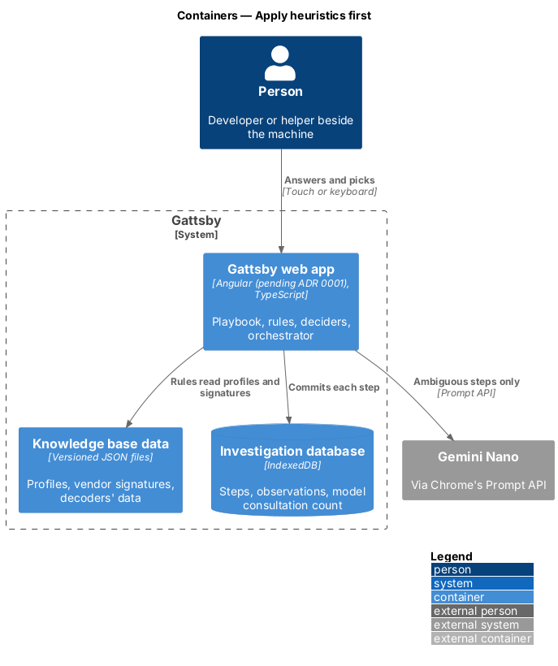
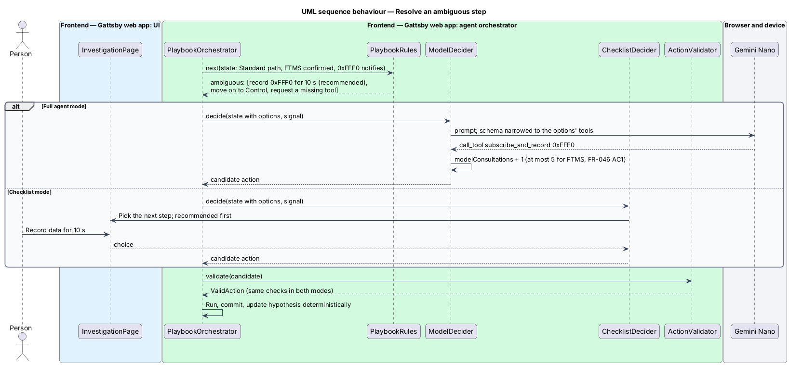

# Apply heuristics first

## Overview

A small on-device model is slow and makes poor multi-step choices, while most of an FTMS
investigation is predictable: connect, enumerate, read the maker, match the profile, record the data
while the person walks. This feature makes the playbook's deterministic rules decide every step they
can, and consults the model only when the rules leave more than one reasonable next step. The same
rules drive checklist mode, so both modes reach the same verdict. The feature belongs to the agent
subsystem and runs at every step of all seven stages: Prepare, Find, Identify, Standard path,
Proprietary path, Control and Conclude.

**playbook rule** — deterministic rule for one stage that maps the decision state either to the next
action or to a short list of options when more than one next step is reasonable

**ambiguous step** — step for which the rules return more than one option

**model consultation** — one model decision, counted per investigation

The person sees the rules at work as steps that run without a prompt ("Now · Reading the maker and
model · Read-only, takes about a second. Nothing for you to do.",
`docs/mocks/pages/investigation/identify.html`) and as questions and actions the playbook asks for
(`prepare.html`, `default.html`). In checklist mode an ambiguous step appears as "Pick the next step"
with the rules' recommendation first (`docs/mocks/pages/investigation/checklist.html`; see the
run-checklist-mode design).

## Description

The design introduces these building blocks in the Angular (pending ADR 0001) workspace under
`frontend/src/app/`:

- **`Playbook`** (`agent/playbook.ts`) — the seven stages in order, the tools allowed at each, and the
  person-facing text of each fixed step ("Why:" and "Purpose:" lines), as data.
- **`PlaybookRules`** (`agent/playbook-rules.ts`) — `next(state)` returns a `RuleOutcome`: `{ kind:
  'decided', action }` or `{ kind: 'ambiguous', options }`. It evaluates the current stage's rules in
  order and returns the first that applies. It is a pure function of the `DecisionState` and the
  knowledge base, unit-tested per rule.
- **Stage rule lists** (`agent/rules/{stage}.rules.ts`, for example `agent/rules/identify.rules.ts`) —
  one ordered `StageRule[]` per stage. A rule has an `id`, a `when(state)` test and a `then(state)`
  result.
- **`PlaybookOrchestrator`** (`agent/playbook-orchestrator.ts`) — at each step calls
  `PlaybookRules.next` first. A decided action goes straight to `ActionValidator` and `ToolExecutor`;
  only an ambiguous outcome goes to the `Decider`.
- **`Decider`** (`agent/decider.ts`) with **`ModelDecider`** (`agent/model-decider.ts`) and
  **`ChecklistDecider`** (`agent/checklist-decider.ts`) — resolve an ambiguous step: the model chooses
  in full agent mode (see the ask-the-model design), the person chooses in checklist mode.
- **`ProfileMatcher`** (`knowledge-base/profile-matcher.ts`) and **`ConfidenceScorer`**
  (`outcome/confidence-scorer.ts`) — deterministic scores the rules read. Hypothesis updates after each
  observation are deterministic too (see the track-the-hypothesis design); the model never scores.
- **`Investigation.modelConsultations`** (`store/model/investigation.ts`) — counter incremented by
  `ModelDecider` and stored with the investigation, so a spec can assert the limit.

### Rules per stage

| Stage | Decided by the rules | Typically ambiguous |
|---|---|---|
| Prepare | `check_capabilities`; ask machine type; ask brand; ask to power on and disconnect other apps (FR-008) | — |
| Find | `scan_devices`; if nothing chosen, `scan_all_devices`; several look-alikes, `power_cycle_match`; after 3 empty scans, `assess_reachability` | — |
| Identify | `connect`; `enumerate_gatt`; `read_device_info` when `0x180A` is present; `match_known_profiles`; `vendor_signature_lookup` when unknown services remain; `read_supported_ranges` for FTMS | two profiles score within a margin of each other (`<TO SUPPLY>` points) |
| Standard path | for each claimed metric not yet confirmed: record, ask for the matching action, decode and compare (FR-025) | an unknown notifying service beside the standard one (the mocks' `0xFFF0`) |
| Proprietary path | `baseline_vs_activity` once; `find_varying_bytes` after each recording | which characteristic to record next, which action to ask for, which encoding test to run |
| Control | the steps in the test-one-command design | — |
| Conclude | `finish` with the verdict `VerdictBuilder` supports | — |

A stage ends when its last rule reports it done; the rules then move to the next stage that applies
(Standard path or Proprietary path, Control only when a Control Point is present).

### How the dispatch works

1. Build the `DecisionState` (see the build-the-decision-state design).
2. `PlaybookRules.next(state)`.
3. **Decided:** validate and run; no model call. Read-only tools run without a prompt.
4. **Ambiguous:** pass the options to the `Decider`. The model's tool list and schema are narrowed to
   the options' tools plus `ask_user` and `request_missing_tool`; the person sees the options as
   buttons. Either way the chosen action is validated like any other (FR-043).
5. Commit the step and update the hypothesis deterministically.

### Limits

- **Model consultations.** For an FTMS treadmill in full agent mode the model is consulted no more
  than 5 times (FR-046 AC1). With the mocks' Horizon T202, only the vendor service `0xFFF0` beside
  FTMS is ambiguous.
- **Same verdict in both modes.** Both deciders sit behind the same rules, validator, tools and
  verdict builder, so an FTMS treadmill reaches "Connected — FTMS" in either mode (FR-046 AC2).
- **Time to verdict (NFR-001).** From opening the app to the verdict shall take under 3 minutes for
  an FTMS treadmill or bike, with the model downloaded or in checklist mode. The rules keep the
  bounded parts small: three Prepare answers (5 seconds each in the spec), one chooser pick, a few
  seconds of connection and reads, three 10-second recordings (A-09) with their actions, and at most 5
  model decisions of under 3 seconds each (NFR-002). The design estimate for the simulated treadmill,
  without the optional Control stage, is about 2 minutes; the spec measures it.

### Data shapes

| Type | Fields |
|---|---|
| `RuleOutcome` | `{ kind: 'decided', action, ruleId }` or `{ kind: 'ambiguous', options, ruleId }` |
| `RuleOption` | `action`, `label` ("Read device information"), `purpose` ("It's read-only and takes a second."), `recommended` |
| `StageRule` | `id`, `stage`, `when(state)`, `then(state)` |

### Tests that prove it

Unit tests drive `PlaybookRules.next` with fixed decision states, one per rule. The behaviour spec
for the fake FTMS treadmill counts the fake `LanguageModel`'s `prompt()` calls (at most 5) and runs
the same scripted device in checklist mode to the same verdict. The time-to-verdict spec answers each
prompt after 5 seconds and checks the total is under 3 minutes; the hardware smoke test on a real
treadmill is run by a person.

## Requirements

The feature realizes the following level-2 (L2) requirements; each refines the level-1 (L1)
requirement cited beside it.

| L2 ID | Refines (L1) | Requirement |
|-------|--------------|-------------|
| [`FR-046`](../../../specs/L2.md#fr-046-run-deterministic-heuristics-before-the-model) | `L1-010` | At each stage the orchestrator must apply the playbook's deterministic rules first and consult the model only when the rules leave more than one reasonable next step. |
| [`NFR-001`](../../../specs/L2.md#nfr-001-time-to-verdict-for-an-ftms-machine) | `L1-019` | For an FTMS treadmill or bike that is powered on and free of other connections, the time from opening the app to the verdict must be under 3 minutes, with the model already downloaded (full agent mode) or in checklist mode, excluding the time the person takes to answer beyond 5 seconds per prompt. |

## Diagrams

### System context

Gattsby decides most steps itself and consults Gemini Nano only for ambiguous ones; the person
answers the playbook's questions and, in checklist mode, picks among the options.

### Containers

The web app reads profiles and vendor data from the knowledge base to apply the rules, and records
each step, including the count of model consultations, in the investigation database.

### Components

`PlaybookOrchestrator` asks `PlaybookRules` first; a decided action goes to `ActionValidator`, and an
ambiguous outcome goes to `ModelDecider` or `ChecklistDecider`.

### Class structure

`PlaybookRules` evaluates the `StageRule` lists of the `Playbook` and returns a `RuleOutcome`; the
two `Decider` implementations resolve the ambiguous outcomes.

### Behaviour — the rules decide a step

At Identify, the rules decide `read_device_info` without the model; the step is validated, runs, and
updates the hypothesis deterministically.

### Behaviour — resolve an ambiguous step

When the rules return options, the model chooses among them in full agent mode and the person
chooses in checklist mode; the choice is validated like any other action.

