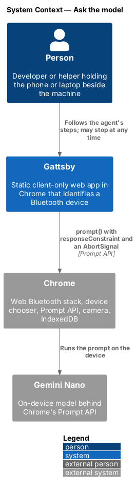
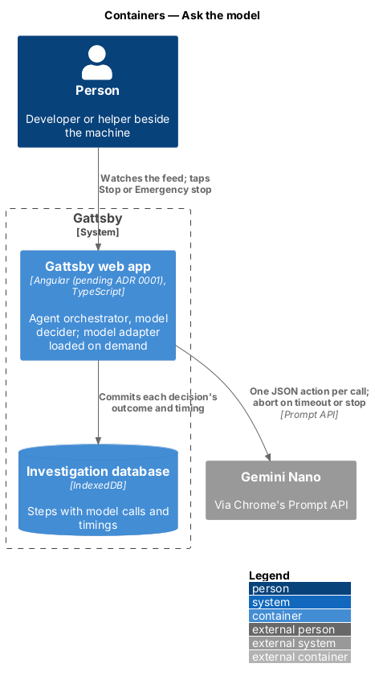
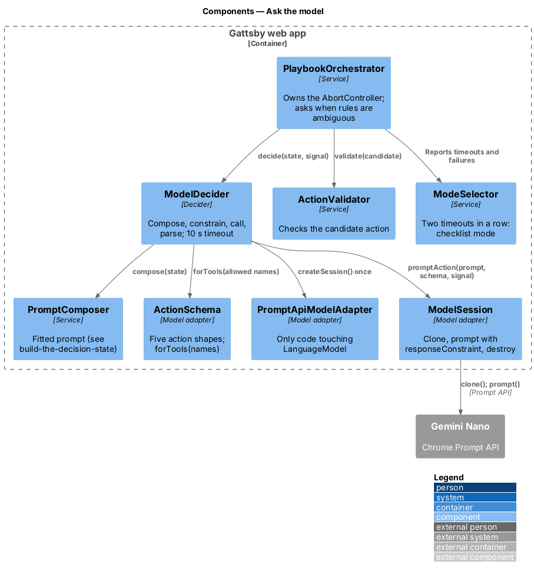
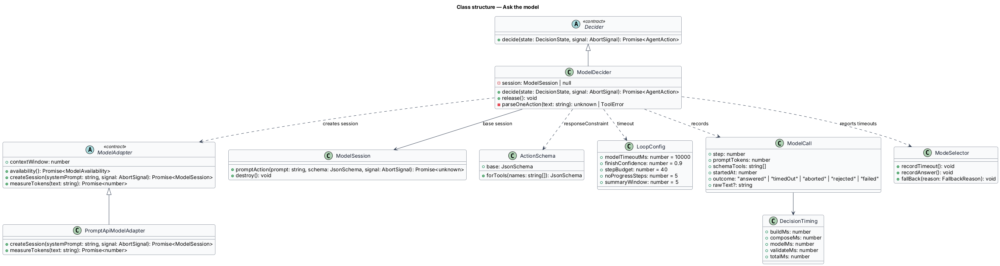
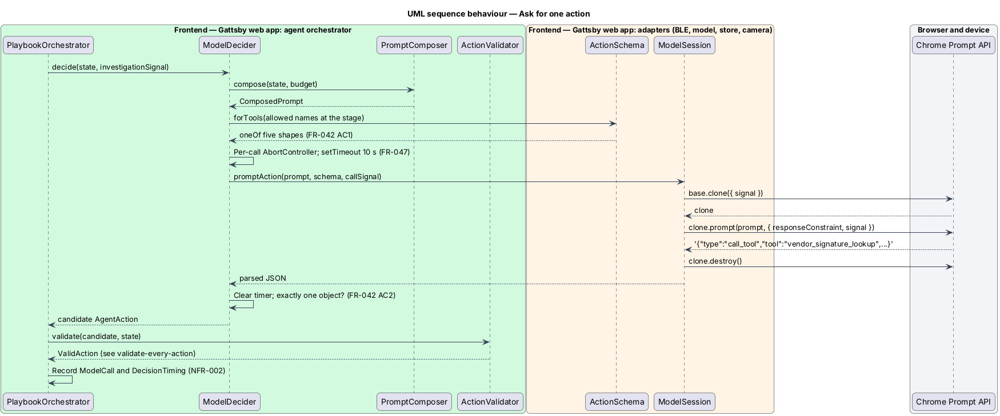
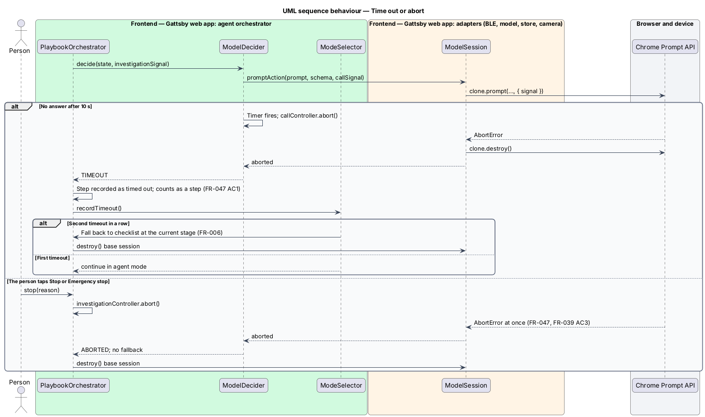

# Ask the model

## Overview

In full agent mode, when the playbook's deterministic rules leave more than one reasonable next step
(see the apply-heuristics-first design), the agent orchestrator asks Gemini Nano to choose. This
feature is that call. It sends the fitted prompt (see the build-the-decision-state design) through
Chrome's Prompt API, constrains the answer to exactly one JSON action with a JSON Schema, and bounds
the call with a 10-second timeout and an `AbortController`. Gattsby does not depend on native tool
calling: the model names a tool in its JSON action, and app code runs it. The feature belongs to the
agent subsystem and is the only route from the orchestrator to the model adapter.

**model decision** — one call to the on-device model that returns one action for one step

**action schema** — JSON Schema of the five action shapes (`call_tool`, `ask_user`,
`update_hypothesis`, `request_missing_tool`, `finish`), passed to the Prompt API as
`responseConstraint`

**base session** — Prompt API session created once per investigation with the fixed system
instructions, from which each model decision clones a short-lived session

The person sees the mode as "Agent" in the Investigation page's app bar ("Agent · Control",
`docs/mocks/pages/investigation/control.html`) and the outcome of each decision as a feed entry with
its "Why:" line. When the model stops answering twice in a row, the mode banner reads "Continuing as
a checklist. The on-device model stopped answering twice in a row."
(`docs/mocks/notifications/mode-banner/warning.html`; see the choose-operating-mode design). The
Prompt API's shape is assumption A-13; the model is available only on desktop Chrome 148 and later
(`PD-PROMPT`).

## Description

The design introduces these building blocks in the Angular (pending ADR 0001) workspace under
`frontend/src/app/`:

- **`ModelDecider`** (`agent/model-decider.ts`) — the `Decider` for full agent mode. On first use it
  imports the model adapter dynamically and creates the base session. For each decision it composes
  the prompt with `PromptComposer`, builds the schema with `ActionSchema.forTools`, calls
  `ModelSession.promptAction` under the timeout, and parses the answer. The `AgentAction` it returns
  is a candidate: `ActionValidator` checks it before anything runs (see the validate-every-action
  design). A timeout or an abort rejects with a `ToolError` (`TIMEOUT` or `ABORTED`).
- **`PromptApiModelAdapter`** (`model/prompt-api-model-adapter.ts`), behind the **`ModelAdapter`**
  contract — the only code that touches `LanguageModel`. `createSession()` calls
  `LanguageModel.create()` with the system instructions as initial prompts. `contextWindow` and
  `measureTokens()` serve the prompt budget.
- **`ModelSession`** (`model/model-session.ts`) — `promptAction(prompt, schema, signal)` clones the
  base session, calls `prompt()` on the clone with `{ responseConstraint: schema, signal }`, destroys
  the clone, and returns the raw text's parsed JSON. Each decision therefore starts from the system
  instructions alone; the Prompt API's own history never grows across steps. `destroy()` releases the
  base session.
- **`ActionSchema`** (`model/action-schema.ts`) — the JSON Schema of the five actions.
  `forTools(names)` narrows `call_tool.tool` to the names allowed at the current stage. The schema is
  plain data passed to Chrome; validation of the answer uses the precompiled schema in
  `SchemaValidator` (NFR-013), never code generated at run time.
- **`LoopConfig`** (`agent/loop-config.ts`) — `modelTimeoutMs` of 10,000 (A-05).
- **`ModeSelector`** (`agent/mode-selector.ts`) — counts consecutive timeouts and falls back to
  checklist mode after two (FR-006).
- **`PlaybookOrchestrator`** (`agent/playbook-orchestrator.ts`) — owns the investigation's
  `AbortController`, which stop and emergency stop abort (FR-047), and records each decision's
  timings on its step.

### The five action shapes

| `type` | Fields |
|---|---|
| `call_tool` | `tool` (one of the stage's allowed names), `input` (object), `why` (≤ 140 characters) |
| `ask_user` | `question` (≤ 140), `answers` (2–6, each ≤ 40), `allowFreeText?`, `why` |
| `update_hypothesis` | `protocol`, `deviceType?`, `maker?`, `model?`, `proposedConfidence` (0–1), `evidence` (IDs) |
| `request_missing_tool` | `capability` (≤ 80), `reason` (≤ 280), `evidence` (IDs) |
| `finish` | `verdict`, `summary` (≤ 280) |

Each shape sets `additionalProperties: false`. The schema is a `oneOf` keyed by `type`, so a
conforming answer is exactly one action (FR-042). The `why` text is shown in the feed as text, never
as HTML (FR-048, NFR-013).

### Rules

1. **One action or rejected.** The answer shall parse as one JSON object. An array, two objects,
   surrounding prose or invalid JSON is rejected with `INVALID_INPUT` ("not one action") and counted
   as a refused step (FR-042 AC2). Its text is kept in the step for diagnostics, never shown as HTML.
2. **Timeout.** Each call gets its own `AbortController`, linked to the investigation's signal and
   fired by a `setTimeout` of `modelTimeoutMs`. Unit tests advance a fake clock;
   `AbortSignal.timeout` is not used because fake clocks do not drive it. A timed-out call is aborted
   and recorded as a timed-out step that counts against the step budget (FR-047 AC1).
3. **Two in a row.** Two consecutive timeouts switch the investigation to checklist mode at the current
   stage, keeping every observation (FR-006).
4. **Stop and emergency stop** abort the pending call at once (FR-047, FR-039 AC3). The call rejects
   with `ABORTED`; no fallback follows because the loop is ending.
5. **Session failures.** A `QuotaExceededError` for the input is treated as `contextExhausted`. A lost
   session is recreated once; a second failure is "session creation fails". Both fall back to
   checklist mode (FR-006).
6. **Release.** Each clone is destroyed after its call; the base session is destroyed when the loop
   ends or the mode falls back.

### Latency (NFR-002)

A model decision covers building the state, the model's answer and validation. It shall take under 3
seconds at the 90th percentile on the reference laptop (A-07). The design keeps it short by:
composing a compact prompt with cached tool-description sizes; cloning a warm base session instead of
creating one; and creating the base session while the person answers the Prepare questions. Each
step stores a `DecisionTiming` for local diagnostics (NFR-025); nothing is reported remotely.
Deterministic steps never call the model and shall take under 200 ms, excluding Bluetooth and the
person.

### Data shapes

| Type | Fields |
|---|---|
| `ModelCall` | `step`, `promptTokens`, `schemaTools`, `startedAt`, `outcome` (`answered`, `timedOut`, `aborted`, `rejected`, `failed`), `rawText?` |
| `DecisionTiming` | `buildMs`, `composeMs`, `modelMs`, `validateMs`, `totalMs` |

### Errors

| Code | Raised by | Meaning to the person |
|---|---|---|
| `TIMEOUT` | `ModelDecider` | The feed notes the model did not answer in 10 seconds; after the second, the mode banner explains the switch. |
| `ABORTED` | `ModelDecider` | None shown; the stop's own screen takes over. |
| `INVALID_INPUT` | `ModelDecider` (unparseable answer) | None shown by itself; three in a row trigger the checklist fallback (FR-006). |

### Tests that prove it

The fake `LanguageModel` (`e2e/fixtures/fake-language-model.ts`) records each `prompt()` call's
options; a spec checks that every call carries a `responseConstraint` with the five shapes (FR-042
AC1). Other scripts answer with two objects (rejected), never answer (aborted after 10 seconds,
fake clock), or are interrupted by "Stop" (signal aborted). The latency criterion on the reference
laptop is a hardware smoke test run by a person.

## Requirements

The feature realizes the following level-2 (L2) requirements; each refines the level-1 (L1)
requirement cited beside it.

| L2 ID | Refines (L1) | Requirement |
|-------|--------------|-------------|
| [`FR-042`](../../../specs/L2.md#fr-042-constrain-the-model-to-one-json-action) | `L1-010` | Each model call must request structured output with a JSON schema (`responseConstraint`) that allows exactly one action: `call_tool` (tool name and input), `ask_user`, `update_hypothesis`, `request_missing_tool` or `finish`. Gattsby must not depend on native tool calling. |
| [`FR-047`](../../../specs/L2.md#fr-047-time-out-and-abort-model-calls) | `L1-010` | Each model call must have a timeout (assumed 10 seconds; see A-05) and an `AbortController`. A timed out call is aborted and counts as a failed step. Stop and emergency stop abort a pending call at once. |
| [`NFR-002`](../../../specs/L2.md#nfr-002-agent-step-latency) | `L1-019` | Once the model is loaded, each model decision (state built, model answers, action validated) must take under 3 seconds at the 90th percentile on a typical laptop (assumed: 4-core CPU, 16 GB RAM, integrated GPU, meeting Chrome's model requirements; see A-07). Deterministic steps must take under 200 ms, excluding Bluetooth and the person. |

## Diagrams

### System context

Gattsby asks Gemini Nano, through Chrome's Prompt API, for one JSON action at a time, and can abort
the call.

### Containers

The web app composes the prompt from the investigation database and calls the model in Chrome; the
model adapter is a separately loaded part of the web app.

### Components

`ModelDecider` composes the prompt, narrows `ActionSchema`, and calls `ModelSession` through
`PromptApiModelAdapter` under the timeout; `ActionValidator` checks the answer and `ModeSelector`
counts timeouts.

### Class structure

`ModelDecider` implements the `Decider` contract and depends on the `ModelAdapter` contract;
`ModelSession` clones the base session for each `promptAction` call.

### Behaviour — ask for one action

The decider composes the prompt, clones the base session, prompts with `responseConstraint` and a
signal, parses exactly one action and hands it to `ActionValidator`.

### Behaviour — time out or abort

After 10 seconds the call is aborted and recorded as timed out, and a second timeout in a row falls
back to checklist mode; stop or emergency stop aborts the call at once.

