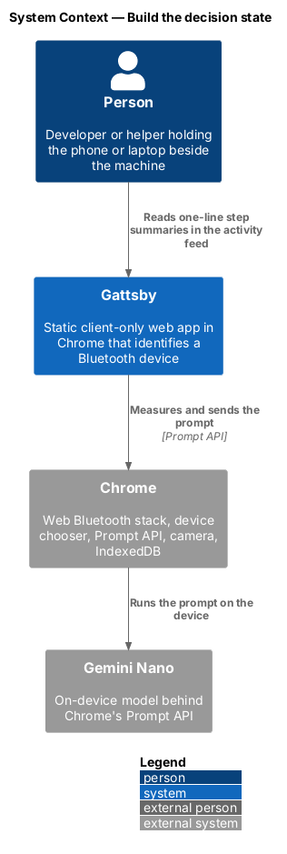
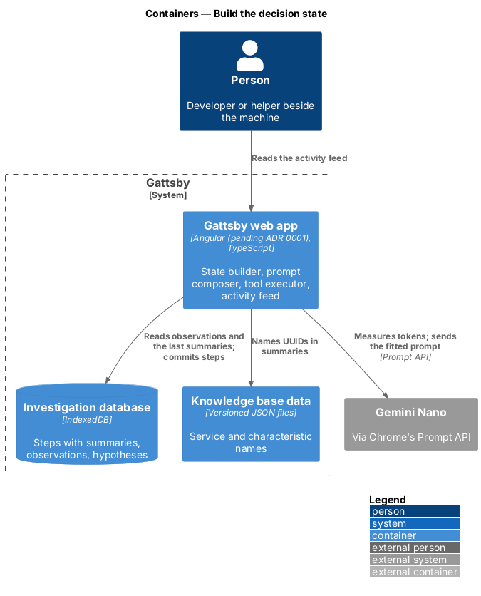
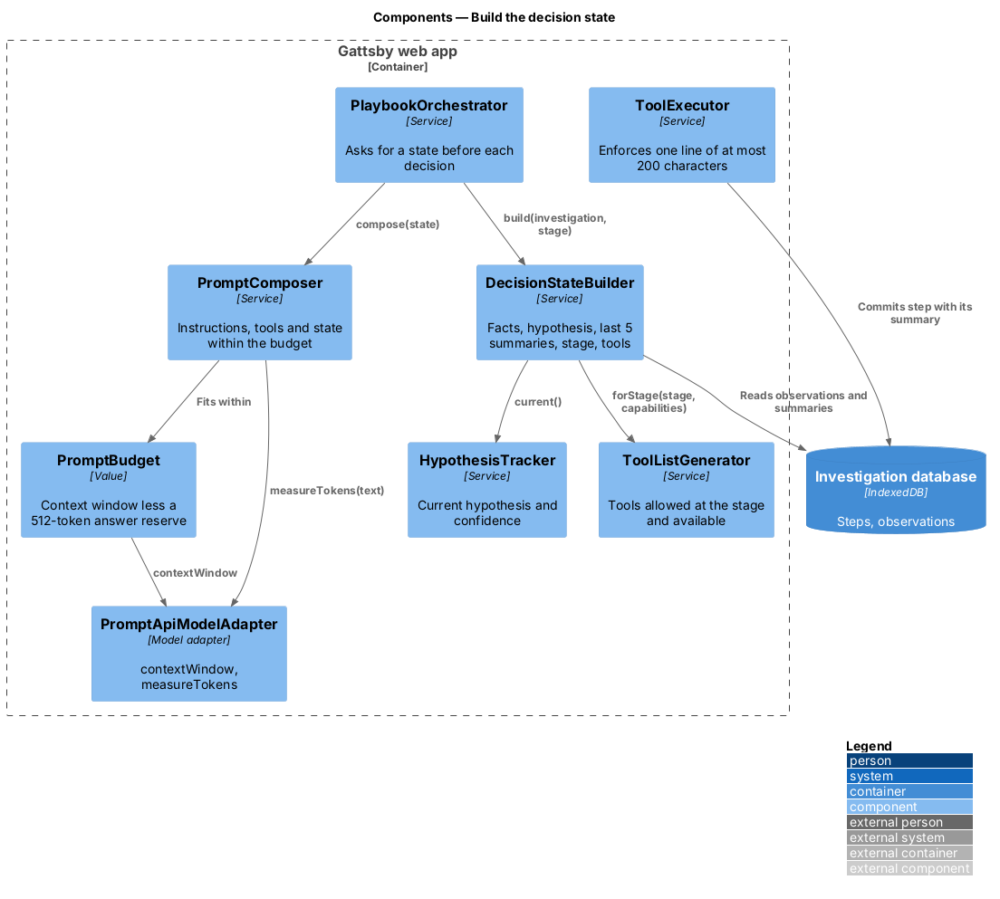
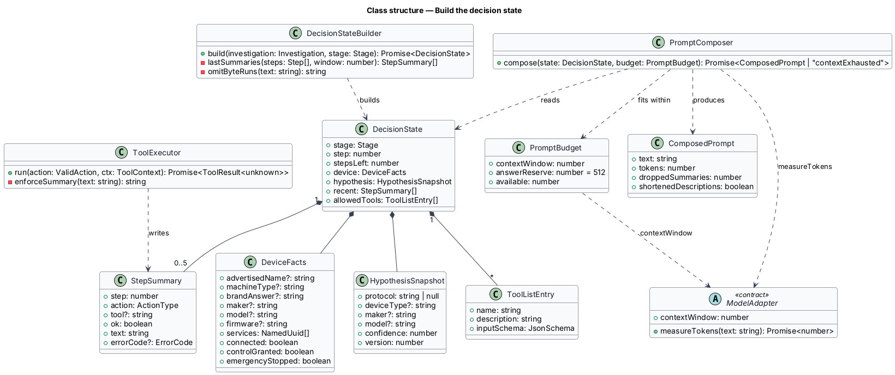
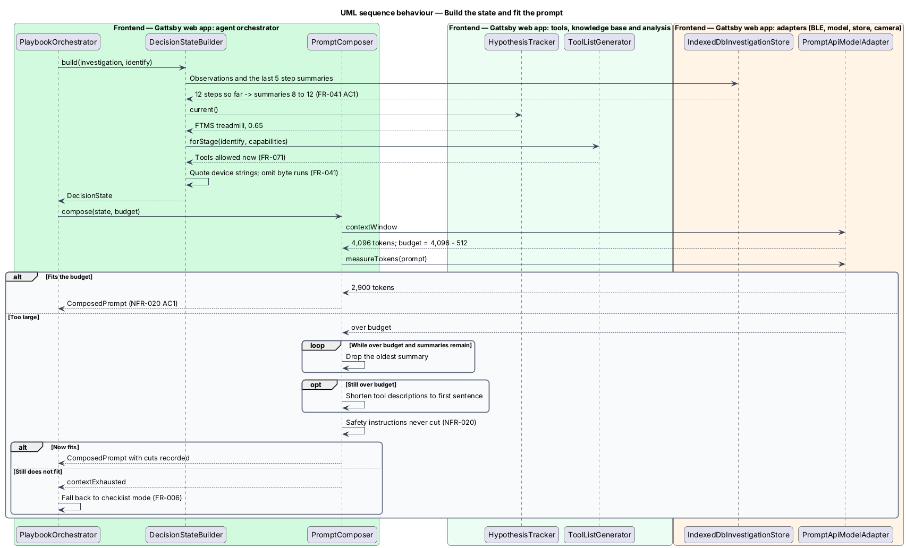
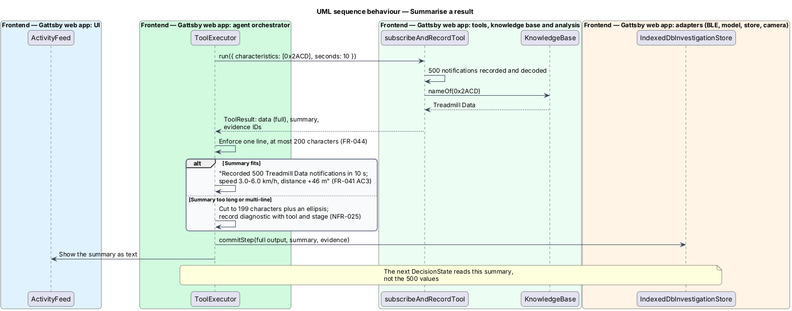

# Build the decision state

## Overview

Gemini Nano is a small model with a limited context window and weak multi-step reasoning. Before each
decision the agent orchestrator therefore gives it a short, fresh picture of the investigation
instead of the whole history. This feature builds that picture, the decision state, and makes every
tool result carry the one-line summary the picture is made of. It also fits the whole prompt (system
instructions, tool list and state) inside the budget the model adapter reports, cutting in a fixed
order and never cutting the safety instructions. The feature belongs to the agent subsystem and runs
at every step of every playbook stage.

**decision state** — compact summary of the investigation, free of raw bytes, that the orchestrator
builds before each decision

**step summary** — one line of at most 200 characters, carried by each tool result, that the
decision state and the person's activity feed both show

**prompt budget** — number of tokens one decision's prompt may use: the session's context window less
the room kept for the answer

The person never sees the decision state itself, but sees every step summary in the activity feed
of the Investigation page: for example "Connected. 4 services, 3 of them standard." and "10
notifications at 1 per second, decoded with the FTMS layout."
(`docs/mocks/pages/investigation/default.html`). The same line is what the model reads about that
step. In checklist mode the decision state is still built, because `PlaybookRules` read it, but no
prompt is composed.

## Description

The design introduces these building blocks in the Angular (pending ADR 0001) workspace under
`frontend/src/app/`:

- **`DecisionStateBuilder`** (`agent/decision-state-builder.ts`) — `build(investigation, stage)`
  returns a `DecisionState` with only: the device facts so far, the current hypothesis with its
  confidence, the last 5 step summaries (`LoopConfig.summaryWindow`, A-05), the current stage, the
  tools allowed at that stage, and the step count against the budget. It reads observations, never
  raw log entries.
- **`DecisionState`** (`agent/decision-state.ts`) and **`StepSummary`** (`agent/step-summary.ts`) —
  the typed shapes. `DecisionState` has no field that can hold bytes.
- **`HypothesisTracker`** (`outcome/hypothesis-tracker.ts`) — supplies the current hypothesis and its
  deterministic confidence (see the track-the-hypothesis design).
- **`ToolListGenerator`** (`tools/tool-list-generator.ts`) — supplies the tools allowed at the stage
  whose required capabilities are available (FR-071), with their descriptions and input schemas.
- **`ToolExecutor`** (`agent/tool-executor.ts`) — enforces the summary rule on every result before
  the step is committed: one line, at most 200 characters (FR-044). It also writes the summary of a
  refused or failed step, for example "Refused send_command: control not granted yet
  (PRECONDITION_FAILED)".
- **Tool implementations** (`tools/{group}/{tool-name}.tool.ts`) — each tool writes its summary from
  decoded values and names services by `KnowledgeBase.nameOf(uuid)`, for example "Found 4 services:
  Fitness Machine, Device Information, Heart Rate, unknown 0xFFF0" (FR-044 AC1).
- **`PromptComposer`** (`agent/prompt-composer.ts`) — turns the fixed system instructions, the tool
  list and the `DecisionState` into the prompt for one decision, and fits it to the `PromptBudget`.
  Used only in full agent mode (see the ask-the-model design).
- **`PromptBudget`** (`agent/prompt-budget.ts`) — computed from `ModelAdapter.contextWindow` less an
  answer reserve of 512 tokens (NFR-020 AC1). Sizes are measured with `ModelAdapter.measureTokens`.

### Rules for the state

1. Exactly the last 5 summaries: with 12 tool results so far, the state holds results 8 to 12
   (FR-041 AC1). Refused actions and timed-out model calls are steps and have summaries too, so the
   model sees why its last action failed (FR-043).
2. No raw bytes reach the model (FR-041). Facts are typed values (names, numbers, UUIDs, booleans).
   Summaries describe decoded values, byte positions and encodings, not payloads. As a backstop, the
   builder replaces any run of more than 4 hex byte pairs in a summary with "[bytes omitted]" in the
   model's copy.
3. Device-derived strings (advertised name, maker, model) are untrusted. They enter the state quoted
   and cut to 120 characters, matching the device profile's identity limit. A name that reads like an instruction gains
   nothing, because every action is validated (see the validate-every-action design).
4. Device facts include the safety-relevant flags the rules and preconditions need: connected,
   control granted, emergency stop latched.

### Rules for the summary (FR-044)

1. Every tool returns a summary besides its full output; the full output goes to the investigation
   store, the summary to the state and the feed.
2. A summary longer than 200 characters, or with a line break, is cut to 199 characters plus "…" on
   one line. The cut is recorded as a diagnostic with the tool and stage (NFR-025), because it means
   the tool's summary needs fixing.
3. A recording summarises counts, rates and decoded ranges, never the values one by one. A recording
   of 500 notifications reads, for example, "Recorded 500 Treadmill Data notifications in 10 s;
   speed 3.0–6.0 km/h, distance +46 m" (FR-041 AC3).

### Fitting the prompt (NFR-020)

`PromptComposer` measures the composed prompt and, while it exceeds the budget, cuts in this order:

1. Drop the oldest summary, one at a time, down to none.
2. Shorten each tool description to its first sentence.
3. If it still does not fit, return `contextExhausted`. The orchestrator then falls back to
   checklist mode at the current stage (FR-006; see the choose-operating-mode design).

The safety instructions, the five action shapes, the stage, the hypothesis and the device facts are
never cut. Tool-description sizes are measured once per stage and cached, so fitting adds little to
the 3-second decision budget (NFR-002).

### Data shapes

| Type | Fields |
|---|---|
| `DecisionState` | `stage`, `step`, `stepsLeft`, `device` (`DeviceFacts`), `hypothesis` (`protocol`, `deviceType`, `maker`, `model`, `confidence`, `version`), `recent` (`StepSummary[]`, at most 5), `allowedTools` (`ToolListEntry[]`) |
| `DeviceFacts` | `advertisedName?`, `machineType?`, `brandAnswer?`, `maker?`, `model?`, `firmware?`, `services` (UUID and knowledge-base name), `connected`, `controlGranted`, `emergencyStopped` |
| `StepSummary` | `step`, `action`, `tool?`, `ok`, `text` (≤ 200 characters), `errorCode?` |
| `PromptBudget` | `contextWindow`, `answerReserve` (512), `available` |
| `ComposedPrompt` | `text`, `tokens`, `droppedSummaries`, `shortenedDescriptions` |

### Tests that prove it

Unit tests cover `DecisionStateBuilder` (12 results → 5 summaries; no byte field), the summary cut in
`ToolExecutor`, and `PromptComposer` with a fake `ModelAdapter` reporting a 4,096-token window: the
largest state of the scripted FTMS investigation fits with at least 512 tokens left, and an
oversized state drops summaries before descriptions. The behaviour spec for the FTMS treadmill checks
that each prompt the fake `LanguageModel` receives holds no payload hex.

## Requirements

The feature realizes the following level-2 (L2) requirements; each refines the level-1 (L1)
requirement cited beside it.

| L2 ID | Refines (L1) | Requirement |
|-------|--------------|-------------|
| [`FR-041`](../../../specs/L2.md#fr-041-build-a-compact-state-for-each-decision) | `L1-010` | Before each model call the orchestrator must build a state holding only: the device facts so far, the current hypothesis with its confidence, the last 5 tool results as one-line summaries, the current playbook stage, and the tools allowed at that stage. Raw bytes are never sent to the model; summaries are. |
| [`FR-044`](../../../specs/L2.md#fr-044-summarise-each-result) | `L1-010` | Every tool must return, besides its full output (stored in the investigation), a one-line summary of at most 200 characters for the model's state and the person's activity feed. |
| [`NFR-020`](../../../specs/L2.md#nfr-020-fit-the-models-context) | `L1-022` | The system prompt, tool list and state for one decision must fit within the budget the model adapter reports from the session's context window, leaving room for the answer; if it would not, the orchestrator must drop the oldest summaries first, then shorten tool descriptions, and never drop the safety instructions. |

## Diagrams

### System context

Gattsby sends Gemini Nano a compact, byte-free prompt for each decision and shows the person the same
one-line summaries in the activity feed.

### Containers

The web app reads observations and summaries from the investigation database and knowledge-base
names from the knowledge base data, then prompts the model through Chrome.

### Components

`DecisionStateBuilder` gathers facts, the hypothesis, the last 5 summaries and the allowed tools;
`PromptComposer` fits them, with the system instructions, inside the `PromptBudget` that the model
adapter's context window sets.

### Class structure

`DecisionState` aggregates `DeviceFacts`, a hypothesis snapshot, up to 5 `StepSummary` records and
the allowed tools; `PromptComposer` produces a `ComposedPrompt` within a `PromptBudget`.

### Behaviour — build the state and fit the prompt

The builder assembles the state; the composer measures the prompt and drops the oldest summaries,
then shortens descriptions, or reports `contextExhausted`, which hands the investigation to checklist
mode.

### Behaviour — summarise a result

A recording of 500 notifications returns its full output for the store and a one-line summary for
the state and the feed; `ToolExecutor` enforces the 200-character line before it commits the step.

