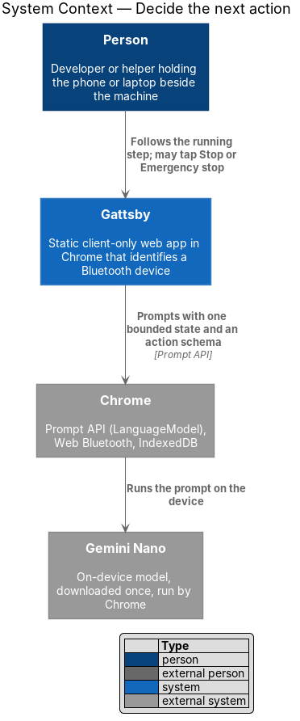
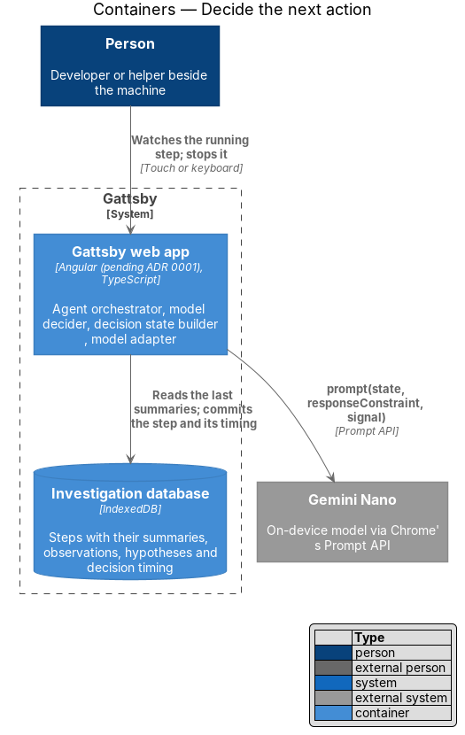
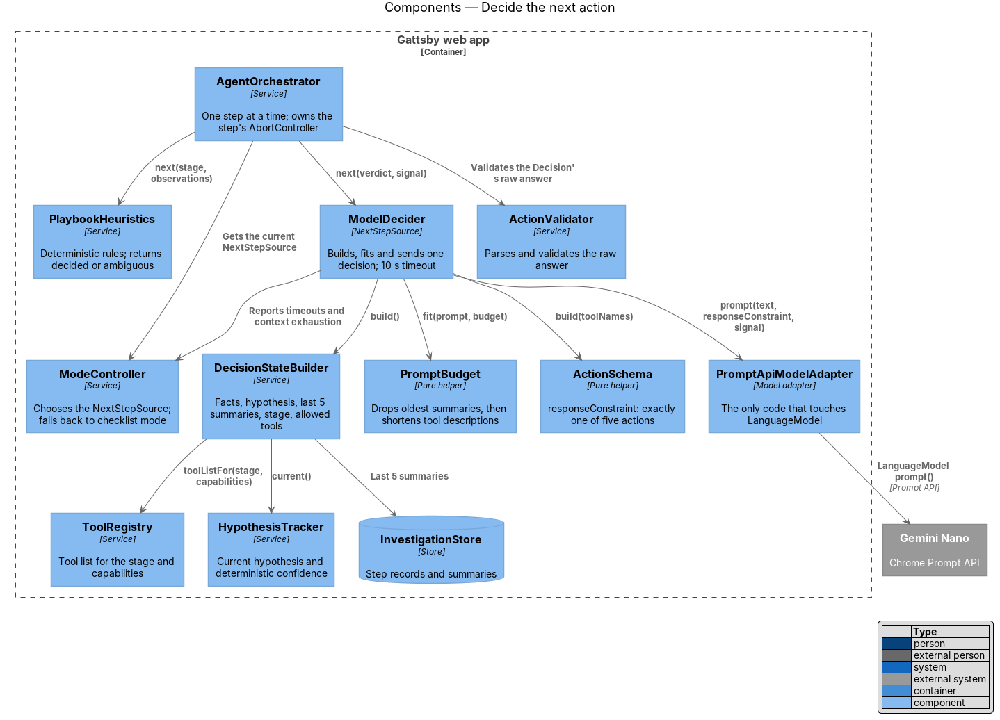
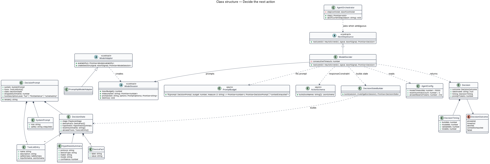
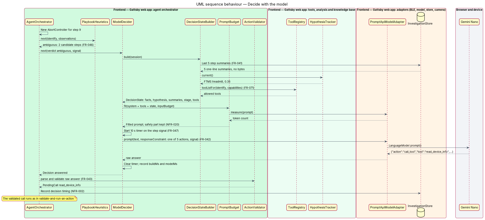
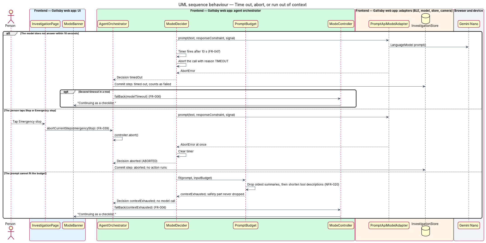

# Decide the next action

## Overview

In full agent mode, the agent orchestrator asks Gemini Nano, through Chrome's Prompt API, to choose
the next step whenever the playbook's deterministic rules leave more than one reasonable next step
(see [apply heuristics first](../apply-heuristics-first/README.md)). This feature is that one
question to the model: what the orchestrator sends, how the answer is constrained, and how long it
waits. It belongs to the agent subsystem and runs at every playbook stage where the rules are
ambiguous; in an FTMS investigation that is at most 5 times (FR-046).

**decision** — one model call that returns one action, from the start of building the state to the
end of validating the answer

**decision state** — compact summary of the investigation sent to the model for one decision: the
device facts, the current hypothesis with its confidence, the last 5 tool summaries, the playbook
stage and the tools allowed at that stage

**prompt budget** — number of tokens the system prompt, tool list and decision state may use, which
the model adapter reports from the session's context window minus the room kept for the answer

**action schema** — JSON Schema passed as the Prompt API's `responseConstraint`, which allows exactly
one of the five action shapes

The model is small, its context window is short, and it reasons weakly over many steps. The design
therefore sends no history and no bytes: each decision sends a fresh, bounded state made of the
one-line summaries that tools already return (FR-044), and the answer is forced into one JSON action
that code then validates (see [validate and run an action](../validate-and-run-an-action/README.md)).
The model never decodes bytes and never scores the hypothesis; `HypothesisTracker` scores it, and the
state carries only the result.

On screen a decision is invisible except as the running step. While the model is deciding, the
prompt dock of the Investigation page shows the running state and the feed marks the step busy
(`docs/mocks/pages/investigation/identify.html`); the person can still tap "Stop" or "Emergency
stop", both of which abort the call at once. When the model fails, Gattsby continues as a checklist
(`docs/mocks/notifications/mode-banner/warning.html`, "The on-device model stopped answering twice in
a row"); that switch belongs to the
[choose-the-operating-mode](../../environment/choose-the-operating-mode/README.md) design (FR-006).

## Description

The design introduces these building blocks in the Angular (pending ADR 0001) workspace under
`frontend/src/app/`:

- **`AgentOrchestrator`** (`agent/agent-orchestrator.ts`) — runs the loop one step at a time. For
  each step it creates one `AbortController`, asks `PlaybookHeuristics` for a `HeuristicVerdict`
  and hands it to the current `NextStepSource`. `abortCurrentStep(reason)` aborts the
  controller; "Stop" and "Emergency stop" call it.
- **`NextStepSource`** (`agent/next-step-source.ts`) — contract with one method,
  `next(verdict, signal)`, that turns the rules' `HeuristicVerdict` into the next action. Full agent
  mode uses `ModelDecider`; checklist mode uses `ChecklistRunner` (see
  [run the checklist](../run-the-checklist/README.md)). `ModeController` chooses the source, so the
  orchestrator holds no mode branches.
- **`ModelDecider`** (`agent/model-decider.ts`) — the full-agent `NextStepSource`. For a `decided`
  verdict it returns the rule's action at once, with no model call. For an `ambiguous` verdict it
  builds the state, fits the prompt to the budget, starts the timeout, calls the model session with the action
  schema, and returns a `Decision` holding the raw answer and its timing. It never parses or runs the
  answer; `ActionValidator` does. It is loaded with a dynamic `import()` when full agent mode starts,
  together with the model adapter, so checklist mode never loads either.
- **`DecisionStateBuilder`** (`agent/decision-state-builder.ts`) — builds a `DecisionState` from
  `InvestigationSession` and the store. It reads `ToolResult.summary` strings and observation
  statements only, never `ToolResult.data` or the raw traffic log, so no byte reaches the model. It
  takes the last 5 summaries (A-05), the current hypothesis from `HypothesisTracker`, and the tool
  list from `ToolRegistry.toolListFor(stage, capabilities)` (FR-071, see
  [register a tool](../../tool-registry/register-a-tool/README.md)). A refusal's reason is a summary
  like any other, so the model sees it in the next state (FR-043).
- **`SystemPrompt`** (`agent/system-prompt.ts`) — fixed text in 2 parts: the role and output rules,
  and the safety instructions (read-only by default, every `write` or `control` call is approved by
  the person, lowest risk first, never bypass pairing or encryption). The safety part is marked
  `required` and is never dropped or shortened. Exact wording: `<TO SUPPLY>` (OQ-06).
- **`PromptBudget`** (`agent/prompt-budget.ts`) — pure helper. `fit(prompt, budget, measure)` returns
  the prompt unchanged when it fits; otherwise it drops the oldest summary, one at a time, then
  shortens tool descriptions to their first sentence, then to the tool name, safety class and input
  schema alone. If the prompt still does not fit, it returns `contextExhausted` and the decision is
  not made (NFR-020).
- **`ActionSchema`** (`agent/action-schema.ts`) — builds the `responseConstraint` for one call: a
  `oneOf` of the five action shapes (`call_tool`, `ask_user`, `update_hypothesis`,
  `request_missing_tool`, `finish`), each with `additionalProperties: false`. `call_tool.tool` is an
  `enum` of the tool names in this decision's tool list; `call_tool.input` is an object that
  `ActionValidator` checks against the named tool's input schema. Every action may carry an optional
  `reason` of at most 200 characters, shown to the person as "Why:" (see
  [show agent activity](../show-agent-activity/README.md)). Gattsby does not use native tool calling
  (FR-042).
- **`ModelAdapter`** (`model/model-adapter.ts`) and **`ModelSession`** — the contract the decider
  uses: `ModelSession.inputBudget()` (context window minus the answer reserve), `measure(text)`
  (token count), `prompt(text, { responseConstraint, signal })` and `destroy()`.
  **`PromptApiModelAdapter`** (`model/prompt-api-model-adapter.ts`) is the only code that touches
  `LanguageModel`. The session carries no conversation history from one decision to the next: each
  decision is a fresh prompt. How the adapter achieves that with the Prompt API (a cloned session or
  a new session per decision) and how it counts tokens are `<TO SUPPLY>`; A-13 names only a reported
  context window. Availability and download belong to
  [prepare the model](../../environment/prepare-the-model/README.md).
- **`AgentConfig`** (`agent/agent-config.ts`) — injection token holding the loop's configuration:
  `modelTimeoutMs` 10,000, `recentSummaryCount` 5, `answerReserveTokens` 512, and the stop settings of
  [end the loop](../end-the-loop/README.md) (A-05; the reserve comes from NFR-020's acceptance
  criterion).

### Rules

1. A decision is made only when `PlaybookHeuristics` returns `ambiguous`. A step the rules decide
   makes no model call.
2. The state holds only the 5 parts FR-041 names. Device-derived strings (names, maker, firmware)
   enter it as JSON string values, never as instructions; they cannot widen what the model may do,
   because `ActionValidator`, not the prompt, enforces the stage, the preconditions and the safety
   rules.
3. Each model call has a 10-second timeout (A-05) and an `AbortSignal` tied to the step's
   `AbortController`. The timer uses `setTimeout`, which unit tests advance with a fake clock, and is
   cleared in `finally`.
4. A timed-out call is aborted, recorded as `timedOut` and counts as a failed step. Two timeouts in a
   row make `ModeController` fall back to checklist mode at the current stage (FR-006).
5. "Stop" and "Emergency stop" abort a pending call at once; the step is recorded as `aborted` with
   `ABORTED` and no action runs.
6. `contextExhausted` and a failed session are recorded as a failed step and hand over to
   `ModeController` (FR-006).
7. Each decision records its timing: `buildMs`, `modelMs`, `validateMs` and `totalMs`, measured with
   `performance.now()`. Deterministic work (`buildMs`, `validateMs`, and every rule-decided step)
   stays under 200 ms (NFR-002).

### Data shapes

| Type | Fields |
|---|---|
| `DecisionState` | `stage`, `deviceFacts` (`DeviceFact[]`: `label`, `value`), `hypothesis` (`protocol`, `deviceType`, `maker`, `model`, `confidence`), `recentSummaries` (at most 5 strings of at most 200 characters), `allowedTools` (`ToolListEntry[]`) |
| `ToolListEntry` | `name`, `description`, `safetyClass`, `inputSchema` |
| `DecisionPrompt` | `system` (`SystemPrompt`), `tools` (`ToolListEntry[]`), `state` (`DecisionState`), `droppedSummaries`, `toolDescriptionLevel` (`full`, `firstSentence`, `schemaOnly`) |
| `Decision` | `outcome` (`answered`, `timedOut`, `aborted`, `contextExhausted`, `failed`), `rawAnswer`, `timing` (`buildMs`, `modelMs`, `validateMs`, `totalMs`), `promptTokens` |

### Errors

| Code or outcome | Raised by | Meaning to the person |
|---|---|---|
| `timedOut` (`TIMEOUT`) | `ModelDecider` | Nothing at the first timeout; the step is retried by the next decision. At the second in a row: "Continuing as a checklist." |
| `aborted` (`ABORTED`) | `ModelDecider` on stop or emergency stop | None of its own; the stop or emergency-stop screen explains. |
| `contextExhausted` | `PromptBudget` | "Continuing as a checklist." |
| `failed` | `PromptApiModelAdapter` (session lost or prompt rejected) | "Continuing as a checklist." The error is recorded with its tool and stage (NFR-025). |

### Tests that prove it

- Unit tests cover `DecisionStateBuilder` (12 results give exactly the last 5 summaries; a result
  with `data` bytes contributes only its summary), `PromptBudget.fit` (oldest summaries go first,
  then descriptions, the safety part never), `ActionSchema` (5 shapes, tool enum), and `ModelDecider`
  with a fake `ModelSession` and a fake clock (a 10-second timeout aborts the call; a stop aborts at
  once; the timer is cleared).
- A unit test runs 100 rule-decided steps against a fake model that answers at once and checks each
  takes under 200 ms (NFR-002 AC2).
- An acceptance spec drives the FTMS treadmill with the fake `LanguageModel`
  (`e2e/fixtures/fake-language-model.ts`), which records every prompt: each prompt carries a
  `responseConstraint` with the 5 action shapes (FR-042 AC1), its state holds at most 5 summaries and
  no hex bytes, and, for a fake session reporting a 4,096-token window, the largest prompt leaves at
  least 512 tokens (NFR-020 AC1). A second spec scripts a model that never answers and checks the
  step is recorded as timed out (FR-047 AC1).
- NFR-002 AC1 (90th percentile under 3 seconds on the reference laptop, A-07) needs the real model
  and is measured by a person in a hardware smoke test from the recorded `timing`, never in CI.

## Requirements

The feature realizes the following level-2 (L2) requirements; each refines the level-1 (L1)
requirement cited beside it.

| L2 ID | Refines (L1) | Requirement |
|-------|--------------|-------------|
| [`FR-041`](../../../specs/L2.md#fr-041-build-a-compact-state-for-each-decision) | `L1-010` | Before each model call the orchestrator must build a state holding only: the device facts so far, the current hypothesis with its confidence, the last 5 tool results as one-line summaries, the current playbook stage, and the tools allowed at that stage. Raw bytes are never sent to the model; summaries are. |
| [`FR-042`](../../../specs/L2.md#fr-042-constrain-the-model-to-one-json-action) | `L1-010` | Each model call must request structured output with a JSON schema (`responseConstraint`) that allows exactly one action: `call_tool` (tool name and input), `ask_user`, `update_hypothesis`, `request_missing_tool` or `finish`. Gattsby must not depend on native tool calling. |
| [`FR-047`](../../../specs/L2.md#fr-047-time-out-and-abort-model-calls) | `L1-010` | Each model call must have a timeout (assumed 10 seconds; see A-05) and an `AbortController`. A timed out call is aborted and counts as a failed step. Stop and emergency stop abort a pending call at once. |
| [`NFR-002`](../../../specs/L2.md#nfr-002-agent-step-latency) | `L1-019` | Once the model is loaded, each model decision (state built, model answers, action validated) must take under 3 seconds at the 90th percentile on a typical laptop (assumed: 4-core CPU, 16 GB RAM, integrated GPU, meeting Chrome's model requirements; see A-07). Deterministic steps must take under 200 ms, excluding Bluetooth and the person. |
| [`NFR-020`](../../../specs/L2.md#nfr-020-fit-the-models-context) | `L1-022` | The system prompt, tool list and state for one decision must fit within the budget the model adapter reports from the session's context window, leaving room for the answer; if it would not, the orchestrator must drop the oldest summaries first, then shorten tool descriptions, and never drop the safety instructions. |

## Diagrams

### System context

The person follows the investigation in Gattsby; Gattsby asks Gemini Nano, through Chrome's Prompt
API, to choose one action when its rules leave a choice.

### Containers

Inside Gattsby the web app builds the decision state from the investigation database and prompts
the on-device model; nothing leaves the device.

### Components

`AgentOrchestrator` hands an ambiguous step to `ModelDecider`, which builds the state with
`DecisionStateBuilder`, fits it with `PromptBudget`, and prompts the model through the adapter with
the action schema; the raw answer goes to `ActionValidator`.

### Class structure

`ModelDecider` implements the `NextStepSource` contract and depends on the `ModelAdapter` contract,
which `PromptApiModelAdapter` realizes; a `DecisionPrompt` composes the system prompt, the tool list
and one `DecisionState`.

### Behaviour — decide with the model

At the Identify stage of the Horizon T202 investigation the rules leave two candidate steps; the
decider builds a state of 5 summaries, fits it to the budget, and the model answers with one
`call_tool` action that goes to validation.

### Behaviour — time out, abort, or run out of context

A call that has not answered after 10 seconds is aborted and counts as a failed step, and a second
timeout in a row falls back to checklist mode; "Stop" or "Emergency stop" aborts the call at once; a
prompt that cannot fit the budget falls back without calling the model.

