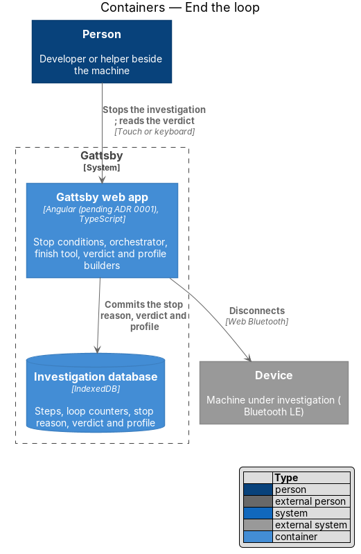
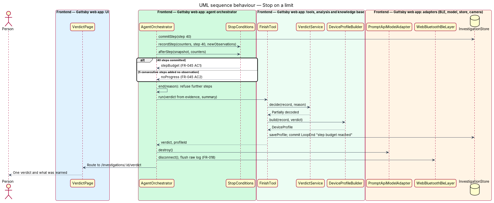
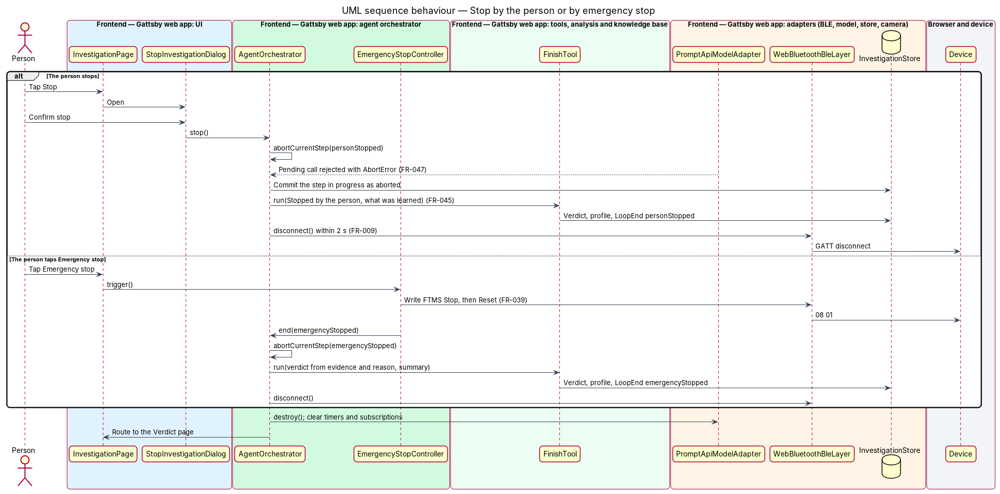

# End the loop

## Overview

A small model can loop: it can ask for the same step again, propose actions that are refused, or
never decide that it is done. This feature guarantees that every investigation's loop ends, and that
it ends with a verdict and a device profile built from what is known, whatever stopped it. It belongs
to the agent subsystem and is checked before and after every step, in full agent mode and in
checklist mode.

**stop condition** — rule that ends the loop: `finish` returned, confidence reached, step budget
reached, no progress, the person stopped, or emergency stop used

**stop reason** — record of which stop condition ended the loop, stored in the investigation record

**step** — one action taken by the loop, whether it ran, failed, timed out or was refused

**progress** — a step's addition of at least one observation that the investigation record did not
already hold

**finish threshold** — hypothesis confidence at which the loop may end once the stage's checks are
done (assumed 0.9, A-05)

**step budget** — largest number of steps one investigation runs (assumed 40, A-05)

**no-progress limit** — number of consecutive steps without progress that ends the loop (assumed 5,
A-05)

Every stop other than a successful `finish` still runs `finish` itself (TOOL-030: "the orchestrator
also calls it on every other stop condition"), so every investigation ends with exactly one verdict
(FR-054). The person sees the Verdict page: for a normal end the verdict with what was learned
(`docs/mocks/pages/verdict/default.html`, "Connected — FTMS … 11 steps"); for a stop by the person,
"Stopped by the person" with "Here's what was learned so far."
(`docs/mocks/pages/verdict/stopped.html`), reached through the Stop the investigation dialog
(`docs/mocks/dialogs/stop-investigation/default.html`). Stopping, pausing and resuming belong to the
[stop, pause and resume](../../investigation/stop-pause-and-resume/README.md) design (FR-009); this
design covers how the loop ends in each case.

## Description

The design introduces these building blocks in the Angular (pending ADR 0001) workspace under
`frontend/src/app/`:

- **`StopConditions`** (`agent/stop-conditions.ts`) — pure service. `afterStep(snapshot, counters)`
  returns a `StopReason` or `null`, checking in this order: `finished`, `confident`, `stepBudget`,
  `noProgress`. `recordStep(step, newObservations)` updates the `LoopCounters`. It reads its limits
  from `AgentConfig`.
- **`LoopCounters`** (`agent/loop-counters.ts`) — `stepCount`, `stepsWithoutProgress`,
  `consecutiveRefusals` and `consecutiveTimeouts`, kept in `InvestigationSession` and committed with
  each step, so a resumed investigation keeps its counts.
- **`observationFingerprint`** (`agent/observation-fingerprint.ts`) — pure helper. An observation's
  fingerprint is its kind, subject and value. A step makes progress when it commits at least one
  observation whose fingerprint is new to the record. A skip is an observation (FR-052), but the same
  skip twice is not new.
- **`AgentOrchestrator.end(reason)`** (`agent/agent-orchestrator.ts`) — the single exit of the loop.
  It aborts the current step's `AbortController`, refuses any further step, runs `finish` for every
  reason other than `finished`, records the `StopReason`, releases the connection and the model
  session, and routes to the Verdict page. `stop()` (the person's Stop) and
  `EmergencyStopController` both call it.
- **`FinishTool`** (`tools/meta/finish.tool.ts`) — issues the verdict and builds the profile
  (TOOL-030). Called by the orchestrator, its input is the verdict `VerdictService` derives from the
  evidence and the `StopReason`, and a summary of what was learned. See
  [issue the verdict](../../outcome/issue-the-verdict/README.md) and
  [build the device profile](../../outcome/build-the-device-profile/README.md).
- **`AgentConfig`** (`agent/agent-config.ts`) — `finishThreshold` 0.9, `stepBudget` 40,
  `noProgressLimit` 5 (A-05). They are configuration, not constants in the loop.

### Rules

1. **The model's `finish`.** A `finish` that passes validation ends the loop with `finished`. A
   `finish` refused with `PRECONDITION_FAILED` (a verdict the evidence does not support) is a refused
   step, and the loop goes on.
2. **Confidence.** When `HypothesisTracker`'s confidence is at or above the finish threshold and the
   current stage's `StageCheck` is done, the loop ends with `confident`. The confidence is the
   deterministic score, never the model's proposal (FR-053), so the model cannot end the loop by
   claiming certainty.
3. **Step budget.** When the 40th step is committed, the loop ends with `stepBudget` ("step budget
   reached"). Every step counts: rule-decided, model-decided, person-picked, refused, timed out.
4. **No progress.** When 5 consecutive steps add no new observation, the loop ends with `noProgress`
   ("no progress"). A refused action never adds an observation, so a model that repeats the same
   refused action counts each repeat, the third included, as a step without progress (FR-045 AC3).
5. **The person stops.** "Stop", confirmed in the Stop the investigation dialog, ends the loop with
   `personStopped`; the verdict is *Stopped by the person* (FR-009). The device is disconnected
   within 2 seconds.
6. **Emergency stop.** `EmergencyStopController` sends the stop or reset command first (see
   [emergency stop](../../device-control/emergency-stop/README.md)), then ends the loop with
   `emergencyStopped`. A pending model call or tool is aborted at once (FR-039, FR-047).
7. **One exit.** Every reason goes through `end(reason)`, once. A second stop while the loop is
   ending is ignored. A stop that arrives mid-step aborts that step; the step is committed as
   `aborted` and the previous steps stay intact (FR-060).
8. **Release.** `end` disconnects through the BLE layer (see
   [release the connection](../../connection/release-the-connection/README.md)), unsubscribes
   notifications, clears timers, destroys the model session, revokes unused approval tokens, and
   flushes the raw traffic log.

### Data shapes

| Type | Fields |
|---|---|
| `StopReason` | `finished`, `confident`, `stepBudget`, `noProgress`, `personStopped`, `emergencyStopped` |
| `LoopCounters` | `stepCount`, `stepsWithoutProgress`, `consecutiveRefusals`, `consecutiveTimeouts` |
| `LoopEnd` (stored with the investigation) | `reason` (`StopReason`), `label` ("step budget reached", "no progress", …), `atStep`, `stage`, `endedAt`, `verdict`, `profileId` |

### Errors

| Situation | Handled by | Meaning to the person |
|---|---|---|
| `finish` refused (`PRECONDITION_FAILED`) | `ActionValidator` | None; the agent is told what is missing and continues. |
| Disconnect fails while ending | `end(reason)` | The verdict is still built; the connection banner reports the state (see release the connection). |
| `STORAGE_FULL` while saving the profile | `InvestigationStore` | See [save as it runs](../../persistence/save-as-it-runs/README.md) (NFR-008). |

The Verdict page mocks show the step count but no line for `stepBudget` or `noProgress`. Whether and
how the page shows those reasons is `<TO SUPPLY>` (OQ-06); the investigation record holds them in
every case.

### Tests that prove it

- Unit tests cover `StopConditions.afterStep` for each reason and the order between them, with a
  `LoopCounters` at 39 and 40 steps, 4 and 5 steps without progress, and confidence 0.89 and 0.9
  with the stage check done and not done; and `observationFingerprint` for a repeated skip.
- An acceptance spec scripts the fake `LanguageModel` (`e2e/fixtures/fake-language-model.ts`) never to
  return `finish` on the unknown-services device of `e2e/fixtures/fake-bluetooth.ts`: the loop stops
  at 40 steps, the record holds "step budget reached", and the Verdict page shows a verdict built
  from the observations (FR-045 AC1).
- An acceptance spec scripts 5 steps that add nothing and checks "no progress" (FR-045 AC2), and a
  model that repeats one refused action 3 times and checks each repeat counts as a step without
  progress (FR-045 AC3).
- Acceptance specs for Stop and Emergency stop check that a pending scripted model call is aborted
  and that the record holds exactly one verdict, through the `InvestigationPage`, `StopInvestigationDialog`
  and `VerdictPage` page objects.

## Requirements

The feature realizes the following level-2 (L2) requirement; it refines the level-1 (L1)
requirement cited beside it.

| L2 ID | Refines (L1) | Requirement |
|-------|--------------|-------------|
| [`FR-045`](../../../specs/L2.md#fr-045-always-end-the-loop) | `L1-010` | The loop must stop when: the model returns `finish`; the hypothesis confidence reaches the finish threshold and the stage's checks are done; the step budget is reached; N consecutive steps add no new observation; the person stops; or emergency stop is used. On every stop other than `finish`, Gattsby must still build a verdict and profile from what is known. The threshold, budget and N are configuration (assumed defaults: 0.9, 40 steps, 5 steps; see A-05). |

## Diagrams

### System context

The person can stop the investigation at any time; when the loop ends, Gattsby releases the device
through Chrome and shows the verdict.

### Containers

Inside Gattsby the web app ends the loop, builds the verdict and profile, stores them with the stop
reason in the investigation database, and disconnects from the device.

### Components

`StopConditions` tells `AgentOrchestrator` when to end; `end(reason)` runs `FinishTool`, which uses
`VerdictService` and `DeviceProfileBuilder`, then releases the BLE connection and the model session.

### Class structure

`StopConditions` reads `AgentConfig` and updates `LoopCounters`; `AgentOrchestrator.end` records a
`LoopEnd` holding the `StopReason`.

### Behaviour — stop on a limit

The 40th step is committed with the model never having returned `finish`; the orchestrator ends with
"step budget reached", runs `finish` on the evidence, stores the profile and opens the Verdict page.
The no-progress limit takes the same path.

### Behaviour — stop by the person or by emergency stop

"Stop" or "Emergency stop" aborts the pending step at once and ends the loop; the person's stop
records *Stopped by the person*, and emergency stop sends the device's stop command before the loop
ends.

