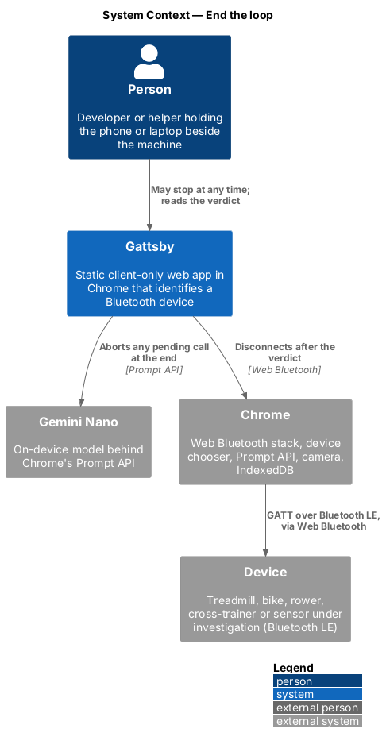
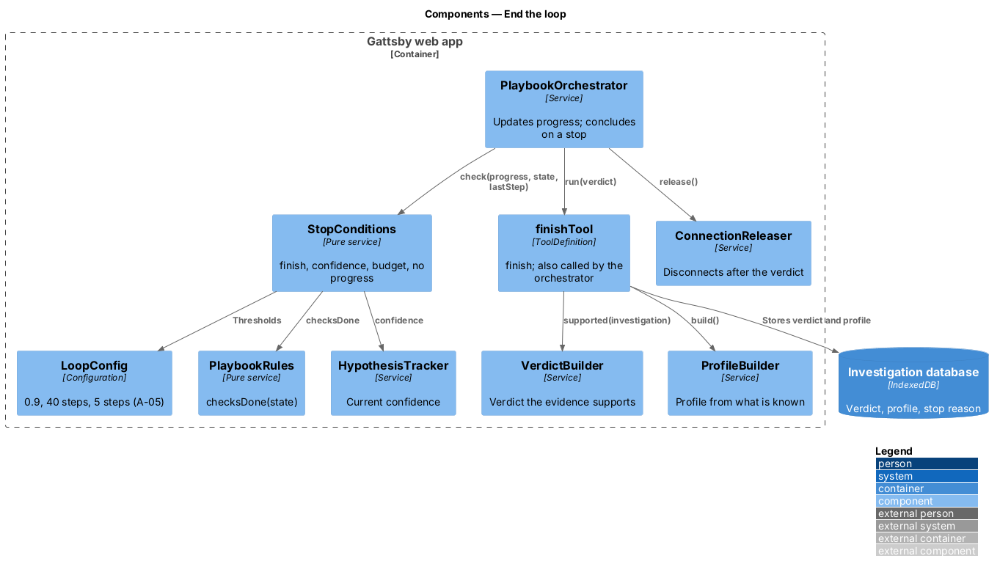
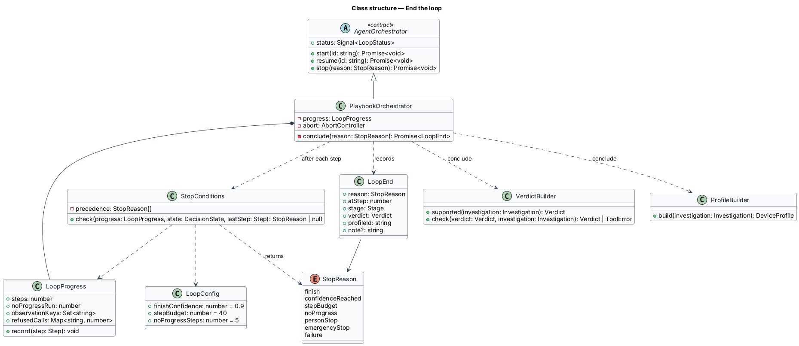
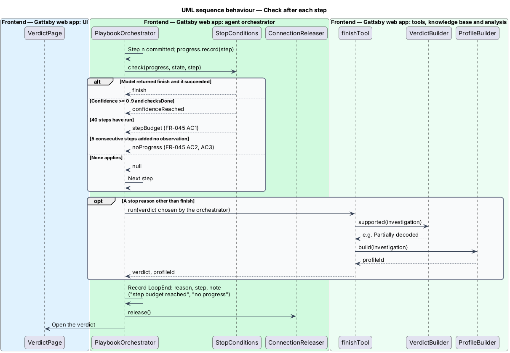
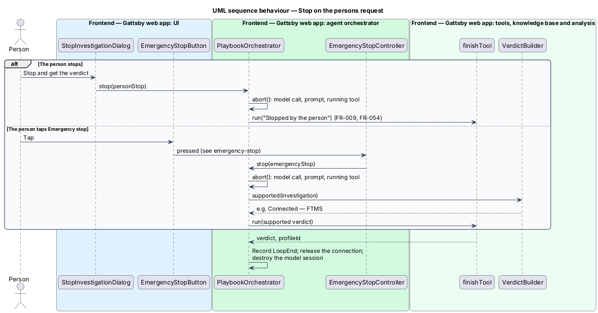

# End the loop

## Overview

An agent driven by a small model can loop: repeat a refused action, ask for one more recording, or
never declare itself done. This feature guarantees that every investigation's observe → decide → act
loop ends, for a recorded reason, with a verdict and a device profile built from what is known. It
belongs to the agent subsystem and is checked after every step of every stage, in full agent mode and
in checklist mode.

**stop condition** — test, checked after each step or raised by the person, that ends the loop

**stop reason** — the one recorded cause of the end: `finish`, `confidenceReached`, `stepBudget`,
`noProgress`, `personStop` or `emergencyStop`

**no-progress run** — count of consecutive steps that added no new observation

The end shows on the Verdict page (`docs/mocks/pages/verdict/default.html` for "Connected — FTMS";
`partial.html`, `missing-tool.html` and `not-connectable.html` for verdicts reached from the
evidence; `stopped.html` for "Stopped by the person"). A person's stop goes through the Stop the
investigation dialog ("Stop this investigation?" with "Keep going" and "Stop and get the verdict",
`docs/mocks/dialogs/stop-investigation/default.html`). A pause for inactivity ("Still there?",
`docs/mocks/dialogs/still-there/default.html`) is not a stop: the loop waits.

## Description

The design introduces these building blocks in the Angular (pending ADR 0001) workspace under
`frontend/src/app/`:

- **`StopConditions`** (`agent/stop-conditions.ts`) — pure service. `check(progress, state,
  lastStep)` returns a `StopReason` or `null` after each step. `personStop` and `emergencyStop` arrive
  through `PlaybookOrchestrator.stop(reason)` instead, at any moment.
- **`LoopConfig`** (`agent/loop-config.ts`) — `finishConfidence` 0.9, `stepBudget` 40,
  `noProgressSteps` 5 (A-05). Configuration, not constants in the loop.
- **`LoopProgress`** (`agent/loop-progress.ts`) — what the conditions count: steps so far, the
  no-progress run, and the recent refused actions by tool and input.
- **`PlaybookOrchestrator`** (`agent/playbook-orchestrator.ts`) — after each step, updates
  `LoopProgress` and asks `StopConditions`; on a stop, aborts pending work and concludes.
- **`PlaybookRules.checksDone(state)`** (`agent/playbook-rules.ts`) — whether the current path's
  checks are done, for the confidence condition (see the apply-heuristics-first design).
- **`HypothesisTracker`** (`outcome/hypothesis-tracker.ts`) — the current deterministic confidence.
- **`finishTool`** (`tools/meta/finish.tool.ts`) and **`VerdictBuilder`**
  (`outcome/verdict-builder.ts`) — on every stop other than `finish`, the orchestrator calls `finish`
  itself with the verdict `VerdictBuilder.supported(investigation)` returns (TOOL-030; see the
  issue-the-verdict design).
- **`ProfileBuilder`** (`outcome/profile-builder.ts`) — builds the device profile from what is known
  (FR-055).
- **`ConnectionReleaser`** (`agent/connection-releaser.ts`) — disconnects once the verdict is issued
  (see the release-the-connection design).

### The conditions

| Stop reason | When | Verdict |
|---|---|---|
| `finish` | The model returns `finish`, or the rules reach Conclude, and `finish` succeeds | The verdict `finish` named |
| `confidenceReached` | Confidence ≥ 0.9 and `checksDone` (every claimed metric tried; Control offered where a Control Point exists) | The supported verdict |
| `stepBudget` | 40 steps have run (FR-045 AC1) | The supported verdict; "step budget reached" recorded |
| `noProgress` | 5 consecutive steps added no new observation (FR-045 AC2) | The supported verdict; "no progress" recorded |
| `personStop` | The person confirms "Stop and get the verdict" (FR-009) | "Stopped by the person" |
| `emergencyStop` | The person taps "Emergency stop" (FR-039) | The supported verdict; the stop is recorded |

When two conditions hold after the same step, one reason is recorded, in this order: `emergencyStop`,
`personStop`, `finish`, `confidenceReached`, `stepBudget`, `noProgress`.

### Counting rules

1. A step is any action that was run or refused, including a model call that timed out (FR-043,
   FR-047). Waiting for the person is part of the step that asked.
2. An observation is new when no earlier observation in the investigation has the same kind, subject
   and value. The person's answers and skips are observations (FR-052).
3. A refused action or a timed-out call adds no observation, so it lengthens the no-progress run. The
   third repetition of the same refused action (same tool, same input) is therefore a no-progress
   step (FR-045 AC3).
4. A `finish` refused for want of evidence (`PRECONDITION_FAILED`, TOOL-030) is a refused step; the
   model is told what is missing and the loop continues.
5. A fall-back to checklist mode (FR-006) does not reset the step count or the no-progress run.

### Concluding on any stop

1. Abort pending work through the investigation's `AbortController`: the model call, the prompt, the
   running tool.
2. For any reason except `finish`, run `finish` with the verdict the evidence supports: "Connected —
   *protocol*" only with a confirmed metric, otherwise "Partially decoded", "Needs a missing tool" or
   "Not connectable"; `personStop` always gives "Stopped by the person" (FR-054).
3. Record the stop reason on the investigation and build the profile.
4. Release the connection, destroy the model session, and open the Verdict page.

An unexpected exception inside the loop also ends it, with the reason `failure`, the error recorded
with its tool and stage (NFR-025) and the same conclusion steps. FR-045 does not list this case; the
design adds it so that a defect cannot leave an investigation without a verdict.

### Data shapes

| Type | Fields |
|---|---|
| `StopReason` | `finish`, `confidenceReached`, `stepBudget`, `noProgress`, `personStop`, `emergencyStop`, `failure` |
| `LoopProgress` | `steps`, `noProgressRun`, `observationKeys` (set), `refusedCalls` (tool and input hash to count) |
| `LoopEnd` | `reason`, `atStep`, `stage`, `verdict`, `profileId`, `note` ("step budget reached", "no progress") |

### Tests that prove it

Unit tests drive `StopConditions` with scripted step sequences: 40 steps, 5 empty steps,
three identical refusals, and simultaneous conditions for the precedence order. Behaviour specs
script the fake `LanguageModel` never to return `finish` (the loop stops at step 40 and the Verdict
page shows a verdict), and to repeat one refused action (the loop stops with "no progress").

## Requirements

The feature realizes the following level-2 (L2) requirement; it refines the level-1 (L1) requirement
cited beside it.

| L2 ID | Refines (L1) | Requirement |
|-------|--------------|-------------|
| [`FR-045`](../../../specs/L2.md#fr-045-always-end-the-loop) | `L1-010` | The loop must stop when: the model returns `finish`; the hypothesis confidence reaches the finish threshold and the stage's checks are done; the step budget is reached; N consecutive steps add no new observation; the person stops; or emergency stop is used. On every stop other than `finish`, Gattsby must still build a verdict and profile from what is known. The threshold, budget and N are configuration (assumed defaults: 0.9, 40 steps, 5 steps; see A-05). |

## Diagrams

### System context

The person may stop at any time; Gattsby also stops by itself, ends any model call and the
connection, and gives the person a verdict.

### Containers

The web app checks the stop conditions in memory, then commits the stop reason, the verdict and the
profile to the investigation database.

### Components

`PlaybookOrchestrator` asks `StopConditions` after each step, using `LoopConfig`, `HypothesisTracker`
and `PlaybookRules.checksDone`; on a stop it runs `finish` with `VerdictBuilder`'s verdict, then
`ProfileBuilder` and `ConnectionReleaser`.

### Class structure

`StopConditions` reads `LoopProgress` and `LoopConfig` and returns a `StopReason`; the orchestrator
records the end as a `LoopEnd`.

### Behaviour — check after each step

After each step the conditions are checked; `finish` ends with its verdict, while confidence, the step
budget or no progress end with the verdict the evidence supports.

### Behaviour — stop on the person's request

"Stop and get the verdict" or "Emergency stop" aborts pending work at once and concludes with
"Stopped by the person" or with the supported verdict.

