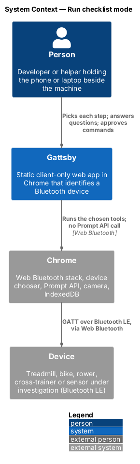
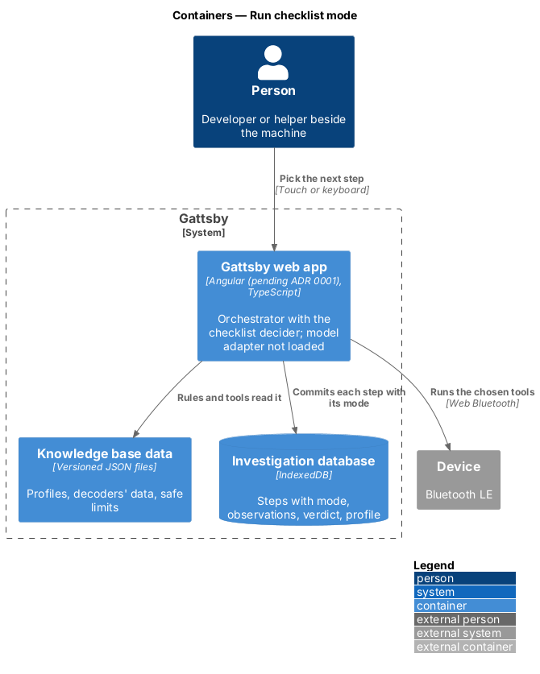
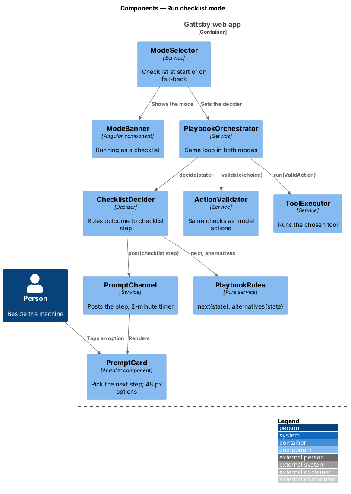
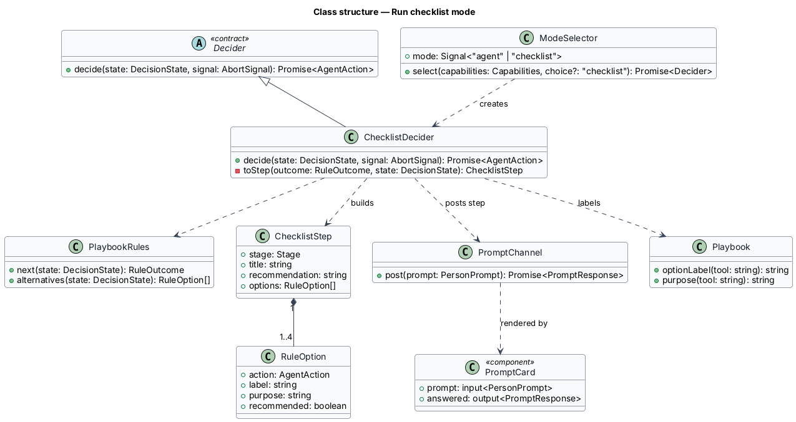
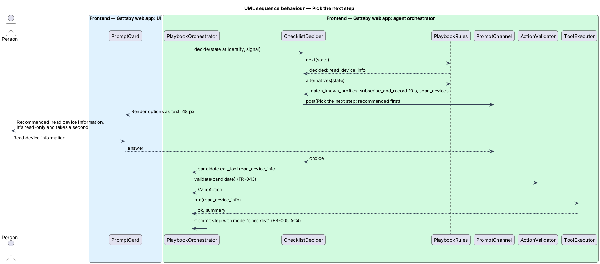
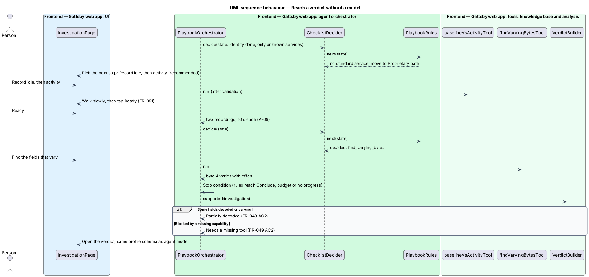

# Run checklist mode

## Overview

Gemini Nano runs only on desktop Chrome, while the in-store use case is often a phone. Checklist mode
runs the same playbook without a model: the same seven stages, the same tools, the same safety
checks, branching on the deterministic rules and on the person's choices instead of model actions.
It produces the same kinds of verdict and device profile. It is the mode on Chrome for Android (A-02),
the mode the person may choose on a laptop, and the mode an investigation falls back to when the model
fails (FR-006; see the choose-operating-mode design). The feature belongs to the agent subsystem.

**checklist mode** — operating mode in which the playbook runs without a model, with each ambiguous
or optional step chosen by the person

**checklist step** — one playbook step offered to the person as a choice, with the rules'
recommendation first and the stage's other available steps after it

**step option** — one button of a checklist step, naming a tool run in plain language with its purpose

The Readiness page on a phone ends in "Ready, in checklist mode." with "Start in checklist mode"
(`docs/mocks/pages/readiness/checklist.html`). The Investigation page in checklist mode
(`docs/mocks/pages/investigation/checklist.html`) reads "Checklist · Identify" in the app bar, shows
the mode banner "Running as a checklist." ("You chose checklist mode, so no model is used. You pick
each step; Gattsby runs it and explains the result.", `docs/mocks/notifications/mode-banner/info.html`),
prefixes feed entries with "Checklist:" and "Purpose:" instead of "Agent:" and "Why:", and offers
"Pick the next step" with "Recommended: read device information. It's read-only and takes a
second." and the options "Read device information", "Match known profiles", "Record data for 10 s"
and "Scan again". The composer offers "Add a note…" in place of "Ask, or tell Gattsby what to try…",
since no model reads free text.

## Description

The design introduces these building blocks in the Angular (pending ADR 0001) workspace under
`frontend/src/app/`:

- **`ChecklistDecider`** (`agent/checklist-decider.ts`) — the `Decider` for checklist mode.
  `decide(state, signal)` calls `PlaybookRules.next(state)`. A decided person-facing action
  (`ask_user`, `request_action`) is returned as it is: the question is itself the step. A decided
  tool call becomes a checklist step whose first option is that call, marked recommended, followed by
  up to 3 alternatives from `PlaybookRules.alternatives(state)`. An ambiguous outcome becomes a
  checklist step from its options. The person's choice is returned as the candidate action.
- **`PlaybookRules`** (`agent/playbook-rules.ts`) — the same rules as in full agent mode (see the
  apply-heuristics-first design). `alternatives(state)` lists the stage's other tools whose
  preconditions hold, as `RuleOption`s.
- **`Playbook`** (`agent/playbook.ts`) — the plain-language option labels and purpose lines per tool
  ("Record data for 10 s"), as data, so a new tool's checklist label is a data entry (NFR-022).
- **`PromptChannel`** (`agent/prompt-channel.ts`) — posts the checklist step as a `question`
  `PersonPrompt` and awaits the choice. Its 2-minute inactivity timer leads to "Still there?"
  (FR-051).
- **`PromptCard`** and **`AnswerButtons`** (`ui/prompt-card/prompt-card.component.ts`,
  `ui/answer-buttons/answer-buttons.component.ts`) — render the step and its options as 48 px buttons,
  as text.
- **`ModeSelector`** (`agent/mode-selector.ts`) — chooses checklist mode at start when no model
  session can be created or the person chose it, and on a fall-back (FR-005, FR-006).
- **`ModeBanner`** (`notifications/mode-banner/mode-banner.ts`) — "Running as a checklist." (info) or
  "Continuing as a checklist." (warning).
- **`PlaybookOrchestrator`** (`agent/playbook-orchestrator.ts`) — the same loop for both modes. Only
  its `Decider` differs; the validator, executor, approval gate, safety limits, emergency stop, stop
  conditions, verdict builder and profile builder are shared.

### Rules

1. **Same playbook.** The seven stages, their tools and their order are the ones full agent mode uses;
   checklist mode has no tool or rule of its own (FR-049).
2. **No model.** `ModelDecider` and the `model/` adapter are dynamically imported only in full agent
   mode. In checklist mode neither is loaded and `LanguageModel` is never touched (FR-005 AC2, AC3).
3. **Read-only steps the person picked run at once.** Steps that write or control still open the
   approval dialog, with the same checks (FR-034 to FR-036); emergency stop works the same way.
4. **Every choice is validated.** A chosen option passes `ActionValidator` like a model action
   (FR-043). A refused choice keeps the same step open with the reason as text; it never triggers a
   mode fall-back, which applies to model actions only.
5. **Same ending.** The step budget of 40, the no-progress stop and the person's stop apply unchanged
   (FR-045). The verdict and profile come from the same builders, so the verdict set and the profile
   schema are the same (FR-049, FR-006 AC3).
6. **Mode on every step.** Each step records its mode, so a record that fell back mid-way shows where
   (FR-005 AC4).
7. **Skips.** "Skip" on a person action and "Skip — finish read-only" on Control are recorded as
   observations (FR-052), as in full agent mode.

### What the checklist reaches

- An FTMS treadmill, following the recommended options: Prepare questions, chooser, connect, read the
  maker, match the profile, record while the person walks and changes speed, then "Connected — FTMS"
  with speed and distance confirmed by live data (FR-049 AC1, brief MVP criterion 4).
- A device with only unknown services: the rules find no standard service and move to the Proprietary
  path; the recommended options record an idle baseline and activity, then find varying bytes. The
  verdict is "Partially decoded" or "Needs a missing tool" (FR-049 AC2).

### Data shapes

| Type | Fields |
|---|---|
| `ChecklistStep` | `stage`, `title` ("Pick the next step"), `recommendation` (purpose line), `options` (`RuleOption[]`, at most 4) |
| `RuleOption` | `action`, `label`, `purpose`, `recommended` |
| `PersonPrompt` (kind `question`) | `id`, `title`, `detail`, `answers` (option labels), `allowFreeText: false` |

### Tests that prove it

Behaviour specs run with the fake `LanguageModel` absent (the Android case) and with the person
choosing checklist mode while it is present; the fake records no call in either. The FTMS treadmill
spec picks the recommended option at each step and expects "Connected — FTMS" with speed and distance
confirmed; the unknown-services spec expects the proprietary recordings in the raw log and one of the
two verdicts. Both use the `InvestigationPage` page object.

## Requirements

The feature realizes the following level-2 (L2) requirement; it refines the level-1 (L1) requirement
cited beside it.

| L2 ID | Refines (L1) | Requirement |
|-------|--------------|-------------|
| [`FR-049`](../../../specs/L2.md#fr-049-run-the-playbook-as-a-checklist) | `L1-002` | In checklist mode, Gattsby must run the same seven playbook stages with the same tools, branching on deterministic rules and the person's answers instead of model actions, and must produce the same kinds of verdict and profile. |

## Diagrams

### System context

In checklist mode the person picks each step and Gattsby runs it against the device through Chrome;
Gemini Nano is not involved.

### Containers

The web app runs the playbook from the knowledge base and its own rules, records every step with its
mode in the investigation database, and leaves the model adapter unloaded.

### Components

`PlaybookOrchestrator` uses `ChecklistDecider`, which turns `PlaybookRules` outcomes into checklist
steps shown through `PromptChannel` and `PromptCard`; the chosen option goes through the shared
`ActionValidator` and `ToolExecutor`.

### Class structure

`ChecklistDecider` implements the `Decider` contract with `PlaybookRules` and `PromptChannel`; a
`ChecklistStep` holds at most 4 `RuleOption`s.

### Behaviour — pick the next step

The rules recommend reading device information; the person picks it from the options, and it is
validated and run like any action, with its mode recorded.

### Behaviour — reach a verdict without a model

For a device with only unknown services, the checklist moves to the Proprietary path, records a
baseline and activity on the person's choices, and ends with "Partially decoded" or "Needs a missing
tool".

