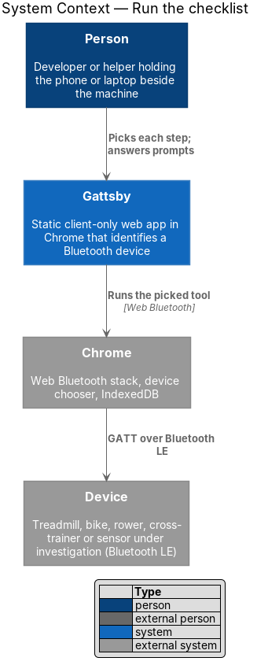
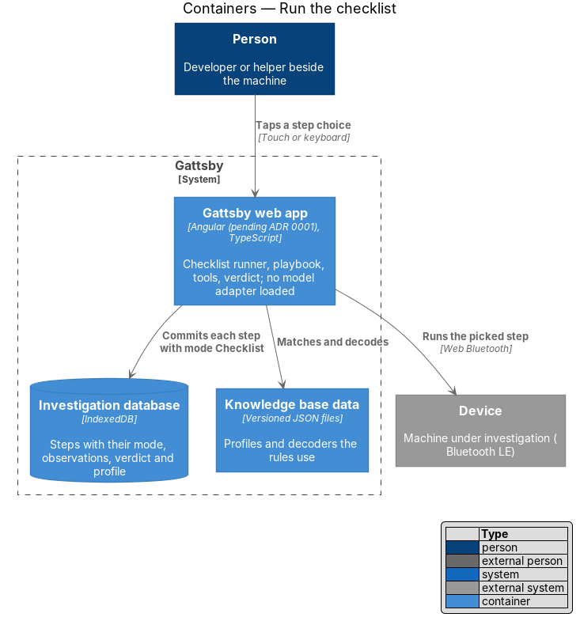
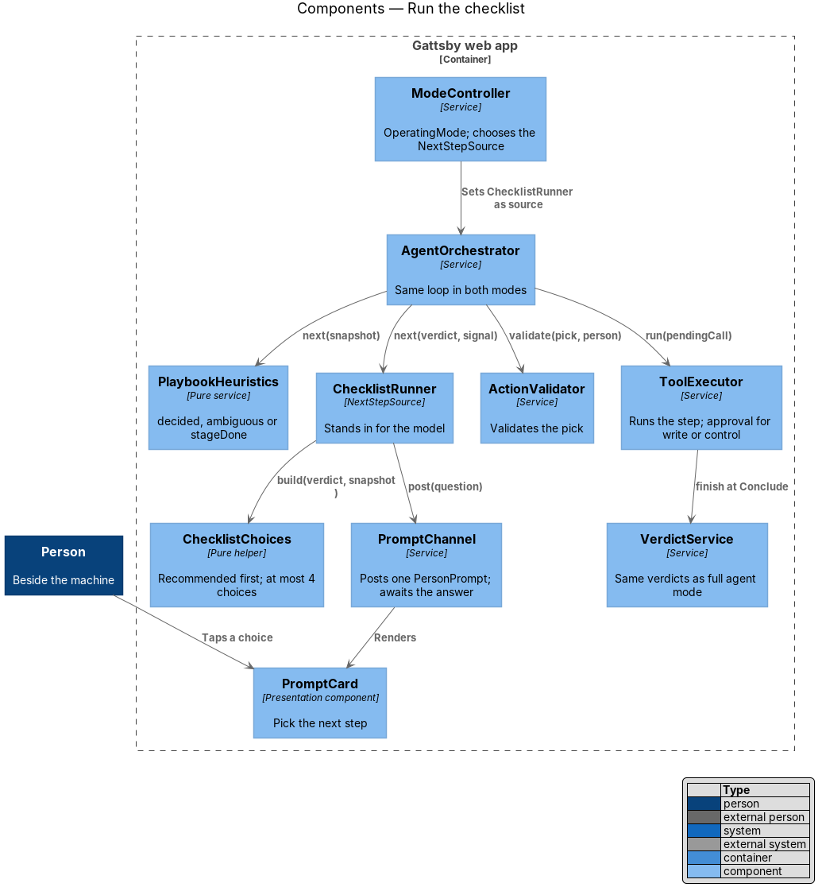
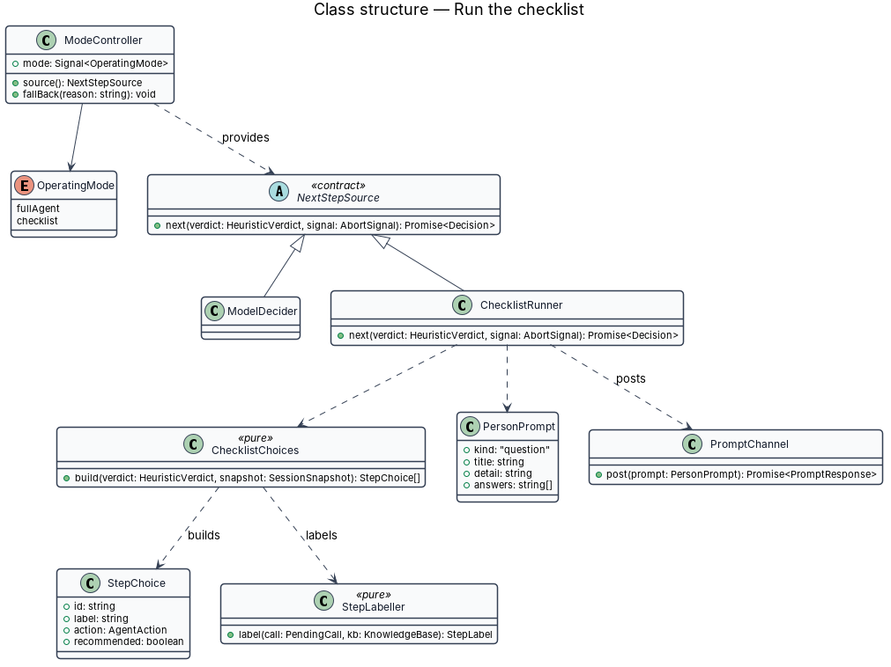
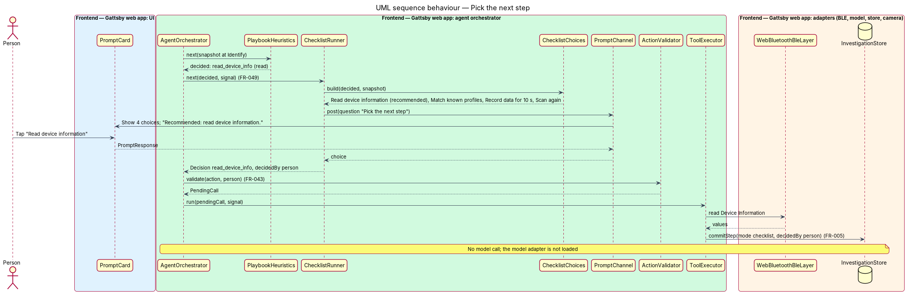
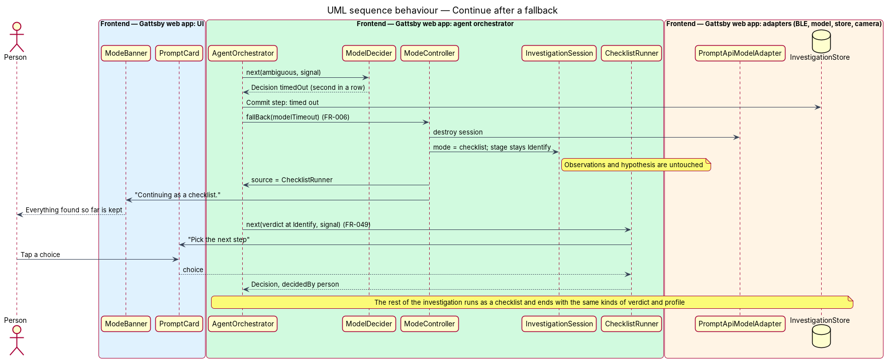

# Run the checklist

## Overview

Gemini Nano runs only in Chrome on desktop today, and the person in a store usually holds a phone.
Checklist mode lets the same investigation run with no model at all: the same 7 playbook stages, the
same tools and the same verdicts, with the person choosing where the model would have chosen. This
feature is the part of the agent subsystem that stands in for the model. It runs for a whole
investigation when no model session can be created or the person chose checklist mode (FR-005), and
from the current stage onwards when the model fails mid-investigation (FR-006, see
[choose the operating mode](../../environment/choose-the-operating-mode/README.md)).

**checklist mode** — operating mode that runs the playbook without a model, branching on the
playbook's deterministic rules and the person's answers

**step choice** — one button the checklist offers when it asks the person to pick the next step,
naming one step in plain words

**recommended step** — step choice that the playbook's rules decided, offered first and named in the
prompt's detail

The Investigation page in checklist mode (`docs/mocks/pages/investigation/checklist.html`) reads
"Checklist · Identify" in the app bar. After `enumerate_gatt` the feed says "Fitness Machine (FTMS) is
a published standard most apps already speak. Next, find out who made it." with "Purpose: Maker and
model narrow down which known profile applies." The dock asks "Pick the next step", with the detail
"Recommended: read device information. It's read-only and takes a second." and 4 choices: "Read
device information", "Match known profiles", "Record data for 10 s" and "Scan again". The composer
reads "Add a note…". The mode banner says "Running as a checklist. You chose checklist mode, so no
model is used. You pick each step; Gattsby runs it and explains the result."
(`docs/mocks/notifications/mode-banner/info.html`), or, after a fallback, "Continuing as a checklist.
The on-device model stopped answering twice in a row. Everything found so far is kept; you pick the
next steps." (`docs/mocks/notifications/mode-banner/warning.html`).

The design keeps the two modes on one path. The orchestrator, the rules, the validator, the tool
executor, the approval gate and the verdict are the same objects in both; only the `NextStepSource`
differs. That is what lets an FTMS treadmill reach "Connected — FTMS" in either mode (FR-046 AC2,
FR-049 AC1).

## Description

The design introduces these building blocks in the Angular (pending ADR 0001) workspace under
`frontend/src/app/`:

- **`ChecklistRunner`** (`agent/checklist-runner.ts`) — the checklist `NextStepSource`.
  `next(verdict, signal)` turns a `HeuristicVerdict` into one action, as the rules below say. When it
  asks the person, it posts one `PersonPrompt` of kind `question` through `PromptChannel` and returns
  the chosen action with `decidedBy` `person`. It never imports the model adapter.
- **`ChecklistChoices`** (`agent/checklist-choices.ts`) — pure helper. `build(verdict, snapshot)`
  returns the `StepChoice`s: the recommended step first (when the verdict is `decided`), then other
  steps allowed at the stage, at most 4 in all, as the mock draws (within FR-050's 2 to 6). An
  alternative is offered only when the stage has a rule that proposes it, so it carries the rule's
  input (for example `subscribe_and_record` for 10 s, A-09), and only when its preconditions hold.
  Labels come from `StepLabeller` (see [show agent activity](../show-agent-activity/README.md)).
- **`ModeController`** (`agent/mode-controller.ts`) — sets the investigation's `OperatingMode` and
  gives the orchestrator `ChecklistRunner` as its `NextStepSource` in checklist mode. On a fallback
  it swaps the source at the current stage, leaving `InvestigationSession`, the observations and the
  hypothesis untouched, and shows the warning `ModeBanner`. Its full behaviour is in the
  choose-the-operating-mode design.
- **`PlaybookHeuristics`**, **`ActionValidator`**, **`ToolExecutor`**, **`StopConditions`** — the same
  as in full agent mode (see [apply heuristics first](../apply-heuristics-first/README.md),
  [validate and run an action](../validate-and-run-an-action/README.md) and
  [end the loop](../end-the-loop/README.md)). The person's pick is validated like any other action.
- **`VerdictService`** and **`DeviceProfileBuilder`** — the same as in full agent mode, so checklist
  mode produces the same kinds of verdict and profile (see
  [issue the verdict](../../outcome/issue-the-verdict/README.md)).

### Rules

How `ChecklistRunner` turns each verdict into an action:

| Verdict | Step | Result |
|---|---|---|
| `decided` | Person tool (`ask_user`, `request_action`, `capture_photo`) | Returned at once; the tool asks the person itself. |
| `decided` | Device-chooser tool (`scan_devices`, `scan_all_devices`, `power_cycle_match`) | Returned at once; the tool shows "Find the device", which supplies the user gesture. |
| `decided` | Meta tool (`update_hypothesis`, `request_missing_tool`, `finish`) | Returned at once; these record what the rules established. |
| `decided` | `read` or `listen` tool | "Pick the next step" with the rule's step recommended. |
| `decided` | `write` or `control` tool | "Pick the next step" with the step and "Skip the control test"; a pick still opens the Approve a command dialog (FR-034). |
| `ambiguous` | Candidates | "Pick the next step" with the candidates and no recommendation. |

1. The checklist runs the 7 stages in the playbook's order, with the same stage checks as full agent
   mode.
2. No model call is made in checklist mode, and the model adapter is not loaded (FR-005 AC2, AC3).
3. Each step records the mode it ran in (FR-005 AC4). After a fallback, earlier steps keep "Agent"
   and later steps record "Checklist"; feed entries from then on read "Checklist:" and "Purpose:".
4. The person can skip any question, action or optional stage (FR-052); a skip is an observation and
   the rules move on.
5. A refusal of the person's pick means the choices offered an invalid step. It is recorded as a
   defect (NFR-025) and the picker is shown again without that choice.
6. A "Pick the next step" prompt has the same 2-minute "Still there?" rule as any other prompt
   (FR-051).

### Data shapes

| Type | Fields |
|---|---|
| `StepChoice` | `id`, `label` (plain words, for example "Read device information"), `action` (`AgentAction`), `recommended` |
| `PersonPrompt` (kind `question`, step picker) | `title` "Pick the next step", `detail` ("Recommended: …"), `answers` (`StepChoice` labels) |

### Tests that prove it

- Unit tests cover `ChecklistRunner.next` for each row of the table above, and `ChecklistChoices`
  (recommended first, at most 4, no choice whose preconditions fail, no `control` tool outside the
  Control stage).
- An acceptance spec opens Gattsby with no `LanguageModel` defined and the FTMS treadmill of
  `e2e/fixtures/fake-bluetooth.ts`, and follows the checklist through the `InvestigationPage` page
  object, picking the recommended step each time: the verdict is "Connected — FTMS" with speed and
  distance confirmed by live data (FR-049 AC1). The same spec with a fake `LanguageModel` present and
  checklist mode chosen fails if any prompt reaches it.
- An acceptance spec in checklist mode plays the unknown-services device: the fake records the
  idle and activity subscriptions of the proprietary path, and the verdict is *Partially decoded* or
  *Needs a missing tool* (FR-049 AC2).

## Requirements

The feature realizes the following level-2 (L2) requirement; it refines the level-1 (L1)
requirement cited beside it.

| L2 ID | Refines (L1) | Requirement |
|-------|--------------|-------------|
| [`FR-049`](../../../specs/L2.md#fr-049-run-the-playbook-as-a-checklist) | `L1-002` | In checklist mode, Gattsby must run the same seven playbook stages with the same tools, branching on deterministic rules and the person's answers instead of model actions, and must produce the same kinds of verdict and profile. |

## Diagrams

### System context

In checklist mode the person picks each step and Gattsby runs it against the device; Gemini Nano is
not involved.

### Containers

Inside Gattsby the web app runs the same playbook, tools and verdict code as in full agent mode and
commits each step, with its mode, to the investigation database.

### Components

`ModeController` gives `AgentOrchestrator` the `ChecklistRunner`, which builds step choices with
`ChecklistChoices` and asks through `PromptChannel` and `PromptCard`; the pick goes to the same
`ActionValidator` and `ToolExecutor`.

### Class structure

`ChecklistRunner` and `ModelDecider` both implement `NextStepSource`; `ChecklistRunner` builds
`StepChoice`s and posts one `PersonPrompt`.

### Behaviour — pick the next step

At Identify the rules recommend reading Device Information; the checklist offers it first among 4
choices, the person taps it, and the step runs as in full agent mode.

### Behaviour — continue after a fallback

The model times out twice in a row at Identify; `ModeController` swaps in `ChecklistRunner` at the
same stage, keeps every observation and the hypothesis, and the next step is the person's pick.

