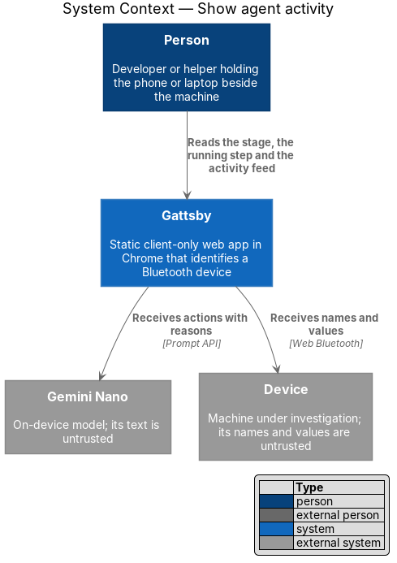
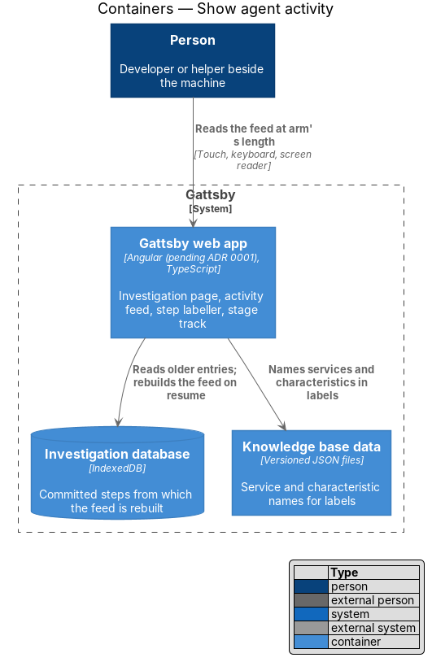
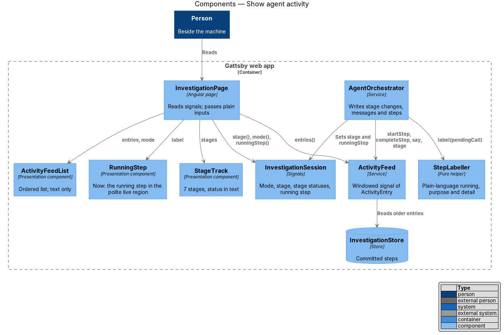
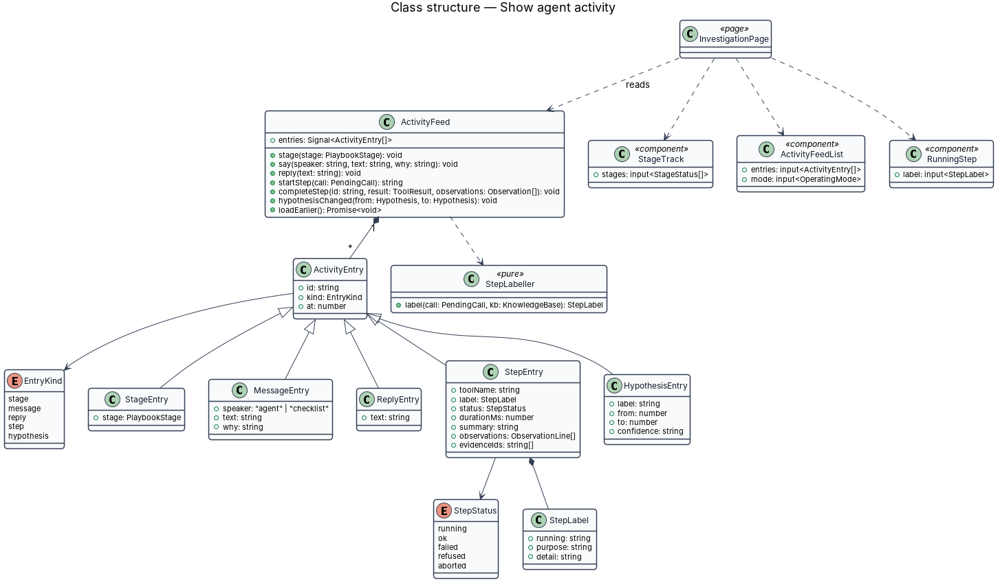
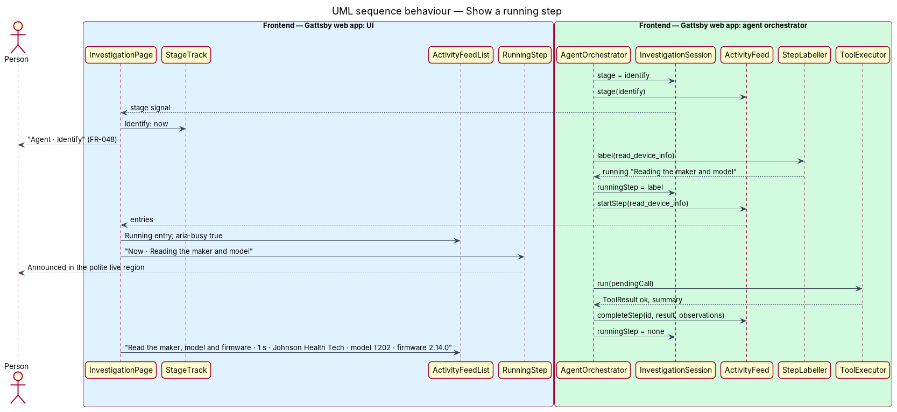
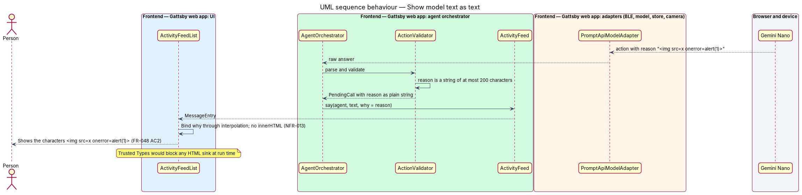

# Show agent activity

## Overview

The person beside the machine is following an agent they cannot see think. This feature keeps them
oriented: it shows which playbook stage the investigation is in, what is running right now in plain
words, and a feed of every step so far with its one-line result, so they always know what is
happening and why they are being asked something. It belongs to the agent subsystem and is drawn on
the Investigation page in every state, in full agent mode and in checklist mode.

**activity feed** — ordered list of what has happened in the investigation: stage dividers, the
agent's messages with their reasons, the person's replies, tool steps with their summaries, and
hypothesis changes

**activity entry** — one item of the activity feed

**running step** — step in progress, named in plain language in the prompt dock ("Now") while no
prompt waits for the person

**stage track** — row of the 7 playbook stages, each marked done, now, to do or skipped

The Investigation page (`docs/mocks/pages/investigation/identify.html`) shows all three. The app bar
reads the mode and the stage, "Agent · Identify". The stage track below it is announced as
"Playbook, stage 3 of 7: Identify". The feed lists, for example, the tool step `enumerate_gatt`
"Connect and list everything it exposes", "3 s", "Connected. 4 services, 3 of them standard.", with
its observations and an "Evidence" link, then the hypothesis change "Standard fitness machine (FTMS)
0% → 35% guess". At the end of the feed the running step `read_device_info` "Reading the maker and
model" has a spinner, and the prompt dock says "Now · Reading the maker and model · Read-only, takes
about a second. Nothing for you to do." In checklist mode the same feed labels the speaker
"Checklist:" and its reasons "Purpose:" instead of "Agent:" and "Why:"
(`docs/mocks/pages/investigation/checklist.html`).

Everything the feed shows that came from the model, the device or the person is shown as text. A
model output containing `` appears as those characters (FR-048, NFR-013).

The mocks also draw a composer under the dock ("Ask the agent or tell it what to try" in full agent
mode, "Add a note…" in checklist mode). No L2 requirement covers free-text messages to the agent;
how such a message enters the decision state is `<TO SUPPLY>`. In checklist mode the composer adds a
note (see [label the location](../../investigation/label-the-location/README.md)).

## Description

The design introduces these building blocks in the Angular (pending ADR 0001) workspace under
`frontend/src/app/`:

- **`ActivityFeed`** (`agent/activity-feed.ts`) — service that holds the feed as a signal of
  `ActivityEntry`s. The orchestrator and the tools' callers write to it: `stage(stage)`,
  `say(speaker, text, why)`, `reply(text)`, `startStep(call)`, `completeStep(id, result,
  observations)` and `hypothesisChanged(from, to)`. It keeps a window of the latest entries in memory
  (size `<TO SUPPLY>`, set well above what a 40-step investigation produces) and reads older entries
  back from `InvestigationStore` when the person scrolls to them (NFR-005). On resume it rebuilds the
  feed from the committed steps.
- **`StepLabeller`** (`agent/step-labeller.ts`) — pure helper. For a `PendingCall` it returns a
  `StepLabel`: `running` ("Reading the maker and model"), `purpose` ("Read the maker, model and
  firmware") and `detail` ("Read-only, takes about a second. Nothing for you to do."). Labels are
  per-tool templates filled from the call's input and knowledge-base names ("Record Treadmill Data
  while you walk", "Record 0xFE01 with the belt stopped (idle)"). A tool without a template is
  labelled by its registry name. Wording is provisional (A-01, OQ-06).
- **`InvestigationSession`** (`agent/investigation-session.ts`) — exposes `stage`, `mode`,
  `stageStatuses` and `runningStep` as signals.
- **`InvestigationPage`** (`pages/investigation/investigation.page.ts`) — the orchestrating page. It
  reads `InvestigationSession` and `ActivityFeed` and passes plain data to the presentation
  components below; they inject no app service.
- **`StageTrack`** (`ui/stage-track/stage-track.component.ts`) — presentation component. Input: the 7
  stages with their status. It renders an ordered list whose label names the stage and its position,
  and gives each segment visually hidden text ("Identify: now"), so colour is never the only carrier
  of the status (NFR-011).
- **`ActivityFeedList`** (`ui/activity-feed-list/activity-feed-list.component.ts`) — presentation
  component. Input: the entries and the mode. It renders an ordered list inside a region labelled
  "Activity", sets `aria-busy` while a step runs, and shows confidence as a word plus a shape
  (confirmed, likely, guess, claimed only). Each tool step links to its evidence (see
  [link evidence](../../outcome/build-the-device-profile/README.md)).
- **`RunningStep`** (`ui/running-step/running-step.component.ts`) — presentation component in the
  prompt dock. Input: a `StepLabel`. It shows "Now", the running label and the detail. When a
  `PersonPrompt` is pending, `PromptCard` takes the dock instead (see
  [ask a question](../../person-interaction/ask-a-question/README.md)). The dock is an
  `aria-live="polite"` region, so the change is announced.

### Rules

1. **Stage.** The app bar shows `<mode> · <stage>`, with the mode "Agent" or "Checklist" (FR-005) and
   the stage's label from the playbook (Prepare, Find, Identify, Standard path, Proprietary path,
   Control, Conclude). A path not taken shows as skipped.
2. **Running step.** The running step's label is set before the tool runs and cleared when it ends,
   so the dock never shows a step that is not running.
3. **One line per result.** A completed tool step shows its `ToolResult.summary` (at most 200
   characters, FR-044), its duration and its observations. A refusal shows its one-line reason.
4. **Why.** Each agent message shows its reason: the playbook rule's `why` for a rule-decided step,
   the action's `reason` for a model-decided step. In checklist mode the label reads "Purpose:".
5. **Text only.** Every string is bound through Angular interpolation. No template uses
   `[innerHTML]` and nothing calls `bypassSecurityTrust*` (NFR-013, see
   [validate and run an action](../validate-and-run-an-action/README.md)).
6. **Motion.** The spinner stops under `prefers-reduced-motion`; the word "Running" stays.

### Data shapes

| Type | Fields |
|---|---|
| `ActivityEntry` | `id`, `kind` (`stage`, `message`, `reply`, `step`, `hypothesis`), `at`, and the kind's fields below |
| `stage` entry | `stage` |
| `message` entry | `speaker` (`agent`, `checklist`), `text`, `why` |
| `reply` entry | `text` |
| `step` entry | `toolName`, `label` (`StepLabel`), `status` (`running`, `ok`, `failed`, `refused`, `aborted`), `durationMs`, `summary`, `observations` (`statement`, `confidence`), `evidenceIds` |
| `hypothesis` entry | `label`, `from`, `to`, `confidence` word |
| `StepLabel` | `running`, `purpose`, `detail` |

### Tests that prove it

- Unit tests cover `StepLabeller` for each MVP tool and the fallback to the tool name, and
  `ActivityFeed`'s window (older entries are read back from the store, not lost).
- An acceptance spec plays the FTMS treadmill of `e2e/fixtures/fake-bluetooth.ts` with the Device
  Information read held open by the fixture. Through the `InvestigationPage` page object
  (`e2e/pages/investigation.page.ts`) it checks that the stage reads "Identify" and the running step
  reads "Reading the maker and model" (FR-048 AC1).
- An acceptance spec scripts the fake `LanguageModel` to return an action whose `reason` is
  ``. It checks that the feed shows that text literally, that the feed
  holds no `img` element from it, and that no `dialog` event or page error occurs (FR-048 AC2).
- The accessibility sweep for the Investigation page (run on request) checks the stage track's
  labels, the live region and the 48 × 48 px targets.

## Requirements

The feature realizes the following level-2 (L2) requirement; it refines the level-1 (L1)
requirement cited beside it.

| L2 ID | Refines (L1) | Requirement |
|-------|--------------|-------------|
| [`FR-048`](../../../specs/L2.md#fr-048-show-what-the-agent-is-doing) | `L1-010` | Gattsby must show the current playbook stage, the step that is running in plain language, and an activity feed of the one-line summaries, so that the person always knows what is happening and why they are being asked something. Model text is shown as text, never as HTML. |

## Diagrams

### System context

The person reads the stage, the running step and the activity feed in Gattsby; the model's text
reaches the screen only as text.

### Containers

Inside Gattsby the web app keeps the feed's latest entries in memory and reads older ones back from
the investigation database.

### Components

`AgentOrchestrator` writes to `ActivityFeed` and `InvestigationSession`, labelling each step with
`StepLabeller`; `InvestigationPage` passes their signals to `StageTrack`, `ActivityFeedList` and
`RunningStep`.

### Class structure

`ActivityFeed` holds `ActivityEntry`s of 5 kinds; the presentation components take plain inputs and
inject no app service.

### Behaviour — show a running step

The orchestrator enters Identify, labels `read_device_info` as "Reading the maker and model", shows
it as running, and completes it with its summary when the tool returns.

### Behaviour — show model text as text

A model action whose reason holds an HTML tag is validated, stored as a string and rendered through
interpolation, so the tag appears as characters and no script runs.

