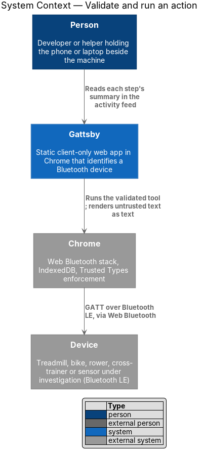
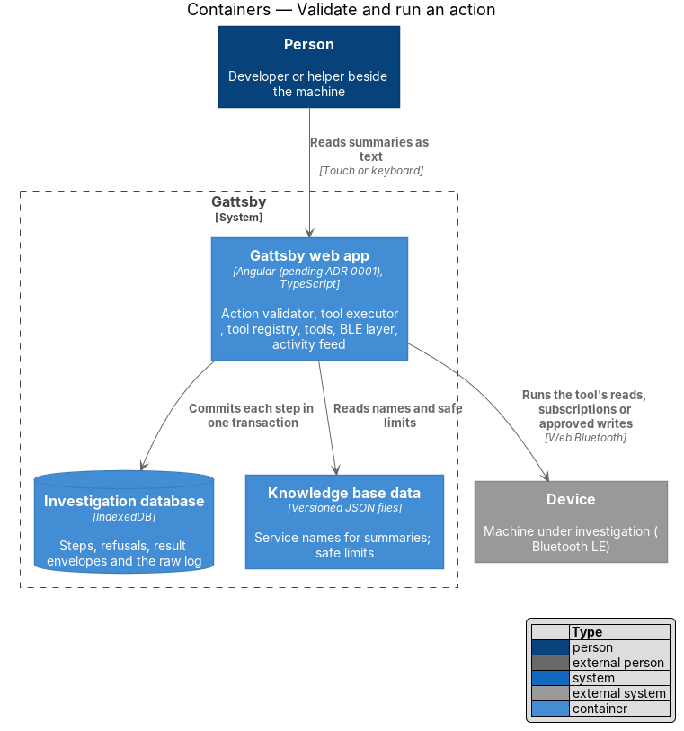
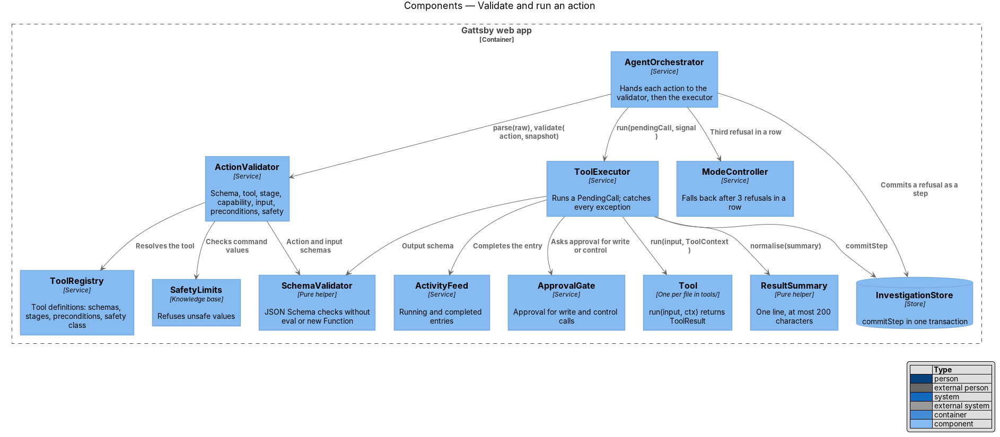
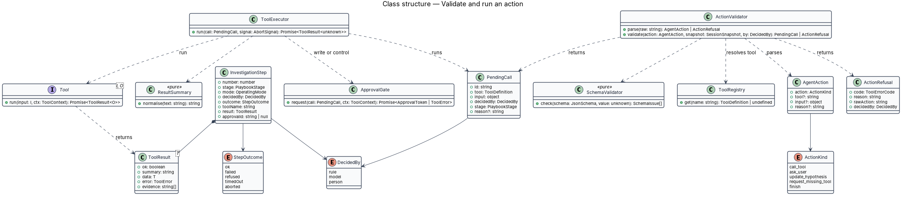
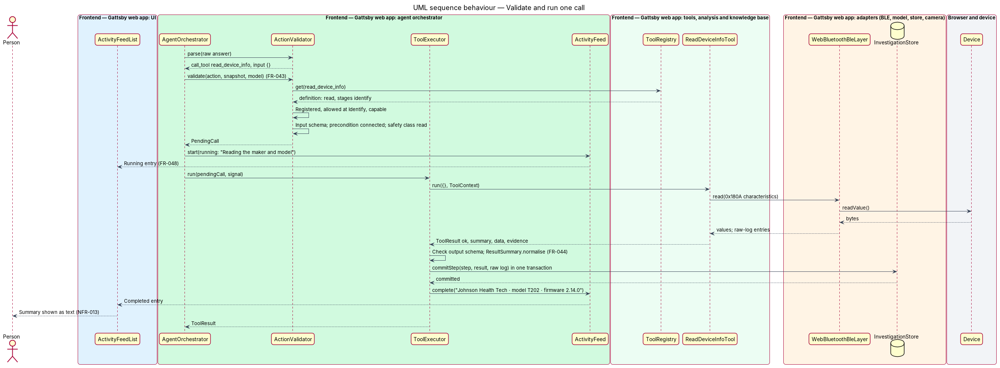
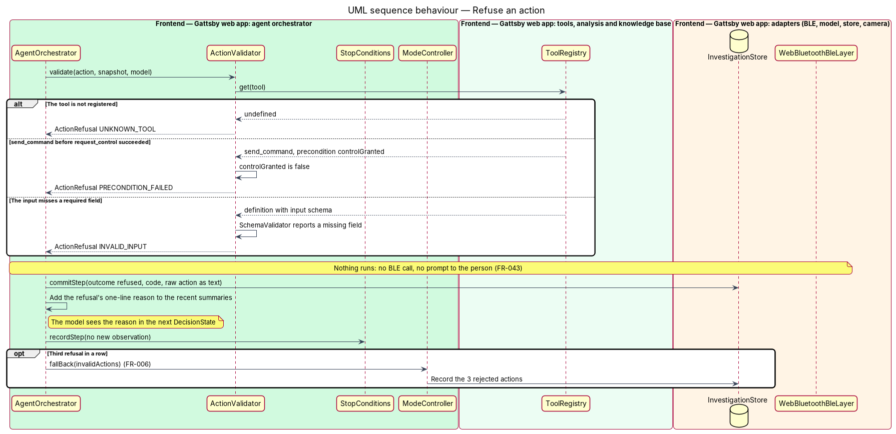

# Validate and run an action

## Overview

Every action the agent takes, whoever chose it, passes one gate before it runs and leaves one
summarised result after. This feature is that gate and that hand-off. It belongs to the agent
subsystem and runs at every step of every playbook stage, in full agent mode and in checklist mode.

**action** — one JSON decision: `call_tool`, `ask_user`, `update_hypothesis`, `request_missing_tool`
or `finish`

**pending call** — action that has passed validation, resolved to one registry tool with a checked
input, ready to run

**refusal** — validator's rejection of an action, with a shared error code and a one-line reason
that the model sees in the next decision state

**result summary** — line of at most 200 characters that a tool returns besides its full output, for
the model's state and the person's activity feed

An action can come from three places: the model's answer (see
[decide the next action](../decide-the-next-action/README.md)), a playbook rule (see
[apply heuristics first](../apply-heuristics-first/README.md)), or the person's pick in checklist
mode (see [run the checklist](../run-the-checklist/README.md)). AGENTS.md treats every model action as
untrusted, and the same validator checks rule and checklist actions too, so the safety rules hold on
one path. A valid action runs through `ToolExecutor`; a `write` or `control` call first passes the
approval gate (see [approve a command](../../device-control/approve-a-command/README.md)).

The person sees the result as one entry in the activity feed: the tool name, a plain purpose, the
time taken and the summary, for example "Connected. 4 services, 3 of them standard."
(`docs/mocks/pages/investigation/identify.html`). Every string that came from the model, from the
device or from the person is shown as text, never as HTML, including a device named
`` (NFR-013).

## Description

The design introduces these building blocks in the Angular (pending ADR 0001) workspace under
`frontend/src/app/`:

- **`ActionValidator`** (`agent/action-validator.ts`) — `parse(raw)` turns the model's raw text into
  one `AgentAction` with `JSON.parse` and the action schema; anything other than exactly one action
  is refused (FR-042). `validate(action, snapshot)` resolves the action to a registry tool and runs
  the checks in the order of the rules below, stopping at the first failure. It returns a
  `PendingCall` or an `ActionRefusal`. It reads an `InvestigationSession` snapshot and has no side
  effects, so each check is unit-tested on its own.
- **`SchemaValidator`** (`tools/schema-validator.ts`) — validates a value against a JSON Schema for
  the action shapes, every tool's input schema and every tool's output schema. It shall not compile
  schemas with `eval` or `new Function` (NFR-013), which rules out run-time code generation such as
  Ajv's default compile. Precompiled standalone validators generated at build time, or an
  interpreting validator, both meet the rule; the choice is `<TO SUPPLY>` (an ADR).
- **`ToolExecutor`** (`agent/tool-executor.ts`) — runs a `PendingCall`. For a `write` or `control`
  tool it asks `ApprovalGate` for a token first. It builds the `ToolContext` (session, BLE layer,
  store, knowledge base, prompt channel, the step's `AbortSignal` and the approval ID), awaits
  `tool.run`, checks the envelope, normalises the summary, and commits the step.
- **`ResultSummary`** (`agent/result-summary.ts`) — pure helper. `normalise(text)` collapses line
  breaks and runs of white space to single spaces, removes control characters, and cuts the line to
  200 characters with "…". A tool is expected to return a valid summary already (FR-044); a cut is
  recorded as a tool defect in the investigation record (NFR-025).
- **`PendingCall`** and **`ActionRefusal`** (`agent/pending-call.ts`, `agent/action-refusal.ts`) —
  the two outcomes of validation (see Data shapes).
- **`InvestigationStore.commitStep`** — writes the step, its decision source, the validation outcome,
  the approval ID, the result envelope, the raw-traffic entries and any hypothesis change in one
  IndexedDB transaction (FR-060, see [save as it runs](../../persistence/save-as-it-runs/README.md)).
- **`ActivityFeed`** (`agent/activity-feed.ts`) — receives the running entry before the tool runs and
  completes it with the summary afterwards (see [show agent activity](../show-agent-activity/README.md)).

### Rules

1. **One action.** The raw answer parses to exactly one of the 5 action shapes, with no extra
   properties; otherwise `INVALID_INPUT` ("not one action").
2. **One tool.** `call_tool` names its tool. The other 4 actions map to the registry tools of the
   same name (`ask_user`, TOOL-025; `update_hypothesis`, TOOL-028; `request_missing_tool`, TOOL-029;
   `finish`, TOOL-030), so every action is validated the same way.
3. **Registered.** The tool is in `ToolRegistry`; otherwise `UNKNOWN_TOOL`.
4. **Allowed at the stage.** The tool lists the current `PlaybookStage`; otherwise
   `NOT_ALLOWED_AT_STAGE`.
5. **Capable.** Every required capability is available in the `CapabilityReport`; otherwise
   `UNSUPPORTED`.
6. **Input.** The input passes the tool's input schema, including string lengths (a 200-character
   question is refused, TOOL-025) and evidence IDs that resolve (TOOL-028); otherwise
   `INVALID_INPUT`.
7. **Preconditions.** Each precondition the registry declares holds against the session (for
   example `send_command` needs a successful `request_control`); otherwise `PRECONDITION_FAILED`.
   `finish` is checked against the evidence by `VerdictService`: a verdict the evidence does not
   support is `PRECONDITION_FAILED`, with what is missing (TOOL-030).
8. **Safety.** For a `write` or `control` tool: after emergency stop, `EMERGENCY_STOPPED`; the same
   call declined in the last 3 steps, `APPROVAL_DENIED` (approve-a-command, rule 4); a value outside
   the knowledge base's limits, `UNSAFE_VALUE` (`SafetyLimits`, see
   [keep commands conservative](../../device-control/keep-commands-conservative/README.md)).
9. **A refusal is a step.** It is committed with outcome `refused`, its code and the raw action as
   text. Its summary, such as "Refused send_command: PRECONDITION_FAILED, request_control has not
   succeeded", enters the recent summaries, so the model sees it in the next state (FR-043). Nothing
   runs. `StopConditions` counts it as a step that added no observation (see
   [end the loop](../end-the-loop/README.md)), and the third refusal in a row makes `ModeController`
   fall back to checklist mode with the 3 rejected actions recorded (FR-006).
10. **No exception escapes.** `ToolExecutor` catches anything a tool throws. An `AbortError` becomes
    `ABORTED`. Any other escaped exception, and any `data` that fails the tool's output schema, is a
    tool defect: the step is committed with `ok` false and recorded with its tool and stage
    (NFR-025). The shared error codes have no code for a tool defect; this design uses
    `INTERNAL_ERROR`, which the
    [result-envelope design](../../tool-registry/return-a-result-envelope/README.md) proposes adding
    to section 3.
11. **Untrusted text stays text.** Model output, device names, characteristic values, answers,
    imported values and text read from photos are held as plain strings and rendered only through
    Angular interpolation or property binding to text. The app uses no `innerHTML`,
    `bypassSecurityTrust*`, `eval` or `new Function` on them; lint fails the build on any of these.
    The static host sends `require-trusted-types-for 'script'` with Angular's `angular` and
    `angular#bundler` policies (NFR-014, see
    [load fast and work offline](../../platform/load-fast-and-work-offline/README.md)).

### Data shapes

| Type | Fields |
|---|---|
| `AgentAction` | `action` (`call_tool`, `ask_user`, `update_hypothesis`, `request_missing_tool`, `finish`), the shape's own fields, optional `reason` (at most 200 characters) |
| `PendingCall` | `id`, `tool` (`ToolDefinition`), `input`, `decidedBy` (`rule`, `model`, `person`), `stage`, `reason` |
| `ActionRefusal` | `code` (`ToolErrorCode`), `reason` (one line, at most 200 characters), `rawAction` (text), `decidedBy` |
| `InvestigationStep` (written here) | `number`, `stage`, `mode`, `decidedBy`, `outcome` (`ok`, `failed`, `refused`, `timedOut`, `aborted`), `toolName`, `input`, `result` (`ToolResult`), `approvalId`, `startedAt`, `endedAt`, `timing` |

### Errors

| Code | Raised by | Meaning to the person |
|---|---|---|
| `INVALID_INPUT`, `UNKNOWN_TOOL`, `NOT_ALLOWED_AT_STAGE`, `UNSUPPORTED`, `PRECONDITION_FAILED` | `ActionValidator` | Nothing in full agent mode beyond a quiet feed line; the agent tries another step. In checklist mode a refusal of the person's pick means the picker offered an invalid step and is recorded as a defect. |
| `EMERGENCY_STOPPED` | `ActionValidator` | "Emergency stop was used. Nothing more will be sent." |
| `APPROVAL_DENIED` | `ActionValidator` (repeat within 3 steps) | None; the person already declined it. |
| `UNSAFE_VALUE` | `SafetyLimits` via `ActionValidator` | None; the command is never proposed. |
| `ABORTED` | `ToolExecutor` | None of its own; the stop screen explains. |

### Tests that prove it

- Unit tests cover each `ActionValidator` rule with a session snapshot, `ResultSummary.normalise`
  (line breaks, 201 characters, control characters), and `ToolExecutor` with a tool that throws.
- Acceptance specs script the fake `LanguageModel` (`e2e/fixtures/fake-language-model.ts`) to return
  `call_tool` for an unregistered tool, `send_command` before `request_control`, and a call with a
  missing required field. Each spec checks the refusal code in the investigation record, the reason
  in the next prompt's state, and that the fake `navigator.bluetooth` (`e2e/fixtures/fake-bluetooth.ts`)
  recorded no call for it (FR-043 AC1–AC3).
- An acceptance spec on the FTMS treadmill checks that the `enumerate_gatt` feed entry names
  Fitness Machine, Device Information and Heart Rate and fits in 200 characters (FR-044 AC1), through
  the `InvestigationPage` page object (`e2e/pages/investigation.page.ts`).
- An acceptance spec plays a fake device named `` and a fake model whose
  `reason` contains a `<script>` tag, runs the investigation, exports and re-imports it, and checks
  the text appears literally on every screen; a page error or a `dialog` event fails it (NFR-013
  AC1). Run against the production build with its Content Security Policy, the behaviour specs
  collect `securitypolicyviolation` events and fail on any Trusted Types violation (NFR-013 AC2).

## Requirements

The feature realizes the following level-2 (L2) requirements; each refines the level-1 (L1)
requirement cited beside it.

| L2 ID | Refines (L1) | Requirement |
|-------|--------------|-------------|
| [`FR-043`](../../../specs/L2.md#fr-043-validate-every-action-before-running-it) | `L1-010` | The orchestrator must check each action against its schema, the named tool's input schema and preconditions, the tools allowed at the current stage, and the safety rules, and must refuse any action that fails, with a reason the model sees in the next state. Each refusal counts as a step. |
| [`FR-044`](../../../specs/L2.md#fr-044-summarise-each-result) | `L1-010` | Every tool must return, besides its full output (stored in the investigation), a one-line summary of at most 200 characters for the model's state and the person's activity feed. |
| [`NFR-013`](../../../specs/L2.md#nfr-013-treat-model-output-and-device-data-as-untrusted) | `L1-018` | Model output, device names, characteristic values, answers, imported files and text read from photos must be rendered as text, never as HTML, and never evaluated. The app must enforce Trusted Types (`require-trusted-types-for 'script'`) and contain no `innerHTML`, `eval` or `new Function` on such data. |

## Diagrams

### System context

The person follows each step in Gattsby; Gattsby runs the validated tool through Chrome against the
device and keeps the full result on the device.

### Containers

Inside Gattsby the web app validates the action against the tool registry and the knowledge base's
limits, runs the tool, and commits the step to the investigation database.

### Components

`ActionValidator` resolves the action through `ToolRegistry` and checks it with `SchemaValidator`,
the session and `SafetyLimits`; `ToolExecutor` runs the `PendingCall`, normalises its summary with
`ResultSummary`, commits the step and completes the feed entry.

### Class structure

`ActionValidator` turns an `AgentAction` into either a `PendingCall` or an `ActionRefusal`;
`ToolExecutor` runs a `PendingCall` through a `Tool` and receives a `ToolResult` envelope.

### Behaviour — validate and run one call

The model asks for `read_device_info` at the Identify stage; every check passes, the tool reads the
Device Information Service, and its summary "Johnson Health Tech · model T202 · firmware 2.14.0" is
committed with the step and shown in the feed.

### Behaviour — refuse an action

An unknown tool, a `send_command` before `request_control`, or a missing input field is refused
with its code; nothing runs, the refusal is committed as a step, and its reason enters the next
state; the third refusal in a row falls back to checklist mode.

