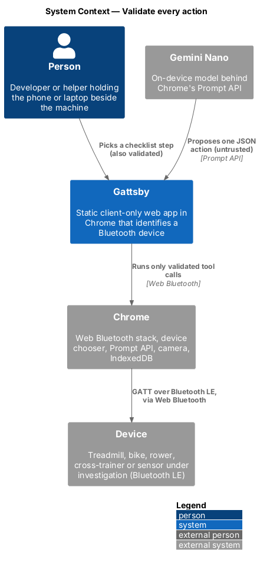
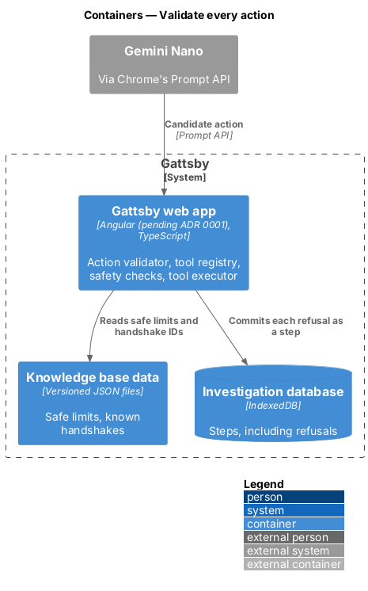
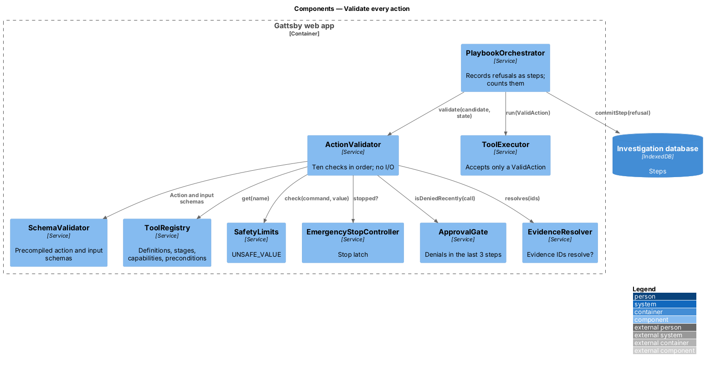
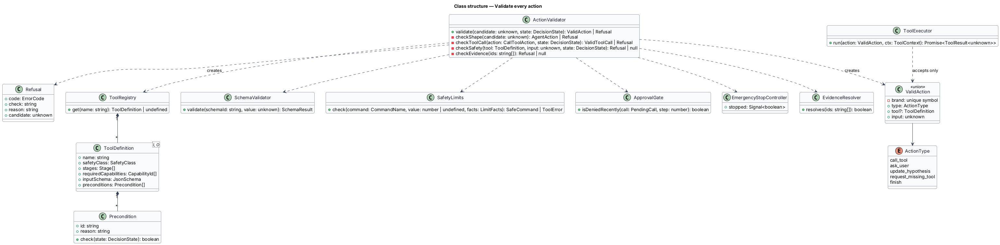
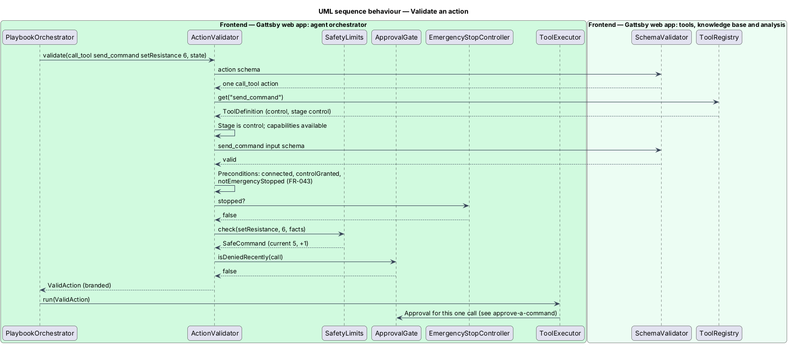
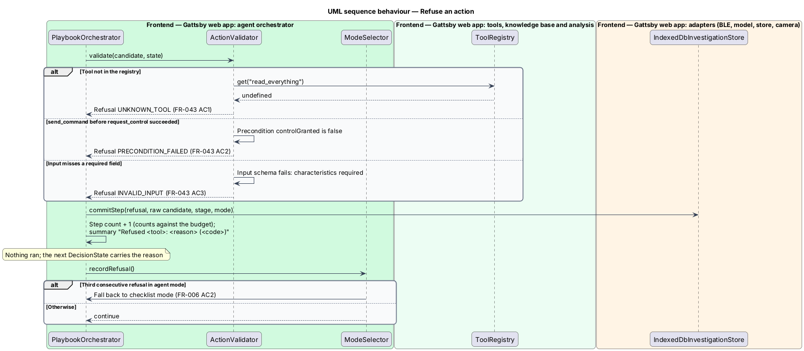

# Validate every action

## Overview

Every action is untrusted, whether the model proposed it or the checklist built it from the
person's choice. This feature is the check that stands between a proposed action and anything that
runs: the action's own schema, the named tool's existence, stage, capabilities, input schema and
preconditions, and the safety rules. An action that fails is refused with a shared error code and a
reason that the model reads in its next decision state, and the refusal counts as a step. The
feature belongs to the agent subsystem and runs once per step, in every stage and both modes.

**refusal** — record that the orchestrator declined an action, holding the error code, the failed
check and a one-line reason that the next decision state carries

**precondition** — named condition on the investigation that shall hold before a tool runs, such as
"connected" or "control granted"

**valid action** — action that passed every check, in a typed form that only the validator can
create and the only form `ToolExecutor` accepts

The person sees a refusal only through its effects: no approval prompt opens for an unsafe value (see
the keep-commands-conservative design), the feed notes that the agent asked for a stop (see the
emergency-stop design), and after three refusals in a row the mode banner announces checklist mode
(`docs/mocks/notifications/mode-banner/warning.html`; FR-006). The
[`model-refusal` mock](../../../mocks/pages/investigation/model-refusal.html) shows the refusal's
plain-text reason in the activity feed while the agent considers another step.

## Description

The design introduces these building blocks in the Angular (pending ADR 0001) workspace under
`frontend/src/app/`:

- **`ActionValidator`** (`agent/action-validator.ts`) — `validate(candidate, state)` returns a
  `ValidAction` or a `Refusal`. It runs the checks below in order and stops at the first failure. It
  performs no I/O and changes nothing, so it fits the 200 ms budget for deterministic steps (NFR-002).
- **`ValidAction`** (`agent/valid-action.ts`) — discriminated union of the five actions with typed
  input, the resolved `ToolDefinition` for `call_tool`, and a module-private brand. `ToolExecutor.run`
  takes only a `ValidAction`, so the type system rejects any path that skips validation.
- **`Refusal`** (`agent/refusal.ts`) — `code`, `check`, `reason` (≤ 200 characters), and the raw
  candidate kept for the investigation record.
- **`SchemaValidator`** (`tools/schema-validator.ts`) — validates the action against the precompiled
  action schema and the input against the tool's precompiled input schema (no `eval` or
  `new Function` at run time; NFR-013).
- **`ToolRegistry`** (`tools/tool-registry.ts`) — `get(name)` for the tool's definition, stages,
  required capabilities and preconditions.
- **`Precondition`** (`tools/precondition.ts`) — `{ id, check(state), reason }`, declared on each
  `ToolDefinition` and evaluated against the `DecisionState`'s device facts: `connected`,
  `ftmsControlPointPresent`, `controlGranted`, `notEmergencyStopped`, `scanDone`, `vendorHandshakeKnown`
  and others as tools need them.
- **`SafetyLimits`** (`agent/safety-limits.ts`), **`EmergencyStopController`**
  (`agent/emergency-stop-controller.ts`) and **`ApprovalGate`** (`agent/approval-gate.ts`) — supply the
  safety checks: safe values, the stop latch, and denials in the last 3 steps.
- **`EvidenceResolver`** (`outcome/evidence-resolver.ts`) — answers whether each evidence ID resolves
  to an entry in this investigation, from an in-memory index.
- **`PlaybookOrchestrator`** (`agent/playbook-orchestrator.ts`) — records each refusal as a step,
  counts it against the step budget, and tells `ModeSelector` about consecutive refusals.

### The checks, in order

| # | Check | Applies to | Refusal code |
|---|---|---|---|
| 1 | The candidate is exactly one of the five action shapes | every action | `INVALID_INPUT` |
| 2 | The named tool is registered | `call_tool` | `UNKNOWN_TOOL` (FR-043 AC1) |
| 3 | The tool is allowed at the current stage | `call_tool` | `NOT_ALLOWED_AT_STAGE` |
| 4 | The tool's required capabilities are available | `call_tool` | `UNSUPPORTED` |
| 5 | The input matches the tool's input schema | `call_tool`, `ask_user` | `INVALID_INPUT` (FR-043 AC3) |
| 6 | Every precondition holds | `call_tool` | `PRECONDITION_FAILED` (FR-043 AC2) |
| 7 | Not emergency-stopped | `write` and `control` tools | `EMERGENCY_STOPPED` |
| 8 | The value is within the safe limits | `send_command` | `UNSAFE_VALUE` |
| 9 | The same call was not declined in the last 3 steps | `write` and `control` tools | `APPROVAL_DENIED` |
| 10 | Every evidence ID resolves | `update_hypothesis`, `request_missing_tool` | `INVALID_INPUT` |

Notes on the checks:

- Check 3 refuses `emergency_stop` at every stage, because the tool has no stage (TOOL-024 AC2).
- Check 4 also records a missing-tool request for the capability (FR-058).
- Check 5 covers the person tools: an `ask_user` question of 200 characters is refused (TOOL-025
  AC1), and a `replay_known_handshake` ID not in the knowledge base is refused (TOOL-023 AC1).
- Checks 7 to 9 run before the approval prompt, so the person is never asked to approve a call the
  code would refuse. `ApprovalGate` repeats checks 7 and 8 itself (see the approve-a-command design).
- `finish` passes the structural checks here; whether its verdict is supported by the evidence is
  checked when it runs (TOOL-030; see the issue-the-verdict design).

### What happens to a refusal

1. The orchestrator commits the refusal as a step with mode, stage and the raw candidate (FR-005 AC4,
   NFR-025). It counts against the step budget of 40 (FR-043, A-05).
2. Its reason becomes the step summary, for example "Refused send_command: control not granted yet
   (PRECONDITION_FAILED)", so the next decision state shows the model why (FR-043, FR-041).
3. A refused step adds no observation, so it counts toward the no-progress stop, and a third
   repetition of the same refused action is a no-progress step (FR-045 AC3; see the end-the-loop
   design).
4. In full agent mode, three consecutive refusals switch the investigation to checklist mode, with the
   three rejected actions in the record (FR-006 AC2).
5. In checklist mode, a refused choice keeps the same prompt open with the reason shown as text (see
   the run-checklist-mode design).

### Tests that prove it

Unit tests feed `ActionValidator` one candidate per row of the table and check the code and that
nothing ran. Acceptance specs script the fake `LanguageModel` to return an unknown tool, a
`send_command` before `request_control`, and an input missing a required field, and check that the
fake `navigator.bluetooth` recorded no call and that the next prompt carries the refusal reason.

## Requirements

The feature realizes the following level-2 (L2) requirement; it refines the level-1 (L1) requirement
cited beside it.

| L2 ID | Refines (L1) | Requirement |
|-------|--------------|-------------|
| [`FR-043`](../../../specs/L2.md#fr-043-validate-every-action-before-running-it) | `L1-010` | The orchestrator must check each action against its schema, the named tool's input schema and preconditions, the tools allowed at the current stage, and the safety rules, and must refuse any action that fails, with a reason the model sees in the next state. Each refusal counts as a step. |

## Diagrams

### System context

Every action, whether from Gemini Nano or from the person's checklist choice, is checked inside
Gattsby before anything reaches the device.

### Containers

The web app validates actions in memory against the tool registry and the knowledge base's limits,
and commits each refusal to the investigation database as a step.

### Components

`ActionValidator` consults `SchemaValidator`, `ToolRegistry`, the tool's preconditions,
`EmergencyStopController`, `SafetyLimits`, `ApprovalGate` and `EvidenceResolver`; only a
`ValidAction` reaches `ToolExecutor`.

### Class structure

`ActionValidator` returns either a branded `ValidAction` or a `Refusal`; `ToolDefinition` declares
the `Precondition`s the validator evaluates against the `DecisionState`.

### Behaviour — validate an action

A `call_tool` passes the schema, registry, stage, capability, input, precondition and safety checks,
becomes a `ValidAction`, and runs.

### Behaviour — refuse an action

An unknown tool, a missing field or an unmet precondition is refused with its code; the refusal is
committed as a step and its reason reaches the next state, and three in a row hand over to checklist
mode.

