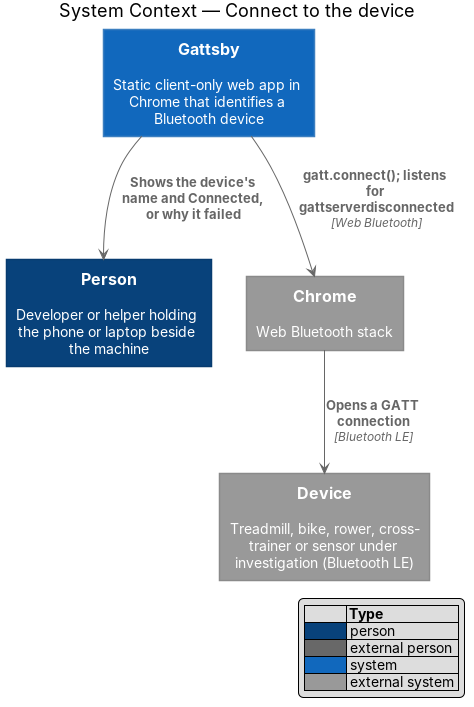
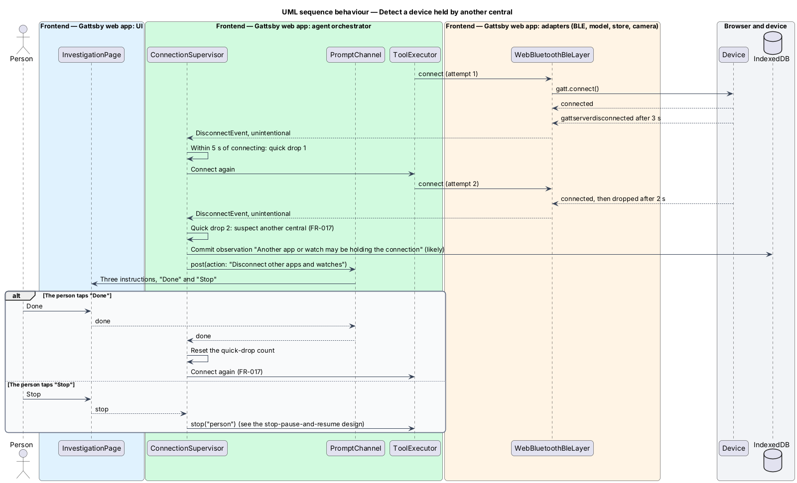
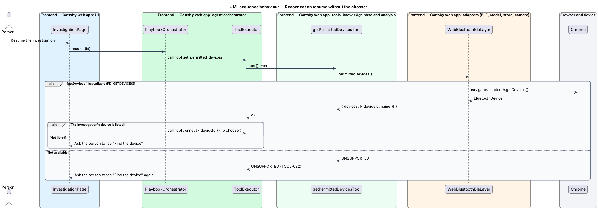

# Connect to the device

## Overview

Once the person has chosen a device, Gattsby connects to its GATT server. The connection opens the
Identify stage of the playbook, and every later read, notification and command travels over it. This
feature owns the first connect, the check that the device is not held by another app, and the
reconnect without the chooser when a paused or interrupted investigation is resumed.

**GATT server** — part of the device that exposes its services and characteristics over Bluetooth Low
Energy

**central** — phone, watch, laptop or console app that connects to a device; most machines accept one
central at a time

**quick drop** — disconnect that follows a successful connect within 5 seconds

**held by another central** — suspicion that another central keeps the device from accepting
Gattsby's connection

**permitted device** — device this origin was allowed to use earlier, listed by
`navigator.bluetooth.getDevices()` without the chooser (`get_permitted_devices`, TOOL-032)

On the Investigation page, the header shows the device's advertised name as soon as the connection
succeeds, and the "Emergency stop" button appears (FR-039; state `identify`,
`docs/mocks/pages/investigation/identify.html`). The connection banner in state `info`
(`docs/mocks/notifications/connection-banner/info.html`) reads "Connected to HZN-T202-4F1A". When the
device drops twice within 5 seconds of connecting, the page moves to state `held-by-other`
(`docs/mocks/pages/investigation/held-by-other.html`): the feed shows "Connected, then the treadmill
dropped the connection after 3 s. Second try: dropped after 2 s." and the prompt "Disconnect other
apps and watches" with "Done" and "Stop".

## Description

The design introduces these building blocks in the Angular (pending ADR 0001) workspace under
`frontend/src/app/`:

- **`connectTool`** (`tools/connection/connect.tool.ts`) — registry entry for `connect` (TOOL-006),
  safety class `read`, stage `identify`. Input `{ deviceId, timeoutMs?: 1000–20000 }`, default
  10,000 ms. Precondition: a device chosen in this investigation (a `ChosenDevice` observation from
  the scan-for-the-device or tell-candidates-apart design), else `PRECONDITION_FAILED`. Output
  `{ connected: true, at }`.
- **`getPermittedDevicesTool`** (`tools/discovery/get-permitted-devices.tool.ts`) — registry entry for
  `get_permitted_devices` (TOOL-032), safety class `read`, phase P2. Output
  `{ devices: [{ deviceId, name }] }`; `UNSUPPORTED` where `getDevices()` is absent (`PD-GETDEVICES`).
- **`WebBluetoothBleLayer`** (`ble/web-bluetooth-ble-layer.ts`) — `connect(deviceId, timeoutMs)` calls
  `device.gatt.connect()` raced against the timeout; on timeout it calls `gatt.disconnect()` to
  cancel the attempt and returns `TIMEOUT`. On success it creates the `GattSession`, adds the
  `gattserverdisconnected` listener that feeds the `disconnected` stream, and appends `connect`
  entries to `RawTrafficLog`. `permittedDevices()` wraps `getDevices()`. It keeps a map from
  `deviceId` (the opaque `BluetoothDevice.id`) to `BluetoothDevice`.
- **`GattSession`** (`ble/gatt-session.ts`) — the connected device, its name, its `state` signal
  (`disconnected`, `connecting`, `connected`, `releasing`) and `connectedAt`.
- **`ConnectionSupervisor`** (`agent/connection-supervisor.ts`) — subscribes to `disconnected`. It
  counts quick drops and refused connects, raises the held-by-other suspicion (FR-017), and otherwise
  hands an unexpected drop to the recover-a-dropped-connection design. It ignores intentional
  disconnects (see the release-the-connection design).
- **`ConnectionBanner`** (`notifications/connection-banner/connection-banner.component.ts`) —
  presentation component bound to `GattSession.state` and the device name.
- **`PromptChannel`** (`agent/prompt-channel.ts`) — posts the held-by-other `action` prompt.
- **`InvestigationPage`** (`pages/investigation/investigation.page.ts`) — shows the name in the
  header and the device panel, always as text (NFR-013).

### Connect rules

1. The screen shows the device's name and "Connected" within 10 seconds, or a failure with its reason
   (FR-015). A refused connection goes to the held-by-other prompt below; a connection that does
   not answer in time shows `docs/mocks/pages/investigation/error.html` ("Couldn't connect"), built
   with the recover-a-dropped-connection journey (10). Journey 2 scripts a device that refuses its
   first connection (`held-by-other`) for FR-017.
2. The connection time `at` is the high-resolution timestamp of the `connect` raw-log entry, and the
   step commits it (FR-015).
3. A device name containing markup, such as `<b>`, is shown literally (FR-015, NFR-013); no template
   binds it as HTML.
4. Connect never writes to the device. It does not pair, bond or change a setting (NFR-019).

### Held by another central (FR-017)

`ConnectionSupervisor` raises the suspicion on any of three triggers:

| Trigger | Source |
|---|---|
| A connect is refused (`CONNECTION_FAILED`) | `connectTool` result |
| Two quick drops: two disconnects, each within 5 seconds of connecting | `disconnected` stream and `GattSession.connectedAt` |
| The device is not seen although the person says it is on | Find stage answers (see the conclude-not-connectable design) |

On the suspicion it commits an observation tagged `likely` ("Another app or watch may be holding the
connection") and posts the prompt with three instructions: close the gym or console app on any phone
nearby; turn Bluetooth off on any watch paired with it; and, if still stuck, switch the machine off
and on. "Done" resets the quick-drop count and connects again; "Stop" stops the investigation (see
the stop-pause-and-resume design). A first quick drop goes to one plain connect retry, not to the
reconnect policy of the recover-a-dropped-connection design.

### Resume without the chooser (P2)

On resume (FR-009) the orchestrator calls `get_permitted_devices`. When the investigation's
`deviceId` is listed, it connects directly. When the API is absent or the device is not listed, the
person is asked to tap "Find the device" again (TOOL-032), which reruns the scan.

### Errors

| Code | Raised by | Meaning to the person |
|---|---|---|
| `TIMEOUT` | `connectTool` | The device did not answer within the time limit |
| `CONNECTION_FAILED` | `connectTool` | The device refused; the held-by-other prompt follows |
| `PRECONDITION_FAILED` | `connectTool` | None shown; no device has been chosen yet |
| `UNSUPPORTED` | `getPermittedDevicesTool` | None shown; "Find the device" is offered instead |

### Tests that prove it

Acceptance specs use the fake `navigator.bluetooth`: the FTMS treadmill for the connected header and
banner within 10 seconds, a device named `<b>Bike</b>` for literal rendering, a device that never
answers for `TIMEOUT`, and the dropping device, scripted to drop after 3 and 2 seconds, for the
held-by-other prompt and the reconnect on "Done". Unit tests cover the quick-drop count in
`ConnectionSupervisor` on a fake clock.

### Built in journey 2

`connect` and the held-by-other path are built: a refused connection commits the *likely* observation, posts "Disconnect other apps and watches" with "Done" and "Stop", and connects again on "Done" (at most three attempts). `GattSession` is folded into `WebBluetoothBleLayer`'s `connection` signal. Not built yet: the two-quick-drops trigger and `ConnectionSupervisor` (journey 10), `ConnectionBanner` (journey 10) and `get_permitted_devices` (P2). The screen shows the device's name in the app bar and the device panel and "Connected." in the step's card.

## Requirements

The feature realizes the following level-2 (L2) requirements; each refines the level-1 (L1)
requirement cited beside it.

| L2 ID | Refines (L1) | Requirement |
|-------|--------------|-------------|
| [`FR-015`](../../../specs/L2.md#fr-015-connect-to-the-chosen-device) | `L1-005` | Gattsby must connect to the GATT server of the device the person chose, show the device's name and the connection state, and record the connection time. |
| [`FR-017`](../../../specs/L2.md#fr-017-detect-a-device-held-by-another-central) | `L1-005` | When a connection is refused, drops within 5 seconds of connecting twice, or the device is not seen although the person says it is on, Gattsby must suspect another connection and ask the person to disconnect the console's app, watches and phones, and to power-cycle the device if that does not help. |
| [`TOOL-006`](../../../specs/L2.md#tool-006-connect) | `L1-005` | Connects to the chosen device's GATT server and starts listening for disconnects. |
| [`TOOL-032`](../../../specs/L2.md#tool-032-get_permitted_devices) | `L1-004` | Lists devices this origin was already permitted to use (`navigator.bluetooth.getDevices()`), so that a resumed investigation can reconnect without the chooser. |

## Diagrams

### System context

Gattsby connects to the device's GATT server through Chrome's Web Bluetooth stack and tells the
person when another central seems to hold it.

### Containers

The web app connects to the device and commits the connect step, its time and any held-by-other
observation to the investigation database.

### Components

`connectTool` and `getPermittedDevicesTool` call the BLE layer, which creates the `GattSession` and
reports disconnects to `ConnectionSupervisor`; the supervisor asks the person to free the device
through `PromptChannel`.

### Class structure

`WebBluetoothBleLayer` implements the `BleLayer` contract, owns at most one `GattSession` and emits
`DisconnectEvent`s that `ConnectionSupervisor` counts against the 5-second quick-drop window.

### Behaviour — connect to the chosen device

A device that accepts is connected within 10 seconds and its name appears as text; a silent device
ends in `TIMEOUT` and a refusal in `CONNECTION_FAILED`.

### Behaviour — detect a device held by another central

Two drops within 5 seconds of connecting raise the suspicion, record it as an observation and ask the
person to disconnect other apps and watches; "Done" connects again.

### Behaviour — reconnect on resume without the chooser

A resumed investigation reconnects to a permitted device directly where `getDevices()` exists, and
asks for "Find the device" otherwise.

