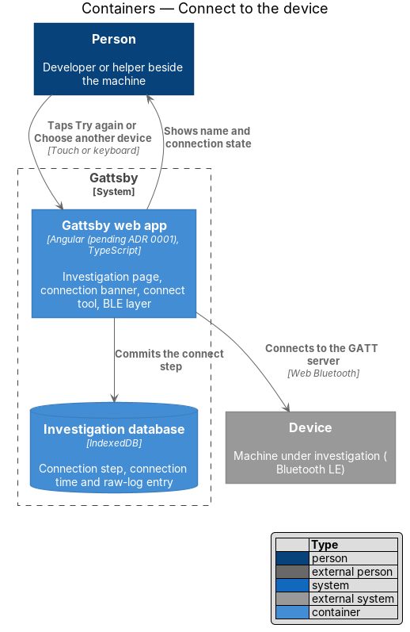
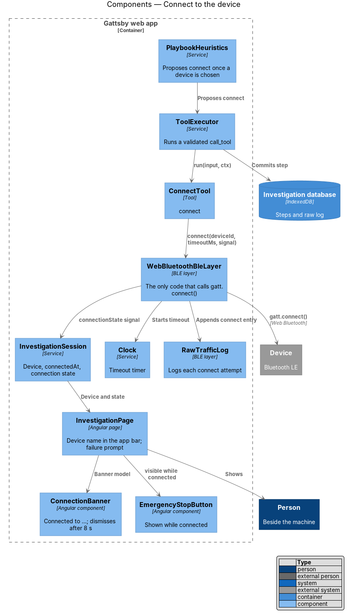
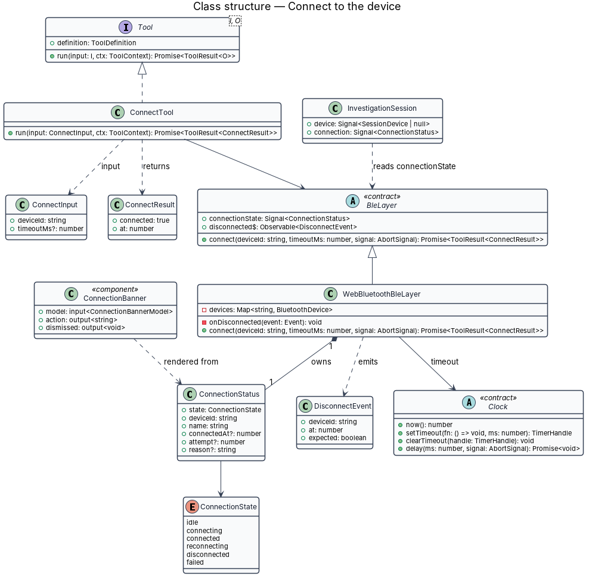
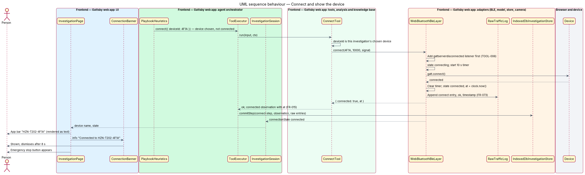
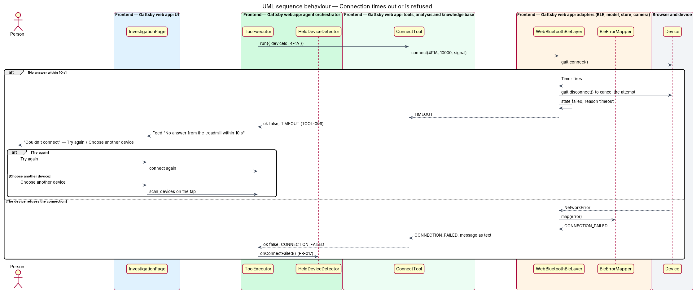

# Connect to the device

## Overview

Once the person has picked the device in Chrome's chooser, Gattsby has permission to talk to it but
no link yet. This feature opens that link: it connects to the device's GATT server, starts listening
for disconnects, shows the device's name and the connection state, and records when the connection
was made. Every later stage that reads, listens or writes depends on it. It belongs to the connection
subsystem and opens the Identify stage of the playbook, right after the
[scan for the device](../../discovery/scan-for-the-device/README.md) or
[tell candidates apart](../../discovery/tell-candidates-apart/README.md) design returns a chosen
device.

**GATT server** — the device's side of a Bluetooth Low Energy connection, which holds its services
and characteristics

**connection state** — the BLE layer's current view of the link to the device: `idle`, `connecting`,
`connected`, `reconnecting`, `disconnected` or `failed`

**connection time** — instant at which the GATT connection succeeded, recorded as an observation and
shown in the investigation record

**disconnect listener** — handler on the device's `gattserverdisconnected` event, added before the
connection opens, that reports every drop to the rest of the app

On success, the investigation screen's title becomes the device's advertised name, and the
connection banner reads "Connected to HZN-T202-4F1A" with "The connection is released when this
investigation ends." It dismisses itself after 8 seconds (`docs/mocks/notifications/connection-banner/info.html`).
The emergency stop button appears as soon as the device is connected
(`docs/mocks/pages/investigation/identify.html`). When the device does not answer in time, the feed
reads "No answer from the treadmill within 10 s", and the prompt "Couldn't connect" asks the person
to wake the console and stand within 2 metres, with "Try again" and "Choose another device"
(`docs/mocks/pages/investigation/error.html`).

## Description

The design introduces these building blocks in the Angular (pending ADR 0001) workspace under
`frontend/src/app/`:

- **`ConnectTool`** (`tools/connection/connect.tool.ts`) — the `connect` tool, safety class `read`.
  It refuses with `PRECONDITION_FAILED` unless `deviceId` is the device chosen in this investigation
  and the BLE layer holds its `BluetoothDevice`. It validates `timeoutMs` (1000–20000, default 10000),
  calls `BleLayer.connect`, and records an `Observation` of kind `connected` with the connection time.
- **`WebBluetoothBleLayer.connect`** (`ble/web-bluetooth-ble-layer.ts`) — the only call to
  `device.gatt.connect()`. It adds the disconnect listener first, sets the connection state to
  `connecting`, and races the connect against a `Clock` timer. On timeout it calls
  `device.gatt.disconnect()` to cancel the pending attempt and returns `TIMEOUT`. A rejected connect
  goes through `BleErrorMapper`, which maps a `NetworkError` to `CONNECTION_FAILED`. On success it
  sets the state to `connected` and returns the connection time.
- **`BleLayer.connectionState`** — read-only signal of `ConnectionStatus`. **`BleLayer.disconnected$`**
  — event stream of `DisconnectEvent`, one per `gattserverdisconnected`, each marked `expected` when
  Gattsby asked for the disconnect. The
  [recover a dropped connection](../recover-a-dropped-connection/README.md) design consumes it.
- **`RawTrafficLog`** (`ble/raw-traffic-log.ts`) — receives one `connect` entry per attempt, with its
  timestamp and outcome (FR-073).
- **`Clock`** (`shared/clock.ts`) — contract over `performance.now()` and timers, so that unit tests
  advance a fake clock for the connect timeout.
- **`InvestigationSession`** (`agent/investigation-session.ts`) — holds `device` (`deviceId`, `name`,
  `connectedAt`) and exposes the connection state to pages as a signal.
- **`ConnectionBanner`** (`notifications/connection-banner/connection-banner.ts`) — presentation
  component. Input: a `ConnectionBannerModel` (tone, title, detail, actions). It renders the `info`
  tone on connect and dismisses itself after 8 seconds through `Clock`. The
  recover-a-dropped-connection design uses the same component for its other tones.
- **`InvestigationPage`** (`pages/investigation/investigation.page.ts`) — shows the device name in
  the app bar and passes the connection state to `ConnectionBanner` and `EmergencyStopButton`.
- **Identify-stage rule** — `PlaybookHeuristics` proposes `connect` as soon as a device is chosen and
  not connected, so the model is never asked whether to connect (FR-046).

### Rules

1. The disconnect listener is added before `gatt.connect()` is called, so a drop during the first
   moments of the connection is still reported (TOOL-006).
2. The default timeout is 10 seconds (TOOL-006 AC2). Within that time the screen shows the device's
   name and the connected state, or a failure with its reason (FR-015 AC1).
3. The device's name, and every error message from Chrome, is rendered with text interpolation,
   never with `innerHTML`. A name such as `<b>Treadmill</b>` is shown literally (FR-015 AC2). An empty
   name is shown as "Unnamed device".
4. The connection time is taken from `Clock` when `gatt.connect()` resolves. It is stored on the
   `connected` observation and on the investigation's device record, and committed with the step
   (FR-060).
5. `TIMEOUT` leads to the "Couldn't connect" prompt. `CONNECTION_FAILED` is a refused connection,
   which the [detect a held device](../detect-a-held-device/README.md) design treats as a sign of
   another central.
6. "Try again" runs `connect` again with the same device. "Choose another device" runs `scan_devices`
   on the person's tap.
7. The connection opens nothing else. Service discovery belongs to the
   [read the GATT layout](../../identification/read-the-gatt-layout/README.md) design; the banner's
   service count appears once `enumerate_gatt` returns.

### Data shapes

| Type | Fields |
|---|---|
| `ConnectInput` | `deviceId`, `timeoutMs?` (1000–20000, default 10000) |
| `ConnectResult` (tool output) | `connected: true`, `at` |
| `ConnectionStatus` | `state` (`idle` \| `connecting` \| `connected` \| `reconnecting` \| `disconnected` \| `failed`), `deviceId`, `name`, `connectedAt?`, `attempt?`, `reason?` |
| `DisconnectEvent` | `deviceId`, `at`, `expected` |
| `ConnectionBannerModel` | `tone` (`info` \| `success` \| `warning` \| `danger`), `title`, `detail`, `actions`, `autoDismissMs?` |

### Errors

| Code | Raised by | Meaning to the person |
|---|---|---|
| `TIMEOUT` | `WebBluetoothBleLayer.connect` | "Couldn't connect. Wake the console, stand within 2 metres of it, then try again." |
| `CONNECTION_FAILED` | `BleErrorMapper` via `connect` | The held-device prompt of the detect-a-held-device design. |
| `PRECONDITION_FAILED` | `ConnectTool` | Never shown; the agent is told to choose a device first. |

The mocks show a successful `connect` folded into the `enumerate_gatt` feed entry ("Connect and list
everything it exposes"), and a failed one as its own entry. This design emits one activity entry per
`connect` step; the [show agent activity](../../agent/show-agent-activity/README.md) design decides
how the feed groups them.

### Tests that prove it

The acceptance spec `e2e/connection/connect-to-the-device.spec.ts` uses the fake `navigator.bluetooth`
with the scripted FTMS treadmill and the `InvestigationPage` page object. It checks that the app bar
shows the treadmill's name and the banner reads "Connected to" within 10 seconds of the pick. A second
scripted device named `<b>Treadmill</b>` checks that the name is shown literally. A third scripted
device never answers; the spec advances Playwright's clock by 10 seconds and checks the "Couldn't
connect" prompt. Unit tests cover `WebBluetoothBleLayer.connect` with a fake clock: timeout, cancel
on timeout, and the listener added before the connect call.

## Requirements

The feature realizes the following level-2 (L2) requirements; each refines the level-1 (L1)
requirement cited beside it.

| L2 ID | Refines (L1) | Requirement |
|-------|--------------|-------------|
| [`FR-015`](../../../specs/L2.md#fr-015-connect-to-the-chosen-device) | `L1-005` | Gattsby must connect to the GATT server of the device the person chose, show the device's name and the connection state, and record the connection time. |
| [`TOOL-006`](../../../specs/L2.md#tool-006-connect) | `L1-005` | Connects to the chosen device's GATT server and starts listening for disconnects. |

## Diagrams

### System context

Gattsby asks Chrome to open a GATT connection to the device the person chose, and shows the person
the device's name and the connection state.

### Containers

The web app connects through Chrome's Web Bluetooth stack and commits the connection step, with its
time and raw-log entry, to the investigation database.

### Components

`ConnectTool` calls the BLE layer, which alone calls `gatt.connect()`; the connection state flows as a
signal to `InvestigationSession`, the investigation page and the connection banner.

### Class structure

`WebBluetoothBleLayer` implements the `BleLayer` contract, owns the `ConnectionStatus` signal and the
`DisconnectEvent` stream, and uses `Clock` for the timeout.

### Behaviour — connect and show the device

The BLE layer adds the disconnect listener, connects within the 10-second limit, logs the connect, and
the page shows the name and the "Connected to" banner.

### Behaviour — connection times out or is refused

A device that does not answer within 10 seconds yields `TIMEOUT` and the "Couldn't connect" prompt; a
refused connection yields `CONNECTION_FAILED` and is handed to the held-device rules.

