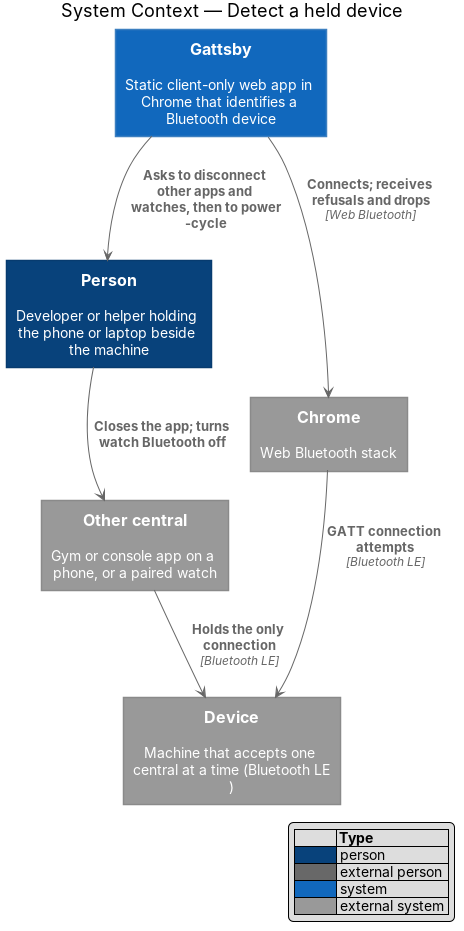
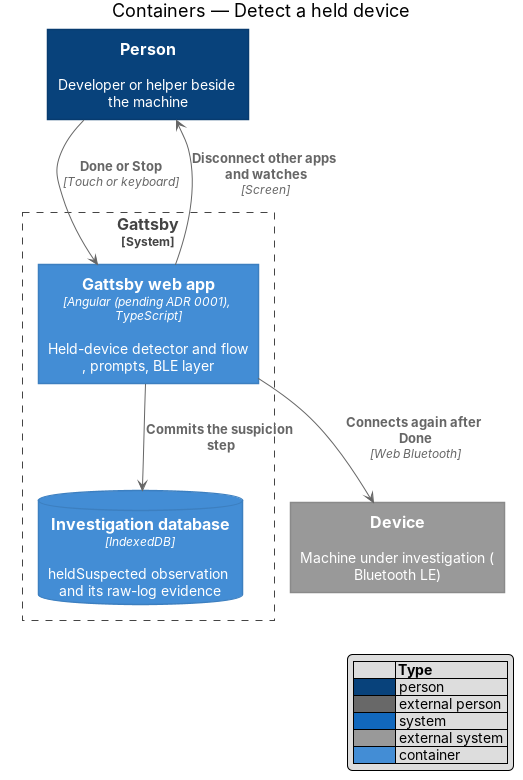
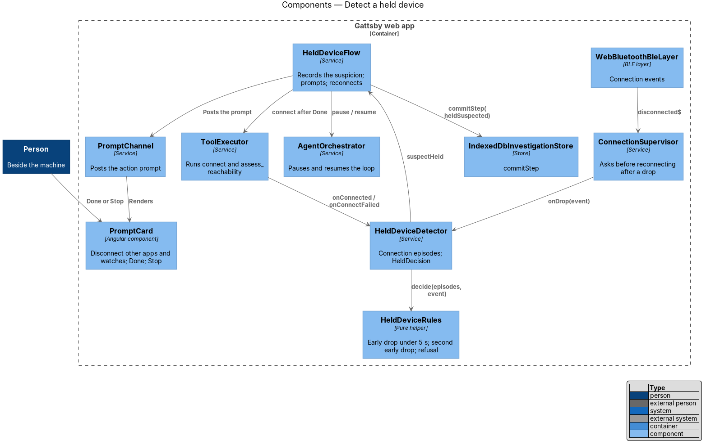
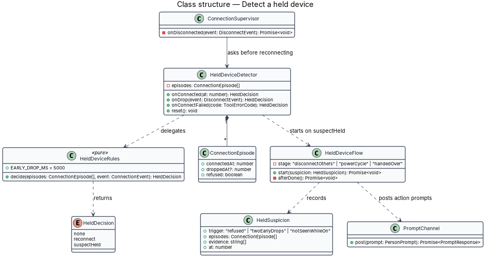
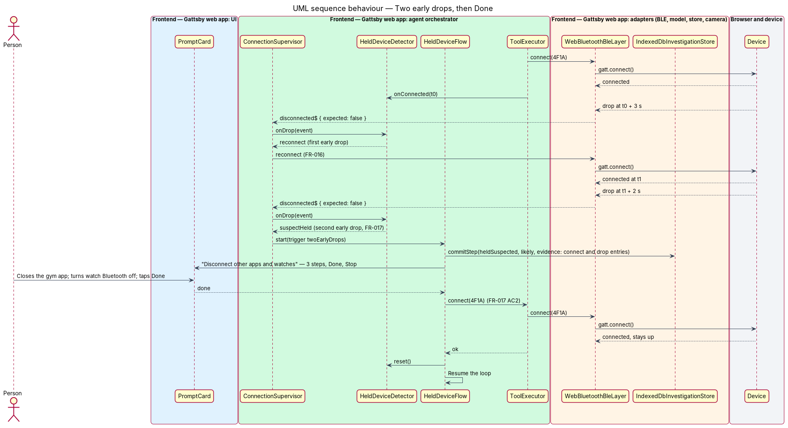
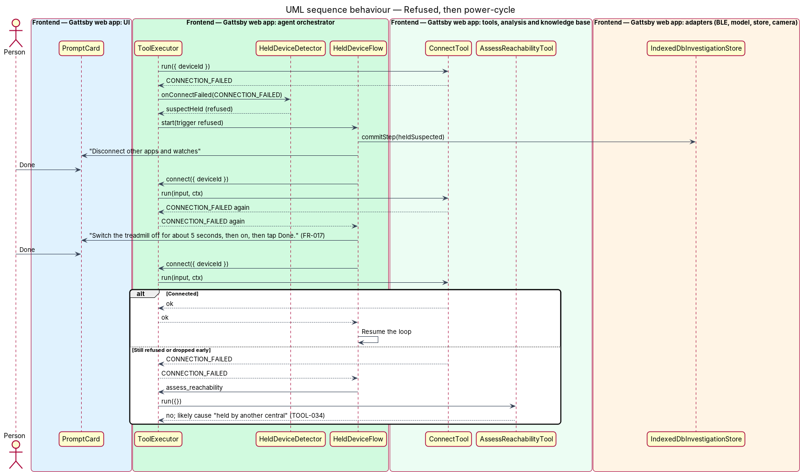

# Detect a held device

## Overview

Most fitness machines accept one Bluetooth Low Energy central at a time. When the gym's app on a
phone, a paired watch or the console's own app already holds that connection, Gattsby either cannot
connect, or connects and is dropped within seconds. The cause is outside the browser and only the
person can remove it. This feature recognises the signs of a device held by another central, records
the suspicion with its evidence, and asks the person to disconnect the other apps and watches, then to
power-cycle the machine if that does not help. It belongs to the connection subsystem and works beside
the [connect to the device](../connect-to-the-device/README.md) and
[recover a dropped connection](../recover-a-dropped-connection/README.md) designs, mostly in the
Identify stage.

**central** — the Bluetooth Low Energy role of the phone, laptop or watch that connects to a device;
a fitness machine is a peripheral and usually accepts one central

**held device** — device whose single connection is taken by another central, such as a phone app or
a watch

**early drop** — unexpected disconnect less than 5 seconds after the connection succeeded

**held-device suspicion** — observation, marked *likely*, that another central probably holds the
device, with the connect and drop entries as evidence

**held-device trigger** — one of the three signs of FR-017: a refused connection, a second early
drop, or a device not seen although the person says it is on

The mock `docs/mocks/pages/investigation/held-by-other.html` shows the flow. The `connect` entry
reads "Connected, then the treadmill dropped the connection after 3 s. Second try: dropped after
2 s.", followed by the *likely* finding "Another app or watch may be holding the connection". The
agent explains "Something else is probably connected to this treadmill — most machines only talk to
one device at a time." The prompt "Disconnect other apps and watches" lists "Close the gym or console
app on any phone nearby.", "Turn Bluetooth off on any watch paired with it." and "Still stuck? Switch
the treadmill off and on.", with "Done" and "Stop". "Done" reconnects.

## Description

The design introduces these building blocks in the Angular (pending ADR 0001) workspace under
`frontend/src/app/`:

- **`HeldDeviceDetector`** (`agent/held-device-detector.ts`) — service that keeps the investigation's
  connection episodes and suspicion state, and delegates every decision to `HeldDeviceRules`.
  `onConnected(at)`, `onDrop(event)` and `onConnectFailed(code)` each return a `HeldDecision`:
  `none`, `reconnect` or `suspectHeld`. It resets its early-drop count after each held-device prompt
  is answered.
- **`HeldDeviceRules`** (`agent/held-device-rules.ts`) — pure helper with unit tests. `decide(episodes,
  event)` applies FR-017: a drop counts as early when it comes less than 5 seconds after
  `connectedAt`; the second early drop is a trigger; a `CONNECTION_FAILED` from `connect` is a
  trigger.
- **`ConnectionSupervisor`** (`agent/connection-supervisor.ts`, from the recover-a-dropped-connection
  design) — asks `HeldDeviceDetector.onDrop` before starting a reconnect. On `suspectHeld` it starts
  no backoff and hands over to the held-device flow.
- **`HeldDeviceFlow`** (`agent/held-device-flow.ts`) — runs the person's side. It records the
  `heldSuspected` observation and pauses the loop. It posts the "Disconnect other apps and watches"
  prompt through `PromptChannel` as kind `action`, then runs `connect` on "Done". If the next attempt
  shows a trigger again, it posts the power-cycle prompt, and after that hands over to the
  [handle a device not found](../../discovery/handle-a-device-not-found/README.md) design.
- **`PromptChannel`** (`agent/prompt-channel.ts`) and **`PromptCard`** (`ui/prompt-card/prompt-card.ts`)
  — post and render the action prompt with its steps, "Done" and "Stop".
- **Find-stage rules** (`agent/find-stage-rules.ts`) — cover the third trigger. When the person has
  confirmed the console is on and the next scan still finds nothing, the second usual cause of
  FR-014 ("Is any other app, phone or watch connected to it?") is posed, and the
  `heldSuspected` observation is recorded with trigger `notSeenWhileOn`.

### Rules

1. One refused connection (`CONNECTION_FAILED` from `connect`) is a trigger. A failed attempt inside
   the reconnect backoff of FR-016 is not; it follows the recover-a-dropped-connection design.
2. The first early drop starts the normal reconnect of FR-016. The second early drop in a row is a
   trigger, and no further backoff runs (FR-017 AC1).
3. The suspicion is recorded as an `Observation` of kind `heldSuspected`, marked *likely*, with its
   trigger and the raw-log IDs of the connect and drop entries as evidence. It is committed with the
   step before the prompt is shown.
4. The first prompt is "Disconnect other apps and watches" with the three steps of the mock and
   "Done" and "Stop" (wording provisional, A-01). It is not subject to the model: the detector posts
   it in full agent mode and in checklist mode alike.
5. "Done" runs `connect` on the same device (FR-017 AC2). A success clears the suspicion state; the
   observation stays in the record.
6. If that connection shows a trigger again, the second prompt asks the person to switch the machine
   off for about 5 seconds, then on, and tap "Done" (FR-017, power-cycle). "Done" runs `connect` once
   more.
7. If a trigger follows the power cycle as well, `HeldDeviceFlow` hands over to `assess_reachability`,
   whose likely causes then include "held by another central" (TOOL-034).
8. "Stop" opens the stop dialog of the [stop, pause and resume](../../investigation/stop-pause-and-resume/README.md)
   design. With no answer for 2 minutes, the "Still there?" dialog of FR-051 appears.

### Data shapes

| Type | Fields |
|---|---|
| `ConnectionEpisode` | `connectedAt`, `droppedAt?`, `refused` |
| `HeldDecision` | `none` \| `reconnect` \| `suspectHeld` |
| `HeldSuspicion` (observation data) | `trigger` (`refused` \| `twoEarlyDrops` \| `notSeenWhileOn`), `episodes`, `evidence: string[]`, `at` |

### Errors

| Code | Raised by | Meaning to the person |
|---|---|---|
| `CONNECTION_FAILED` | `connect`, via `WebBluetoothBleLayer` | "Something else is probably connected to this treadmill — most machines only talk to one device at a time." with the prompt of rule 4. |
| `TIMEOUT` | `PromptChannel` | The "Still there?" dialog of FR-051. |

### Tests that prove it

The acceptance spec `e2e/connection/detect-a-held-device.spec.ts` uses the fake `navigator.bluetooth`,
whose FTMS treadmill is scripted to drop 3 seconds and then 2 seconds after each connect, and the
`InvestigationPage` page object. It checks that after the second drop the prompt "Disconnect other
apps and watches" appears and the `heldSuspected` observation is stored. It then switches the script
to a stable connection, taps "Done", and checks that the treadmill reconnects. A second scripted
device refuses the connection and checks the same prompt. Unit tests cover `HeldDeviceRules.decide`
with a fake clock: a drop at 4.9 s and at 5.0 s, one early drop, two early drops, and a refusal.

## Requirements

The feature realizes the following level-2 (L2) requirement; it refines the level-1 (L1) requirement
cited beside it.

| L2 ID | Refines (L1) | Requirement |
|-------|--------------|-------------|
| [`FR-017`](../../../specs/L2.md#fr-017-detect-a-device-held-by-another-central) | `L1-005` | When a connection is refused, drops within 5 seconds of connecting twice, or the device is not seen although the person says it is on, Gattsby must suspect another connection and ask the person to disconnect the console's app, watches and phones, and to power-cycle the device if that does not help. |

## Diagrams

### System context

Another central, such as the gym's phone app or a watch, holds the device; Gattsby sees refusals or
early drops through Chrome and asks the person to free the device.

### Containers

The web app detects the triggers from its own connection events, commits the suspicion to the
investigation database, and reconnects through Web Bluetooth once the person taps "Done".

### Components

`HeldDeviceDetector` applies `HeldDeviceRules` to the BLE layer's connection events, and
`HeldDeviceFlow` records the suspicion, prompts the person and reconnects.

### Class structure

`HeldDeviceDetector` keeps `ConnectionEpisode`s and returns a `HeldDecision` from `HeldDeviceRules`;
`HeldDeviceFlow` records a `HeldSuspicion` and drives the prompts.

### Behaviour — two early drops, then Done

The treadmill drops 3 seconds and then 2 seconds after connecting; the second drop raises the
suspicion, the person disconnects the other apps, taps "Done", and Gattsby reconnects.

### Behaviour — refused, then power-cycle

A refused connection raises the suspicion at once; when the connection still fails after "Done", the
person is asked to power-cycle the machine, and a further failure hands over to the reachability
assessment.

