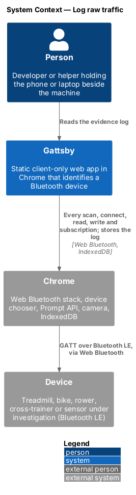
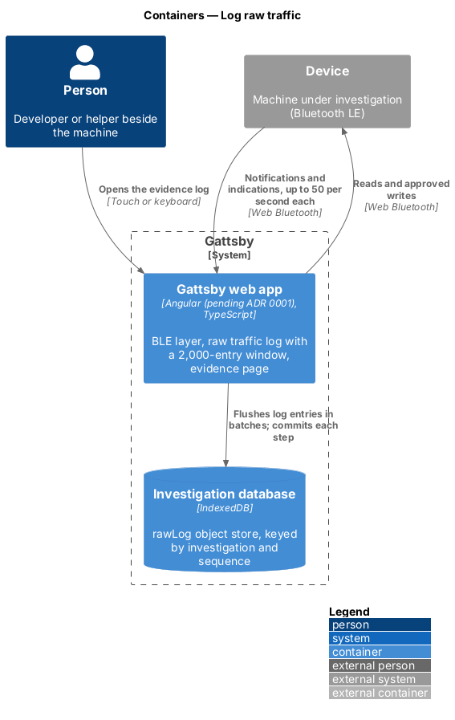
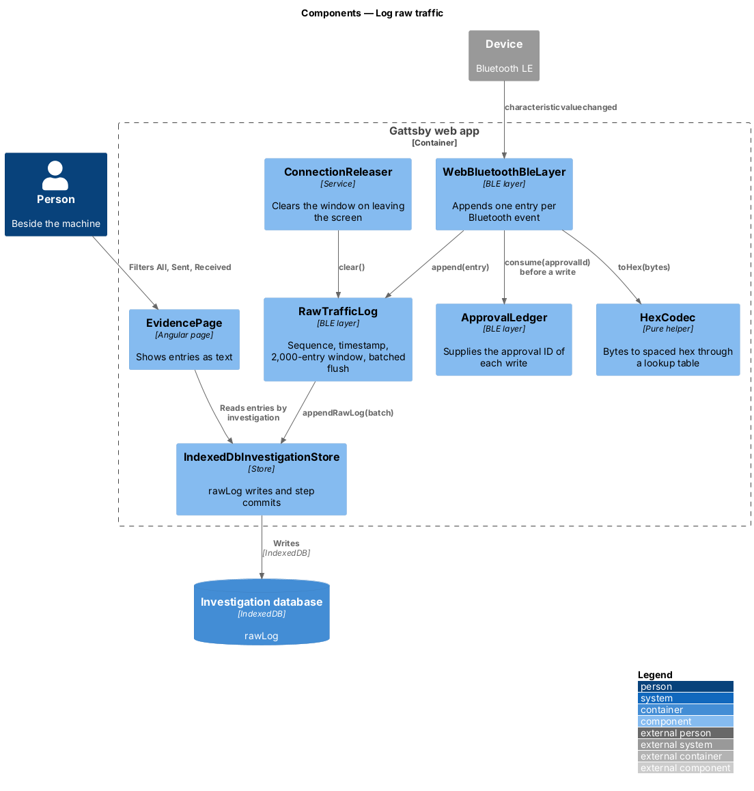
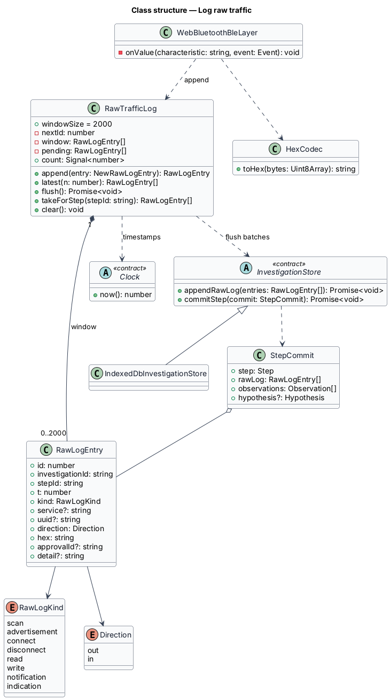
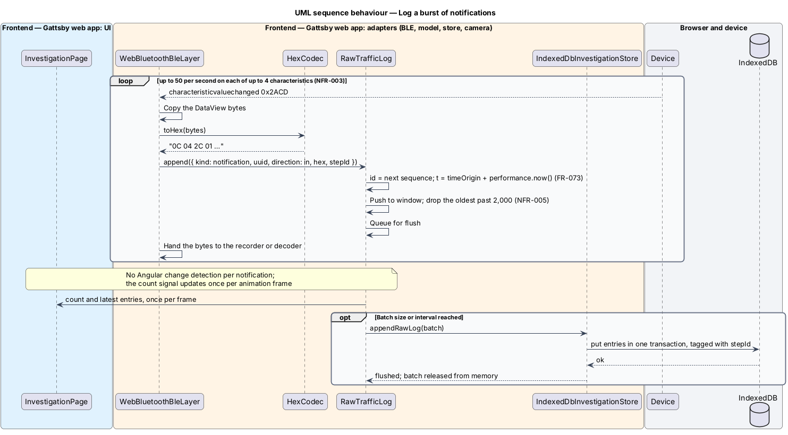
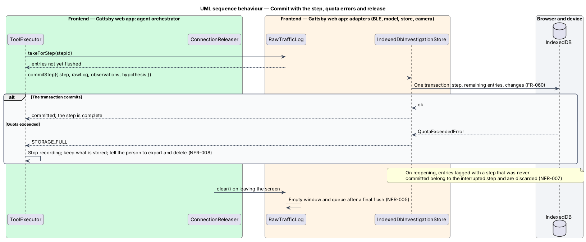

# Log raw traffic

## Overview

Every conclusion Gattsby draws about a device rests on bytes that crossed the Bluetooth link. This
feature records those bytes: every scan, connect, disconnect, read, write, notification and
indication, with a high-resolution timestamp, the characteristic, the direction and the value, and
every write with the ID of the approval that allowed it. The log is the evidence that the verdict,
the device profile and the export point back to (FR-056), and the proof that no write went out
unapproved (NFR-018). It runs underneath every stage from Find onwards.

**raw log** — append-only, ordered record of Bluetooth events in one investigation, held in the
`rawLog` object store

**raw-log entry** — one Bluetooth event with its sequence number, timestamp, kind, UUIDs, direction,
bytes in hex and, for a write, its approval ID

**window** — last 2,000 raw-log entries kept in memory for the screen; older entries live only in
IndexedDB (NFR-005)

**flush** — write of queued raw-log entries to IndexedDB in one transaction

The person reads the log on the Evidence log page (`docs/mocks/pages/evidence/default.html`):
"Horizon T202 · 412 packets · 11 steps", filters "All", "Sent", "Received", "You" and "Agent", and
rows such as "14:28:03 ← Received: 0x1826 / 0x2ACD notify, 0C 04 2C 01 08 00 00 00 00 00 00 34 00".
State `filtered` shows only sent entries, and state `empty` (`empty.html`) reads "No Bluetooth
traffic yet". That page and its decoded lines belong to the link-evidence and decode-standard-data
designs; this feature owns the entries they read.

The log has two pressures on it. A fitness machine can notify 50 times a second on several
characteristics, and an investigation can last 30 minutes, so logging shall neither drop an entry nor
grow memory without bound (NFR-003, NFR-005).

## Description

The design introduces these building blocks in the Angular (pending ADR 0001) workspace under
`frontend/src/app/`:

- **`RawTrafficLog`** (`ble/raw-traffic-log.ts`) — `append(entry)` stamps a sequence `id` and a
  timestamp `t`, pushes the entry into the window, and queues it for flush. `latest(n)` serves the
  screen; `count` is a signal updated at most once per animation frame. `takeForStep(stepId)` hands
  the step's unflushed entries to the step commit. `clear()` empties the window and queue after a
  final flush.
- **`WebBluetoothBleLayer`** (`ble/web-bluetooth-ble-layer.ts`) — the only producer. Each operation
  appends exactly one entry, except a read, which appends one entry holding the returned bytes. A
  write consumes its approval token first (see the approve-a-command design) and logs the token's ID
  in `approvalId`.
- **`HexCodec`** (`ble/hex-codec.ts`) — pure helper with unit tests; formats bytes as spaced
  upper-case hex ("0C 04 2C 01") through a 256-entry lookup table.
- **`Clock`** (`shared/clock.ts`) — `now()` returns `performance.timeOrigin + performance.now()`, a
  millisecond value with sub-millisecond fraction (FR-073). Tests inject a fake clock.
- **`InvestigationStore`** (`store/investigation-store.ts`) / **`IndexedDbInvestigationStore`** —
  `appendRawLog(entries)` writes a flush batch in one transaction; `commitStep(commit)` writes the
  step, its remaining entries and its changes in one transaction (FR-060).
- **`RawLogEntry`** (`store/model/raw-log-entry.ts`) — the data shape below.
- **`ConnectionReleaser`** (`agent/connection-releaser.ts`) — clears the log's memory when the person
  leaves the investigation screen (NFR-005; see the release-the-connection design).

### Data shape

| Field | Meaning |
|---|---|
| `id` | Sequence number, increasing within the investigation; orders entries whose `t` is equal |
| `investigationId`, `stepId` | The investigation and the step the entry belongs to |
| `t` | Timestamp in milliseconds since the epoch, with sub-millisecond fraction |
| `kind` | `scan`, `advertisement`, `connect`, `disconnect`, `read`, `write`, `notification`, `indication` |
| `service`, `uuid` | Service and characteristic UUIDs, where the event has them |
| `direction` | `out` (sent by Gattsby) or `in` (received from the device or Chrome) |
| `hex` | The bytes in hex; empty for events without a value |
| `approvalId` | The approval token's ID; present on every `write` (FR-073) |
| `detail` | Short text for events without bytes, for example the scan mode or an ATT error code |

Web Bluetooth reports notifications and indications through the same event. The BLE layer sets
`kind` from the characteristic's properties at subscription time: `indication` when it has
`indicate` and not `notify`, `notification` otherwise.

### Keeping up (NFR-003)

1. The value handler does constant work per event: copy the bytes, format the hex, append, and hand
   the bytes to the recorder or decoder. It schedules no Angular change detection; the screen reads
   `count` and `latest(n)` once per animation frame.
2. The target is 50 notifications per second per characteristic on up to 4 characteristics, with no
   entry dropped and the UI delayed by at most one frame (NFR-003).
3. Flushes run in batches, off the value handler's path. The batch size and interval are
   proposed as 200 entries or 500 ms, whichever comes first (journey 2), to be tuned from the
   NFR-003 and NFR-005 measurements.

### Staying bounded (NFR-005)

- The window holds the last 2,000 entries; older entries leave memory once flushed.
- The flush queue is bounded; its limit is 10,000 entries (proposed, journey 2). A queue that cannot drain because a write
  failed for quota stops recording (below).
- Recordings longer than 120 seconds are refused with `INVALID_INPUT` (TOOL-013), and the model's
  history is capped (see the build-the-decision-state design).
- Leaving the investigation screen flushes and clears the window, the queue and the subscriptions.

### Commit and recovery

- Entries are flushed as they arrive, tagged with their `stepId`, so a long recording never waits in
  memory for its step to end. `commitStep` writes the step's last unflushed entries with the step
  record in one transaction; only then is the step complete (FR-060).
- On reopening after a crash or tab close, entries tagged with a step that has no committed record
  belong to the interrupted step and are discarded (NFR-007; see the save-as-the-investigation-runs
  design). A step interrupted by a connection drop is committed as `interrupted` with its entries
  (see the recover-a-dropped-connection design).
- A flush or commit that fails for quota returns `STORAGE_FULL`. Recording stops, what is stored is
  kept, and the person is told to export and delete old investigations (NFR-008).

### Rendering

Every entry's `hex` and `detail`, and every UUID or name it carries, is rendered as text, never as
HTML (NFR-013).

The Evidence page merges committed raw packets with saved tool results, answers, approvals and
hypothesis versions by timestamp. It reads the raw log in bounded batches and shows 100 entries
at a time. All, Sent, Received, You and Agent operate over the selected evidence or the full
timeline.

### Tests that prove it

An acceptance spec runs the fake `navigator.bluetooth` at 50 notifications per second on 4
characteristics for 60 seconds and asserts that all 12,000 entries are in the store, in order, with
timestamps (NFR-003). The approve-a-command specs assert `approvalId` on every write. The 30-minute
heap spec of NFR-005 samples the JS heap every minute; it cannot fit CI's 5-minute budget and runs
when a person asks. Unit tests cover `HexCodec`, the window's eviction and the flush on a fake clock.

### Built in journey 2

`RawTrafficLog` keeps the 2,000-entry window, flushes batches of 200 or every 500 ms as provisional rows, and hands the rest to the step commit. Scans, connects, disconnects and reads are logged; notifications arrive with journey 3. The 12,000-notification spec of NFR-003 waits for notifications (journey 3).

## Requirements

The feature realizes the following level-2 (L2) requirements; each refines the level-1 (L1)
requirement cited beside it.

| L2 ID | Refines (L1) | Requirement |
|-------|--------------|-------------|
| [`FR-073`](../../../specs/L2.md#fr-073-log-all-raw-traffic) | `L1-016` | The BLE layer must log every scan, connect, disconnect, read, write, notification and indication with a high-resolution timestamp, the characteristic UUID, the direction and the bytes, and every write with the ID of the approval that allowed it. |
| [`NFR-003`](../../../specs/L2.md#nfr-003-keep-up-with-notifications) | `L1-019` | The BLE layer and the recorder must log and decode notifications at up to 50 per second per characteristic, across up to 4 characteristics at once, without dropping one or delaying the UI by more than one frame. |
| [`NFR-005`](../../../specs/L2.md#nfr-005-bounded-memory) | `L1-019` | Memory held during an investigation must be bounded: the model's history is capped (FR-041), raw traffic is written to IndexedDB and kept in memory only in a window of the last 2,000 entries, and a recording longer than 120 seconds is refused. Leaving the investigation screen releases its memory. |

## Diagrams

### System context

All Bluetooth traffic between Gattsby and the device passes through Chrome; Gattsby records each event
and stores it in Chrome's IndexedDB, where the person reads it as evidence.

### Containers

The web app holds a 2,000-entry window in memory and flushes every entry to the `rawLog` store in the
investigation database.

### Components

The BLE layer appends one entry per event to `RawTrafficLog`, with hex from `HexCodec` and, for a
write, the ID from `ApprovalLedger`; the log flushes to the store, which the Evidence page reads.

### Class structure

`RawTrafficLog` owns the window of `RawLogEntry`s, stamps them through the `Clock` contract and
flushes them through the `InvestigationStore` contract; `StepCommit` carries a step's last entries.

### Behaviour — log a burst of notifications

Each notification is copied, formatted, stamped and appended in constant time; the screen updates
once per frame, and batches flush to IndexedDB tagged with their step.

### Behaviour — commit with the step, quota errors and release

The step commit writes the last entries with the step in one transaction; a quota error stops
recording; leaving the screen clears the log's memory.

