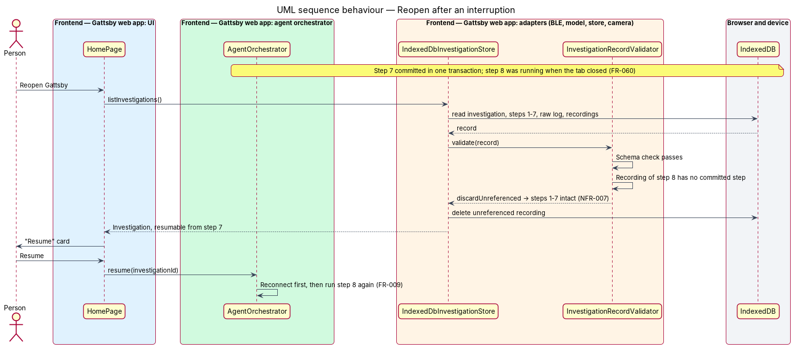

# Recover a dropped connection

## Overview

Bluetooth Low Energy links drop: the person walks away with the phone, the console goes to sleep, or
the machine's radio resets. A drop in the middle of a recording would otherwise leave half a step in
the investigation record and the agent acting on a device that is no longer there. This feature
notices every unexpected disconnect, pauses the agent loop, records the drop, reconnects up to three
times with growing delays, restores the notification subscriptions, and repeats the step that was
interrupted. It also makes sure no drop, tab close, crash or model failure leaves the investigation
record unreadable. It belongs to the connection subsystem and can run in any stage after the
[connect to the device](../connect-to-the-device/README.md) design has opened the link.

**unexpected disconnect** — `gattserverdisconnected` event that Gattsby did not ask for

**interrupted step** — step that was running when the drop happened; its partial results are
discarded and the step is run again after the reconnect

**backoff schedule** — delays before each reconnect attempt: 1, 2 and 4 seconds

**subscription** — active notification or indication on one characteristic, with its listener, that
the BLE layer restores after a reconnect

**atomic step commit** — single IndexedDB transaction that writes a completed step, its raw traffic
and any hypothesis change together, or writes nothing (FR-060)

While reconnecting, the investigation screen shows the warning banner "Connection dropped 6 s into the
recording." with "Reconnecting, attempt 2 of 3. I'll repeat this step and ignore the partial data.",
and the prompt card reads "Paused while reconnecting." (`docs/mocks/notifications/connection-banner/warning.html`).
On success, the success banner reads "Reconnected after 2 tries." with "Repeating the step that was
interrupted; its partial data was dropped." (`success.html`). After three failures, the persistent
danger banner reads "Couldn't reconnect after 3 tries." with "Check the treadmill is on and within a
few metres. Everything so far is saved." and offers "Try again" and "Stop" (`danger.html`). The
emergency stop stays available throughout.

## Description

The design introduces these building blocks in the Angular (pending ADR 0001) workspace under
`frontend/src/app/`:

- **`ConnectionSupervisor`** (`agent/connection-supervisor.ts`) — subscribes to
  `BleLayer.disconnected$` for the life of the investigation and ignores events marked `expected`. On
  an unexpected disconnect it asks `HeldDeviceDetector` whether the drop points to another central
  (see the [detect a held device](../detect-a-held-device/README.md) design). Otherwise it pauses the
  loop, runs `reconnect` through `ToolExecutor`, drives `ConnectionBanner`, and resumes the loop. It
  unsubscribes and cancels its timers when the investigation ends.
- **`AgentOrchestrator.pause(reason)` and `resume({ repeatStep })`** (`agent/agent-orchestrator.ts`) —
  `pause` aborts the current step's `AbortController`. The step ends with `ABORTED` and is never
  committed. `resume({ repeatStep: true })` runs the same action with the same input again.
- **`ReconnectTool`** (`tools/connection/reconnect.tool.ts`) — the `reconnect` tool, safety class
  `read`. It refuses with `PRECONDITION_FAILED` unless a `connected` observation exists for
  `deviceId` in this investigation. It runs up to `attempts` (1–3, default 3) attempts on the backoff
  schedule and returns the number of attempts and the restored subscriptions.
- **`ReconnectPolicy`** (`ble/reconnect-policy.ts`) — pure helper: `delayBefore(attempt)` returns
  1000, 2000 or 4000 ms. `ReconnectTool` waits on `Clock` (`shared/clock.ts`, see the
  connect-to-the-device design), so unit tests advance a fake clock.
- **`WebBluetoothBleLayer.reconnect`** (`ble/web-bluetooth-ble-layer.ts`) — calls `gatt.connect()`
  with the connect timeout of TOOL-006 (10 seconds), then asks `SubscriptionRegistry` to restore every
  subscription. An attempt counts as failed when any subscription cannot be restored; the layer then
  disconnects before the next attempt.
- **`SubscriptionRegistry`** (`ble/subscription-registry.ts`) — records each active subscription
  (service UUID, characteristic UUID, listener) as it starts and stops. `restore(server)` fetches
  fresh service and characteristic handles, since handles from before the drop are no longer valid,
  calls `startNotifications()` and adds the listener again. `clear()` empties it on disconnect by
  request.
- **`RawTrafficLog`** (`ble/raw-traffic-log.ts`) — receives a `disconnect` entry for the drop, with its
  timestamp and `expected: false`, and one `connect` entry per attempt (FR-073).
- **`ConnectionBanner`** (`notifications/connection-banner/connection-banner.ts`, from the
  connect-to-the-device design) — shows the `warning`, `success` and `danger` tones.
- **`IndexedDbInvestigationStore.commitStep`** (`store/indexed-db-investigation-store.ts`) — writes a
  step, its raw-log entries, observations and hypothesis change in one IndexedDB transaction (the
  [save as it runs](../../persistence/save-as-it-runs/README.md) design).
- **`InvestigationRecordValidator`** (`store/investigation-record-validator.ts`) — pure helper with
  unit tests. On reopening, it checks an investigation against the record schema, and discards any
  recording, photo or raw-log chunk that no committed step references.

### Rules

1. Only an unexpected disconnect starts recovery. `disconnect()` marks its own event `expected`, so
   releasing the connection never triggers a reconnect.
2. On the drop, the loop pauses before anything else runs, and the drop is in the raw log with its
   timestamp. The first attempt follows 1 second later (FR-016 AC1).
3. The interrupted step's recording and observations are discarded. Its raw-log entries from before
   the drop are kept, tagged with the interrupted step's ID and `interrupted: true`, so the raw log
   stays complete (FR-073).
4. The recovery is committed as its own step: the drop entry, each attempt, and the restored
   subscriptions, in one transaction (NFR-007).
5. On success, every earlier subscription is active again before the loop resumes. The loop then
   repeats the interrupted step from its start (FR-016 AC2). A step that needs the person, such as a
   "Ready" prompt, posts its prompt again.
6. A repeated `write` or `control` step asks for a new approval. The approval of the interrupted call
   was consumed or revoked with it, and an approval covers one call
   ([approve a command](../../device-control/approve-a-command/README.md), rule 1).
7. After the third failed attempt, the danger banner stays until the person chooses (FR-016 AC3).
   "Try again" runs `reconnect` again with 3 attempts. "Stop" opens the stop dialog of the
   [stop, pause and resume](../../investigation/stop-pause-and-resume/README.md) design.
8. Stop, emergency stop and leaving the screen abort a recovery in progress: pending timers are
   cleared and no further attempt runs.
9. A model call that fails or times out ends its step without a commit, in the same way, so a model
   failure also leaves no partial step (NFR-007).

### Data shapes

| Type | Fields |
|---|---|
| `ReconnectInput` | `deviceId`, `attempts?` (1–3, default 3) |
| `ReconnectResult` (tool output) | `connected`, `attempts`, `restoredSubscriptions: string[]` |
| `Subscription` | `serviceUuid`, `characteristicUuid`, `listener`, `startedAt` |
| `ConnectionRecovery` (step data) | `dropAt`, `interruptedStepId`, `attempts: { at, ok, error? }[]`, `restoredSubscriptions` |

### Errors

| Code | Raised by | Meaning to the person |
|---|---|---|
| `CONNECTION_FAILED` | `ReconnectTool` | "Couldn't reconnect after 3 tries. Check the treadmill is on and within a few metres. Everything so far is saved." |
| `PRECONDITION_FAILED` | `ReconnectTool` | Never shown; the device was never connected in this investigation. |
| `ABORTED` | `AgentOrchestrator.pause` | Not shown as an error; the warning banner explains that the step will be repeated. |

### Tests that prove it

The acceptance spec `e2e/connection/recover-a-dropped-connection.spec.ts` uses the fake
`navigator.bluetooth`, whose FTMS treadmill can be told to drop, and the `InvestigationPage` page
object. It drops the treadmill during a recording with two subscriptions, checks the warning banner,
advances Playwright's clock by 1 second, and checks that both subscriptions deliver notifications
again and that the interrupted step runs again. A second spec makes every attempt fail and checks the
danger banner with "Try again" and "Stop". A third spec, run locally, interrupts 50 investigations at
a seeded random step by a drop or a page reload, then reopens each and checks that it validates and
can be resumed or concluded (NFR-007); CI runs one seed. Unit tests cover `ReconnectPolicy`,
`ReconnectTool` with a fake clock, `SubscriptionRegistry.restore`, and `InvestigationRecordValidator`.

## Requirements

The feature realizes the following level-2 (L2) requirements; each refines the level-1 (L1)
requirement cited beside it.

| L2 ID | Refines (L1) | Requirement |
|-------|--------------|-------------|
| [`FR-016`](../../../specs/L2.md#fr-016-recover-from-a-dropped-connection) | `L1-005` | On an unexpected disconnect Gattsby must pause the agent loop, record the drop in the raw log, try to reconnect up to 3 times with growing delays (1, 2 and 4 seconds), restore notification subscriptions, and resume. If every attempt fails it must ask the person to check the device and offer to retry or stop. |
| [`NFR-007`](../../../specs/L2.md#nfr-007-survive-connection-drops-without-corruption) | `L1-020` | No connection drop, tab close, crash or model failure may leave an investigation unreadable or inconsistent: each step is committed atomically (FR-060), and a partly written step is detectable and discarded on reopening. |
| [`TOOL-007`](../../../specs/L2.md#tool-007-reconnect) | `L1-005` | Reconnects after a drop with up to 3 attempts at 1, 2 and 4 seconds, and restores the earlier notification subscriptions. |

## Diagrams

### System context

The device drops the link; Chrome reports the disconnect to Gattsby, which reconnects through Chrome
and tells the person what is happening.

### Containers

The web app reconnects to the device through Web Bluetooth and commits the recovery step, with the
drop and each attempt, to the investigation database in one transaction.

### Components

`ConnectionSupervisor` listens to the BLE layer's disconnect stream, pauses the orchestrator, runs
`ReconnectTool`, and drives the connection banner; the BLE layer restores subscriptions through
`SubscriptionRegistry`.

### Class structure

`ReconnectTool` uses `ReconnectPolicy` and `Clock` for the backoff schedule; `WebBluetoothBleLayer`
owns a `SubscriptionRegistry` of `Subscription`s that it restores after each successful connect.

### Behaviour — drop, reconnect and repeat the step

The treadmill drops during a recording; the loop pauses, the first attempt fails, the second succeeds
after 2 seconds, both subscriptions are restored, and the interrupted step runs again.

### Behaviour — every attempt fails

All three attempts fail; the danger banner asks the person to check the device and offers "Try
again", which starts three more attempts, or "Stop".

### Behaviour — reopen after an interruption

After a crash or page reload, the store opens the investigation, the validator discards anything no
committed step references, and the investigation can be resumed with a reconnect or concluded.

