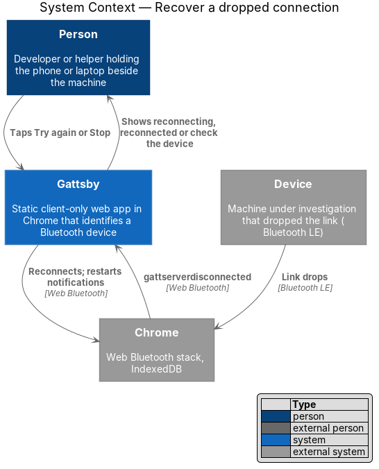
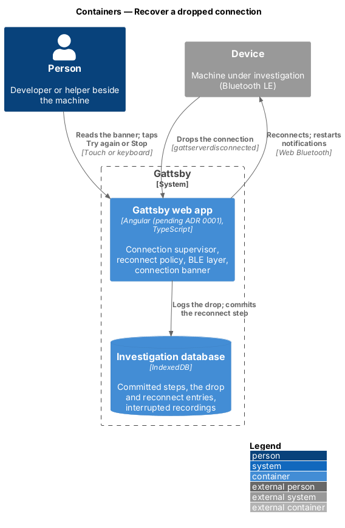
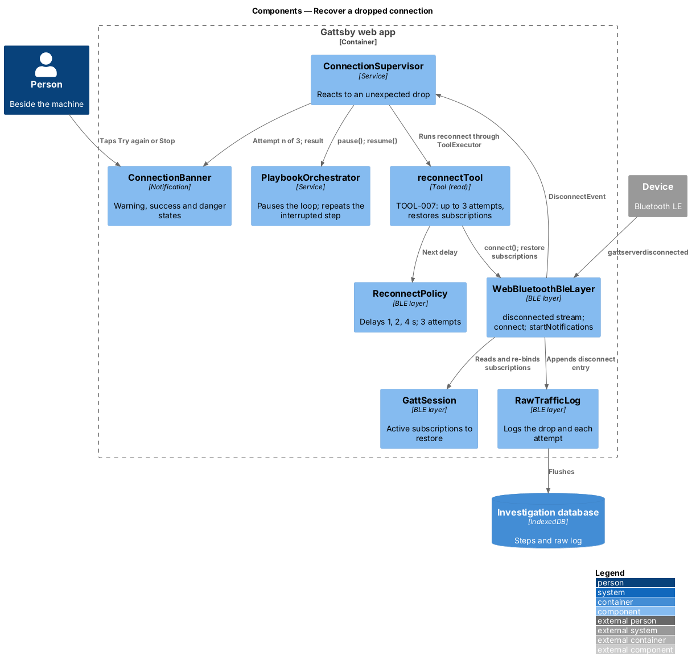
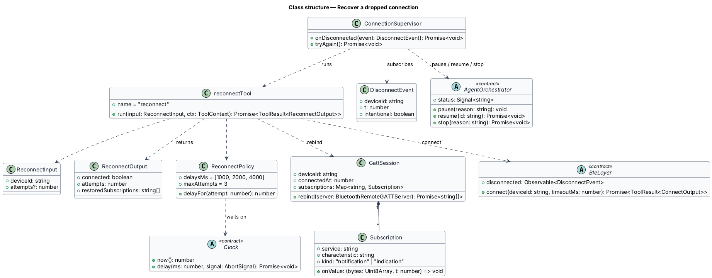
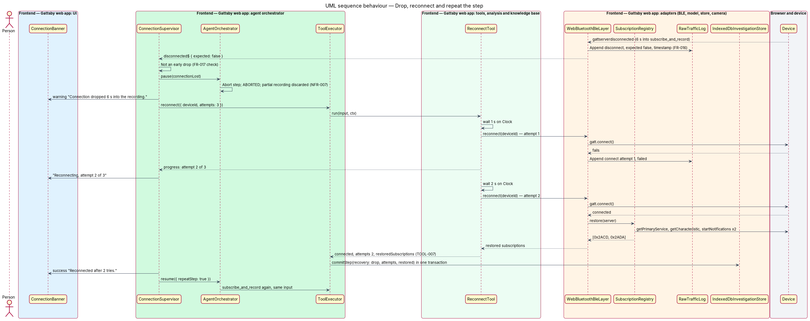
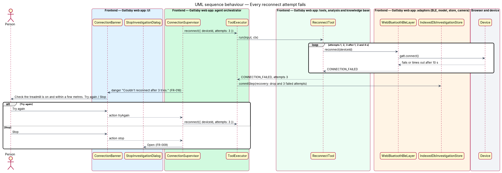

# Recover a dropped connection

## Overview

Bluetooth Low Energy connections drop: the person walks out of range, the console sleeps, or the
machine's radio resets. A drop can come at any stage after connect, often in the middle of a
recording. This feature keeps an investigation whole through a drop. It pauses the agent loop,
records the drop, reconnects with growing delays, restores the notification subscriptions, and
repeats the step the drop interrupted. When every attempt fails, the person decides whether to try
again or stop.

**unexpected drop** — disconnect that Gattsby did not ask for; a release by the
release-the-connection design is intentional and is not a drop

**subscription** — active notification or indication on one characteristic, held by the
`GattSession` so that it can be restarted after a reconnect

**interrupted step** — step that was running when the drop happened; it is never committed as
complete and is repeated after the reconnect

The person follows the drop in the connection banner on the Investigation page. State `warning`
(`docs/mocks/notifications/connection-banner/warning.html`) reads "Connection dropped 6 s into the
recording." and "Reconnecting, attempt 2 of 3. I'll repeat this step and ignore the partial data."
State `success` (`success.html`) reads "Reconnected after 2 tries." and "Repeating the step that was
interrupted; its partial data was dropped." State `danger` (`danger.html`) reads "Couldn't reconnect
after 3 tries." and "Check the treadmill is on and within a few metres. Everything so far is saved.",
with "Try again" and "Stop".

## Description

The design introduces these building blocks in the Angular (pending ADR 0001) workspace under
`frontend/src/app/`:

- **`ConnectionSupervisor`** (`agent/connection-supervisor.ts`) — subscribes to the BLE layer's
  `disconnected` stream. On an unexpected drop that is not a quick drop (see the
  connect-to-the-device design) it pauses the orchestrator, runs `reconnect` through `ToolExecutor`,
  drives `ConnectionBanner`, and resumes or offers "Try again" and "Stop".
- **`reconnectTool`** (`tools/connection/reconnect.tool.ts`) — registry entry for `reconnect`
  (TOOL-007), safety class `read`. Input `{ deviceId, attempts?: 1–3 }`; output
  `{ connected, attempts, restoredSubscriptions: [uuid] }`. Precondition: the device was connected
  earlier in this investigation, else `PRECONDITION_FAILED`.
- **`ReconnectPolicy`** (`ble/reconnect-policy.ts`) — the delays before attempts 1, 2 and 3: 1, 2 and
  4 seconds; at most 3 attempts. It waits on an injected `Clock` (`shared/clock.ts`), so unit tests
  advance a fake clock instead of sleeping.
- **`GattSession`** (`ble/gatt-session.ts`) — holds the `Subscription`s
  (`ble/subscription.ts`: service, characteristic, kind, value handler). `rebind(server)` resolves
  each characteristic again on the new connection, calls `startNotifications()` and re-attaches the
  `characteristicvaluechanged` listener, returning the UUIDs restored. The Web Bluetooth layer
  holds the subscription descriptions so they survive the loss of the browser's GATT handles.
- **`WebBluetoothBleLayer`** (`ble/web-bluetooth-ble-layer.ts`) — turns `gattserverdisconnected` into a
  `DisconnectEvent` (`deviceId`, `t`, `intentional`), appends a `disconnect` entry to
  `RawTrafficLog`, and reconnects through `connect(deviceId, timeoutMs)`.
- **`PlaybookOrchestrator`** (`agent/playbook-orchestrator.ts`) — `pause(reason)` aborts the running
  tool's `AbortSignal` and any pending model call, and sets `status` to paused; resuming repeats the
  interrupted action.
- **`ConnectionBanner`** (`notifications/connection-banner/connection-banner.component.ts`) — renders
  the `warning`, `success` and `danger` states and emits "Try again" and "Stop".

### Recovery rules

1. A drop is logged in the raw log with its high-resolution timestamp before anything else happens
   (FR-016, FR-073).
2. The loop pauses at once. No new tool runs and no model call is made until the reconnect ends.
3. The first attempt starts 1 second after the drop; the next two follow at 2 and 4 seconds
   (FR-016, TOOL-007). Each attempt uses `connect`'s default timeout of 10,000 ms.
4. After a successful reconnect every data subscription active before the drop is restarted and
   listed in `restoredSubscriptions` (TOOL-007). The FTMS Control Point exchange has its own
   lifecycle and is released when its connection drops.
5. The reconnect restores notifications only. It replays no write and restores no control session.
   A device that granted control before the drop needs a new `request_control`, with a new approval
   (see the approve-a-command and request-control designs).
6. The loop resumes by repeating the interrupted read, listen, or person prompt (FR-016).
   Reconnect cycles and interrupted steps remain in the investigation record. They do not consume
   the action or no-progress budgets. An interrupted write or control step is never replayed.
7. After 3 failed attempts the banner offers "Try again", which runs another cycle of 3 attempts, and
   "Stop", which stops the investigation with the verdict *Stopped by the person* (FR-009).
8. Emergency stop during a reconnect aborts it and stops the loop (see the emergency-stop design).

### What a drop does to the record

- Every step committed before the drop stays intact, because each step commits in one transaction
  (FR-060, NFR-007; see the save-as-the-investigation-runs design).
- The executor commits the interrupted step marked `interrupted`, with its raw-log entries, so the
  export shows the traffic up to the drop (FR-016, FR-060). A recording interrupted by the drop keeps
  what arrived and is marked `interrupted` (TOOL-013); it is evidence of the drop but is not
  analysed. The repeated step records afresh. The banner's "its partial data was dropped" means it is
  left out of analysis.
- A crash or tab close, unlike a drop, leaves no chance to commit; the step in progress is then
  discarded on reopening (NFR-007; see the log-raw-traffic design).

### Errors

| Code | Raised by | Meaning to the person |
|---|---|---|
| `CONNECTION_FAILED` | `reconnectTool` | "Couldn't reconnect after 3 tries." with "Try again" and "Stop" |
| `PRECONDITION_FAILED` | `reconnectTool` | None shown; the device was never connected |
| `ABORTED` | The interrupted tool | None shown; the step is repeated after the reconnect |

### Tests that prove it

Acceptance specs drop the fake FTMS treadmill during a recording and accept the second attempt.
They assert that the loop waits, the drop appears in the raw log and the recording repeats. A
second script refuses all attempts and verifies that Try again starts a fresh cycle and Stop
ends the investigation. Unit tests advance a fake clock through the delays and verify that the
Bluetooth adapter restores two simultaneous subscriptions and receives packets on both.

## Requirements

The feature realizes the following level-2 (L2) requirements; each refines the level-1 (L1)
requirement cited beside it.

| L2 ID | Refines (L1) | Requirement |
|-------|--------------|-------------|
| [`FR-016`](../../../specs/L2.md#fr-016-recover-from-a-dropped-connection) | `L1-005` | On an unexpected disconnect Gattsby must pause the agent loop, record the drop in the raw log, try to reconnect up to 3 times with growing delays (1, 2 and 4 seconds), restore notification subscriptions, and resume. If every attempt fails it must ask the person to check the device and offer to retry or stop. |
| [`TOOL-007`](../../../specs/L2.md#tool-007-reconnect) | `L1-005` | Reconnects after a drop with up to 3 attempts at 1, 2 and 4 seconds, and restores the earlier notification subscriptions. |

## Diagrams

### System context

The device drops the connection; Gattsby reconnects through Chrome's Web Bluetooth stack and keeps the
person informed until it succeeds or the person decides.

### Containers

The web app logs the drop and the reconnect to the investigation database and restores the
notifications on the device.

### Components

The BLE layer reports the drop to `ConnectionSupervisor`, which pauses the orchestrator and runs
`reconnectTool`; the tool follows `ReconnectPolicy` and rebinds the `GattSession`'s subscriptions.

### Class structure

`reconnectTool` depends on `ReconnectPolicy`, the `BleLayer` contract and `GattSession`, which owns
the `Subscription`s; `ConnectionSupervisor` drives the `AgentOrchestrator` contract.

### Behaviour — drop, reconnect and resume

The drop is logged, the loop pauses, the second attempt succeeds, both subscriptions are restored,
and the interrupted step is repeated.

### Behaviour — three reconnects fail

After attempts at 1, 2 and 4 seconds all fail, the banner offers "Try again", which starts a new
cycle, and "Stop", which ends the investigation.

