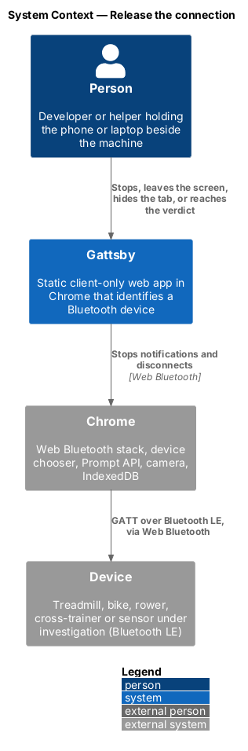
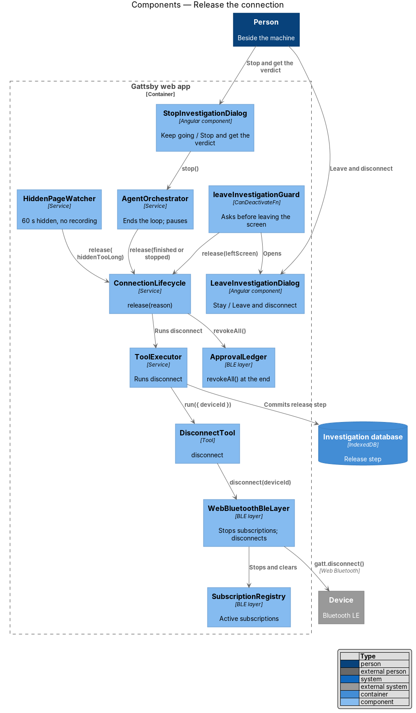
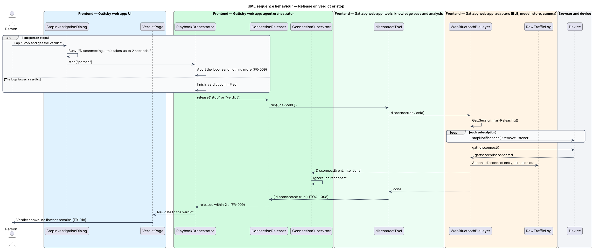
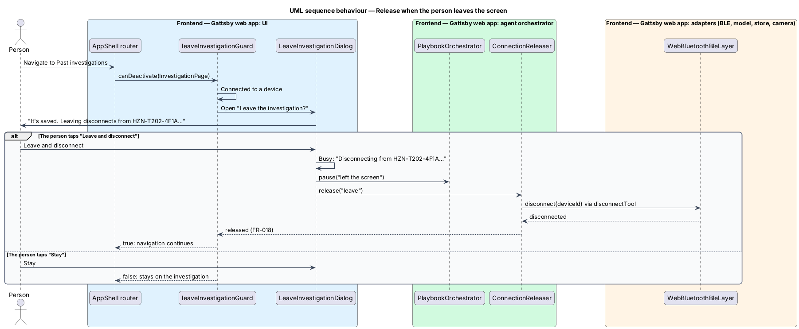

# Release the connection

## Overview

Most machines accept one central at a time, so a connection Gattsby keeps open blocks the store's own
app and the next person. Open notifications also hold memory and battery. This feature lets go of the
device whenever Gattsby no longer needs it: when the verdict is issued, when the person stops the
investigation, when the person leaves the investigation screen, and when the page has been hidden for
more than 60 seconds with no recording running. It belongs to the Conclude stage, but a release can
happen at any stage.

**release** — intentional end of the connection: every notification stopped, every listener
removed, then `gatt.disconnect()`

**hidden-page release** — release that follows 60 seconds of `document.visibilityState` being
`hidden` while no recording runs

The person meets the release in three places. The Stop the investigation dialog
(`docs/mocks/dialogs/stop-investigation/default.html`) says "I'll send nothing more, disconnect from
HZN-T202-4F1A, and give you a verdict from what's known so far. Everything is kept."; its `busy` state
(`busy.html`) reads "Disconnecting… this takes up to 2 seconds." The Leave the investigation dialog
(`docs/mocks/dialogs/leave-investigation/default.html`) says "It's saved. Leaving disconnects from
HZN-T202-4F1A; resume it from the home screen later, with a reconnect.", with "Stay" and "Leave and
disconnect"; its `busy` state reads "Disconnecting from HZN-T202-4F1A…". The Verdict page
(`docs/mocks/pages/verdict/default.html`) appears only after the device is disconnected.

## Description

The design introduces these building blocks in the Angular (pending ADR 0001) workspace under
`frontend/src/app/`:

- **`ConnectionReleaser`** (`agent/connection-releaser.ts`) — the one service that decides to
  release. `release(reason)` takes `verdict`, `stop`, `leave`, `hidden` or `pagehide`. It owns the
  hidden-page timer and listens to `visibilitychange`, `pagehide` and the recorder's running state.
- **`disconnectTool`** (`tools/connection/disconnect.tool.ts`) — registry entry for `disconnect`
  (TOOL-008), safety class `read`. Input `{ deviceId }`; output `{ disconnected: true }`. It has no
  precondition and no error: it is idempotent and returns the same result when nothing is connected.
- **`WebBluetoothBleLayer.disconnect(deviceId)`** (`ble/web-bluetooth-ble-layer.ts`) — marks the
  `GattSession` as releasing, calls `stopNotifications()` and removes the value listener for every
  subscription, calls `gatt.disconnect()`, removes the `gattserverdisconnected` listener, appends a
  `disconnect` entry (direction out) to `RawTrafficLog`, and clears the session.
- **`GattSession`** (`ble/gatt-session.ts`) — `markReleasing()` sets `state` to `releasing`, so the
  resulting `DisconnectEvent` carries `intentional: true`.
- **`ConnectionSupervisor`** (`agent/connection-supervisor.ts`) — ignores intentional disconnects;
  a release never starts the recover-a-dropped-connection flow.
- **`leaveInvestigationGuard`** (`pages/investigation/leave-investigation.guard.ts`) — `CanDeactivate`
  guard on the Investigation route. While a device is connected it opens `LeaveInvestigationDialog`;
  "Leave and disconnect" pauses the loop, releases, and lets the navigation continue; "Stay" cancels
  it. The orchestrator's own navigation to the Verdict page passes without the dialog.
- **`LeaveInvestigationDialog`** (`dialogs/leave-investigation/leave-investigation.dialog.ts`) and
  **`StopInvestigationDialog`** (`dialogs/stop-investigation/stop-investigation.dialog.ts`) —
  presentation components with `default` and `busy` states. The stop flow itself belongs to the
  stop-pause-and-resume design.
- **`PlaybookOrchestrator`** (`agent/playbook-orchestrator.ts`) — calls `release('verdict')` after the
  verdict is committed and `release('stop')` after a stop, before it navigates to the Verdict page.

### Release rules

1. Order: mark releasing, stop each notification, remove each listener, disconnect, log. A failed
   `stopNotifications()` is logged and does not block the disconnect.
2. A stop disconnects within 2 seconds (FR-009). The per-call time limit for `stopNotifications()`
   inside that budget is `<TO SUPPLY>`; when it is spent, the layer disconnects anyway.
3. When the Verdict page appears, the device is disconnected and no notification listener remains
   (FR-018).
4. Navigating away from a connected investigation, by link, back button or menu, goes through the
   guard and its dialog (FR-018).
5. The hidden-page timer starts when the page becomes hidden with no recording running, or when a
   recording ends while the page is hidden; it stops when the page becomes visible. After 60 seconds
   it pauses the loop and releases (FR-018). Chrome throttles timers in hidden tabs, so the release
   may come later than 60 seconds, never earlier.
6. A released investigation is paused, not ended. Resuming it starts with a reconnect (FR-009; see
   the connect-to-the-device design).
7. On `pagehide` the releaser calls `disconnect` without waiting; Chrome also closes the connection
   when the tab closes.
8. Leaving the screen also frees the investigation's memory: the raw-log window, subscriptions and
   timers (NFR-005; see the log-raw-traffic design).

### Tests that prove it

Acceptance specs use the fake `navigator.bluetooth`, which reports open listeners and
`gatt.connected`. They assert that the Verdict page shows with the device disconnected and no
listener left, that navigating to Past investigations during an investigation shows the dialog and
disconnects on "Leave and disconnect", and that "Stay" keeps the connection. A unit test drives the
hidden-page timer with a fake clock and a fake visibility source.

### Built in journey 2

The orchestrator disconnects after committing the verdict and before opening the Verdict page, and the Investigation page releases the connection and the raw log's memory when it is destroyed, so leaving by the back link or the brand disconnects. Not built yet: `leaveInvestigationGuard` and the leave and stop dialogs, and the hidden-page timer (journey 11). Until then leaving disconnects without asking.

## Requirements

The feature realizes the following level-2 (L2) requirements; each refines the level-1 (L1)
requirement cited beside it.

| L2 ID | Refines (L1) | Requirement |
|-------|--------------|-------------|
| [`FR-018`](../../../specs/L2.md#fr-018-release-the-connection) | `L1-005` | Gattsby must stop notifications and disconnect when the investigation finishes or is stopped, when the person leaves the investigation screen, and when the page is hidden for more than 60 seconds with no recording running. |
| [`TOOL-008`](../../../specs/L2.md#tool-008-disconnect) | `L1-005` | Stops every notification and disconnects. |

## Diagrams

### System context

When the person stops, leaves, hides the page or reaches the verdict, Gattsby stops notifications and
disconnects through Chrome's Web Bluetooth stack.

### Containers

The web app disconnects from the device and commits the disconnect to the investigation database.

### Components

The orchestrator, the leave guard and its dialog all ask `ConnectionReleaser` to release; the
releaser runs `disconnectTool`, and `ConnectionSupervisor` sees the session as releasing and does not
reconnect.

### Class structure

`ConnectionReleaser` maps each `ReleaseReason` to one run of `disconnectTool`, which depends on the
`BleLayer` contract; `GattSession.markReleasing()` is what makes the disconnect intentional.

### Behaviour — release on verdict or stop

A stop or a verdict leads to one release: notifications stop, the device disconnects within 2
seconds, the supervisor ignores the event, and the Verdict page appears.

### Behaviour — release when the person leaves the screen

The guard opens the leave dialog; "Leave and disconnect" releases before the navigation continues,
and "Stay" keeps the investigation open.

### Behaviour — release after 60 seconds hidden

A hidden page with no recording running is released after 60 seconds; returning sooner cancels the
timer, and a running recording postpones it.

