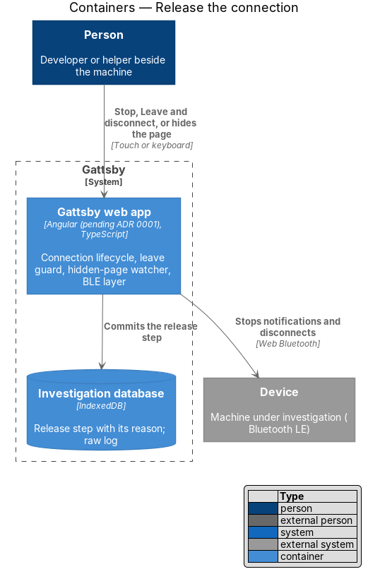
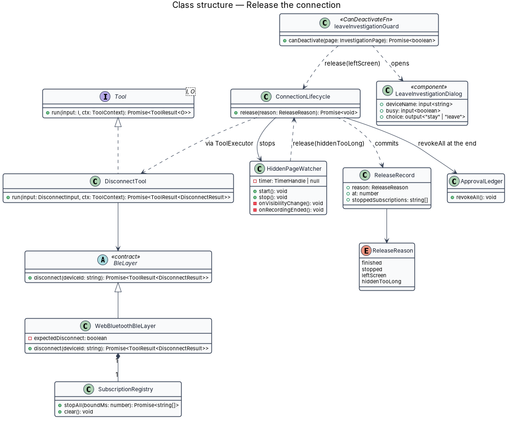
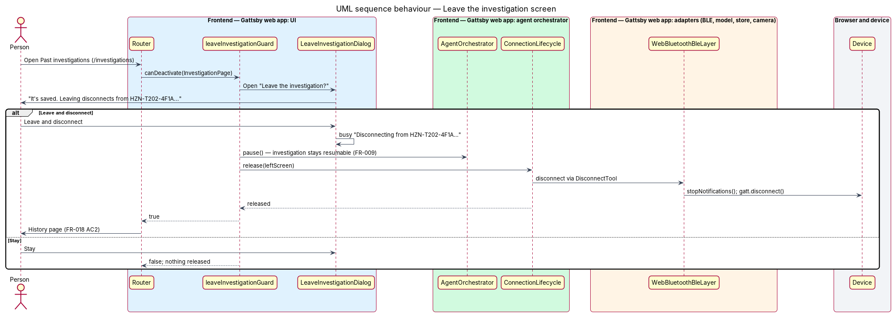
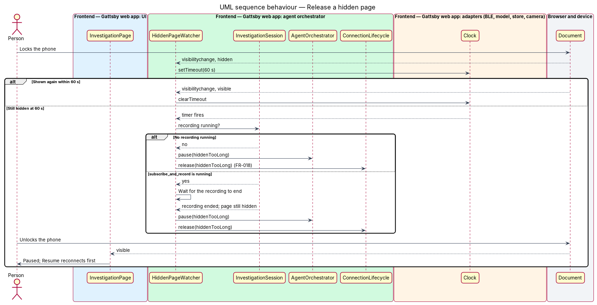

# Release the connection

## Overview

A machine in a store usually accepts one Bluetooth Low Energy central. While Gattsby holds the
connection, the gym's app, the next customer's phone and the console's own app cannot connect. An
open connection also keeps notification listeners and timers alive in the page. This feature
releases the connection whenever Gattsby no longer needs it: when the investigation finishes or is
stopped, when the person leaves the investigation screen, and when the page has been hidden for more
than 60 seconds with no recording running. Releasing means stopping every notification, removing
every listener, and disconnecting. It belongs to the connection subsystem and closes every path out
of an investigation that the [connect to the device](../connect-to-the-device/README.md) design opened.

**release** — stopping every notification, removing their listeners, and disconnecting the GATT
connection, in that order, without triggering a reconnect

**release reason** — why a release happened: `finished`, `stopped`, `leftScreen` or `hiddenTooLong`,
recorded with the release step

**hidden page** — page whose `document.visibilityState` is `hidden`, for example a phone with its
screen locked or a laptop with another tab in front

**recording** — a running `subscribe_and_record` or `baseline_vs_activity` call, which a hidden page
does not interrupt

The verdict screen appears only after the release, so the device is already disconnected when the
person reads the verdict (`docs/mocks/pages/verdict/loading.html`). Stopping shows "Stop this
investigation?" and, while releasing, "Disconnecting… this takes up to 2 seconds."
(`docs/mocks/dialogs/stop-investigation/busy.html`). Leaving shows "Leave the investigation?" with
"It's saved. Leaving disconnects from HZN-T202-4F1A; resume it from the home screen later, with a
reconnect.", "Stay" and "Leave and disconnect", then "Disconnecting from HZN-T202-4F1A…"
(`docs/mocks/dialogs/leave-investigation/default.html` and `busy.html`).

## Description

The design introduces these building blocks in the Angular (pending ADR 0001) workspace under
`frontend/src/app/`:

- **`DisconnectTool`** (`tools/connection/disconnect.tool.ts`) — the `disconnect` tool, safety class
  `read`. It has no precondition, returns `{ disconnected: true }` whether or not a connection was
  open, and raises no error.
- **`WebBluetoothBleLayer.disconnect`** (`ble/web-bluetooth-ble-layer.ts`) — marks the coming
  `gattserverdisconnected` event `expected`, so no reconnect starts. For each entry in
  `SubscriptionRegistry` it calls `stopNotifications()` and removes the listener, then empties the
  registry. It calls `device.gatt.disconnect()`, removes the disconnect listener, aborts any read or
  subscribe still pending, appends a `disconnect` entry with `expected: true` to `RawTrafficLog`, and
  sets the connection state to `disconnected`.
- **`ConnectionLifecycle`** (`agent/connection-lifecycle.ts`) — the one place that decides when to
  release. `release(reason)` runs `disconnect` through `ToolExecutor`, commits the release step with
  its reason, stops `ConnectionSupervisor` and `HiddenPageWatcher`, and, when the investigation ends,
  calls `ApprovalLedger.revokeAll()`.
- **`HiddenPageWatcher`** (`agent/hidden-page-watcher.ts`) — listens for `visibilitychange`. When the
  page is hidden it starts a 60-second `Clock` timer, and cancels it when the page is shown again. At
  60 seconds, or later when a running recording ends while the page is still hidden, it asks
  `AgentOrchestrator` to pause and `ConnectionLifecycle` to release with `hiddenTooLong`. It removes
  its listener when the investigation ends.
- **`leaveInvestigationGuard`** (`pages/investigation/leave-investigation.guard.ts`) — `CanDeactivateFn`
  on the investigation route. While an investigation is running it opens `LeaveInvestigationDialog`
  and lets the navigation proceed only after "Leave and disconnect" and the release.
- **`LeaveInvestigationDialog`** (`dialogs/leave-investigation/leave-investigation.dialog.ts`) and
  **`StopInvestigationDialog`** (`dialogs/stop-investigation/stop-investigation.dialog.ts`) —
  presentation components. Input: the device name and a `busy` flag. Output: the person's choice.
- **`VerdictService`** (`outcome/verdict.service.ts`) — on any end of the loop, issues the verdict;
  `AgentOrchestrator` then calls `ConnectionLifecycle.release('finished')` before it navigates to
  `VerdictPage`.

### Rules

1. Every end of an investigation releases the connection: `finish`, every other stop condition of
   FR-045, stop by the person (FR-009), and emergency stop (the
   [emergency stop](../../device-control/emergency-stop/README.md) design).
2. On a verdict, the release completes before `VerdictPage` is shown (FR-018 AC1).
3. On "Stop and get the verdict", the release completes within 2 seconds (FR-009 AC1). Each
   `stopNotifications()` call is bounded so that `gatt.disconnect()` runs inside that time even if
   the device does not answer.
4. Leaving the investigation screen by any route, the browser's back button included, goes through
   `leaveInvestigationGuard` (FR-018 AC2). "Stay" cancels the navigation and releases nothing. The
   investigation stays saved and is resumed later with a reconnect (FR-009).
5. A hidden page is released only after more than 60 seconds hidden with no recording running. A
   recording that is running at 60 seconds finishes; the release follows when it ends, if the page is
   still hidden. Showing the page again before then cancels the timer.
6. A release for `hiddenTooLong` pauses the investigation. When the page is shown again, the
   investigation shows its paused state, and "Resume" reconnects first.
7. On `pagehide` (the tab closing), the BLE layer calls `gatt.disconnect()` synchronously as a best
   effort; Chrome also closes the connection when the page unloads.
8. The release frees everything it acquired: notification listeners, the disconnect listener,
   pending `AbortController`s, the watcher's timer and its `visibilitychange` listener.
9. A failure inside `disconnect` (for example, `stopNotifications()` on a link that has already
   dropped) is recorded in the local diagnostics of NFR-025 and never shown as an error.

### Data shapes

| Type | Fields |
|---|---|
| `DisconnectInput` | `deviceId` |
| `DisconnectResult` (tool output) | `disconnected: true` |
| `ReleaseReason` | `finished` \| `stopped` \| `leftScreen` \| `hiddenTooLong` |
| `ReleaseRecord` (step data) | `reason`, `at`, `stoppedSubscriptions: string[]` |

### Errors

`disconnect` raises no error (TOOL-008). The dialogs show no failure state: a release that meets an
already-dropped link still ends disconnected.

### Mock gap

The paused dialog (`docs/mocks/dialogs/still-there/paused.html`) reads "Still connected to
HZN-T202-4F1A". After a `hiddenTooLong` release the device is not connected. A paused state that
says the connection was released and that "Resume" reconnects is `<TO SUPPLY>` in the mocks.

### Tests that prove it

The acceptance spec `e2e/connection/release-the-connection.spec.ts` uses the fake
`navigator.bluetooth`, which reports `gatt.connected` and the number of notification listeners per
characteristic, and the `InvestigationPage`, `VerdictPage` and `LeaveInvestigationDialog` page
objects. It runs an FTMS investigation to its verdict and checks, when the verdict screen appears,
that `gatt.connected` is false and no listener remains. A second spec navigates to the history during
an investigation, confirms "Leave and disconnect", and checks the disconnect. A third spec hides the
page through the fixture, advances Playwright's clock by 61 seconds, and checks the disconnect; with a
recording running, it checks that the disconnect waits for the recording to end. Unit tests cover
`HiddenPageWatcher` with a fake clock and `WebBluetoothBleLayer.disconnect` called twice.

## Requirements

The feature realizes the following level-2 (L2) requirements; each refines the level-1 (L1)
requirement cited beside it.

| L2 ID | Refines (L1) | Requirement |
|-------|--------------|-------------|
| [`FR-018`](../../../specs/L2.md#fr-018-release-the-connection) | `L1-005` | Gattsby must stop notifications and disconnect when the investigation finishes or is stopped, when the person leaves the investigation screen, and when the page is hidden for more than 60 seconds with no recording running. |
| [`TOOL-008`](../../../specs/L2.md#tool-008-disconnect) | `L1-005` | Stops every notification and disconnects. |

## Diagrams

### System context

Gattsby stops notifications and disconnects through Chrome when the person finishes, stops or leaves
an investigation, or leaves the page hidden, so the device is free for other centrals.

### Containers

The web app disconnects from the device through Web Bluetooth and commits the release step, with its
reason, to the investigation database.

### Components

`ConnectionLifecycle` receives the release triggers from the orchestrator, the leave guard and
`HiddenPageWatcher`, and runs `DisconnectTool`; the BLE layer stops every subscription and
disconnects.

### Class structure

`ConnectionLifecycle` depends on `ToolExecutor`, `ConnectionSupervisor`, `HiddenPageWatcher` and
`ApprovalLedger`; `WebBluetoothBleLayer` empties its `SubscriptionRegistry` on disconnect.

### Behaviour — release on a verdict or a stop

When the loop ends or the person taps "Stop and get the verdict", the subscriptions stop, the device
disconnects, the release step is committed, and only then does the verdict screen appear.

### Behaviour — leave the investigation screen

Navigating to the history opens the leave dialog; "Leave and disconnect" releases the connection
before the navigation proceeds, and "Stay" keeps everything as it was.

### Behaviour — release a hidden page

After more than 60 seconds hidden with no recording running, the investigation pauses and the
connection is released; a recording that is running delays the release until it ends.

