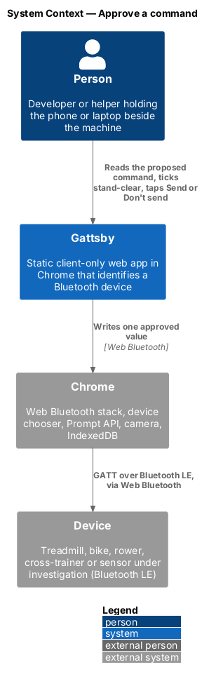
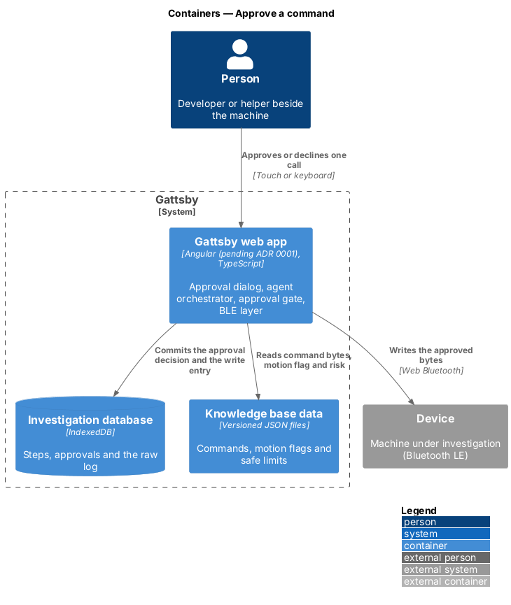
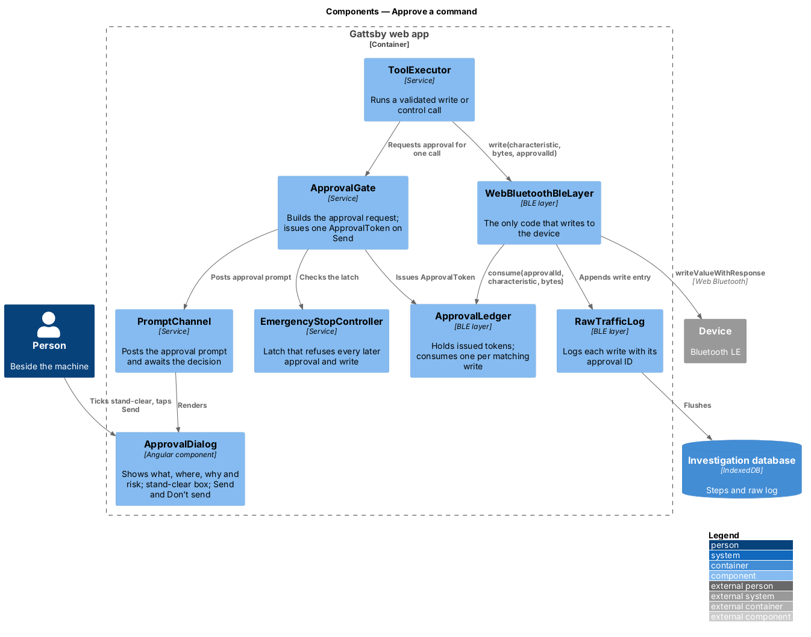
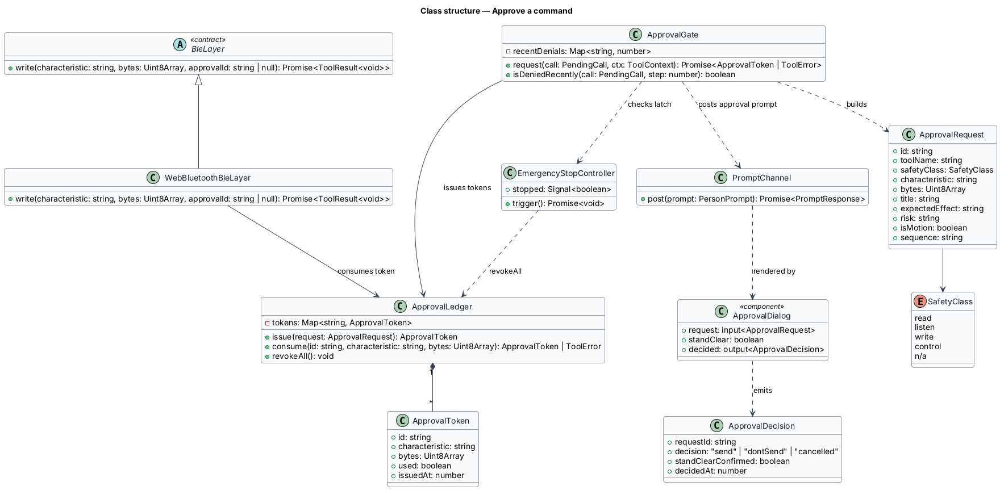
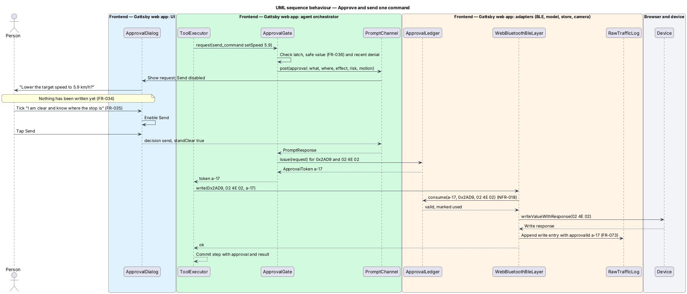
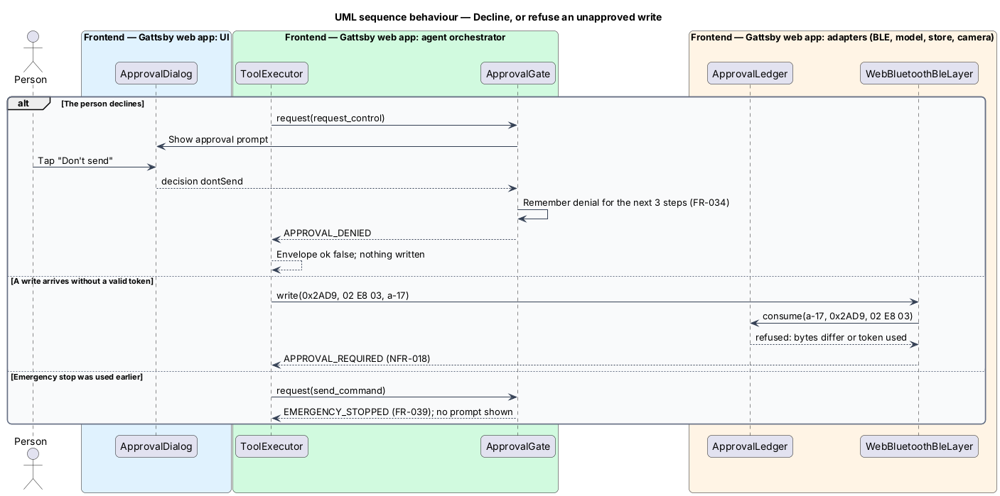

# Approve a command

## Overview

Gattsby is read-only by default. A small set of tools can change what a device does: the `control`
tools (`request_control`, `send_command`, `emergency_stop`) and the one `write` tool
(`replay_known_handshake`). This feature is the gate every one of those calls passes through before
a single byte reaches the device. It belongs to the device-control subsystem and runs mostly in the
Control stage of the playbook, and in the Proprietary path when a vendor handshake is proposed.

**approval** — the person's yes to one `write` or `control` call, given at that moment, for that
exact characteristic and those exact bytes

**approval token** — record issued on an approval that the BLE layer consumes once, for the one write
it names

**motion command** — command that can make the device move or change its load: start, set speed, set
incline, set resistance, set power target

When the agent (in full agent mode) or the checklist (in checklist mode) proposes a `write` or
`control` call, the orchestrator pauses and shows the Approve a command dialog
(`docs/mocks/dialogs/approval/default.html`). The dialog states what will be sent, to which
characteristic, what it is expected to do, and its risk. For a motion command it also tells the
person to stand clear and to know where the machine's own stop is, and keeps "Send" disabled until
they tick "I am clear and know where the stop is". A stop needs approval but no stand-clear check
(`docs/mocks/dialogs/approval/stop.html`). While the device answers, the dialog shows the busy state
(`busy.html`); a refusal by the device shows the failed state (`failed.html`).

The gate has two halves so that no single fault can write without approval. The orchestrator's
`ApprovalGate` asks the person and issues a token. The BLE layer, the only code that writes, refuses
any write without a valid, unused token for that exact call. `emergency_stop` is the one exception:
the person's own tap on "Emergency stop" is its approval (see the emergency-stop design).

## Description

The design introduces these building blocks in the Angular (pending ADR 0001) workspace under
`frontend/src/app/`:

- **`ToolExecutor`** (`agent/tool-executor.ts`) — runs a validated `call_tool` action. For a tool of
  safety class `write` or `control` it first asks `ApprovalGate` for a token, then passes the token's
  ID to the tool through `ToolContext`.
- **`ApprovalGate`** (`agent/approval-gate.ts`) — builds an `ApprovalRequest` from the pending call
  and the knowledge base's command entry, refuses at once when `EmergencyStopController` has
  latched, posts the request through `PromptChannel`, and on "Send" issues an `ApprovalToken` into
  `ApprovalLedger`. It remembers each denial for 3 steps.
- **`ApprovalRequest`** (`store/model/approval-request.ts`) — what the person sees: tool name, safety
  class, target characteristic, bytes in hex, a plain title ("Lower the target speed to 5.9 km/h?"),
  the expected effect, the risk line, whether it is a motion command, and its place in the sequence
  ("Command 2 of 3").
- **`PromptChannel`** (`agent/prompt-channel.ts`) — posts one `PersonPrompt` of kind `approval` and
  awaits the `PromptResponse`. An approval prompt has no inactivity timeout: an unanswered approval
  sends nothing.
- **`ApprovalDialog`** (`dialogs/approval/approval.dialog.ts`) — presentation component. Input: the
  `ApprovalRequest`. Output: an `ApprovalDecision` (`send`, `dontSend` or `cancelled` by Escape). It
  keeps the page behind inert, but the `EmergencyStopButton` stays reachable inside the dialog.
- **`ApprovalLedger`** (`ble/approval-ledger.ts`) — holds issued tokens. `consume(id, characteristic,
  bytes)` returns the token and marks it used only when the ID exists, is unused, and names the same
  characteristic and byte-for-byte the same value; otherwise it returns `APPROVAL_REQUIRED`.
  `revokeAll()` empties it on emergency stop and when the investigation ends.
- **`WebBluetoothBleLayer.write`** (`ble/web-bluetooth-ble-layer.ts`) — the only path to
  `writeValueWithResponse`. It consumes the token before writing and refuses a `null` or invalid
  approval ID with `APPROVAL_REQUIRED`.
- **`RawTrafficLog`** (`ble/raw-traffic-log.ts`) — appends every write with the approval's ID, so the
  investigation record proves that each write was approved.

### Rules the gate enforces

1. Every `write` or `control` call needs its own approval. An approval covers one call; a second
   `send_command` shows a new prompt. No mode, setting, earlier approval or model output skips it.
2. Value checks run first. `SafetyLimits` refuses an unsafe value with `UNSAFE_VALUE` before any
   prompt is shown (see the keep-commands-conservative design), so the person is never asked to
   approve something the code would refuse.
3. A motion command is flagged by its knowledge-base command entry, not by the model. Its prompt
   carries the stand-clear reminder and the confirmation box. `request_control` alone moves nothing
   and is treated as needing approval without the stand-clear check (`OQ-12`).
4. "Don't send" returns `APPROVAL_DENIED` to the agent with nothing written. `ActionValidator`
   refuses the same call (same tool, same input) again for the next 3 steps.
5. After emergency stop, `ApprovalGate` returns `EMERGENCY_STOPPED` without showing a prompt, and the
   ledger holds no token.
6. The approval decision, the token ID and the write's raw-log entry are committed with the step
   (`InvestigationStore.commitStep`), so an export shows each write preceded by its approval.

### Data shapes

| Type | Fields |
|---|---|
| `ApprovalRequest` | `id`, `toolName`, `safetyClass`, `characteristic`, `bytes`, `title`, `expectedEffect`, `risk`, `isMotion`, `sequence` |
| `ApprovalDecision` | `requestId`, `decision`, `standClearConfirmed`, `decidedAt` |
| `ApprovalToken` | `id`, `characteristic`, `bytes`, `used`, `issuedAt` |

### Errors

| Code | Raised by | Meaning to the person |
|---|---|---|
| `APPROVAL_DENIED` | `ApprovalGate` | "Not sent." The activity feed records the decision. |
| `APPROVAL_REQUIRED` | `ApprovalLedger` via the BLE layer | Never expected in use; it means a code path bypassed the gate and is recorded with the tool and stage (NFR-025). |
| `EMERGENCY_STOPPED` | `ApprovalGate` | "Emergency stop was used. Nothing more will be sent." |

### Tests that prove it

The acceptance specs use the fake `navigator.bluetooth` (`e2e/fixtures/fake-bluetooth.ts`), which
records every write, and the `ApprovalDialog` page object. A shared check fails any spec in which a
recorded write is not preceded by a recorded approval for that call. Unit tests cover
`ApprovalLedger.consume` for a missing ID, mismatched bytes and a reused token.

## Requirements

The feature realizes the following level-2 (L2) requirements; each refines the level-1 (L1)
requirement cited beside it.

| L2 ID | Refines (L1) | Requirement |
|-------|--------------|-------------|
| [`FR-034`](../../../specs/L2.md#fr-034-ask-for-approval-for-every-write-and-control-call) | `L1-009` | Before any tool of safety class `write` or `control` runs, Gattsby must show the person what will be sent, to which characteristic, what it is expected to do, and its risk, and must run it only after the person taps "Send". The approval covers that one call. No mode, setting, earlier approval or model output may skip it. `emergency_stop` is the one exception: it runs on the person's own tap, which is its approval. |
| [`FR-035`](../../../specs/L2.md#fr-035-remind-the-person-before-any-motion-command) | `L1-009` | Before a command that can make the device move or change its load (start, set speed, set incline, set resistance, set power target), the approval prompt must tell the person to stand clear and to know where the machine's own physical stop is, and must ask them to confirm that they do. |
| [`NFR-018`](../../../specs/L2.md#nfr-018-no-unapproved-write-is-possible) | `L1-017` | The only path from the agent or the checklist to a Bluetooth write must pass through the approval gate in the orchestrator, and the BLE layer must refuse any write that does not carry a valid, unused approval ID for that exact call (characteristic and bytes). `emergency_stop` carries its own approval. |

## Diagrams

### System context

The person approves each call in Gattsby, which writes the approved bytes through Chrome's Web
Bluetooth stack to the device.

### Containers

Inside Gattsby the web app reads the command entry from the knowledge base, asks the person, writes
to the device, and commits the decision and the write to the investigation database.

### Components

`ApprovalGate` asks the person through `PromptChannel` and `ApprovalDialog` and issues a token into
`ApprovalLedger`; the BLE layer consumes the token before it writes and logs the write with the
token's ID.

### Class structure

`ApprovalGate` builds `ApprovalRequest`s and issues `ApprovalToken`s into the `ApprovalLedger`, which
owns them; `WebBluetoothBleLayer` implements the `BleLayer` contract and consumes a token for each
write.

### Behaviour — approve and send one command

The person ticks the stand-clear box, taps "Send", and the gate issues one token; the BLE layer
consumes it, writes `02 4E 02` to the Fitness Machine Control Point (`0x2AD9`) and logs the write
with the token's ID.

### Behaviour — decline, or refuse an unapproved write

"Don't send" returns `APPROVAL_DENIED` with nothing written; a write whose token is missing, used or
for other bytes is refused with `APPROVAL_REQUIRED`; after emergency stop no prompt is shown.

