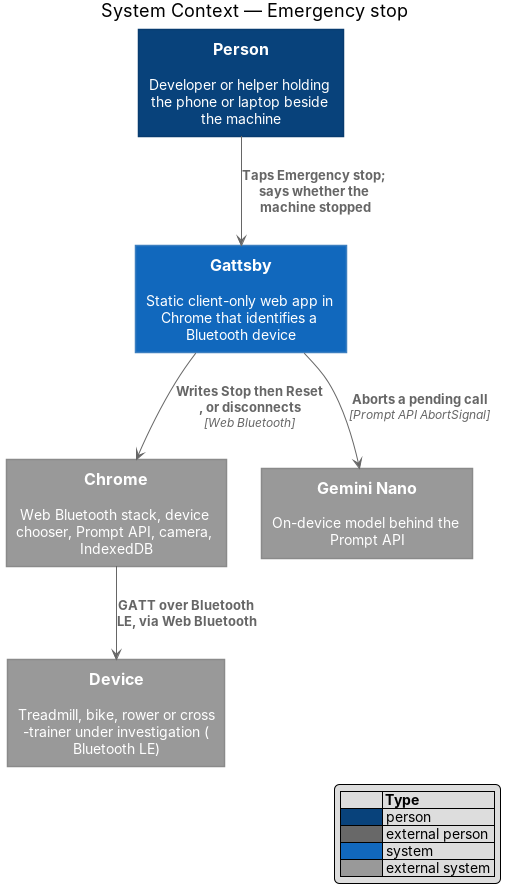
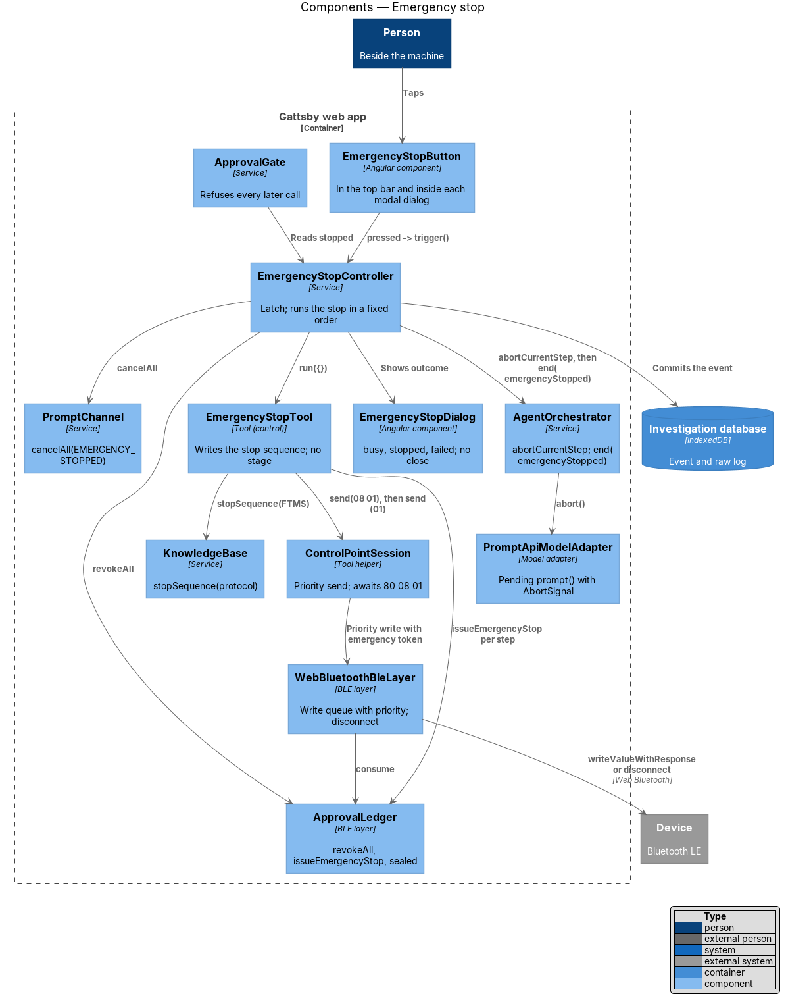
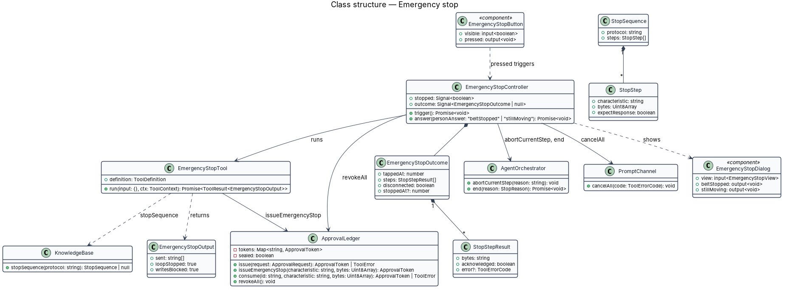
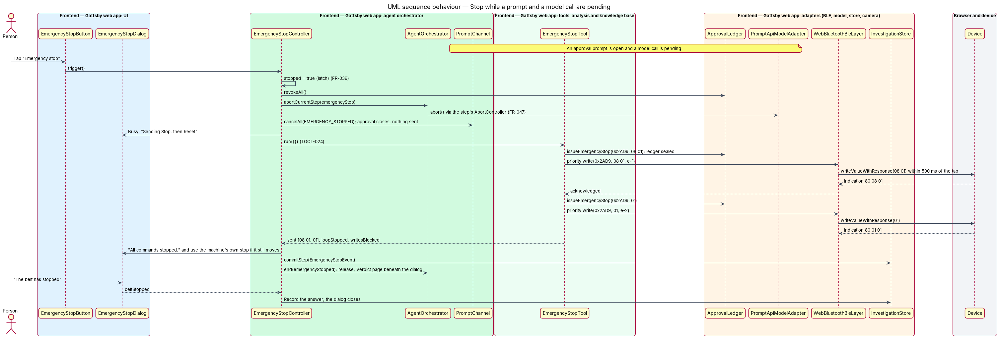
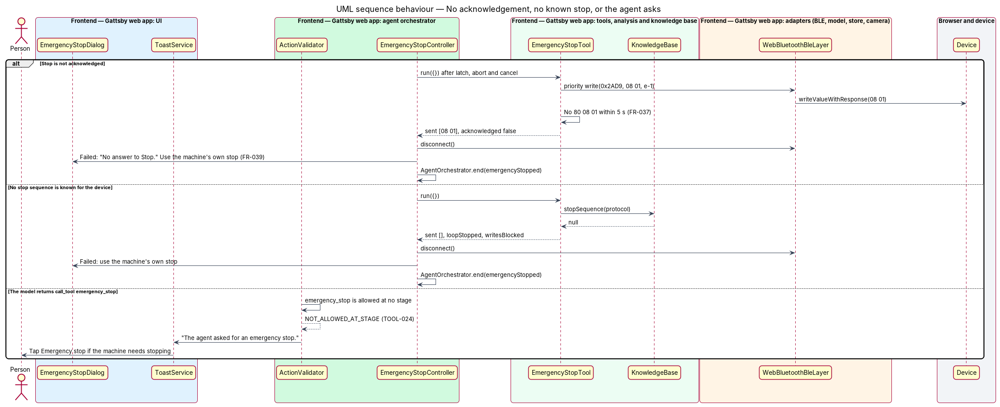

# Emergency stop

## Overview

A person standing beside a treadmill that Gattsby has just told to move needs one sure way to stop
it. This feature is that way: a red "Emergency stop" button on every screen while a device is
connected, which sends the device's stop and reset commands, refuses every later write, stops the
agent loop and records what happened. It belongs to the device-control subsystem and runs at any
stage, including while an approval prompt or a model call is pending. The
[approve-a-command design](../approve-a-command/README.md) names it as the one exception to per-call
approval: the person's own tap is its approval.

**emergency stop** — person-initiated halt that sends the device's stop sequence and blocks every
later `write` and `control` call for the rest of the investigation

**stop sequence** — ordered writes the knowledge base gives for a protocol to stop a device and clear
its targets; for FTMS, Stop (`08 01`) then Reset (`01`) on the Control Point (`0x2AD9`)

**latch** — one-way flag that, once set, makes `ApprovalGate` and `ApprovalLedger` refuse every
later write with `EMERGENCY_STOPPED`

**acknowledged** — answered by the device with a success response code, for Stop `80 08 01`

The button sits in the top bar of the investigation (`docs/mocks/pages/investigation/control.html`)
and inside every dialog that makes the page behind it inert
(`docs/mocks/dialogs/approval/default.html`: "Emergency stop stays reachable inside the dialog
because the page behind is inert"). A tap opens the Emergency stop dialog in its busy state
(`docs/mocks/dialogs/emergency-stop/busy.html`: "Sending Stop, then Reset, to the treadmill. The
agent is halted."), then its result: acknowledged
(`docs/mocks/dialogs/emergency-stop/default.html`: "All commands stopped.") or not
(`docs/mocks/dialogs/emergency-stop/failed.html`: "No answer to Stop. … I've disconnected and stopped
the agent"). Both tell the person to use the machine's own stop if it still moves. The dialog has no
close button, and Escape does nothing: the person says whether the belt stopped.

## Description

The design introduces these building blocks in the Angular (pending ADR 0001) workspace under
`frontend/src/app/`:

- **`EmergencyStopButton`** (`ui/emergency-stop-button/emergency-stop-button.ts`) — presentation
  component. Input: `visible`. Output: `pressed`. A native `button` with a 48 × 48 px minimum target,
  the label "Emergency stop" (shortened to "Stop" on narrow screens with the full name kept as its
  accessible name), and an icon as well as colour.
- **Root component** (`app.ts`) — renders `EmergencyStopButton` in the top bar on every route while
  `InvestigationSession.connectionState` is connected, and wires `pressed` to
  `EmergencyStopController.trigger()`. Each dialog that can open while connected renders its own
  button wired the same way, because a modal dialog makes the page behind inert.
- **`EmergencyStopController`** (`agent/emergency-stop-controller.ts`) — owns the latch.
  `stopped` is a `Signal<boolean>`; `trigger()` runs the stop in a fixed order (see the rules below);
  `outcome` is a signal holding the `EmergencyStopOutcome` for the dialog. A second tap while a stop
  runs is ignored.
- **`ApprovalGate`** (`agent/approval-gate.ts`) — reads `stopped` first and returns
  `EMERGENCY_STOPPED` without a prompt, as the approve-a-command design states.
- **`ApprovalLedger`** (`ble/approval-ledger.ts`) — `revokeAll()` empties it. A new
  `issueEmergencyStop(characteristic, bytes)` issues a token for one write of the stop sequence and
  seals the ledger: after it, `issue()` refuses, and `consume()` accepts only tokens issued this way
  and returns `EMERGENCY_STOPPED` for anything else.
- **`EmergencyStopTool`** (`tools/control/emergency-stop.tool.ts`) — the `emergency_stop` tool,
  safety class `control`, input `{}`, no preconditions. Its registry entry lists no playbook stage,
  so the model's tool list never shows it and `ActionValidator` refuses a model's call with
  `NOT_ALLOWED_AT_STAGE`. Only `EmergencyStopController` runs it. It writes each step of the stop
  sequence through `ControlPointSession.send` with the step's emergency token, as a priority write.
- **`KnowledgeBase.stopSequence(protocol)`** (`knowledge-base/knowledge-base.ts`) — returns the
  stop sequence for the device's protocol: FTMS Stop then Reset at MVP; a vendor's equivalent from
  its entry at P2; `null` when none is known.
- **`WebBluetoothBleLayer`** (`ble/web-bluetooth-ble-layer.ts`) — keeps one write queue per device. A
  priority write goes to the front of the queue. A write already in flight cannot be cancelled, so
  the stop follows it at once. `disconnect()` ends the connection on the failed path.
- **`AgentOrchestrator`** (`agent/agent-orchestrator.ts`) — `abortCurrentStep(reason)` aborts the
  current step's `AbortController`, which aborts a pending model call (FR-047; see the
  [decide-the-next-action design](../../agent/decide-the-next-action/README.md)). While `stopped` is
  set, the orchestrator starts no new step. `end('emergencyStopped')`, the loop's single exit, runs
  once the stop sequence has finished: it records the stop reason, releases the connection and the
  model session, and routes to the Verdict page (see the
  [end-the-loop design](../../agent/end-the-loop/README.md)). `ChecklistRunner` stops the same way in
  checklist mode.
- **`PromptChannel.cancelAll(code)`** (`agent/prompt-channel.ts`) — closes a pending prompt, such as
  an open approval, and resolves it with `EMERGENCY_STOPPED`, so nothing it would have approved is
  sent.
- **`EmergencyStopDialog`** (`dialogs/emergency-stop/emergency-stop.dialog.ts`) — presentation
  component. Input: an `EmergencyStopView` (`busy`, `stopped` or `failed`, the stop time, the device
  word such as "belt"). Outputs: `beltStopped` and `stillMoving`. No close control; Escape is
  ignored.

### Rules the stop follows

1. `trigger()` runs in this order: set the latch; revoke every token; abort the current step and
   any pending model call; cancel a pending prompt; open the dialog in its busy state; write the stop
   sequence; then end the loop with `emergencyStopped`. Every step before the write is synchronous,
   so the Stop write starts without waiting for the agent, and the loop ends after the device has
   been told to stop, as the end-the-loop design states.
2. FTMS Stop (`08 01`) is written within 500 ms of the tap. When a write is already in flight, the
   500 ms include waiting for it; whether a device's slow write can break the budget is a hardware
   smoke-test question (`<TO SUPPLY>`).
3. The controller waits for each step's response for 5 seconds, the Control Point timeout of FR-037.
   An acknowledged Stop is followed by Reset (`01`).
4. When Stop is not acknowledged, a write fails, or no stop sequence is known, the controller
   disconnects at once, and the dialog shows its failed state, which tells the person to use the
   machine's own stop. On the acknowledged path the connection is released by `end`.
5. When indications on the Control Point are not yet on, `ControlPointSession` starts them as part
   of the tapped call. When control was never granted, Gattsby has sent no motion command; Stop is
   still tried and, unacknowledged, leads to rule 4. Whether to send Request Control first in that
   case is `<TO SUPPLY>`.
6. After the latch, every `write` and `control` call returns `EMERGENCY_STOPPED` for the rest of the
   investigation, from the gate and again from the ledger. `read` and `listen` tools are not
   blocked by the latch; the loop has stopped, so none is proposed.
7. A model action `call_tool emergency_stop` is refused with `NOT_ALLOWED_AT_STAGE`, and a warning
   toast and a feed entry tell the person: "The agent asked for an emergency stop. Tap Emergency stop
   if the machine needs stopping." Wording is provisional (`A-01`).
8. The event is committed with the step: the tap time, the bytes sent, whether each was
   acknowledged, whether Gattsby disconnected, and the person's answer. The raw traffic log holds
   each write with its emergency token's ID.
9. The dialog stays above the Verdict page that `end` routes to. "The belt has stopped" closes it;
   the verdict is built from what is known with the stop reason `emergencyStopped` (see the
   [issue-the-verdict design](../../outcome/issue-the-verdict/README.md)). "It's still moving" is
   recorded and repeats the instruction to use the machine's own stop; the dialog stays open. No mock
   draws the screen after "It's still moving" (`<TO SUPPLY>`).

### Data shapes

| Type | Fields |
|---|---|
| `EmergencyStopOutput` | `sent` (hex list), `loopStopped` (`true`), `writesBlocked` (`true`) — the TOOL-024 output |
| `EmergencyStopOutcome` | `tappedAt`, `steps` (`bytes`, `acknowledged`, `error?`), `disconnected`, `stoppedAt` |
| `EmergencyStopEvent` | the outcome plus `personAnswer` (`beltStopped`, `stillMoving`), committed with the step |
| `StopSequence` | `protocol`, `steps` (`characteristic`, `bytes`, `expectResponse`) |
| `EmergencyStopView` | `state` (`busy`, `stopped`, `failed`), `stoppedAt`, `deviceWord` |

### Errors

| Code | Raised by | Meaning to the person |
|---|---|---|
| `EMERGENCY_STOPPED` | `ApprovalGate`, `ApprovalLedger` | "Emergency stop was used. Nothing more will be sent." |
| `NOT_ALLOWED_AT_STAGE` | `ActionValidator` | The agent asked for a stop; the person is told and the button stays ready. |
| `TIMEOUT`, `GATT_ERROR`, `NOT_CONNECTED` | `EmergencyStopTool` | Reported inside the output, never as a failure of the stop; the dialog's failed state says to use the machine's own stop. |

### Tests that prove it

The acceptance spec (`e2e/specs/device-control/emergency-stop.spec.ts`) uses the FTMS treadmill and
the unknown-services device of the fake `navigator.bluetooth` (`e2e/fixtures/fake-bluetooth.ts`),
which timestamps every write, the fake `LanguageModel` (`e2e/fixtures/fake-language-model.ts`), and
the `EmergencyStopButton`, `EmergencyStopDialog`, `ApprovalDialog` and `InvestigationPage` page
objects. Scenarios: after an approved start, a tap writes `08 01` within 500 ms of the click, stops
the loop and shows "All commands stopped."; a later scripted `send_command` returns
`EMERGENCY_STOPPED` with no prompt; a tap while the fake model holds its answer aborts the call's
signal; a tap while the approval dialog is open sends nothing it held; the unknown-services device
disconnects and shows the failed state; and a scripted `call_tool emergency_stop` is refused with
`NOT_ALLOWED_AT_STAGE` and the notice. Unit tests cover the order of `trigger()` with fakes, and the
ledger's sealing after `issueEmergencyStop`.

## Requirements

The feature realizes the following level-2 (L2) requirements; each refines the level-1 (L1)
requirement cited beside it.

| L2 ID | Refines (L1) | Requirement |
|-------|--------------|-------------|
| [`FR-039`](../../../specs/L2.md#fr-039-offer-an-emergency-stop-at-all-times) | `L1-009` | While a device is connected, an emergency stop must be visible on every screen, reachable in one tap, and must: send the device's stop or reset command where one is known (FTMS Stop, then Reset); refuse every later `write` or `control` call for the rest of the investigation; stop the agent loop; and record the event. It must work even while an approval prompt or model call is pending. |
| [`TOOL-024`](../../../specs/L2.md#tool-024-emergency_stop) | `L1-009` | Sends stop and reset where known, refuses every later write, and stops the agent loop. Runs on the person's tap; that tap is its approval. The agent may not call it. |

## Diagrams

### System context

The person taps "Emergency stop" in Gattsby, which writes the stop sequence through Chrome's Web
Bluetooth stack and, when the device gives no answer, disconnects and points to the machine's own
stop.

### Containers

The web app reads the stop sequence from the knowledge base data, writes it to the device, aborts the
on-device model call, and commits the event to the investigation database.

### Components

`EmergencyStopController` sets the latch, empties `ApprovalLedger`, aborts the orchestrator's current
step, cancels the pending prompt, and runs `EmergencyStopTool`. The tool takes one emergency token per write, which
seals the ledger, and its priority writes go straight to the front of the BLE layer's queue.

### Class structure

`EmergencyStopController` owns the latch and the outcome; `EmergencyStopTool` writes a `StopSequence`
from the knowledge base with tokens from the sealed `ApprovalLedger`.

### Behaviour — stop while a prompt and a model call are pending

The person taps the button while an approval prompt is open and a model call runs; the latch is set,
the call is aborted, the prompt is cancelled, Stop `08 01` and Reset `01` are written and
acknowledged, the event is recorded, and the loop ends with `emergencyStopped`.

### Behaviour — no acknowledgement, no known stop, or the agent asks

With no acknowledgement or no known stop sequence, Gattsby disconnects and shows the failed state; a
model's request for `emergency_stop` is refused with `NOT_ALLOWED_AT_STAGE` and the person is told.

