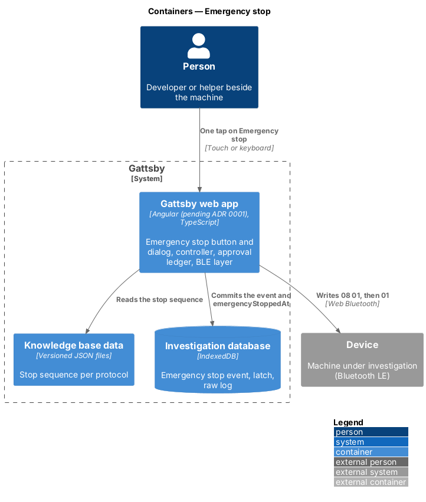
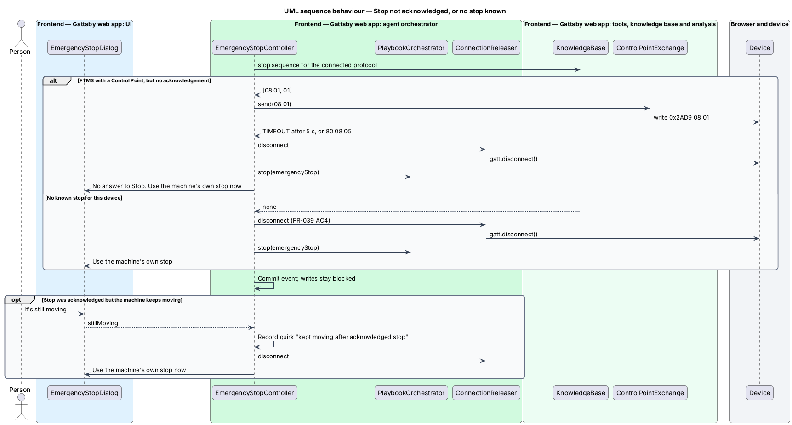
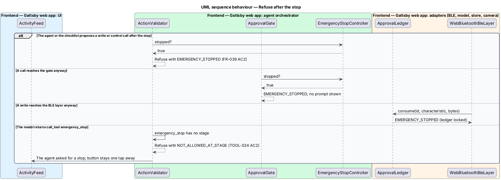

# Emergency stop

## Overview

A machine that Gattsby has commanded can move with a person on it. This feature gives the person one
tap that stops it, wherever they are in the app, whatever the agent is doing. It sends the device's
stop and reset where they are known, ends the agent loop, and blocks every later write for the rest
of the investigation. It belongs to the device-control subsystem but is not a playbook stage: it is
available in every stage once a device is connected, in full agent mode and in checklist mode alike.

**emergency stop** — the person's one-tap request that sends the device's stop sequence, ends the
agent loop and blocks every later write in the investigation

**stop latch** — investigation-wide flag set by the first emergency stop tap, which every approval
and every write checks, and which nothing clears

**stop sequence** — knowledge-base list of commands an emergency stop writes for a protocol; for FTMS,
Stop (`08 01`) and then Reset (`01`) to the Fitness Machine Control Point (`0x2AD9`)

The "Emergency stop" button sits in the Investigation page's app bar as soon as a device is connected
(`docs/mocks/pages/investigation/identify.html`; "Stop" at 360 px), and in the toolbar of every dialog
over a connected investigation, because the page behind a dialog is inert
(`docs/mocks/dialogs/approval/default.html`). Its danger colour `#A11D1D` keeps 7:1 contrast with its
label (`docs/mocks/README.md`). A tap opens the Emergency stop dialog: busy while it sends ("Sending
Stop…", `docs/mocks/dialogs/emergency-stop/busy.html`), then acknowledged ("All commands stopped.",
`default.html`) or not acknowledged ("No answer to Stop.", `failed.html`). The dialog has no close
button and ignores Escape: the person says whether the belt stopped.

`emergency_stop` is the one `control` tool whose approval is the person's own tap (FR-034, NFR-018).
The design makes that exception narrow: only the controller can use it, and only for the knowledge
base's stop sequence.

## Description

The design introduces these building blocks in the Angular (pending ADR 0001) workspace under
`frontend/src/app/`:

- **`EmergencyStopButton`** (`ui/emergency-stop-button/emergency-stop-button.component.ts`) —
  presentation component: a 48 px button with an icon and the label "Emergency stop", output
  `pressed`. It reacts to one tap or Enter or Space, with no confirmation step.
- **`AppShell`** (`app-shell.ts`) and **`InvestigationPage`** (`pages/investigation/investigation.page.ts`)
  — show the button whenever `BleLayer` reports a connected device. Every dialog that opens over a
  connected investigation (`ApprovalDialog`, `StillThereDialog`, `UnexpectedEffectDialog` and the
  others) renders its own `EmergencyStopButton` in its toolbar and forwards `pressed`.
- **`EmergencyStopController`** (`agent/emergency-stop-controller.ts`) — holds the stop latch as the
  signal `stopped` and runs `trigger()`. It is the only caller of `emergencyStopTool.run`.
- **`emergencyStopTool`** (`tools/control/emergency-stop.tool.ts`) — the `ToolDefinition` for
  `emergency_stop`: safety class `control`, input `{}`, output `{ sent, loopStopped, writesBlocked }`,
  and an empty `stages` list. With no stage it never appears in the model's tool list (FR-071), and
  `ActionValidator` refuses it from the model with `NOT_ALLOWED_AT_STAGE` (TOOL-024 AC2).
- **`ApprovalLedger`** (`ble/approval-ledger.ts`) — `revokeAll()` removes every unused token.
  `issueForEmergencyStop(characteristic, bytes)` issues a token only for a command in the knowledge
  base's stop sequence. `lock()` then refuses every later `issue` and `consume` with
  `EMERGENCY_STOPPED`.
- **`ControlPointExchange`** (`tools/control/control-point-exchange.ts`) — writes each command of the
  sequence and waits up to 5 seconds for its response indication (see the request-control design).
- **`PlaybookOrchestrator`** (`agent/playbook-orchestrator.ts`) — owns the investigation's
  `AbortController`; the controller aborts it, which cancels the pending model call (FR-047), the
  pending prompt in `PromptChannel` and the running tool. The loop then ends with the stop reason
  `emergencyStop` (see the end-the-loop design).
- **`EmergencyStopDialog`** (`dialogs/emergency-stop/emergency-stop.dialog.ts`) — presentation
  component. Input: the `EmergencyStopOutcome`. Outputs: `stillMoving` and `stopped`.
- **`ConnectionReleaser`** (`agent/connection-releaser.ts`) — disconnects when the stop is not
  acknowledged, when no stop is known, or when the person reports the machine is still moving.
- **`InvestigationStore.commitStep`** (`store/investigation-store.ts`) — stores the
  `EmergencyStopEvent` and sets `emergencyStoppedAt` on the investigation.

### What one tap does, in order

1. Set the stop latch. From this moment `ApprovalGate` answers `EMERGENCY_STOPPED` without a prompt,
   and `ActionValidator` refuses every `write` and `control` call (FR-039 AC2).
2. `ApprovalLedger.revokeAll()`, so a token issued for a pending approval can never be used.
3. Look up the stop sequence for the connected protocol, issue its tokens, and call the Stop write at
   once. Nothing is awaited between the tap and the write call, so the write starts within 500 ms of
   the tap (FR-039 AC1). The event records both times with `performance.now()`.
4. In parallel, abort the investigation's `AbortController`: the model call is aborted (FR-039 AC3),
   the pending prompt is withdrawn, and an open approval dialog closes with nothing sent.
5. Wait up to 5 seconds for `80 08 01`. On it, write Reset (`01`) and wait for `80 01 01`.
6. `ApprovalLedger.lock()`. Stop the loop with reason `emergencyStop`; the verdict and profile are
   built from what is known.
7. Commit the `EmergencyStopEvent` and the latch in one transaction.

### Rules

1. The button is on every screen while a device is connected, one tap away, and never behind a
   confirmation (FR-039).
2. Chrome runs GATT operations one at a time per device. A command write already in flight finishes
   or fails first; Stop follows it, and the wait for that command's response is abandoned.
3. Stop is written even when control was never granted. A non-success answer (such as `80 08 05`) is
   treated as not acknowledged.
4. Not acknowledged within 5 seconds: Gattsby disconnects, stops the loop and tells the person to use
   the machine's own stop (`failed.html`).
5. No known stop (no Control Point, or a protocol without a stop sequence): nothing is written;
   Gattsby disconnects, stops the loop and tells the person to use the machine's own stop (FR-039
   AC4).
6. "It's still moving" records the report as a connection quirk, disconnects and shows the
   machine's-own-stop instruction. "The belt has stopped" records the report and opens the verdict.
7. The latch lasts for the rest of the investigation and survives a reload: `emergencyStoppedAt` is
   read back on resume, so a resumed investigation still refuses every write.
8. When the model returns `call_tool emergency_stop`, nothing is written. The feed tells the person
   that the agent asked for a stop, and the button stays where it is (TOOL-024 AC2). The wording is
   `<TO SUPPLY>` (A-01).

### Data shapes

| Type | Fields |
|---|---|
| `EmergencyStopOutcome` | `state` (`sending`, `acknowledged`, `notAcknowledged`, `noKnownStop`), `sentAt`, `deviceKind` (for "belt" or "flywheel" wording) |
| `EmergencyStopEvent` | `id`, `tappedAt`, `firstWriteAt`, `sent` (hex list), `responses` (hex list), `outcome`, `personReport?` (`stopped`, `stillMoving`), `stage`, `mode` |
| `EmergencyStopOutput` | `sent` (hex list), `loopStopped: true`, `writesBlocked: true` (TOOL-024) |

### Errors

| Code | Raised by | Meaning to the person |
|---|---|---|
| `EMERGENCY_STOPPED` | `ApprovalGate`, `ActionValidator`, `ApprovalLedger` | "Emergency stop was used. Nothing more will be sent." |
| `NOT_ALLOWED_AT_STAGE` | `ActionValidator` | The agent asked for a stop; the feed says so and points to the button. |

TOOL-024 has no error that stops it: a failed or unanswered write is reported in its output, and the
person is told to use the machine's own stop.

### Tests that prove it

Acceptance specs use the fake FTMS treadmill with control granted and the `EmergencyStopDialog` page
object: Stop `08 01` is recorded within 500 ms of the tap, then Reset `01`; a later scripted
`send_command` is refused with `EMERGENCY_STOPPED`. Other specs tap the button while the fake
`LanguageModel` is mid-call (the call's signal is aborted), while an approval is pending (nothing is
written), and on the fake device with no Control Point (disconnect, no write).

### Built in journey 2

Journey 2 sends no command, so it shows `EmergencyStopButton` whenever a device is connected and treats every protocol as having no known stop (rule 5): one tap aborts the loop, disconnects at once, sends nothing, and concludes with the stop reason `emergencyStop`; the verdict's summary tells the person to use the machine's own stop. The stop sequence, the approval ledger's lock and `EmergencyStopDialog` arrive with journey 8.

## Requirements

The feature realizes the following level-2 (L2) requirements; each refines the level-1 (L1)
requirement cited beside it.

| L2 ID | Refines (L1) | Requirement |
|-------|--------------|-------------|
| [`FR-039`](../../../specs/L2.md#fr-039-offer-an-emergency-stop-at-all-times) | `L1-009` | While a device is connected, an emergency stop must be visible on every screen, reachable in one tap, and must: send the device's stop or reset command where one is known (FTMS Stop, then Reset); refuse every later `write` or `control` call for the rest of the investigation; stop the agent loop; and record the event. It must work even while an approval prompt or model call is pending. |
| [`TOOL-024`](../../../specs/L2.md#tool-024-emergency_stop) | `L1-009` | Sends stop and reset where known, refuses every later write, and stops the agent loop. Runs on the person's tap; that tap is its approval. The agent may not call it. |

## Diagrams

### System context

The person taps "Emergency stop" in Gattsby, which writes the stop sequence through Chrome to the
device and stops consulting the on-device model.

### Containers

The web app reads the stop sequence from the knowledge base, writes it to the device, and commits the
event and the latch to the investigation database.

### Components

`EmergencyStopButton` feeds `EmergencyStopController`, which latches, revokes and issues tokens in
`ApprovalLedger`, writes through `ControlPointExchange`, aborts the orchestrator, and shows
`EmergencyStopDialog`.

### Class structure

`EmergencyStopController` owns the latch and runs `emergencyStopTool`; `ApprovalLedger` gains
`issueForEmergencyStop` and `lock`; the outcome and event types carry what the dialog and the record
need.

### Behaviour — stop from any screen

The tap latches, revokes tokens, writes Stop `08 01` within 500 ms, aborts the model call and the
pending prompt, writes Reset `01` after the acknowledgement, and ends the loop.

### Behaviour — stop not acknowledged, or no stop known

Without an acknowledgement within 5 seconds, or without a known stop, Gattsby disconnects, ends the
loop and points the person to the machine's own stop.

### Behaviour — refuse after the stop

Once latched, every `write` or `control` call is refused with `EMERGENCY_STOPPED`, and a model action
that names `emergency_stop` is refused with `NOT_ALLOWED_AT_STAGE`.

