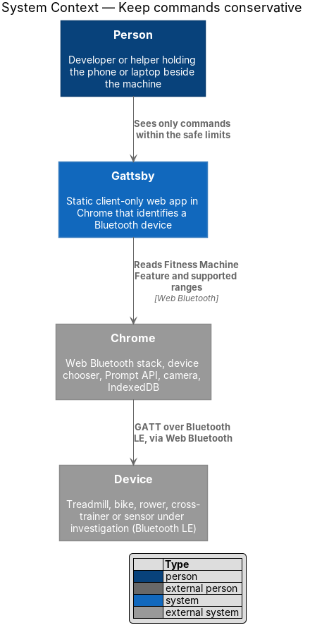
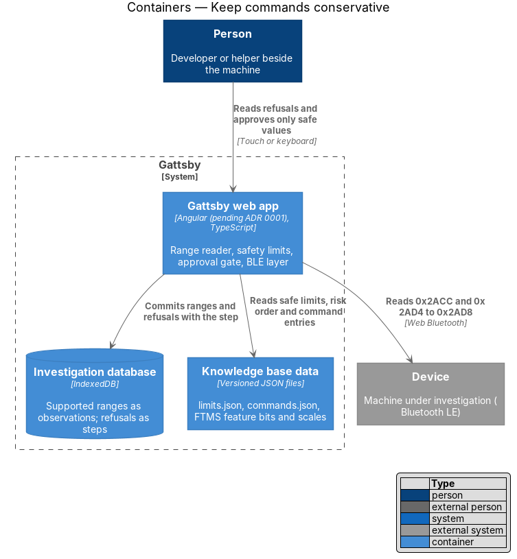
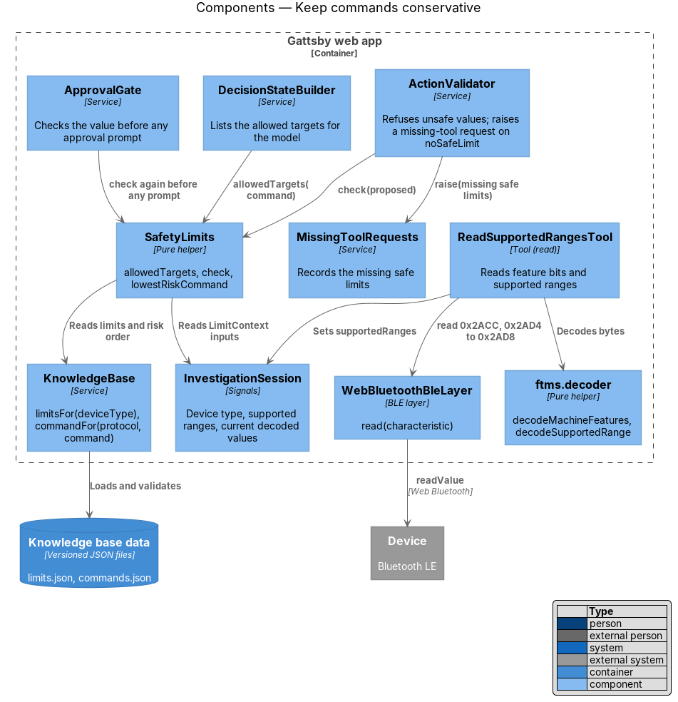
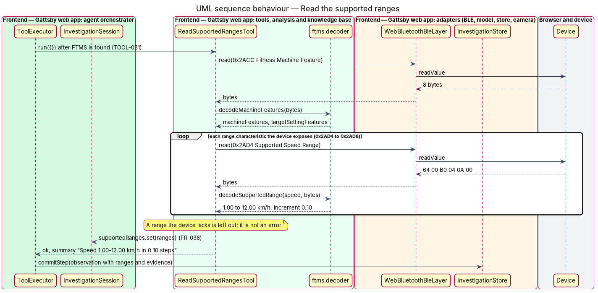
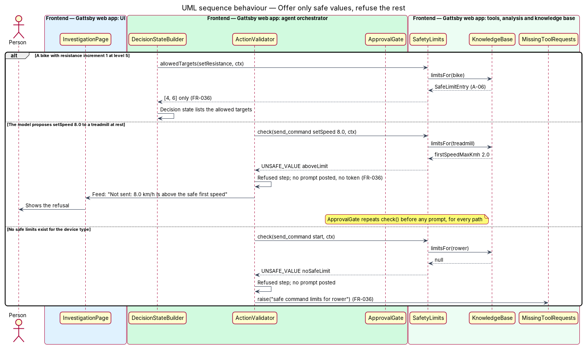

# Keep commands conservative

## Overview

Every command Gattsby can send to a device is bounded before the person is asked to approve it. This
feature is that bound. It decides which command values are safe for the device in front of the
person, refuses everything else with `UNSAFE_VALUE`, and reads the device's own supported ranges so
that the bound respects the device's minimum and increment. It belongs to the device-control
subsystem and runs in the Control stage of the playbook, before the approval gate described in the
[approve-a-command design](../approve-a-command/README.md).

**safe limit** — knowledge-base value that bounds one command parameter for one device type, such as
the highest first speed for a treadmill

**supported range** — minimum, maximum and increment a device reports for one setting in its FTMS
supported-range characteristics

**smallest step** — change of one increment of the device's supported range from the current value

**allowed target** — command value that both the safe limit and the supported range permit at this
moment; the only values the agent or the checklist can propose

**lowest-risk command** — first entry in the device type's risk order that the device claims to
support

The limits are data, not code: they live in `limits.json` in the knowledge base, carry their source
and are enforced by one pure helper, `SafetyLimits`. The values at MVP are the assumption `A-06`
(first treadmill speed at most 2.0 km/h or the device's minimum, whichever is higher; incline
changes of one increment, never above 2 %; resistance changes of one increment; power target at most
100 W; one command at a time). Their final values and who signs them off are open (`OQ-07`).

A refused value never reaches the person as an approval prompt. The Approve a command dialog
(`docs/mocks/dialogs/approval/default.html`) shows only a value that has already passed the limits:
"Lower the target speed to 5.9 km/h?", which the risk line describes as "the smallest step it
supports". The supported ranges read here also feed the device profile's controllable features
(`docs/mocks/pages/device-profile/default.html`: "Set target speed op 0x02 · uint16 · 0.01 km/h ·
0.5–16.0"), which the [test-one-command design](../test-one-command/README.md) records.

## Description

The design introduces these building blocks in the Angular (pending ADR 0001) workspace under
`frontend/src/app/`:

- **`ReadSupportedRangesTool`** (`tools/inspection/read-supported-ranges.tool.ts`) — the
  `read_supported_ranges` tool, safety class `read`, group Inspection. It reads Fitness Machine
  Feature (`0x2ACC`) and each supported-range characteristic the device exposes (`0x2AD4` speed,
  `0x2AD5` incline, `0x2AD6` resistance, `0x2AD7` heart rate, `0x2AD8` power) through `BleLayer.read`.
  A range characteristic the device lacks is left out of the output; it is not an error. The tool
  stores the result as an observation and sets `InvestigationSession.supportedRanges`.
- **`ftms.decoder.ts`** (`knowledge-base/decoders/ftms.decoder.ts`) — gains two pure functions:
  `decodeMachineFeatures(bytes)` returns the names of the set bits in the Fitness Machine Features and
  Target Setting Features fields; `decodeSupportedRange(kind, bytes)` returns `{ min, max, increment }`
  in the unit the FTMS entry of the knowledge base gives for that kind (km/h for speed, % for
  incline). The bit names and the scales are data in the knowledge base's FTMS entry.
- **`SafetyLimits`** (`knowledge-base/safety-limits.ts`) — pure helper with three functions.
  `allowedTargets(command, ctx)` returns the values that are safe now. `check(proposed, ctx)` returns
  a `SafeCommand` or refuses with `UNSAFE_VALUE` and a reason. `lowestRiskCommand(ctx)` returns the
  first command in the device type's risk order that the Target Setting Features claim.
- **`LimitContext`** (`knowledge-base/limit-context.ts`) — the inputs `SafetyLimits` needs, built
  fresh for each check from `InvestigationSession`: the device type, the `SafeLimitEntry` for it (or
  `null`), the supported ranges, the current decoded values (speed, incline, resistance, power) and
  whether the device is moving.
- **`KnowledgeBase`** (`knowledge-base/knowledge-base.ts`) — `limitsFor(deviceType)` and
  `commandFor(protocol, command)`; it loads and validates `limits.json` with the rest of the
  knowledge base (see the [load-the-knowledge-base design](../../knowledge-base/load-the-knowledge-base/README.md)).
- **`ActionValidator`** (`agent/action-validator.ts`) — checks every proposed `send_command` with
  `SafetyLimits.check` and refuses an unsafe value with `UNSAFE_VALUE` before the call runs (see the
  [validate-and-run-an-action design](../../agent/validate-and-run-an-action/README.md)). When the
  reason is `noSafeLimit`, it raises a missing-tool request for the device type's safe limits through
  `MissingToolRequests.raise` (see the
  [record-a-missing-tool design](../../outcome/record-a-missing-tool/README.md)). `SafetyLimits`
  itself stays pure and only returns the reason.
- **`ApprovalGate`** (`agent/approval-gate.ts`) — calls `SafetyLimits.check` again before it builds
  the `ApprovalRequest`, as the approve-a-command design states, so a call that reaches the gate by
  any path is still bounded. A refusal returns at once; no prompt is posted and no token is issued.
- **`DecisionStateBuilder`** (`agent/decision-state-builder.ts`) — in the Control stage, adds the
  output of `SafetyLimits.allowedTargets` to the decision state, so the model chooses among safe
  values instead of inventing one (see the
  [decide-the-next-action design](../../agent/decide-the-next-action/README.md)). The checklist reads
  the same list.

### Rules the limits enforce

1. Values come only from `allowedTargets`. `check` refuses any other value, whatever the model or the
   checklist proposes. Values compare on the device's increment grid.
2. No limits entry for the device type means no motion command: start, set speed, set incline, set
   resistance and set power are refused with `UNSAFE_VALUE` (reason `noSafeLimit`) and a missing-tool
   request is raised. Stop and pause lower risk and are never refused for lack of limits.
3. Every allowed target lies inside both the safe limit and the device's supported range. A device
   that reports no range for a setting is bounded by the safe limit alone.
4. Speed from rest: the allowed targets run from the device's minimum up to the higher of the first
   speed limit and the device's minimum (`A-06`). With the 2.0 km/h limit, `setSpeed` 2.0 encodes as
   `02 C8 00` and `setSpeed` 6.0 or 8.0 is refused.
5. Speed while moving: the only allowed target is one increment below the current decoded speed, as
   the approval mock shows (6.0 to 5.9 km/h). An increase while moving is refused. Limits for raising
   a moving belt are `<TO SUPPLY>` (`OQ-07`).
6. Incline and resistance: the current decoded value plus or minus one increment, never above the
   incline limit (2 %, `A-06`). With a resistance increment of 1, the only targets offered are ±1.
7. Power: the safe limit (100 W, `A-06`) caps the target. The step for a power change is
   `<TO SUPPLY>` (`OQ-07`).
8. A setting whose current value cannot be decoded has no allowed target, because the smallest step
   cannot be computed from an unknown value. The refusal's reason is `currentUnknown`.
9. Start is a motion command whose speed is chosen by the machine, not by Gattsby. Whether a start
   needs a safe target speed set first is `<TO SUPPLY>` (`OQ-07`).
10. A vendor's limits, at P2, may narrow the general limits and never widen them (see the
    [add-a-vendor-signature design](../../knowledge-base/add-a-vendor-signature/README.md)).
11. One command at a time: `ApprovalGate` posts one approval prompt at a time, and the Control stage
    sends one test command (see the test-one-command design).

The risk order is data in each `SafeLimitEntry`. The specs give two first commands: a resistance
change of +1 for a bike (FR-038) and a one-increment speed decrease for a moving treadmill (the
approval mock). The orders for the other commands and for rowers and cross-trainers are
`<TO SUPPLY>` (`OQ-07`). Until a device type has an entry, rule 2 applies to it.

### Data shapes

| Type | Fields |
|---|---|
| `SafeLimitEntry` | `deviceType`, `firstSpeedMaxKmh`, `inclineMaxPercent`, `powerMaxW`, `stepIncrements` (1), `riskOrder`, `source`, `signedOffBy` (`<TO SUPPLY>`, `OQ-07`) |
| `SupportedRange` | `min`, `max`, `increment` |
| `SupportedRanges` | `speed?`, `incline?`, `resistance?`, `heartRate?`, `power?` (each a `SupportedRange`) |
| `SupportedRangesResult` | `machineFeatures`, `targetSettingFeatures`, `ranges` (the TOOL-031 output) |
| `LimitContext` | `deviceType`, `limits`, `ranges`, `current`, `moving` |
| `ProposedCommand` | `command`, `value?` |
| `SafeCommand` | `command`, `value`, `entry` (the knowledge base's `CommandEntry`) |
| `UnsafeReason` | `noSafeLimit`, `aboveLimit`, `notSmallestStep`, `outsideDeviceRange`, `currentUnknown` |

The device type is a `MachineType` (`treadmill`, `bike`, `rower`, `crossTrainer`, `heartRateSensor`,
`other`, `unknown`; see the [start-an-investigation design](../../investigation/start-an-investigation/README.md)).
`LimitContext` takes it from the hypothesis's `deviceType`, set by profile matching, and falls back to
the person's answer in Prepare (`PrepareFacts.machineType`). `unknown` and `other` have no limits
entry, so rule 2 applies.

### Errors

| Code | Raised by | Meaning to the person |
|---|---|---|
| `UNSAFE_VALUE` | `SafetyLimits` via `ActionValidator`, and again via `ApprovalGate` | "Not sent: 8.0 km/h is above the safe first speed of 2.0 km/h." The activity feed records the refusal; no prompt opens. Wording is provisional (`A-01`). |
| `NOT_CONNECTED` | `ReadSupportedRangesTool` | The connection banner offers to reconnect. |
| `PRECONDITION_FAILED` | `ReadSupportedRangesTool` | The device has no FTMS service; the ranges are not read. |
| `GATT_ERROR` | `ReadSupportedRangesTool` | The read failed; the ATT error code is recorded (NFR-025) and the range is left unknown. |

### Tests that prove it

Unit tests cover `decodeSupportedRange` with `64 00 B0 04 0A 00` (1.00–12.00 km/h, increment 0.10),
and `SafetyLimits` for each rule: 8.0 km/h refused from rest, ±1 resistance, a moving belt, an
unknown current value, and a device type with no entry. An `ActionValidator` unit test checks that
`noSafeLimit` raises a missing-tool request. The acceptance spec
(`e2e/specs/device-control/keep-commands-conservative.spec.ts`) uses the FTMS treadmill and FTMS bike
of the fake `navigator.bluetooth` (`e2e/fixtures/fake-bluetooth.ts`) and a fake `LanguageModel`
(`e2e/fixtures/fake-language-model.ts`) scripted to propose `setSpeed` 8.0: the `ApprovalDialog` page
object sees no dialog, the `InvestigationPage` page object reads the refusal in the feed, and the
fake records no write. A second scenario on the bike checks that the decision state offers only ±1
resistance.

## Requirements

The feature realizes the following level-2 (L2) requirements; each refines the level-1 (L1)
requirement cited beside it.

| L2 ID | Refines (L1) | Requirement |
|-------|--------------|-------------|
| [`FR-036`](../../../specs/L2.md#fr-036-keep-every-command-conservative) | `L1-009` | Gattsby must take command values only from the knowledge base's safe limits for the device's type, must start with the lowest-risk command, must change one value by the smallest step, and must refuse any value above the limits, whatever the model proposes. |
| [`TOOL-031`](../../../specs/L2.md#tool-031-read_supported_ranges) | `L1-009` | Reads FTMS Fitness Machine Feature (`0x2ACC`) and the supported speed (`0x2AD4`), incline (`0x2AD5`), resistance (`0x2AD6`), heart rate (`0x2AD7`) and power (`0x2AD8`) ranges. Needed for FR-027, FR-036 and FR-040: safe command values depend on the device's own minimum and increment. |

## Diagrams

### System context

The person sees only commands that already fit the limits; Gattsby reads the device's supported
ranges through Chrome's Web Bluetooth stack.

### Containers

The web app reads the safe limits and command entries from the knowledge base data, reads the
supported ranges from the device, and stores them as observations in the investigation database.

### Components

`ReadSupportedRangesTool` fills `InvestigationSession` with the device's ranges; `SafetyLimits`
combines them with the knowledge base's limits, gives `DecisionStateBuilder` the allowed targets, and
lets `ActionValidator`, and again `ApprovalGate`, refuse anything else before a prompt.

### Class structure

`SafetyLimits` is a pure helper over a `LimitContext`, which joins a `SafeLimitEntry` from the
knowledge base with the `SupportedRanges` that `ReadSupportedRangesTool` produces.

### Behaviour — read the supported ranges

The tool reads Fitness Machine Feature and each range the device exposes; Supported Speed Range
`64 00 B0 04 0A 00` decodes to 1.00–12.00 km/h with an increment of 0.10.

### Behaviour — offer only safe values, refuse the rest

The decision state lists only the allowed targets; a proposal of 8.0 km/h is refused with
`UNSAFE_VALUE` before any prompt, and a device type with no limits refuses every motion command and
records a missing-tool request.

