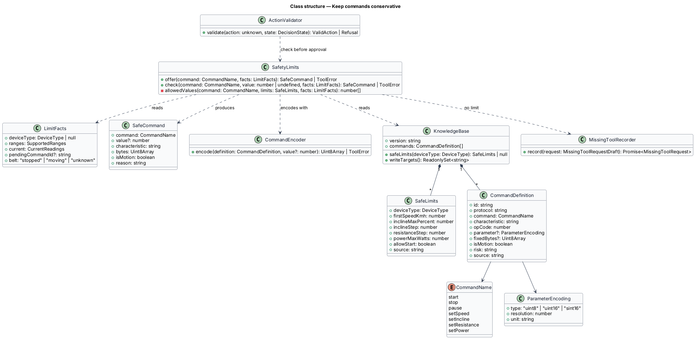
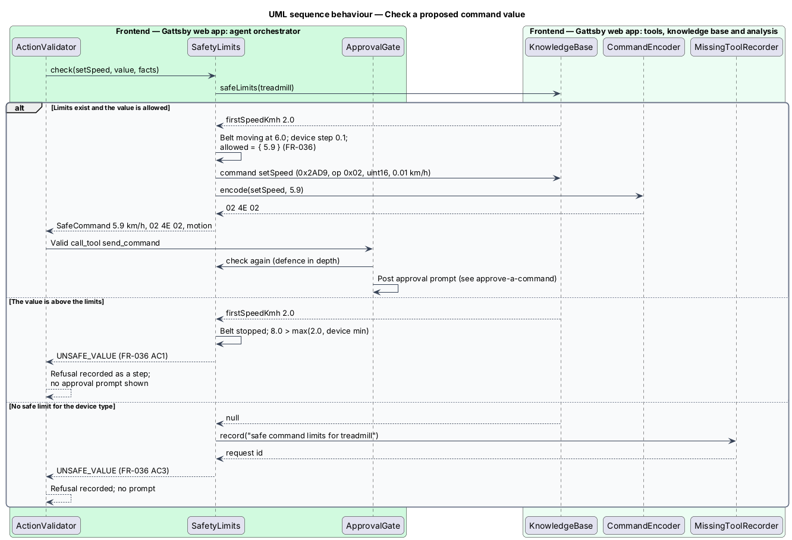
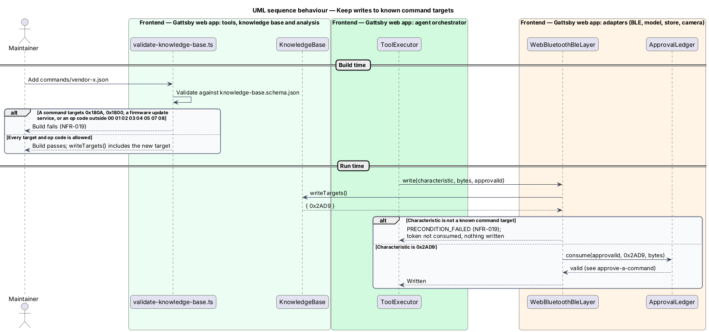

# Keep commands conservative

## Overview

The Control stage of the playbook may send a handful of commands to the device: request control, one
test command and a stop. This feature decides which command values Gattsby may send at all, and to
which characteristics. It sits between the proposal (from the model in full agent mode, or from the
rules in checklist mode) and the approval prompt. A value that fails here is refused before the
person is asked, so the person is never asked to approve something the code would refuse. The
feature belongs to the device-control subsystem and runs in the Control stage, and in the
Proprietary path when a vendor handshake is proposed.

**safe limit** — knowledge-base value that bounds one command for one device type, such as a first
treadmill speed of 2.0 km/h

**offered value** — single command value that the code computes as the lowest-risk next step from the
safe limits, the device's supported range and the current reading

**write target** — characteristic that a known command or handshake in the knowledge base names, and
the only kind of characteristic the BLE layer writes to

The person sees the result of this feature in the Approve a command dialog
(`docs/mocks/dialogs/approval/default.html`): "Lower the target speed to 5.9 km/h?", with the lead
"the smallest step it supports" and the risk line "Low — slows the belt by 0.1 km/h". The mocks
replaced the Magic Patterns command "slow the belt to 4.0 km/h" with this one-increment step for
FR-036 (`docs/mocks/README.md`, departures). A refused value shows no dialog; the refusal appears as
a one-line summary in the activity feed of the Investigation page, state `control`
(`docs/mocks/pages/investigation/control.html`).

The limits themselves are not settled. The values below are assumption A-06, pending open question
OQ-07 (who signs off the safe command limits per device type). They are data in the knowledge base,
so a corrected value needs no code change.

## Description

The design introduces these building blocks in the Angular (pending ADR 0001) workspace under
`frontend/src/app/`:

- **`SafetyLimits`** (`agent/safety-limits.ts`) — pure service with two methods. `offer(command,
  facts)` returns the one `SafeCommand` the rules may propose. `check(command, value, facts)` returns
  the `SafeCommand` when the value is allowed, or a `ToolError` with code `UNSAFE_VALUE`. Both read
  the knowledge base's safe limits for the device type, the device's own supported range and the
  current decoded reading.
- **`KnowledgeBase.safeLimits(deviceType)`** (`knowledge-base/knowledge-base.ts`) — returns the
  `SafeLimits` entry for `treadmill`, `bike`, `rower` or `crossTrainer`, or `null` when none exists.
  `KnowledgeBase.commands` holds the `CommandDefinition` entries. `KnowledgeBase.writeTargets()`
  returns the set of characteristics named by any command or handshake.
- **`SafeLimits`** (`knowledge-base/safe-limits.ts`) and **`CommandDefinition`**
  (`knowledge-base/command-definition.ts`) — the typed shapes of the limit and command data files.
- **`CommandEncoder`** (`knowledge-base/command-encoder.ts`) — pure helper that turns a
  `CommandDefinition` and a value into bytes: the op code, then the parameter little-endian at the
  definition's resolution. It refuses a value that is not on the resolution grid.
- **`ActionValidator`** (`agent/action-validator.ts`) — calls `SafetyLimits.check` for every
  `send_command` before the approval prompt (see the validate-every-action design).
  **`ApprovalGate`** (`agent/approval-gate.ts`) checks the value again before it posts the prompt
  (see the approve-a-command design).
- **`MissingToolRecorder`** (`outcome/missing-tool-recorder.ts`) — records the request "safe command
  limits for *device type*" when no limit exists (FR-036 AC3, FR-058).
- **`WebBluetoothBleLayer.write`** (`ble/web-bluetooth-ble-layer.ts`) — refuses a write to any
  characteristic outside `KnowledgeBase.writeTargets()` with `PRECONDITION_FAILED`, before it
  consumes the approval token.
- **Data files** — `frontend/src/knowledge-base/limits/{treadmill,bike,rower,cross-trainer}.json` and
  `frontend/src/knowledge-base/commands/ftms.json`, validated at build by
  `frontend/scripts/validate-knowledge-base.ts` against `knowledge-base.schema.json`.

### Rules for command values

1. The code chooses the value. The model's `value` is a proposal only. `SafetyLimits` recomputes the
   allowed values and refuses any other with `UNSAFE_VALUE`, whatever the model proposes (FR-036).
   In checklist mode the offered value is the only one shown.
2. A value lies inside the device's own supported range and on its increment grid, as read by
   `read_supported_ranges` (TOOL-031). For Supported Speed Range `64 00 B0 04 0A 00` that is 1.00 to
   12.00 km/h in steps of 0.10.
3. **Target speed.** From standstill, the value is at most the first safe speed: 2.0 km/h or the
   device's minimum, whichever is higher (A-06). With the belt moving, the only value offered is the
   current decoded speed minus one increment (6.0 → 5.9 km/h in the mocks). A raise above the first
   safe speed is always refused. Whether one increment up from a moving belt is acceptable is open
   (OQ-07); the design refuses it.
4. **Target incline.** One increment from the current incline, never above 2 % (A-06).
5. **Resistance.** One increment from the current level, up or down: with an increment of 1, the only
   change offered is ±1 (FR-036 AC2).
6. **Power target.** At most 100 W (A-06).
7. **Start.** A motion command whose speed the device chooses. The limit entry's `allowStart` flag
   says whether it may be offered for the device type; its value per type is `<TO SUPPLY>` (OQ-07).
8. **Stop and pause.** Always allowed while connected: they carry no value and reduce risk. They
   still need approval (FR-034).
9. **One command at a time.** A second motion command is refused with `UNSAFE_VALUE` while the effect
   of the previous one is unconfirmed (A-06). Stop is exempt.
10. **No limit, no motion.** When the device type is unknown or has no limit entry, every motion
    command is refused with `UNSAFE_VALUE` and a missing-tool request is raised (FR-036 AC3).

### Rules for write targets (NFR-019)

1. The BLE layer writes only to write targets. At MVP the only write target is the FTMS Fitness
   Machine Control Point (`0x2AD9`); P2 adds the characteristics named by vendor handshakes.
2. The knowledge-base validator fails the build when a command or handshake targets Device
   Information (`0x180A`), Generic Access (`0x1800`, which holds Device Name `0x2A00`), a firmware
   update service, or a pairing or bonding characteristic. The schema lists these forbidden targets;
   the firmware update service UUIDs in it are `<TO SUPPLY>`.
3. The FTMS command list allows only op codes `0x00` (Request Control), `0x01` (Reset), `0x02`,
   `0x03`, `0x04`, `0x05` (targets), `0x07` (Start or Resume) and `0x08` (Stop or Pause). The
   validator refuses any other op code, so stored-setting procedures such as Set Wheel Circumference
   (`0x12`) and Spin Down Control (`0x13`) cannot be added.

### Encodings

| Command | Op code | Parameter | Example |
|---|---|---|---|
| `setSpeed` | `0x02` | uint16, 0.01 km/h | 2.0 km/h → `02 C8 00`; 5.9 km/h → `02 4E 02` |
| `setIncline` | `0x03` | sint16, 0.1 % | 2.0 % → `03 14 00` |
| `setResistance` | `0x04` | from the knowledge-base entry and its source | — |
| `setPower` | `0x05` | from the knowledge-base entry and its source | — |
| `start` | `0x07` | none | `07` |
| `stop` / `pause` | `0x08` | uint8: `01` stop, `02` pause | `08 01` / `08 02` |

### Data shapes

| Type | Fields |
|---|---|
| `SafeLimits` | `deviceType`, `firstSpeedKmh` (2.0), `inclineMaxPercent` (2), `inclineStep` (1 increment), `resistanceStep` (1 increment), `powerMaxWatts` (100), `allowStart`, `source` |
| `CommandDefinition` | `id`, `protocol`, `command`, `characteristic`, `opCode`, `parameter?` (`type`, `resolution`, `unit`), `fixedBytes?`, `isMotion`, `risk`, `source` |
| `LimitFacts` | `deviceType`, `ranges` (from TOOL-031), `current` (decoded speed, incline, resistance), `pendingCommandId?`, `belt` (`stopped`, `moving`, `unknown`) |
| `SafeCommand` | `command`, `value?`, `characteristic`, `bytes`, `isMotion`, `reason` ("smallest step: 6.0 → 5.9 km/h") |

### Errors

| Code | Raised by | Meaning to the person |
|---|---|---|
| `UNSAFE_VALUE` | `SafetyLimits` via `ActionValidator` | No prompt is shown. The feed reads "Not sent: outside the safe limits for this machine." (provisional, A-01). |
| `PRECONDITION_FAILED` | `WebBluetoothBleLayer.write` | Never expected in use; a write to a characteristic that no known command names. Recorded with tool and stage (NFR-025). |

### Tests that prove it

Unit tests cover `SafetyLimits` (8.0 km/h refused against a 2.0 km/h first limit, ±1 resistance,
missing limit) and `CommandEncoder` (`02 C8 00`, `02 4E 02`). An acceptance spec scripts the fake
`LanguageModel` to propose `setSpeed` 8.0 to the fake FTMS treadmill and checks that no approval
dialog opens and no write is recorded. The knowledge-base validator runs in CI with the build.

## Requirements

The feature realizes the following level-2 (L2) requirements; each refines the level-1 (L1)
requirement cited beside it.

| L2 ID | Refines (L1) | Requirement |
|-------|--------------|-------------|
| [`FR-036`](../../../specs/L2.md#fr-036-keep-every-command-conservative) | `L1-009` | Gattsby must take command values only from the knowledge base's safe limits for the device's type, must start with the lowest-risk command, must change one value by the smallest step, and must refuse any value above the limits, whatever the model proposes. |
| [`NFR-019`](../../../specs/L2.md#nfr-019-respect-the-devices-configuration) | `L1-017` | Gattsby must never write to the Device Information Service, to any characteristic not named by a known command or handshake in the knowledge base, or to anything that changes pairing, bonding, names, firmware or stored settings. The knowledge base must not hold such commands. |

## Diagrams

### System context

The person approves only values that Gattsby has already checked; Gattsby writes them through
Chrome's Web Bluetooth stack to the device.

### Containers

The web app reads safe limits and command definitions from the knowledge base data, which the build
validates, and writes only to the characteristics that data names.

### Components

`ActionValidator` and `ApprovalGate` both ask `SafetyLimits`, which reads `KnowledgeBase` and encodes
the offered value with `CommandEncoder`; the BLE layer refuses any write outside the knowledge base's
write targets.

### Class structure

`SafetyLimits` combines `SafeLimits`, the device's ranges and the current reading in `LimitFacts` to
produce one `SafeCommand`; `CommandEncoder` turns a `CommandDefinition` and a value into bytes.

### Behaviour — check a proposed command value

A value inside the limits becomes a `SafeCommand` and goes on to the approval prompt; a value above
the limits, or a motion command with no limit, is refused with `UNSAFE_VALUE` and no prompt is shown.

### Behaviour — keep writes to known command targets

The build fails when a command targets Device Information or a forbidden op code; at run time the
BLE layer refuses a write to any characteristic no known command names.

