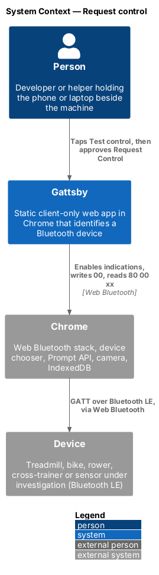
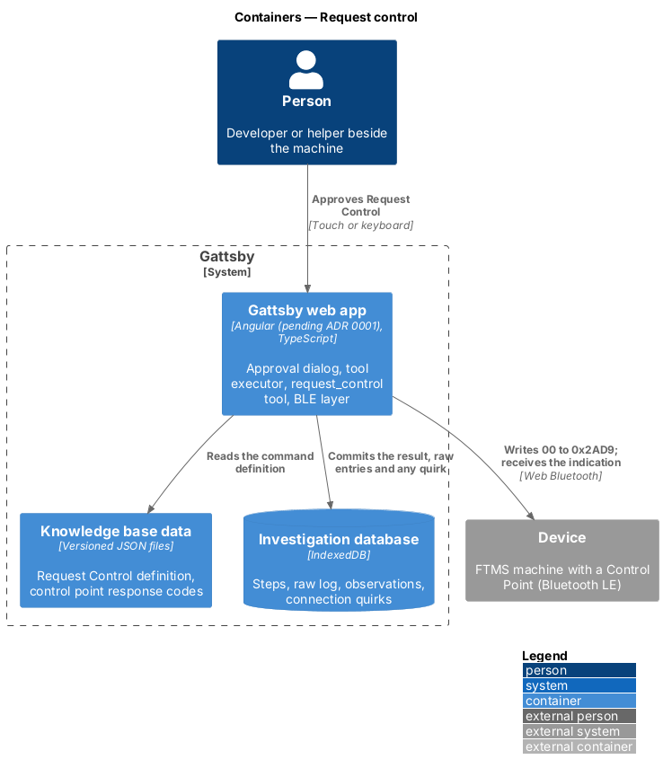
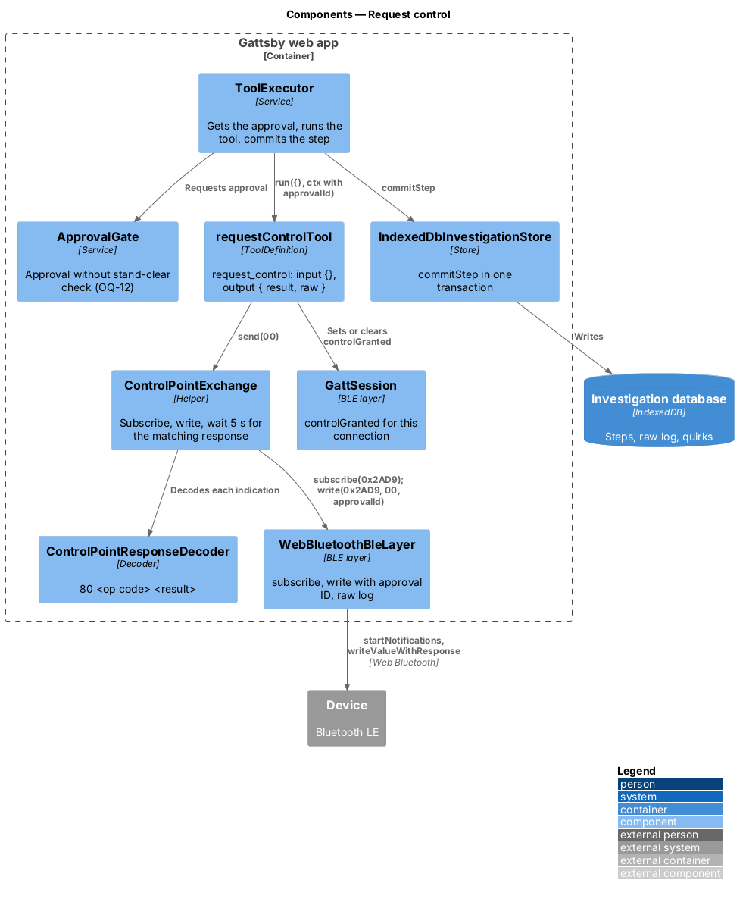
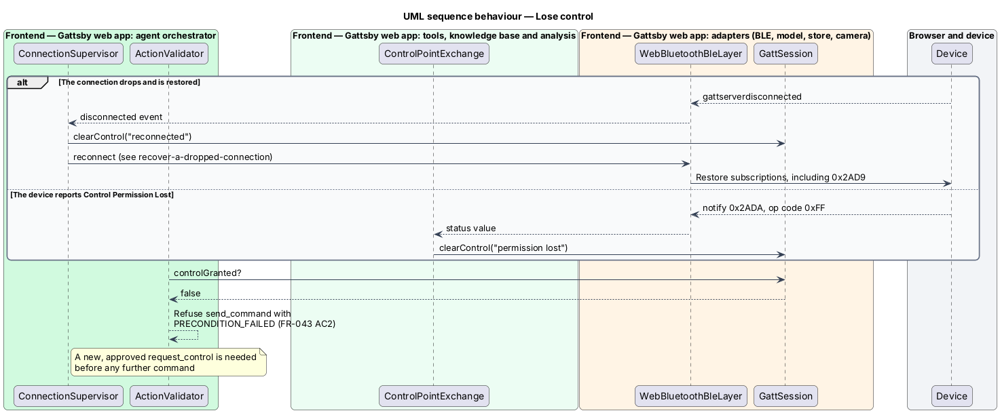

# Request control

## Overview

An FTMS machine accepts commands only from a client that has asked for control and been granted it.
This feature is the first step of the optional Control stage of the playbook: it asks the device for
control through the `request_control` tool and reports the device's answer. Every later command test
depends on its result (see the test-one-command design), and a refusal ends the Control stage
without another command. The feature belongs to the device-control subsystem.

**Fitness Machine Control Point** — FTMS characteristic `0x2AD9` that receives procedure requests
(op code first, then parameters) and answers each by indication

**Request Control** — FTMS procedure with op code `0x00` and no parameter, by which a client asks to
command the machine

**response indication** — Control Point indication `80 <request op code> <result code>` that answers
one procedure; `80 00 01` means Request Control succeeded

**control grant** — fact that the device answered Request Control with success on the current
connection

The person reaches this step from the Investigation page, state `control`
(`docs/mocks/pages/investigation/control.html`), by tapping "Test control" on the "Test control?"
prompt. `request_control` is a tool of safety class `control`, so it opens the Approve a command
dialog first (see the approve-a-command design). It moves nothing, so its prompt carries no
stand-clear check (OQ-12). While the device answers, the dialog shows its busy state
(`docs/mocks/dialogs/approval/busy.html`: "waiting up to 5 s for the treadmill to answer"); a refusal
shows the failed state (`docs/mocks/dialogs/approval/failed.html`). The evidence log records the
exchange as "Approved: request control", "Sent: 0x2AD9 control point `00`" and "Received: 0x2AD9
indicate `80 00 01` Response: success" (`docs/mocks/pages/evidence/default.html`).

## Description

The design introduces these building blocks in the Angular (pending ADR 0001) workspace under
`frontend/src/app/`:

- **`requestControlTool`** (`tools/control/request-control.tool.ts`) — the `ToolDefinition` for
  `request_control`: group Control, safety class `control`, stage `control`, input `{}`, output
  `{ result, raw }`. Preconditions: connected, FTMS Control Point present, not emergency-stopped.
  `ToolExecutor` obtains the approval before `run` is called and passes its ID in `ToolContext`.
- **`ControlPointExchange`** (`tools/control/control-point-exchange.ts`) — shared helper for every
  Control Point procedure (`request_control`, `send_command` and emergency stop). It makes sure
  indications are enabled on `0x2AD9`, writes the request with the approval ID, and waits up to 5
  seconds for the response indication whose request op code matches. It ignores indications for
  other op codes and returns a `ControlPointOutcome` or `TIMEOUT`.
- **`ControlPointResponseDecoder`** (`knowledge-base/decoders/control-point-response.decoder.ts`) — the
  standard decoder for `0x2AD9` indications: checks the response code `0x80`, then reads the request
  op code and the result code. A value that does not fit is a `DecodeError`, logged and skipped.
- **`WebBluetoothBleLayer`** (`ble/web-bluetooth-ble-layer.ts`) — `subscribe(0x2AD9, onValue)` calls
  `startNotifications()`, which enables indications through the browser. It is not a characteristic
  write and needs no approval token. `write(0x2AD9, 00, approvalId)` consumes the token (see the
  approve-a-command design).
- **`GattSession`** (`ble/gatt-session.ts`) — holds `controlGranted` for the current connection. It
  starts `false` on every connection, is set by a success result, and is cleared on disconnect.
  `0x2AD9` joins the subscriptions it restores after a reconnect.
- **`RawTrafficLog`** (`ble/raw-traffic-log.ts`) — logs the write with its approval ID and the
  indication with a millisecond timestamp (FR-073).
- **`InvestigationStore.commitStep`** (`store/investigation-store.ts`) — commits the approval, the
  write, the indication, the `control` observation and, on a refusal, the connection quirk in one
  transaction.

### Result codes

| Indication | `result` | Shown as | Effect |
|---|---|---|---|
| `80 00 01` | `success` | "Success" | `controlGranted` set; controllable features may be tested (FR-037 AC1) |
| `80 00 02` | `opNotSupported` | "Op code not supported" | Quirk recorded; Control stage ends |
| `80 00 03` | `invalidParameter` | "Invalid parameter" | Quirk recorded; Control stage ends |
| `80 00 04` | `operationFailed` | "Operation failed" | Quirk recorded; Control stage ends |
| `80 00 05` | `controlNotPermitted` | "Control not permitted" | Quirk recorded; no further control command is proposed (FR-037 AC2) |
| none in 5 s | — | "No answer in 5 seconds" | Envelope `ok: false`, `TIMEOUT`; Control stage ends |

A non-success result is a valid answer, so the envelope is `ok: true` with that `result`; TOOL-021
lists no `DEVICE_REJECTED` for this tool. The summary reads, for example, "Request control: control
not permitted (80 00 05)". After any non-success result or a timeout, `PlaybookRules` proposes no
further control command, and `ActionValidator` refuses `send_command` with `PRECONDITION_FAILED`
because `controlGranted` is false. The profile lists every controllable feature as *refused* after
a refusal (FR-040; see the test-one-command design).

### Rules

1. Indications are enabled before the write, so a fast answer is not missed (FR-037).
2. The 5-second timer starts when the write is acknowledged. The timer is a `setTimeout` owned by the
   exchange, so unit tests advance a fake clock. Emergency stop aborts the wait at once through the
   investigation's `AbortSignal`.
3. Request Control needs an approval like every `control` call. Its approval request has
   `isMotion: false`, so the dialog shows no stand-clear check (OQ-12). Its sequence label is
   "Command 1 of *n*".
4. The grant belongs to one connection. A drop and reconnect (FR-016) clears `controlGranted`, so a
   later command needs a new, approved Request Control.
5. Where the device has Fitness Machine Status (`0x2ADA`), the exchange also subscribes to it. A
   "Control Permission Lost" status (op code `0xFF`) clears `controlGranted` and is recorded as an
   observation.
6. A device without `0x2AD9`, or whose `0x2AD9` lacks write or indicate, fails the precondition: the
   validator refuses the call with `PRECONDITION_FAILED`, or the tool returns `PROPERTY_MISSING` if
   the properties are found missing at run time.

### Data shapes

| Type | Fields |
|---|---|
| `RequestControlOutput` | `result` (`success`, `opNotSupported`, `invalidParameter`, `operationFailed`, `controlNotPermitted`), `raw` (hex) |
| `ControlPointResponse` | `requestOpCode`, `resultCode`, `result`, `raw` |
| `ControlPointOutcome` | `response`, `writeEntryId`, `indicationEntryId`, `elapsedMs` |

### Errors

| Code | Raised by | Meaning to the person |
|---|---|---|
| `APPROVAL_DENIED` | `ApprovalGate` | "Not sent." Nothing was written. |
| `EMERGENCY_STOPPED` | `ApprovalGate` | "Emergency stop was used. Nothing more will be sent." |
| `PROPERTY_MISSING` | `requestControlTool` | "This machine's control point can't take commands." |
| `TIMEOUT` | `ControlPointExchange` | "The machine didn't answer within 5 seconds." |
| `NOT_CONNECTED` | `WebBluetoothBleLayer` | The connection banner takes over (see the recover-a-dropped-connection design). |

Messages are provisional (A-01, OQ-06).

### Tests that prove it

The fake FTMS treadmill in `e2e/fixtures/fake-bluetooth.ts` is scripted to indicate `80 00 01`, `80 00
05` or nothing. Acceptance specs drive the `ApprovalDialog` page object and check the result in the
activity feed and the quirk in the profile. Unit tests cover `ControlPointResponseDecoder` for every
result code and a malformed value, and the 5-second timeout with a fake clock.

## Requirements

The feature realizes the following level-2 (L2) requirements; each refines the level-1 (L1)
requirement cited beside it.

| L2 ID | Refines (L1) | Requirement |
|-------|--------------|-------------|
| [`FR-037`](../../../specs/L2.md#fr-037-request-control-and-report-the-result) | `L1-009` | For FTMS, Gattsby must send Request Control (`0x00`) to the Fitness Machine Control Point, with indications enabled, and must report the response's result code (success, op code not supported, invalid parameter, operation failed, control not permitted) or a timeout after 5 seconds. |
| [`TOOL-021`](../../../specs/L2.md#tool-021-request_control) | `L1-009` | Enables indications on the FTMS Control Point and writes Request Control (`0x00`), reporting the result code. |

## Diagrams

### System context

The person approves Request Control in Gattsby, which writes `00` to the device's control point
through Chrome and reads the device's answer back as an indication.

### Containers

The web app reads the Request Control definition from the knowledge base, exchanges it with the
device, and commits the result and any quirk to the investigation database.

### Components

`ToolExecutor` gets the approval, then runs `requestControlTool`, which uses `ControlPointExchange`
to subscribe, write and wait; `ControlPointResponseDecoder` reads the indication and `GattSession`
holds the grant.

### Class structure

`requestControlTool` is a `ToolDefinition` that delegates the write-and-wait to
`ControlPointExchange`; the exchange decodes each indication into a `ControlPointResponse` and sets
`GattSession.controlGranted`.

### Behaviour — request control and report the result

After the approval, indications are enabled, `00` is written, and the result of `80 00 xx` is
reported; success sets the grant, a refusal records a quirk, and silence for 5 seconds is a timeout.

### Behaviour — lose control

A reconnect or a "Control Permission Lost" status clears the grant, so a later `send_command` is
refused with `PRECONDITION_FAILED` until control is requested and approved again.

