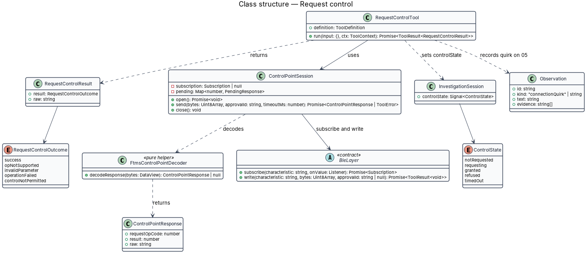
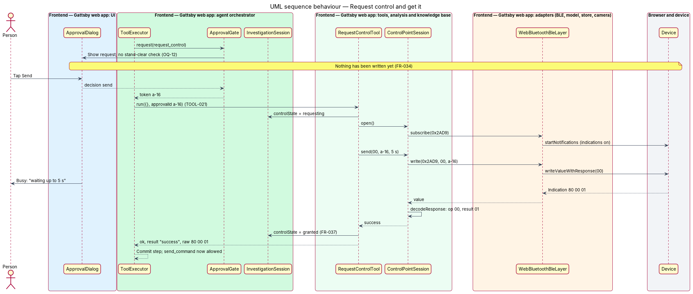
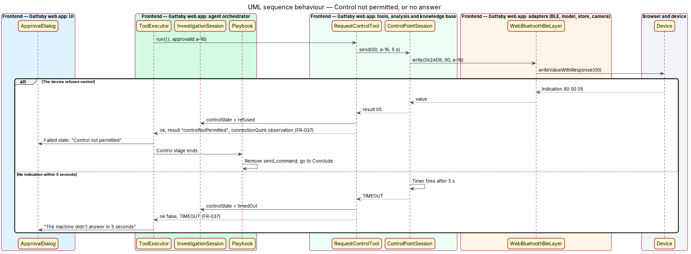

# Request control

## Overview

An FTMS machine accepts commands only from a client that holds control. Before any test command, the
client asks for it by writing Request Control (op code `0x00`) to the Fitness Machine Control Point
(`0x2AD9`) and reads the machine's answer from an indication on the same characteristic. This
feature is that request and the report of its result. It belongs to the device-control subsystem and
is the first command of the optional Control stage of the playbook; the
[test-one-command design](../test-one-command/README.md) decides whether the stage runs and what
follows.

**Fitness Machine Control Point** — FTMS characteristic (`0x2AD9`) that takes commands by write and
answers each one by indication

**indication** — notification the device sends and the client acknowledges; the Control Point
answers every command this way

**response code** — three bytes of a Control Point indication: `80` (response), the op code being
answered, and the result code

**result code** — one byte stating the outcome: `01` success, `02` op code not supported, `03`
invalid parameter, `04` operation failed, `05` control not permitted

**control state** — whether this investigation holds control of the device: not requested,
requesting, granted, refused or timed out

`request_control` is a `control` tool, so it passes through the approval gate of the
[approve-a-command design](../approve-a-command/README.md). It moves nothing, so its prompt carries
no stand-clear check (`OQ-12`). While the device answers, the Approve a command dialog shows its busy
state (`docs/mocks/dialogs/approval/busy.html`: "waiting up to 5 s for the treadmill to answer"). A
refusal shows the failed state (`docs/mocks/dialogs/approval/failed.html`), which tells the person
that no more commands will be proposed and that the profile will list control as refused. The mocks
draw both states for a speed command; a request for control uses the same states with its own title,
which is provisional (`A-01`).

## Description

The design introduces these building blocks in the Angular (pending ADR 0001) workspace under
`frontend/src/app/`:

- **`RequestControlTool`** (`tools/control/request-control.tool.ts`) — the `request_control` tool,
  safety class `control`, group Control, input `{}`. Its preconditions are: connected, FTMS Control
  Point present with the write and indicate properties, and not emergency-stopped. It runs only with
  the approval ID that `ToolExecutor` passes through `ToolContext`.
- **`ControlPointSession`** (`tools/control/control-point-session.ts`) — owns the Control Point for
  the investigation. `open()` starts indications through `BleLayer.subscribe` once; `send(bytes,
  approvalId, timeoutMs)` writes through `BleLayer.write` and waits for the indication that answers
  the same op code; `close()` stops indications and releases the listener. `request_control`,
  `send_command` and `emergency_stop` share it, so a later command does not subscribe again. It is
  closed on disconnect and when the investigation ends.
- **`ftms-control-point.decoder.ts`** (`knowledge-base/decoders/ftms-control-point.decoder.ts`) — pure
  helper. `decodeResponse(bytes)` returns `{ requestOpCode, result }` for an indication that starts
  with `80`, and `null` for anything else. The result-code names are data in the knowledge base's
  FTMS entry.
- **`InvestigationSession.controlState`** (`agent/investigation-session.ts`) — a signal of type
  `ControlState`. `RequestControlTool` sets it to `requesting`, then to `granted`, `refused` or
  `timedOut`. `send_command` requires `granted` (TOOL-022), so no command can follow any other
  outcome.
- **`Observation` of kind `connectionQuirk`** (`store/model/observation.ts`) — the tool's envelope
  carries one for "Control not permitted", committed with the step; `DeviceProfileBuilder` lists it
  under the profile's connection quirks (see the
  [build-the-device-profile design](../../outcome/build-the-device-profile/README.md)).
- **`Playbook`** (`agent/playbook.ts`) — after `refused`, removes `send_command` from the Control
  stage's allowed tools and moves on to Conclude, so no further control command is proposed in either
  mode.

### Rules

1. Nothing is written before the approval. Starting indications writes the Control Point's
   descriptor, so `ControlPointSession.open()` runs after the person taps "Send", never while the
   prompt is shown (FR-034).
2. The tool writes exactly `00` with the approval's ID. The BLE layer consumes the token for
   `0x2AD9` and `00` before it writes (NFR-018).
3. The tool waits 5 seconds for an indication that starts `80 00`. An indication for another op code
   does not end the wait. After 5 seconds the tool returns `TIMEOUT` and sets `timedOut`.
4. `80 00 01` sets `granted`; the result is "Success" and controllable features may be tested.
5. `80 00 05` sets `refused`; the result is "Control not permitted", recorded as a connection quirk,
   and no further control command is proposed (FR-037).
6. `80 00 02`, `80 00 03` and `80 00 04` are reported with their names; control stays not granted, so
   `send_command` fails its precondition. A repeat `request_control` needs a new approval and counts
   against the step budget.
7. A result code outside `01` to `05` is recorded with its raw bytes; its reported result is
   `<TO SUPPLY>`, because TOOL-021's output names only the five codes.
8. Emergency stop latches the gate first; a pending `request_control` returns `EMERGENCY_STOPPED` or
   `ABORTED` and the wait ends.

### Data shapes

| Type | Fields |
|---|---|
| `RequestControlResult` | `result` (`success`, `opNotSupported`, `invalidParameter`, `operationFailed`, `controlNotPermitted`), `raw` (hex) |
| `ControlPointResponse` | `requestOpCode`, `result`, `raw` |
| `ControlState` | `notRequested`, `requesting`, `granted`, `refused`, `timedOut` |

### Errors

| Code | Raised by | Meaning to the person |
|---|---|---|
| `APPROVAL_DENIED` | `ApprovalGate` | "Not sent." Control is not requested; the Control stage may be skipped. |
| `EMERGENCY_STOPPED` | `ApprovalGate` | "Emergency stop was used. Nothing more will be sent." |
| `PROPERTY_MISSING` | `RequestControlTool` | The Control Point cannot be written or does not indicate; control is listed as claimed only. |
| `TIMEOUT` | `ControlPointSession` | "The machine didn't answer in 5 seconds." The result is recorded; nothing more is sent. |
| `NOT_CONNECTED` | `RequestControlTool` | The connection banner offers to reconnect. |

### Tests that prove it

The acceptance spec (`e2e/specs/device-control/request-control.spec.ts`) uses the FTMS treadmill of
the fake `navigator.bluetooth` (`e2e/fixtures/fake-bluetooth.ts`), scripted to indicate `80 00 01` in
one scenario and `80 00 05` in another, and the `ApprovalDialog` and `InvestigationPage` page
objects. It checks that the fake records no write while the prompt is shown, that "Don't send"
returns `APPROVAL_DENIED` with nothing written, that success lets a command be proposed, and that
`80 00 05` shows the failed state and proposes no further command. Unit tests cover
`decodeResponse` and the 5-second timeout of `ControlPointSession` with a fake clock.

## Requirements

The feature realizes the following level-2 (L2) requirements; each refines the level-1 (L1)
requirement cited beside it.

| L2 ID | Refines (L1) | Requirement |
|-------|--------------|-------------|
| [`FR-037`](../../../specs/L2.md#fr-037-request-control-and-report-the-result) | `L1-009` | For FTMS, Gattsby must send Request Control (`0x00`) to the Fitness Machine Control Point, with indications enabled, and must report the response's result code (success, op code not supported, invalid parameter, operation failed, control not permitted) or a timeout after 5 seconds. |
| [`TOOL-021`](../../../specs/L2.md#tool-021-request_control) | `L1-009` | Enables indications on the FTMS Control Point and writes Request Control (`0x00`), reporting the result code. |

## Diagrams

### System context

The person approves the request in Gattsby, which writes Request Control through Chrome's Web
Bluetooth stack and reads the machine's answer by indication.

### Containers

The web app reads the FTMS op code and result-code names from the knowledge base, talks to the
device's Control Point, and commits the result and any connection quirk to the investigation
database.

### Components

`RequestControlTool` opens `ControlPointSession` after the approval, sends `00` with the token's ID,
decodes the indication, and sets `controlState`; a refusal becomes a connection quirk.

### Class structure

`RequestControlTool` depends on the shared `ControlPointSession`, which uses the `BleLayer` contract
and the pure Control Point decoder; `ControlState` lives on `InvestigationSession`.

### Behaviour — request control and get it

After the person taps "Send", the tool starts indications, writes `00`, and the treadmill indicates
`80 00 01`; control is granted.

### Behaviour — control not permitted, or no answer

`80 00 05` is reported as "Control not permitted", recorded as a connection quirk, and ends the
Control stage; no indication within 5 seconds returns `TIMEOUT`.

