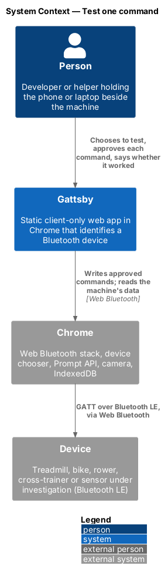
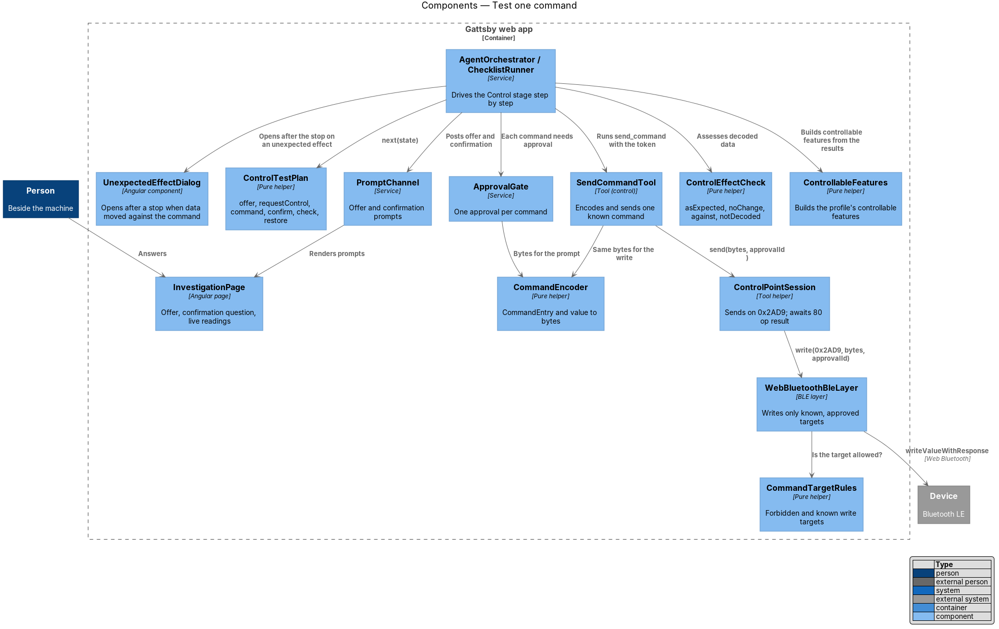
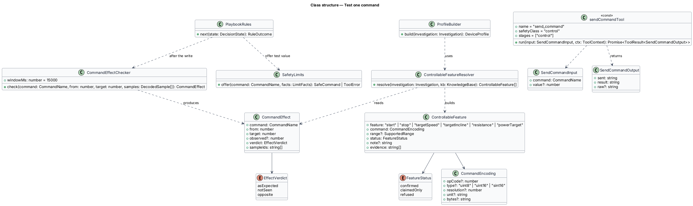
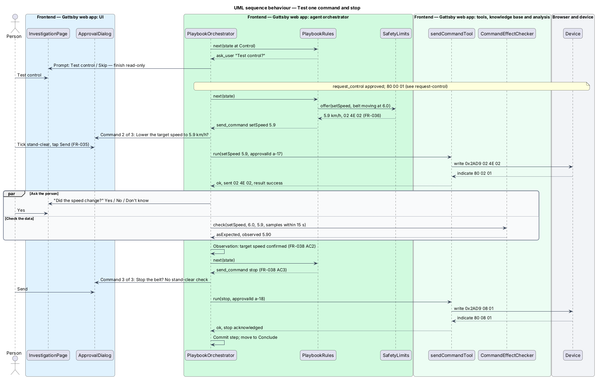
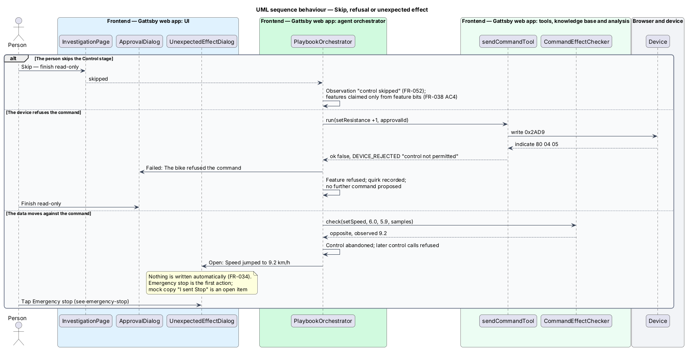
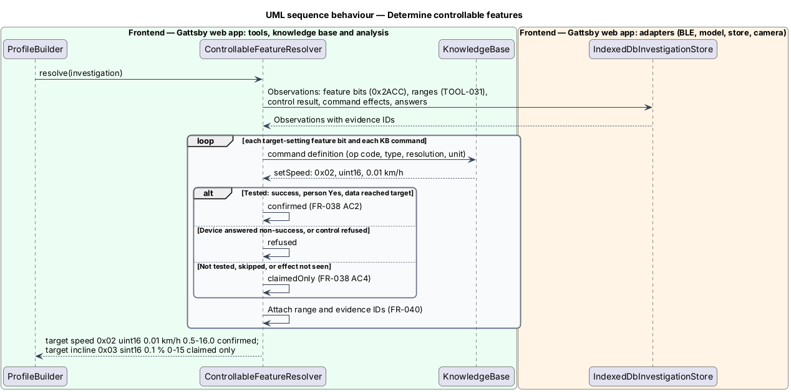

# Test one command

## Overview

Reading a machine is enough for most fitness software, but the developer standing beside it also
wants to know whether the software can command it. This feature is the body of the optional Control
stage of the playbook. Once control is granted (see the request-control design), Gattsby sends one
low-risk command, asks the person whether the machine did what was expected, checks the decoded data
where it can, and then sends stop or returns to the starting value. From what happened it records,
for each controllable feature, how it is commanded and whether it was confirmed. The feature belongs
to the device-control subsystem.

**controllable feature** — machine function that a command can set: start, stop, target speed, target
incline, resistance or power target

**test command** — the one low-risk command the Control stage sends, such as resistance +1 on a bike
or target speed one increment lower on a moving treadmill

**feature status** — how far a controllable feature was established: *confirmed* (sent, accepted and
seen to work), *claimed only* (advertised by the feature bits but not shown to work) or *refused*
(the device answered with a non-success result)

The stage opens on the Investigation page, state `control`
(`docs/mocks/pages/investigation/control.html`), with the prompt "Test control?" ("Optional. I'll ask
before every single command.") and the answers "Test control" and "Skip — finish read-only". Each
command then opens the Approve a command dialog: the test command with the stand-clear check
(`docs/mocks/dialogs/approval/default.html`, "Command 2 of 3 · Lower the target speed to 5.9
km/h?"), and the closing stop without it (`docs/mocks/dialogs/approval/stop.html`, "Command 3 of 3 ·
Stop the belt?"). A device refusal shows `docs/mocks/dialogs/approval/failed.html`; data that moves
against the command shows the Unexpected response dialog
(`docs/mocks/dialogs/unexpected-effect/default.html`). The result appears under "Can control" on the
Verdict page (`docs/mocks/pages/verdict/default.html`) and under "Controllable" on the Device profile
page (`docs/mocks/pages/device-profile/default.html`). Whether the Control stage runs in a store at
all was open (OQ-08). The Control stage is optional and skippable even when the device supports it.

## Description

The design introduces these building blocks in the Angular (pending ADR 0001) workspace under
`frontend/src/app/`:

- **`PlaybookRules`** (`agent/playbook-rules.ts`) — the Control-stage rules. They are deterministic in
  both modes (see the apply-heuristics-first design): offer the stage, request control, pick the test
  command, ask about its effect, close with stop or a return, then move to Conclude.
- **`SafetyLimits`** (`agent/safety-limits.ts`) — `offer(command, facts)` gives the test command's one
  value (see the keep-commands-conservative design).
- **`sendCommandTool`** (`tools/control/send-command.tool.ts`) — the `ToolDefinition` for
  `send_command`: safety class `control`, stage `control`, input `{ command, value? }`, output `{ sent,
  result, raw? }`. Preconditions: connected; control granted (FTMS) or a vendor command known;
  stand-clear confirmed for a motion command; not emergency-stopped. It encodes the checked value,
  sends it through `ControlPointExchange` (see the request-control design) and maps the response.
- **`CommandEffectChecker`** (`analysis/command-effect-checker.ts`) — pure helper. Given the command,
  the starting value, the target and the decoded samples after the write, it returns `asExpected`,
  `notSeen` or `opposite`. It looks at the 15 seconds after the write, the window A-12 uses for a
  confirmed metric.
- **`askUserTool`** (`tools/person/ask-user.tool.ts`) — asks "Did the speed change?" or "Did the
  resistance change?" with "Yes", "No" and "Don't know" (see the ask-the-person design).
- **`UnexpectedEffectDialog`** (`dialogs/unexpected-effect/unexpected-effect.dialog.ts`) —
  presentation component shown when `CommandEffectChecker` returns `opposite`. Further test
  commands are blocked. The person can use the physical stop or tap Emergency stop.
- **`ControllableFeatureResolver`** (`outcome/controllable-feature-resolver.ts`) — builds the
  `ControllableFeature` list for `ProfileBuilder` from the FTMS Fitness Machine Feature bits
  (`0x2ACC`), the supported ranges (TOOL-031), the knowledge-base command definitions and the
  command test's outcome.
- **`ProfileBuilder`** (`outcome/profile-builder.ts`) — places the list in the device profile's
  controllable features (see the build-the-device-profile design).

### The Control stage, step by step

1. **Offer.** When FTMS Control Point `0x2AD9` is present and the standard path has confirmed at least
   one metric, the rules ask "Test control?". "Skip — finish read-only" records a skip observation
   (FR-052) and moves to Conclude.
2. **Request control** with approval (FR-037). A non-success result or a timeout ends the stage.
3. **Pick the test command.** The limits entry for the device type lists the test order (bike, rower
   and cross-trainer: resistance; treadmill: target speed while the belt moves, then incline). The
   first command whose target-setting feature bit is set and that `SafetyLimits.offer` accepts is
   used. The test order per type is `<TO SUPPLY>` with the limits themselves (OQ-07).
4. **Send it** with approval and the stand-clear check (FR-034, FR-035). For the mocks' treadmill this
   is target speed 6.0 → 5.9 km/h, `02 4E 02` to `0x2AD9`, answered by `80 02 01`. For an FTMS bike
   it is resistance +1 (FR-038 AC1).
5. **Ask and check.** The person is asked whether the machine did it; at the same time
   `CommandEffectChecker` reads the decoded data. Both results are stored as observations.
6. **Close.** The rules propose stop (`08 01`) or the return to the starting value, each with its own
   approval (FR-038 AC3). A stop needs no stand-clear check; a return is a motion command and does.
7. **Conclude.** The stage ends and no further command is proposed.

### Outcomes and feature status

| What happened | Status of the tested feature |
|---|---|
| Device answered success, the person said "Yes" and the decoded value reached the target | *confirmed* (FR-038 AC2) |
| Device answered success, the person said "Yes", and the data carries no field for the metric | *confirmed*, evidence names the person's answer only |
| Device answered success, but the person said "No" or "Don't know" and the data did not move | *claimed only*, with the note "accepted, effect not seen" |
| Device answered a non-success result (for example `80 02 05`) | *refused*; no further command is proposed |
| The person skipped the stage | every feature with a set target-setting bit is *claimed only* (FR-038 AC4) |

Features that were not tested take *claimed only* from their feature bit. After a refused Request
Control, every controllable feature is *refused*. Stop is *confirmed* when the device acknowledges
`80 08 01` and the decoded speed falls.

### Device answers to `send_command`

| Indication | Envelope |
|---|---|
| `80 <op> 01` | `ok: true`, `result: "success"`, `sent` and `raw` in hex |
| `80 <op> 02`–`05` | `ok: false`, `DEVICE_REJECTED`, message names the result ("invalid parameter" for `80 02 03`, TOOL-022 AC3) |
| none in 5 s | `ok: false`, `TIMEOUT` |

### Unexpected effect

When the decoded data moves against the command, the orchestrator blocks further test commands and
opens the Unexpected response dialog. The dialog shows the actual reading and points to the machine's
own physical stop. It also offers Emergency stop, whose tap authorizes its stop sequence (FR-034).

### Data shapes

| Type | Fields |
|---|---|
| `SendCommandInput` | `command` (`start`, `stop`, `pause`, `setSpeed`, `setIncline`, `setResistance`, `setPower`), `value?` |
| `SendCommandOutput` | `sent` (hex), `result`, `raw?` (hex) |
| `CommandEffect` | `command`, `from`, `target`, `observed?`, `verdict` (`asExpected`, `notSeen`, `opposite`), `sampleIds` |
| `ControllableFeature` | `feature`, `command` (`opCode`, `type`, `resolution`, `unit`, or vendor `bytes`), `range?` (`min`, `max`, `increment`), `status` (`confirmed`, `claimedOnly`, `refused`), `note?`, `evidence` |

For the mocks' treadmill the profile lists "Set target speed: op `0x02`, uint16, 0.01 km/h,
0.5–16.0, tested 6.0 → 5.9, *confirmed*" and "Set target incline: op `0x03`, sint16, 0.1 %, 0–15,
advertised, not tested, *claimed only*" (FR-040 AC1).

### Errors

| Code | Raised by | Meaning to the person |
|---|---|---|
| `DEVICE_REJECTED` | `sendCommandTool` | The activity feed names the device's refusal. The playbook finishes read-only. |
| `UNSAFE_VALUE` | `SafetyLimits` | No prompt; see the keep-commands-conservative design. |
| `PRECONDITION_FAILED` | `ActionValidator` | Control not granted, or control abandoned after a refusal or an unexpected effect. |
| `APPROVAL_DENIED`, `EMERGENCY_STOPPED`, `TIMEOUT` | as in the approve-a-command and request-control designs | |

### Tests that prove it

Acceptance specs use the fake FTMS bike (resistance +1 and "Did the resistance change?") and the fake
FTMS treadmill (5.9 km/h, then stop), with the `ApprovalDialog` and `InvestigationPage` page objects.
Scripts cover a success, a `80 02 05` refusal, a skipped stage and data that moves the wrong way.
Unit tests cover `CommandEffectChecker` and `ControllableFeatureResolver` for each row of the status
table.

## Requirements

The feature realizes the following level-2 (L2) requirements; each refines the level-1 (L1)
requirement cited beside it.

| L2 ID | Refines (L1) | Requirement |
|-------|--------------|-------------|
| [`FR-038`](../../../specs/L2.md#fr-038-test-one-command-and-confirm-its-effect) | `L1-009` | The Control stage is optional and must offer the person the choice to skip it. If they take it, Gattsby must send one low-risk command, ask the person whether the machine did what was expected, check the decoded data where it can, and then send stop (FTMS Stop or Pause, or the vendor's equivalent), also with approval. |
| [`FR-040`](../../../specs/L2.md#fr-040-determine-controllable-features) | `L1-009` | For each controllable feature (start, stop, target speed, incline, resistance, power target) Gattsby must record in the profile how it is commanded (op code and parameter encoding, or vendor command bytes), its supported range where the device reports one, and whether it was *confirmed*, *claimed only* or *refused* by the device. |
| [`TOOL-022`](../../../specs/L2.md#tool-022-send_command) | `L1-009` | Sends one known command: start or resume, stop, pause, set target speed, incline, resistance or power. The bytes come from the knowledge base; the value must be within its safe limits (FR-036). |

## Diagrams

### System context

The person chooses to test control, approves each command and says whether the machine responded;
Gattsby writes each approved command through Chrome and reads the machine's data back.

### Containers

The web app reads the test order, limits and command definitions from the knowledge base, exchanges
commands with the device, and commits every outcome to the investigation database for the profile.

### Components

`PlaybookRules` picks the test command with `SafetyLimits`; `sendCommandTool` sends it after approval;
`CommandEffectChecker` and the person's answer decide the outcome; `ControllableFeatureResolver` turns
outcomes and feature bits into the profile's controllable features.

### Class structure

`sendCommandTool` returns `SendCommandOutput`; `CommandEffectChecker` produces a `CommandEffect`; and
`ControllableFeatureResolver` combines effects, feature bits and ranges into `ControllableFeature`
records.

### Behaviour — test one command and stop

The person agrees to the test, approves target speed 5.9 km/h with the stand-clear check, confirms
the change, and approves the closing stop; the feature is recorded as *confirmed*.

### Behaviour — skip, refusal or unexpected effect

A skip lists features as *claimed only*; a device refusal returns `DEVICE_REJECTED` and lists the
feature as *refused*; data that moves against the command abandons control and opens the Unexpected
response dialog without an automatic write.

### Behaviour — determine controllable features

At Conclude, `ControllableFeatureResolver` reads the feature bits, the ranges, the command
definitions and the test outcome, and gives `ProfileBuilder` one entry per controllable feature.

