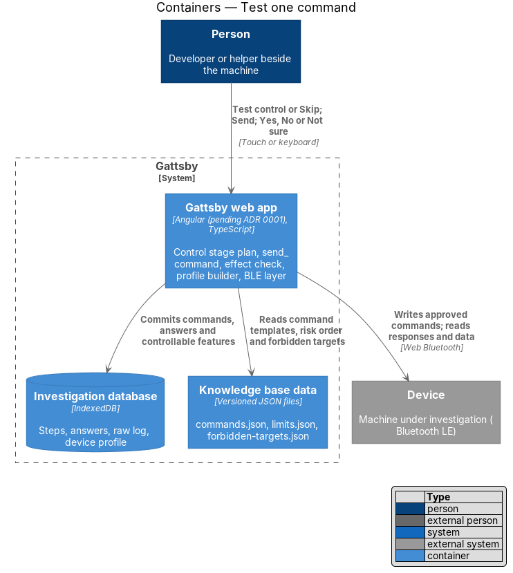
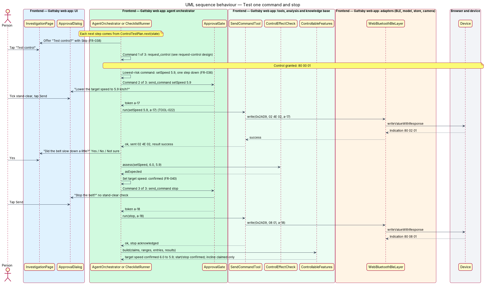
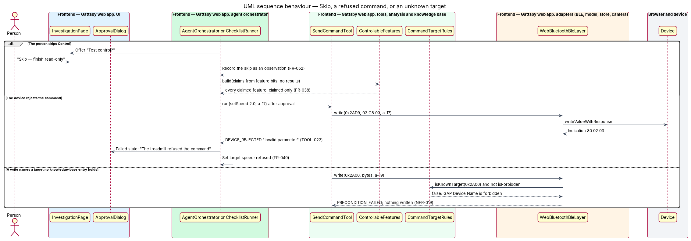
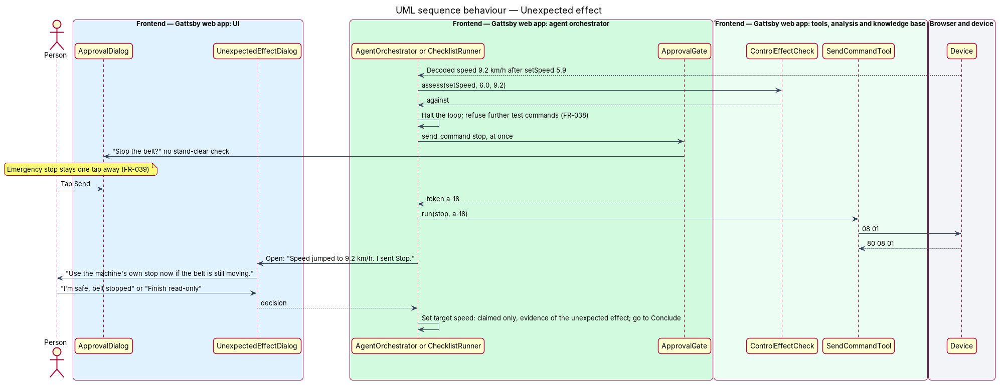

# Test one command

## Overview

Reading a device tells a developer what it reports; only a command tells them what it can be told to
do. This feature is the optional Control stage of the playbook: with the person's consent it sends
one low-risk command, asks the person whether the machine did what was expected, checks the decoded
data, and then sends stop, each command with its own approval. It also writes the result into the
device profile as a list of controllable features, and it keeps every write inside the set of
commands the knowledge base holds. It belongs to the device-control subsystem and runs between the
Standard or Proprietary path and Conclude.

**controllable feature** — one thing a device can be commanded to do: start, stop, target speed,
target incline, target resistance or target power

**command test** — the sequence of request control, one low-risk command, the person's confirmation,
the data check, and stop or a return to the starting value

**confirmed** — status of a controllable feature that was sent, accepted by the device, and seen to
take effect

**claimed only** — status of a controllable feature that the device's feature bits claim but that was
not tested or not seen to take effect

**refused** — status of a controllable feature that the device answered with a non-success result
code, or for which it refused control

**unexpected effect** — decoded data that moves against the command, such as a belt that speeds up
after a command to slow it

The stage opens with an offer in the investigation's prompt dock
(`docs/mocks/pages/investigation/control.html`): "Test control? Optional. I'll ask before every single
command.", with "Test control" and "Skip — finish read-only". A test is three commands, each shown
in the Approve a command dialog with its place in the sequence: request control (see the
[request-control design](../request-control/README.md)), the test command
(`docs/mocks/dialogs/approval/default.html`: "Command 2 of 3 · Lower the target speed to 5.9 km/h?")
and stop (`docs/mocks/dialogs/approval/stop.html`: "Command 3 of 3 · Stop the belt?"). A device that
refuses shows the failed state (`docs/mocks/dialogs/approval/failed.html`). Data that moves against
the command leads to the Unexpected response dialog
(`docs/mocks/dialogs/unexpected-effect/default.html`). The profile lists each feature with its
command, range and status (`docs/mocks/pages/device-profile/default.html`: "Set target speed op 0x02
· uint16 · 0.01 km/h · 0.5–16.0 · tested 6.0 → 5.9 · confirmed").

Whether the Control stage should run in a store at all at MVP is open (`OQ-08`). The design offers it
in every investigation that reaches it, always optional.

## Description

The design introduces these building blocks in the Angular (pending ADR 0001) workspace under
`frontend/src/app/`:

- **`ControlTestPlan`** (`agent/control-test-plan.ts`) — pure helper that holds the Control stage's
  order: `offer`, `requestControl`, `command`, `confirm`, `check`, `restore`, `done`. `next(state)`
  returns the next step and its place in the sequence ("Command 2 of 3"). `ChecklistRunner` follows
  it step by step; in full agent mode `PlaybookHeuristics` uses it where the next step is fixed (after
  the test command, only stop or a return is allowed), and `ActionValidator` refuses a second test
  command with `NOT_ALLOWED_AT_STAGE`.
- **`PromptChannel`** (`agent/prompt-channel.ts`) — posts the offer as a `question` prompt with two
  answers. "Skip — finish read-only" is a skip (FR-052): it is recorded as an observation and the
  playbook moves to Conclude. After the test command it posts the confirmation question with the
  answers "Yes", "No" and "Not sure", for example "Did the resistance change?".
- **`SendCommandTool`** (`tools/control/send-command.tool.ts`) — the `send_command` tool, safety class
  `control`, group Control, input `{ command, value? }`. Its preconditions are: connected, control
  granted (FTMS) or a vendor command known, an approval for this call, the stand-clear confirmation
  for a motion command, and not emergency-stopped. It resolves the `CommandEntry`, encodes the bytes,
  sends them through `ControlPointSession.send` with the approval's ID, and waits 5 seconds for the
  response. `80 <op> 01` is success; any other result code returns `DEVICE_REJECTED` with the code's
  name. FTMS commands are MVP; vendor commands are P2 and their response handling comes from each
  vendor's entry (`<TO SUPPLY>` per vendor).
- **`CommandEncoder`** (`knowledge-base/command-encoder.ts`) — pure helper. `encode(entry, value)`
  builds the bytes from the entry's template: op code, then the parameter in the entry's type and
  resolution. Set target speed is op `0x02` with a uint16 in 0.01 km/h, so 2.0 km/h encodes as
  `02 C8 00` and 5.9 km/h as `02 4E 02`; set target incline is op `0x03` with a sint16 in 0.1 %; stop
  is `08 01`. `ApprovalGate` and `SendCommandTool` both call it, so the bytes the person approves are
  byte-for-byte the bytes the BLE layer writes.
- **`ControlEffectCheck`** (`analysis/control-effect-check.ts`) — pure helper. `assess(command,
  before, after)` compares the decoded values of the commanded setting before and after the command
  and returns `asExpected`, `noChange`, `against` or `notDecoded`. The window it reads after the
  command is `<TO SUPPLY>`; `A-12` sets 15 seconds for a person's action, and the command check has
  no stated window yet.
- **`UnexpectedEffectDialog`** (`dialogs/unexpected-effect/unexpected-effect.dialog.ts`) —
  presentation component. Input: the commanded and observed values. Outputs: `finishReadOnly` and
  `safe`. It opens only after a stop has been sent, as its mock states.
- **`ControllableFeatures`** (`outcome/controllable-features.ts`) — pure helper. `build(claims,
  ranges, entries, results)` returns one `ControllableFeature` per feature the device claims: from the
  Target Setting Features bits for targets, and from the Control Point's presence for start and stop.
  `DeviceProfileBuilder` calls it when the profile is built (see the
  [build-the-device-profile design](../../outcome/build-the-device-profile/README.md)).
- **`CommandTargetRules`** (`knowledge-base/command-target-rules.ts`) — pure helper over
  `knowledge-base/data/forbidden-targets.json`: Device Information (`0x180A`) and its characteristics,
  the GAP Device Name (`0x2A00`), and firmware update and pairing services. The full list of firmware
  update and pairing UUIDs is `<TO SUPPLY>`, each with a cited source (`A-11`). The knowledge base's
  validator rejects any command or handshake that targets one of them (NFR-019).
- **`WebBluetoothBleLayer.write`** (`ble/web-bluetooth-ble-layer.ts`) — before it consumes the
  approval token, refuses a characteristic that no command or handshake entry in the knowledge base
  names, or that `CommandTargetRules` forbids.

### Rules the stage follows

1. The stage is optional. The offer always comes first, and "Skip" sends nothing; the profile then
   lists every claimed feature as claimed only, from the feature bits.
2. One test command per investigation. `ControlTestPlan` picks it with
   `SafetyLimits.lowestRiskCommand` and its value with `SafetyLimits.allowedTargets` (see the
   [keep-commands-conservative design](../keep-commands-conservative/README.md)): +1 resistance for a
   bike, one speed step down for a moving treadmill.
3. Every command, stop included, has its own approval. A motion command also has the stand-clear
   check; stop does not (see the [approve-a-command design](../approve-a-command/README.md)).
4. After the device answers success, the person is asked whether the machine did what was expected,
   and `ControlEffectCheck` reads the decoded data where the device reports the setting.
5. A feature is confirmed when the person answers "Yes" and the decoded data moved as expected. Where
   the device does not report the setting, the person's "Yes" confirms it and the evidence says the
   data was not decoded. "No" or "Not sure" leaves it claimed only.
6. After the check the plan proposes stop (FTMS Stop `08 01`, or the vendor's equivalent), or, for a
   setting the command entry marks as revertible, a return to the starting value. A declined stop
   sends nothing; the feed tells the person to use the machine's own stop if it is still moving, and
   the stage moves to Conclude.
7. A non-success result code marks the feature refused. "Control not permitted" marks every
   controllable feature refused and ends the stage.
8. An unexpected effect halts the loop at once and refuses any further test command for this device.
   The stop prompt opens straight away; after the stop is sent, the Unexpected response dialog opens.
   Emergency stop stays one tap away throughout (see the [emergency-stop design](../emergency-stop/README.md)).
   Nothing is sent without the person's tap: the dialog's "I sent Stop" follows an approved stop or
   an emergency stop. The feature stays claimed only, with the unexpected effect as its evidence.
9. Only characteristics named by a command or handshake entry receive writes. No entry may target
   Device Information, firmware update, pairing, bonding, naming or stored settings.

### Data shapes

| Type | Fields |
|---|---|
| `SendCommandInput` | `command` (`start`, `stop`, `pause`, `setSpeed`, `setIncline`, `setResistance`, `setPower`), `value?` |
| `SendCommandResult` | `sent` (hex), `result`, `raw?` (hex) — the TOOL-022 output |
| `CommandEntry` | `protocol`, `command`, `characteristic`, `opCode` or `vendorBytes`, `parameter` (`type`, `resolution`, `unit`), `isMotion`, `revertible`, `title`, `expectedEffect`, `risk`, `source` |
| `ControlTestState` | `step`, `controlState`, `command`, `startValue`, `sentValue`, `answer`, `effect` |
| `ControllableFeature` | `feature`, `howCommanded` (op code and parameter encoding, or vendor bytes), `range?`, `status` (`confirmed`, `claimedOnly`, `refused`), `tested?` (for example "6.0 → 5.9"), `evidence` |
| `EffectAssessment` | `asExpected`, `noChange`, `against`, `notDecoded` |

### Errors

| Code | Raised by | Meaning to the person |
|---|---|---|
| `APPROVAL_DENIED` | `ApprovalGate` | "Not sent." The feature stays claimed only. |
| `UNSAFE_VALUE` | `SafetyLimits` via `ActionValidator`, and again via `ApprovalGate` | Refused before any prompt; see the keep-commands-conservative design. |
| `PRECONDITION_FAILED` | `ActionValidator`, `SendCommandTool`, `WebBluetoothBleLayer` | Control was not granted, or the target is not a known command target. The latter is never expected in use and is recorded as a diagnostic (NFR-025). |
| `DEVICE_REJECTED` | `SendCommandTool` | "The treadmill refused the command" with the result name, for example "invalid parameter" for `80 02 03`. The feature is refused. |
| `EMERGENCY_STOPPED` | `ApprovalGate` | "Emergency stop was used. Nothing more will be sent." |
| `TIMEOUT` | `ControlPointSession` | "The machine didn't answer in 5 seconds." The feature stays claimed only. |

### Tests that prove it

The acceptance spec (`e2e/specs/device-control/test-one-command.spec.ts`) uses the FTMS bike and
FTMS treadmill of the fake `navigator.bluetooth` (`e2e/fixtures/fake-bluetooth.ts`), with the
`InvestigationPage`, `ApprovalDialog`, `UnexpectedEffectDialog` and `DeviceProfilePage` page objects.
It runs in checklist mode and in full agent mode with a fake `LanguageModel`
(`e2e/fixtures/fake-language-model.ts`). Scenarios: the bike is offered one +1 resistance change and
asked "Did the resistance change?"; "Yes" with a changed decoded level lists set resistance as
confirmed; stop or a return is proposed before Conclude; "Skip" lists features as claimed only; a
scripted `80 02 03` returns `DEVICE_REJECTED`; and a scripted speed jump opens the stop prompt and
then the Unexpected response dialog. The shared write check of the approve-a-command design runs in
every scenario. Unit tests cover `CommandEncoder` (`02 C8 00` for 2.0 km/h), `ControlEffectCheck`,
`ControllableFeatures` for the FR-040 treadmill (target speed op `0x02`, uint16, 0.01 km/h; target
incline op `0x03`, sint16, 0.1 %; with ranges), and the knowledge-base validator rejecting a fixture
command that targets Device Information.

## Requirements

The feature realizes the following level-2 (L2) requirements; each refines the level-1 (L1)
requirement cited beside it.

| L2 ID | Refines (L1) | Requirement |
|-------|--------------|-------------|
| [`FR-038`](../../../specs/L2.md#fr-038-test-one-command-and-confirm-its-effect) | `L1-009` | The Control stage is optional and must offer the person the choice to skip it. If they take it, Gattsby must send one low-risk command, ask the person whether the machine did what was expected, check the decoded data where it can, and then send stop (FTMS Stop or Pause, or the vendor's equivalent), also with approval. |
| [`FR-040`](../../../specs/L2.md#fr-040-determine-controllable-features) | `L1-009` | For each controllable feature (start, stop, target speed, incline, resistance, power target) Gattsby must record in the profile how it is commanded (op code and parameter encoding, or vendor command bytes), its supported range where the device reports one, and whether it was *confirmed*, *claimed only* or *refused* by the device. |
| [`NFR-019`](../../../specs/L2.md#nfr-019-respect-the-devices-configuration) | `L1-017` | Gattsby must never write to the Device Information Service, to any characteristic not named by a known command or handshake in the knowledge base, or to anything that changes pairing, bonding, names, firmware or stored settings. The knowledge base must not hold such commands. |
| [`TOOL-022`](../../../specs/L2.md#tool-022-send_command) | `L1-009` | Sends one known command: start or resume, stop, pause, set target speed, incline, resistance or power. The bytes come from the knowledge base; the value must be within its safe limits (FR-036). |

## Diagrams

### System context

The person takes or skips the test, approves each command and says what the machine did; Gattsby
writes the commands through Chrome's Web Bluetooth stack and reads the device's data to check them.

### Containers

The web app reads command entries, limits and forbidden targets from the knowledge base data, writes
to the device, and commits each command, answer and controllable feature to the investigation
database.

### Components

`AgentOrchestrator`, or `ChecklistRunner` in checklist mode, drives the stage in the order
`ControlTestPlan` gives; `SendCommandTool` encodes with `CommandEncoder` and sends through
`ControlPointSession`; `ControlEffectCheck` compares the decoded data; `ControllableFeatures` turns
the results into the profile's list.

### Class structure

`SendCommandTool` resolves a `CommandEntry` and encodes it; `ControlTestPlan` holds the
`ControlTestState`; `ControllableFeatures` builds `ControllableFeature` records; `CommandTargetRules`
bounds what the BLE layer may write.

### Behaviour — test one command and stop

On a treadmill at 6.0 km/h the person takes the test; after control is granted, the speed is lowered
one step to 5.9 km/h (`02 4E 02`), the person confirms, the data agrees, and an approved Stop
(`08 01`) ends the test.

### Behaviour — skip, a refused command, or an unknown target

"Skip" lists features as claimed only; `80 02 03` returns `DEVICE_REJECTED` and marks the feature
refused; a write to a characteristic no knowledge-base entry names is refused by the BLE layer.

### Behaviour — unexpected effect

Decoded speed rises after a command to lower it; the loop halts, the stop prompt opens at once, and
after the approved stop the Unexpected response dialog tells the person to use the machine's own stop
if the belt still moves.

