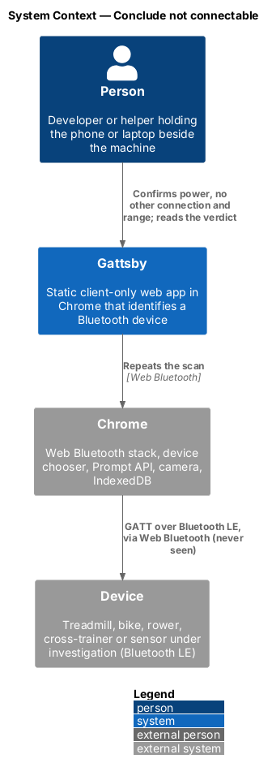
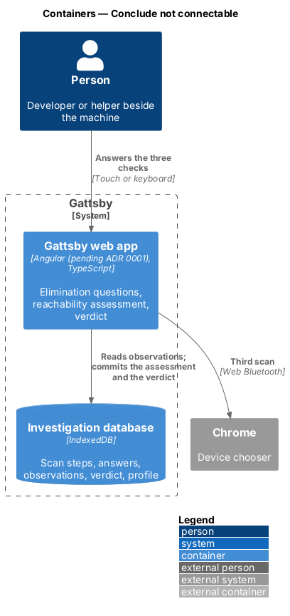
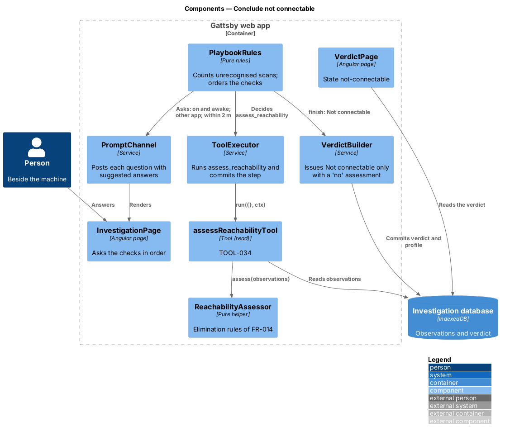
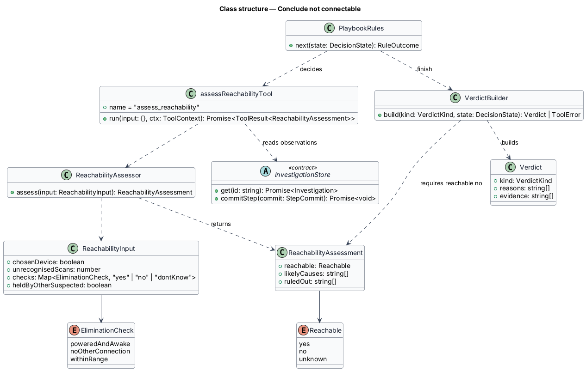
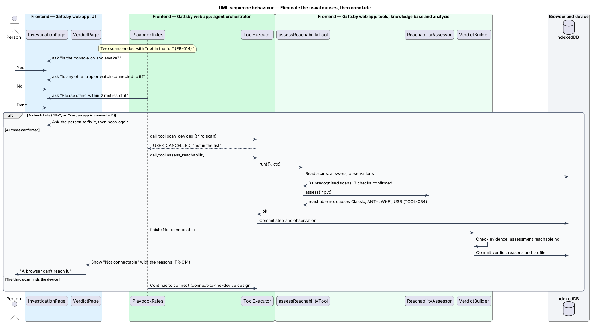

# Conclude not connectable

## Overview

Some machines never appear in a Bluetooth Low Energy scan. They may be switched off or asleep, held
by another app, out of range, or they may not use Bluetooth Low Energy at all: Bluetooth Classic,
ANT+, Wi-Fi and USB are out of a browser's reach. This feature works through those causes in a fixed
order and, once the reachable ones are ruled out, ends the investigation with the verdict *Not
connectable* and the reasons. It closes the Find stage of the playbook when Find cannot succeed, and
it hands over to the Conclude stage.

**unrecognised scan** — scan that ends with the person closing the chooser and saying the device was
not in it

**elimination check** — question that rules out one reachable cause: the console is on and awake, no
other app or watch is connected, the person stands within 2 metres

**reachability assessment** — deterministic judgement, from the observations so far, of whether the
device is likely unreachable from a browser, with the likely causes and the causes ruled out
(`assess_reachability`, TOOL-034)

The questions appear on the Investigation page, in the Find section of the feed, as ordinary
questions with suggested answers (see the ask-the-person design). The end state is the Verdict page
in state `not-connectable` (`docs/mocks/pages/verdict/not-connectable.html`): the heading "Not
connectable", the sentence "This treadmill never appeared in a Bluetooth Low Energy scan — not after a
power cycle, and not standing next to it. A browser can't reach it.", a "What might work instead"
list, and the observations with their evidence.

The conclusion is rule-driven in both modes. The model may propose `finish` early, but
`VerdictBuilder` accepts *Not connectable* only with an assessment whose `reachable` is `"no"`.

## Description

The design introduces these building blocks in the Angular (pending ADR 0001) workspace under
`frontend/src/app/`:

- **`PlaybookRules`** (`agent/playbook-rules.ts`), Find stage — counts unrecognised scans. After the
  second, it asks the three elimination checks in order, one per prompt. A failed check leads to an
  instruction to fix it (switch the console on; disconnect the other app) and a new scan. When all
  three are confirmed, it decides a third scan, then `assess_reachability`, then `finish`.
- **`assessReachabilityTool`** (`tools/analysis/assess-reachability.tool.ts`) — registry entry for
  `assess_reachability` (TOOL-034), safety class `read`. Precondition: at least one scan has run in
  this investigation; otherwise `PRECONDITION_FAILED`. It reads the observations from
  `InvestigationStore` and passes them to `ReachabilityAssessor`.
- **`ReachabilityAssessor`** (`analysis/reachability-assessor.ts`) — pure helper with unit tests. It
  applies the elimination rules below and returns `{ reachable, likelyCauses, ruledOut }`.
- **`VerdictBuilder`** (`outcome/verdict-builder.ts`) — issues exactly one verdict (see the
  issue-the-verdict design). For *Not connectable* it requires a committed assessment with
  `reachable: "no"` and copies its causes into the verdict's reasons.
- **`ConnectionSupervisor`** (`agent/connection-supervisor.ts`) — supplies the held-by-another-central
  suspicion of FR-017 when the device is not seen although the person says it is on (see the
  connect-to-the-device design).
- **`VerdictPage`** (`pages/verdict/verdict.page.ts`) — renders the `not-connectable` state.

### Elimination rules

| Inputs | `reachable` | `likelyCauses` | `ruledOut` |
|---|---|---|---|
| A device was chosen in this investigation | `"yes"` | — | — |
| At least 3 unrecognised scans, and all three checks confirmed | `"no"` | Bluetooth Classic, ANT+, Wi-Fi, USB | off or asleep, held by another central, out of range |
| The person says another app or watch is connected, or the held-by-other suspicion stands | `"no"` | held by another central | the checks that were confirmed |
| Fewer than 3 unrecognised scans, or a check answered "Don't know" | `"unknown"` | the causes not yet ruled out | the checks that were confirmed |

The three scans are the two before the checks and the one after them (FR-014). Filtered and open
scans both count. The order of the checks is fixed: power, then other connections, then range.

### The verdict

- *Not connectable* carries the evidence that Bluetooth Low Energy was not found (the scan steps and
  their raw-log `scan` entries) and the note that the device may use Bluetooth Classic, ANT+, Wi-Fi
  or USB (FR-014).
- "What might work instead" gives the person checks that apply to an unknown model: look for a
  Bluetooth Low Energy or FTMS option, look up a native app or adapter, or ask the maker.
- The evidence counts the chooser attempts and the person’s answers. Chrome does not expose the
  list or the device count when the chooser closes.
- The device profile is built as for every verdict (see the build-the-device-profile design), and
  the connection is released (see the release-the-connection design), although none was made.

### Errors

| Code | Raised by | Meaning to the person |
|---|---|---|
| `PRECONDITION_FAILED` | `assessReachabilityTool` | None shown; the agent is told that no scan has run yet |

### Tests that prove it

An acceptance spec uses the fake `navigator.bluetooth` with no device in range and the scripted
cancels, answers the three checks through the Investigation page object, and asserts the order of the
questions, the third scan, and the *Not connectable* verdict with its reasons. Unit tests cover each
row of the elimination table in `ReachabilityAssessor`.

## Requirements

The feature realizes the following level-2 (L2) requirements; each refines the level-1 (L1)
requirement cited beside it.

| L2 ID | Refines (L1) | Requirement |
|-------|--------------|-------------|
| [`FR-014`](../../../specs/L2.md#fr-014-handle-a-device-that-cannot-be-found) | `L1-004` | If no scan finds the device, Gattsby must check the usual causes in order (device off or asleep, another app connected, out of range), and, if they are ruled out, conclude by elimination that the device may use Bluetooth Classic, ANT+, Wi-Fi or USB, and issue the verdict *Not connectable* with the reasons. |
| [`TOOL-034`](../../../specs/L2.md#tool-034-assess_reachability) | `L1-004` | Applies the elimination rules of FR-014 to the observations so far and states whether the device is likely unreachable from a browser (Bluetooth Classic, ANT+, Wi-Fi, USB, or held by another central), with the reasons. |

## Diagrams

### System context

The person confirms the usual causes in Gattsby; the scans through Chrome never reach the device, and
Gattsby reports that a browser cannot reach it.

### Containers

The web app asks the checks, repeats the scan, and commits the assessment and the verdict to the
investigation database.

### Components

`PlaybookRules` orders the checks and decides each step; `assessReachabilityTool` reads the
observations and asks `ReachabilityAssessor`; `VerdictBuilder` issues *Not connectable* only on a
`"no"` assessment.

### Class structure

`ReachabilityAssessor` turns a `ReachabilityInput` into a `ReachabilityAssessment`; `VerdictBuilder`
depends on that assessment to build the verdict.

### Behaviour — eliminate the usual causes, then conclude

After two unrecognised scans the person confirms power, no other connection and range; a third scan
finds nothing, the assessment returns `"no"`, and the verdict page shows *Not connectable*. A failed
check leads to a fix and a new scan, and a third scan that finds the device leads to connect.

