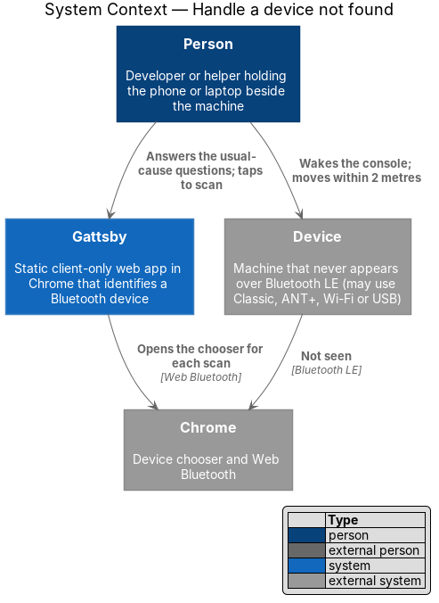
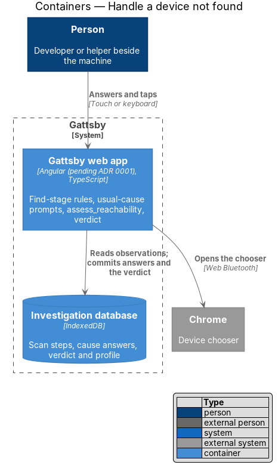
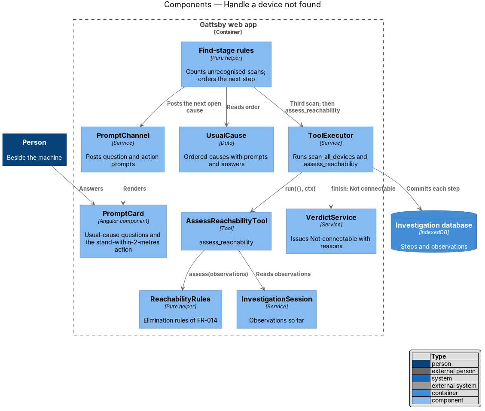
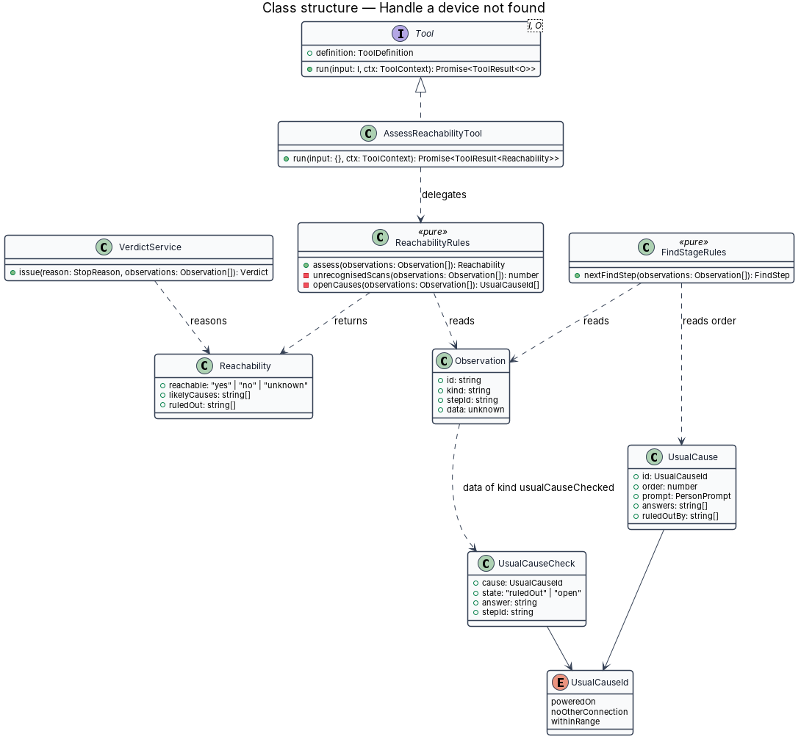
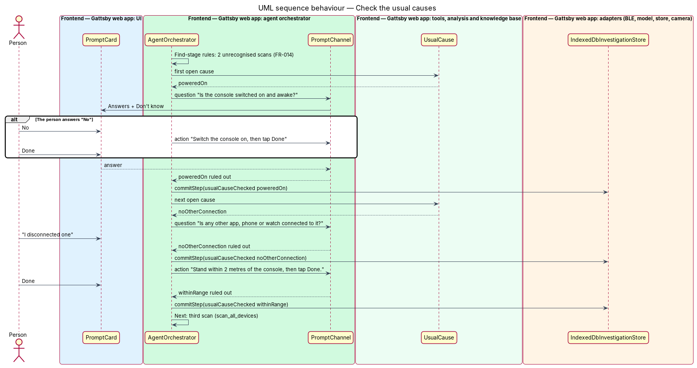
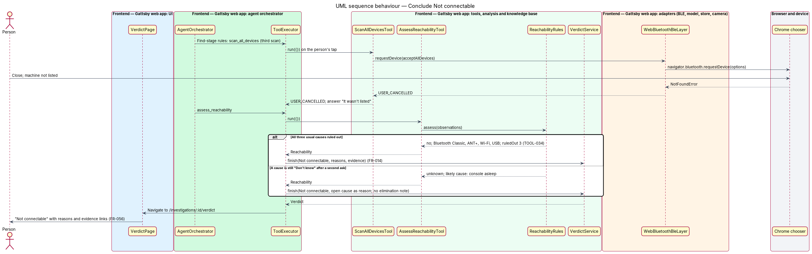

# Handle a device not found

## Overview

Some machines never appear in a Bluetooth Low Energy scan. The usual causes are ordinary: the console
is off or asleep, another app or watch holds the only connection, or the person is too far away.
When those are ruled out, the remaining explanation is that the machine talks over something a
browser cannot reach: Bluetooth Classic, ANT+, Wi-Fi or USB. This feature checks the usual causes in
a fixed order and, when all are ruled out, ends the investigation with the verdict *Not connectable*
and the reasons. It belongs to the discovery subsystem and closes the Find stage of the playbook when
the [scan for the device](../scan-for-the-device/README.md) design has found nothing the person
recognises.

**unrecognised scan** — scan step that ended without a device the person recognised: the person
closed the chooser and answered that the machine was not listed, or did not know

**usual cause** — one of the three ordinary reasons a device is not seen, checked in this order:
device off or asleep, another app connected, out of range

**ruled out** — state of a usual cause the person has confirmed is not the reason, or has fixed
(woke the console, disconnected the other app, moved within range)

**reachability assessment** — deterministic judgement, from the observations so far, of whether the
device is reachable from a browser: `yes`, `no` or `unknown`, with likely causes and the causes
ruled out

**elimination conclusion** — note that the device may use Bluetooth Classic, ANT+, Wi-Fi or USB,
reached when every usual cause is ruled out and a further scan still finds nothing

After two unrecognised scans, the investigation asks three things in turn: whether the console is on
and awake, whether any other app or watch is connected, and, as an action, to stand within 2 metres
of the console. A third scan follows. When it also finds nothing, `assess_reachability` returns
`reachable: "no"`, and the agent issues *Not connectable*. The verdict screen
(`docs/mocks/pages/verdict/not-connectable.html`) reads "This treadmill never appeared in a Bluetooth
Low Energy scan — not after a power cycle, and not standing next to it. A browser can't reach it.",
lists "It may use Bluetooth Classic, ANT+, Wi-Fi or USB" under "What might work instead", and shows
the observations behind it, each with its evidence link.

## Description

The design introduces these building blocks in the Angular (pending ADR 0001) workspace under
`frontend/src/app/`:

- **Find-stage rules** (`agent/find-stage-rules.ts`, see the scan-for-the-device design) — count the
  unrecognised scans in the observations. After the second, they return the first open usual cause
  as the next step, then the third scan, then `assess_reachability`. They run before the model in
  full agent mode (FR-046) and drive the same steps in checklist mode (FR-049). The model is not
  consulted while a usual-cause check is pending.
- **`UsualCause`** (`analysis/usual-cause.ts`) — the ordered list `poweredOn`, `noOtherConnection`,
  `withinRange`, each with its question or action, its suggested answers and the answer that rules it
  out. The order is data in this one file, so no rule restates it.
- **`AssessReachabilityTool`** (`tools/analysis/assess-reachability.tool.ts`) — the
  `assess_reachability` tool, group Analysis, safety class `read`, Phase MVP (proposed). It refuses
  with `PRECONDITION_FAILED` when no scan step exists, and otherwise returns `ReachabilityRules.assess`
  on the investigation's observations. It needs no connection and touches no browser API.
- **`ReachabilityRules`** (`analysis/reachability-rules.ts`) — pure helper with unit tests.
  `assess(observations)` applies the elimination rules of FR-014 and returns a `Reachability`.
- **`PromptChannel`** (`agent/prompt-channel.ts`) — posts the first two usual causes as `question`
  prompts (FR-050) and the third as an `action` prompt with "Done" (FR-051).
- **`VerdictService`** (`outcome/verdict.service.ts`) — on `finish`, issues *Not connectable* with the
  assessment's likely causes as reasons and the scan steps and cause answers as evidence. The
  [issue the verdict](../../outcome/issue-the-verdict/README.md) design owns the verdict itself.

### Rules

1. The usual causes are checked in the order of FR-014: device off or asleep, then another app
   connected, then out of range. A cause is not asked about again once it is ruled out.
2. The first question is "Is the console switched on and awake?" with "Yes, it's on and awake", "It
   was asleep — I woke it", "No" and "Don't know". The second is "Is any other app, phone or watch
   connected to it?" with "No, nothing else", "I disconnected one" and "Don't know". The third is the
   action "Stand within 2 metres of the console, then tap Done." (wording provisional, A-01).
3. "No" to the first question leads to the action "Switch the console on, then tap Done", which rules
   the cause out. Each answer is recorded as an `Observation` of kind `usualCauseChecked` with the
   cause and its state: `ruledOut` or `open`.
4. The third scan opens the chooser with all devices (`scan_all_devices`), since the filtered scan
   has already run.
5. `ReachabilityRules.assess` returns:
   - `yes` when a device was chosen and connected in this investigation;
   - `no` when at least three scans were unrecognised and every usual cause is ruled out, with
     likely causes "Bluetooth Classic", "ANT+", "Wi-Fi" and "USB";
   - `no` when the held-device suspicion of the [detect a held device](../../connection/detect-a-held-device/README.md)
     design survived a power cycle, with the likely cause "held by another central";
   - `unknown` otherwise, with the open usual causes as likely causes.
6. A cause answered "Don't know" is asked once more after the third scan. When it is still open, the
   verdict is still *Not connectable*, since no Bluetooth Low Energy device was found (FR-054), but its
   reasons name the open causes and leave out the elimination conclusion.
7. The verdict's evidence holds every scan step and every usual-cause answer, each linked to its
   record (FR-056).

### Data shapes

| Type | Fields |
|---|---|
| `UsualCause` | `id` (`poweredOn` \| `noOtherConnection` \| `withinRange`), `order`, `prompt`, `answers`, `ruledOutBy` |
| `UsualCauseCheck` (observation data) | `cause`, `state` (`ruledOut` \| `open`), `answer`, `stepId` |
| `Reachability` (tool output) | `reachable` (`yes` \| `no` \| `unknown`), `likelyCauses: string[]`, `ruledOut: string[]` |

### Errors

| Code | Raised by | Meaning to the person |
|---|---|---|
| `PRECONDITION_FAILED` | `AssessReachabilityTool` | Never shown; the agent is told to scan first. |
| `TIMEOUT` | `PromptChannel` | After 2 minutes without an answer, the "Still there?" dialog of FR-051. |

### Mock gaps

The not-connectable mock shows "Bluetooth on this laptop works — 14 other devices seen". The page
cannot count the devices in Chrome's chooser (A-10). This design backs "Bluetooth works" with the
capability check (`getAvailability()` true) and leaves the count `<TO SUPPLY>` unless advertisement
scanning is available. The mock's other suggestions (console settings, the maker's cloud service) have
no requirement or knowledge-base source yet: `<TO SUPPLY>`.

### Tests that prove it

The acceptance spec `e2e/discovery/handle-a-device-not-found.spec.ts` scripts the fake
`navigator.bluetooth` with no device and closes every chooser, and uses the `InvestigationPage` and
`VerdictPage` page objects. It checks that, after two scans, the three usual causes are asked in
order, and that after the third scan the verdict is *Not connectable* with Bluetooth Classic, ANT+,
Wi-Fi and USB among its reasons. The same spec runs in checklist mode with the fake `LanguageModel`
reporting `unavailable`. Unit tests cover `ReachabilityRules.assess` for `yes`, both kinds of `no`,
and `unknown` with an open cause.

## Requirements

The feature realizes the following level-2 (L2) requirements; each refines the level-1 (L1)
requirement cited beside it.

| L2 ID | Refines (L1) | Requirement |
|-------|--------------|-------------|
| [`FR-014`](../../../specs/L2.md#fr-014-handle-a-device-that-cannot-be-found) | `L1-004` | If no scan finds the device, Gattsby must check the usual causes in order (device off or asleep, another app connected, out of range), and, if they are ruled out, conclude by elimination that the device may use Bluetooth Classic, ANT+, Wi-Fi or USB, and issue the verdict *Not connectable* with the reasons. |
| [`TOOL-034`](../../../specs/L2.md#tool-034-assess_reachability) | `L1-004` | Applies the elimination rules of FR-014 to the observations so far and states whether the device is likely unreachable from a browser (Bluetooth Classic, ANT+, Wi-Fi, USB, or held by another central), with the reasons. |

## Diagrams

### System context

The person answers the usual-cause questions in Gattsby and opens Chrome's chooser for each scan; the
device never appears over Bluetooth Low Energy.

### Containers

The web app asks the questions, scans through Chrome, assesses reachability from the stored
observations, and commits the answers and the verdict to the investigation database.

### Components

The Find-stage rules order the usual causes from `UsualCause`, and `AssessReachabilityTool` applies
`ReachabilityRules` to the observations before `VerdictService` issues the verdict.

### Class structure

`AssessReachabilityTool` delegates to `ReachabilityRules`, which reads `UsualCauseCheck` observations
and returns a `Reachability`.

### Behaviour — check the usual causes

After two unrecognised scans, Gattsby asks whether the console is on and awake, whether another app
or watch is connected, and asks the person to stand within 2 metres, recording each answer.

### Behaviour — conclude Not connectable

A third scan finds nothing; `assess_reachability` returns `no` with Bluetooth Classic, ANT+, Wi-Fi and
USB as likely causes, and the verdict is *Not connectable*; when a cause stays open, the reasons name
it instead.

