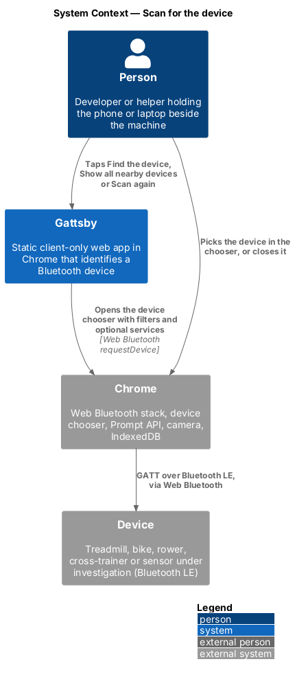
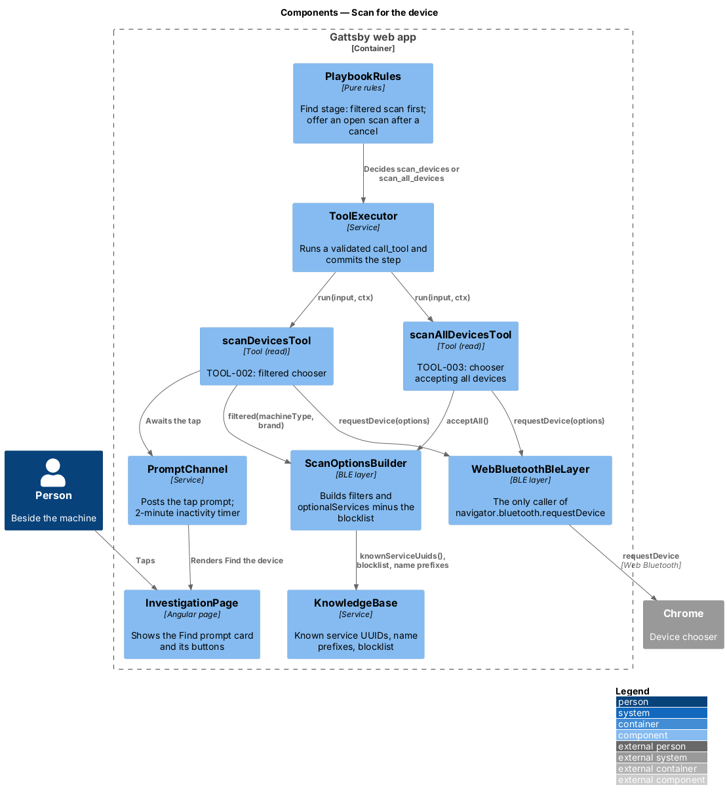
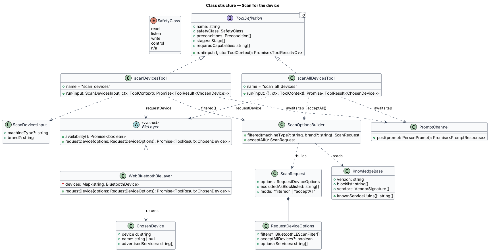
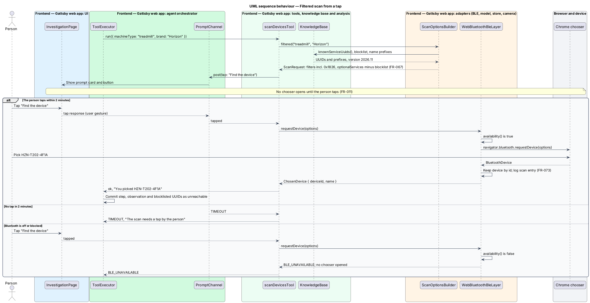
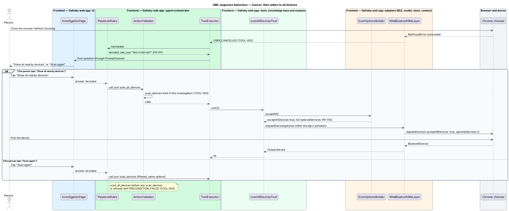

# Scan for the device

## Overview

Scanning is how an investigation first meets the device. It is the opening move of the Find stage,
the second of the playbook's seven stages, and it runs in full agent mode and in checklist mode
alike. Chrome exposes a Bluetooth device to a page only when the person chooses it in a list Chrome
draws, and exposes only the services the page named when it asked. Scanning therefore does two
jobs at once: it gets the person's choice of device, and it names, up front, every service Gattsby
may later want to read.

**device chooser** — Chrome-drawn list of nearby Bluetooth devices that `requestDevice` opens and the
page cannot read (A-10)

**filtered scan** — chooser request whose filters name the knowledge base's known services and name
prefixes (`scan_devices`, TOOL-002)

**open scan** — chooser request that accepts all devices (`scan_all_devices`, TOOL-003)

**optional-service list** — every known service UUID, standard and vendor, that is not on Chrome's
GATT blocklist, passed as `optionalServices` so that those services are reachable after connecting

**tap gate** — prompt of kind `tap` whose button press is the user gesture that `requestDevice` needs

The person sees the Investigation page in state `find`
(`docs/mocks/pages/investigation/find.html`): the prompt card "Tap Find the device. Chrome will list
nearby fitness machines — pick yours, or close the list if you're not sure." with one button, "Find
the device". When the person closes the chooser and says the device was not listed, the page moves
to state `find-cancelled` (`docs/mocks/pages/investigation/find-cancelled.html`), which offers "Show
all nearby devices" and "Scan again" and explains that names in the open list can look unfamiliar.
When the person says several names look alike, the tell-candidates-apart design takes over; when no
scan finds the device, the conclude-not-connectable design does.

The filtered scan always comes first, because it keeps the chooser short on a store floor full of
unrelated devices. The open scan exists for machines that do not advertise a known service or name
prefix. Both scans pass the same optional-service list, so a device found either way exposes the
same reachable services (FR-067).

## Description

The design introduces these building blocks in the Angular (pending ADR 0001) workspace under
`frontend/src/app/`:

- **`scanDevicesTool`** (`tools/discovery/scan-devices.tool.ts`) — registry entry for `scan_devices`
  (TOOL-002), safety class `read`, stage `find`. Input `{ machineType?, brand? }`. It asks
  `ScanOptionsBuilder` for a filtered `ScanRequest`, waits for the tap gate, calls
  `BleLayer.requestDevice`, and returns a `ChosenDevice`.
- **`scanAllDevicesTool`** (`tools/discovery/scan-all-devices.tool.ts`) — registry entry for
  `scan_all_devices` (TOOL-003), safety class `read`. Its precondition is a `scan_devices` step in the
  same investigation; `ActionValidator` refuses it otherwise with `PRECONDITION_FAILED`.
- **`ScanOptionsBuilder`** (`ble/scan-options-builder.ts`) — builds the `requestDevice` options from
  the knowledge base. `filtered(machineType, brand)` returns filters for the known services and name
  prefixes; `acceptAll()` returns `acceptAllDevices: true`. Both return the same optional-service list
  and the UUIDs left out for the blocklist.
- **`KnowledgeBase`** (`knowledge-base/knowledge-base.ts`) — supplies `knownServiceUuids()` (standard
  and vendor), the `blocklist` (Chrome's GATT blocklist, held as versioned data) and the vendors' name
  prefixes.
- **`PromptChannel`** (`agent/prompt-channel.ts`) — posts the `tap` prompt "Find the device" and owns
  its 2-minute inactivity timer.
- **`InvestigationPage`** (`pages/investigation/investigation.page.ts`) and **`PromptCard`**
  (`ui/prompt-card/prompt-card.component.ts`) — render the Find prompt and its buttons; the button's
  click is the user gesture.
- **`WebBluetoothBleLayer.requestDevice(options)`** (`ble/web-bluetooth-ble-layer.ts`) — the only call
  to `navigator.bluetooth.requestDevice`. It checks `availability()` first, keeps the returned
  `BluetoothDevice` by its `id` for the connect design, maps exceptions to error codes and appends a
  `scan` entry to `RawTrafficLog` (see the log-raw-traffic design).
- **`PlaybookRules`** (`agent/playbook-rules.ts`), Find stage — decides `scan_devices` first; after
  `USER_CANCELLED` asks "Not in the list?" and decides `scan_all_devices` or a second `scan_devices`
  from the answer. Both deciders (`ModelDecider`, `ChecklistDecider`) receive the same rule outcome.
- **`ScanRequest`** (`ble/scan-request.ts`) and **`ChosenDevice`** (`store/model/chosen-device.ts`) —
  the data shapes below.

### Building the request

1. The optional-service list is `knownServiceUuids()` minus `blocklist`, for every scan, filtered or
   open (FR-067). A vendor entry's service UUID is therefore in `optionalServices` the moment the
   vendor entry ships.
2. Each UUID left out for the blocklist is returned in `ScanRequest.excludedAsBlocklisted`. The
   executor records it as an observation that the service is unreachable (FR-067), and the
   enumerate-the-gatt-layout design carries it into `requestedButUnreachable`.
3. The filtered request has one `{ services: [uuid] }` filter per known service that the knowledge
   base marks as a scan filter, and one `{ namePrefix }` filter per vendor name prefix. Generic
   services such as Device Information (`0x180A`) and Battery (`0x180F`) would list unrelated
   devices; whether they serve as filters is `<TO SUPPLY>`.
4. `machineType` and `brand` (from the Prepare stage's answers) only order the filters, placing the
   brand's prefixes and the machine type's standard service first. They never remove a filter
   (TOOL-002).
5. The builder runs before the tap prompt is shown, so nothing slow sits between the tap and the
   `requestDevice` call, which Chrome accepts only within the tap's transient user activation.

### The tap gate

- No tool and no model action can open the chooser without a tap (FR-011). When a decider chooses a
  scan, the tool posts the tap prompt and waits. The step's live summary reads "The scan needs a tap
  by the person".
- With no tap within 2 minutes the tool returns `TIMEOUT` (L2 section 3, common rules), and the
  ask-the-person design asks "Still there?".
- In checklist mode the same tools run behind the same prompt; the feed labels the lines
  "Checklist:" instead of "Agent:" (`docs/mocks/pages/investigation/checklist.html`).

### Outcomes and errors

| Outcome | Code | What follows |
|---|---|---|
| The person picks a device | `ok: true` | Observation "Chosen device"; the connect-to-the-device design runs next |
| The person closes the chooser | `USER_CANCELLED` | State `find-cancelled`: "Show all nearby devices" or "Scan again" (FR-011, FR-012) |
| No tap within 2 minutes | `TIMEOUT` | "Still there?" (ask-the-person design) |
| `availability()` is false, or Chrome refuses by policy | `BLE_UNAVAILABLE` | Plain message to switch Bluetooth on; no chooser opens |
| No `navigator.bluetooth` | `UNSUPPORTED` | The check-capabilities design explains the browser |
| `scan_all_devices` before any `scan_devices` | `PRECONDITION_FAILED` | Refused by `ActionValidator`; counts against the step budget |

Chrome reports both a cancelled chooser and a missing adapter as `NotFoundError`. The BLE layer tells
them apart by calling `availability()` before it opens the chooser: an unavailable adapter returns
`BLE_UNAVAILABLE` without a chooser, so a `NotFoundError` after the chooser opened means the person
cancelled. A `SecurityError` maps to `BLE_UNAVAILABLE`.

### Data shapes

| Type | Fields |
|---|---|
| `ScanRequest` | `options` (`RequestDeviceOptions`), `excludedAsBlocklisted: string[]`, `mode: "filtered" \| "acceptAll"` |
| `ChosenDevice` | `deviceId`, `name` (`null` when the device has none; shown as "Unnamed device"), `advertisedServices: string[]` |

`requestDevice` resolves with a `BluetoothDevice` that does not carry the advertised service list.
`advertisedServices` is therefore empty unless an advertisement sample is available (P2, `PD-ADV`;
see the tell-candidates-apart design). The device name is untrusted text and is rendered as text
(NFR-013).

### Tests that prove it

The acceptance specs use the fake `navigator.bluetooth` (`e2e/fixtures/fake-bluetooth.ts`) with the
FTMS treadmill script and the Investigation page object (`e2e/pages/investigation.page.ts`). They
assert the recorded `requestDevice` options (a filter with `0x1826`; `optionalServices` holding every
non-blocklisted known UUID; `acceptAllDevices: true` for the open scan), that no chooser call happens
before the tap, and that a cancel leads to the `find-cancelled` prompt. Unit tests cover
`ScanOptionsBuilder` with a vendor entry and a blocklisted UUID.

## Requirements

The feature realizes the following level-2 (L2) requirements; each refines the level-1 (L1)
requirement cited beside it.

| L2 ID | Refines (L1) | Requirement |
|-------|--------------|-------------|
| [`FR-011`](../../../specs/L2.md#fr-011-scan-with-known-uuid-filters-first) | `L1-004` | The Find stage must first open the browser's device chooser filtered to the knowledge base's known services and name prefixes, with every known service UUID passed as an optional service. The scan must start only from a tap by the person. |
| [`FR-012`](../../../specs/L2.md#fr-012-widen-to-all-devices-when-needed) | `L1-004` | If the filtered scan finds nothing the person recognises, Gattsby must offer a scan that accepts all devices, still passing every known service UUID as an optional service, and explain that names in that list may be unfamiliar. |
| [`FR-067`](../../../specs/L2.md#fr-067-pass-the-known-uuid-list-at-scan-time) | `L1-015` | The knowledge base must provide the full list of known service UUIDs (standard and vendor), and every scan must pass all of them that are not on Chrome's GATT blocklist as optional services. |
| [`TOOL-002`](../../../specs/L2.md#tool-002-scan_devices) | `L1-004` | Opens the browser's chooser filtered to the knowledge base's known services and name prefixes. |
| [`TOOL-003`](../../../specs/L2.md#tool-003-scan_all_devices) | `L1-004` | Opens the chooser accepting all devices, with the full optional-service list. |

## Diagrams

### System context

The person taps in Gattsby and picks the device in Chrome's chooser; Gattsby never sees the chooser's
list, only the device the person picked.

### Containers

The web app reads the known UUIDs, name prefixes and blocklist from the knowledge base, opens the
chooser through Web Bluetooth, and commits the scan step and the chosen device to the investigation
database.

### Components

`PlaybookRules` decides which scan to run; the scan tool builds its request with `ScanOptionsBuilder`,
waits for the tap through `PromptChannel`, and calls the BLE layer, the only code that opens the
chooser.

### Class structure

Both scan tools implement `ToolDefinition` and share `ScanOptionsBuilder`, which turns knowledge-base
data into a `ScanRequest`; `WebBluetoothBleLayer` implements the `BleLayer` contract and returns a
`ChosenDevice`.

### Behaviour — filtered scan from a tap

The tool builds the request, waits for the tap, and opens the filtered chooser; a missing tap ends in
`TIMEOUT` and an unavailable adapter ends in `BLE_UNAVAILABLE`, both without a chooser.

### Behaviour — cancel, then widen to all devices

A cancelled chooser leads to "Not in the list?"; "Show all nearby devices" runs `scan_all_devices`
with `acceptAllDevices: true` and the same optional-service list, and "Scan again" repeats the
filtered scan.

