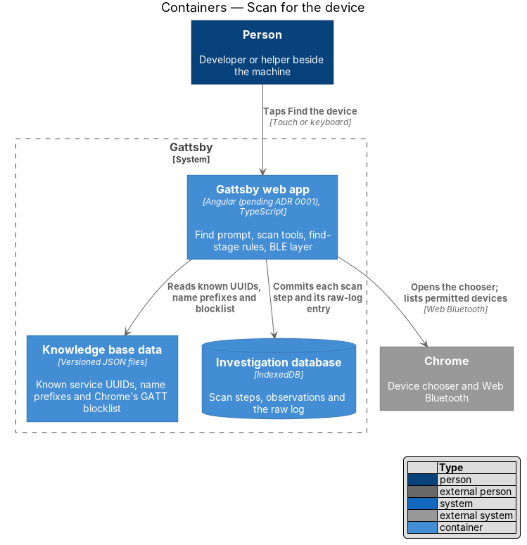
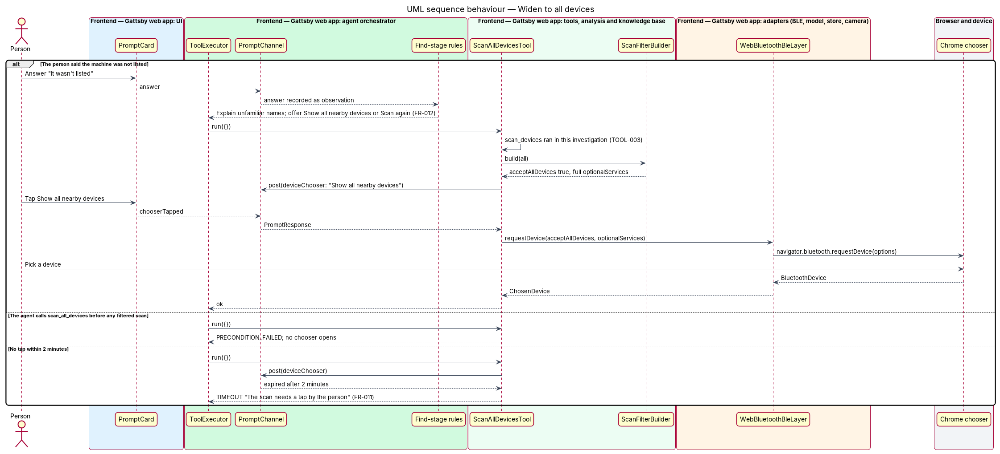
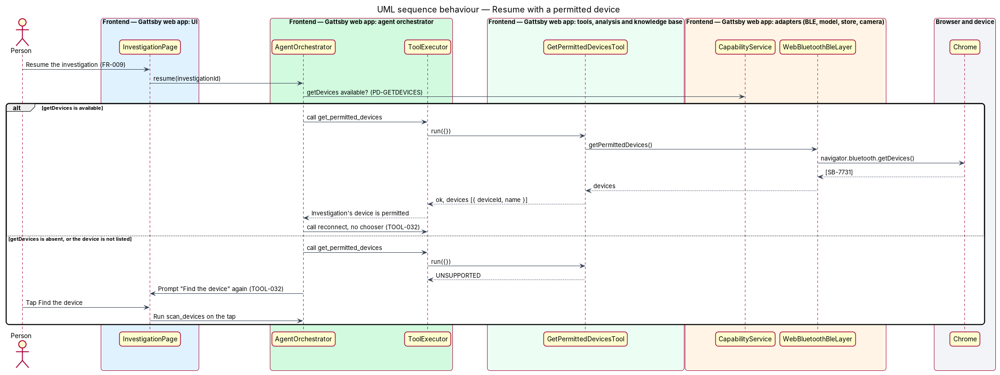

# Scan for the device

## Overview

Gattsby can only talk to a device the person has picked in Chrome's own device chooser, and it can
only see the services it named when it opened that chooser. This feature is the Find stage's first
move: it opens the chooser, filtered to the fitness services and name prefixes the knowledge base
knows, and widens to every nearby device when the person does not recognise anything in the filtered
list. It belongs to the discovery subsystem and runs in the Find stage of the playbook, in full agent
mode and in checklist mode alike.

**device chooser** — dialog drawn by Chrome, not by the page, that lists nearby Bluetooth devices and
grants the page access to the one the person picks

**filtered scan** — chooser request (`scan_devices`) that lists only devices advertising a known
service or a known name prefix

**all-devices scan** — chooser request (`scan_all_devices`) that lists every nearby Bluetooth Low
Energy device

**optional-service list** — every known service UUID, standard and vendor, that is not on Chrome's
GATT blocklist; the browser hides any service missing from it once a device is connected

**chooser tap** — the person's tap on "Find the device", which supplies the user gesture Chrome
requires before it opens the chooser

When the agent or the checklist reaches Find, the investigation screen asks the person to tap "Find
the device" (`docs/mocks/pages/investigation/find.html`). The tap opens the chooser with the known
filters. If the person closes the chooser and says the machine was not listed, Gattsby offers "Show
all nearby devices" and "Scan again", and explains that names in the wider list can look unfamiliar
(`docs/mocks/pages/investigation/find-cancelled.html`). If the person says several names look alike,
the investigation moves to the [tell candidates apart](../tell-candidates-apart/README.md) design
(`docs/mocks/pages/investigation/find-candidates.html`). If repeated scans find nothing, it moves to
the [handle a device not found](../handle-a-device-not-found/README.md) design.

The chooser is also Chrome's Bluetooth permission prompt. The feature therefore carries Gattsby's
permission rule (NFR-016): nothing asks for any permission when the app loads, Bluetooth is asked for
only through a chooser tap, and location, notifications, microphone and contacts are never asked
for. A third, later-phase tool, `get_permitted_devices`, lists the devices this origin was already
allowed to use, so that a resumed investigation can reconnect without opening the chooser again.

## Description

The design introduces these building blocks in the Angular (pending ADR 0001) workspace under
`frontend/src/app/`:

- **`ScanDevicesTool`** (`tools/discovery/scan-devices.tool.ts`) — the `scan_devices` tool, safety
  class `read`. It builds a filtered `ScanRequest` with `ScanFilterBuilder`, posts a `PersonPrompt` of
  kind `deviceChooser` through `PromptChannel`, and calls `BleLayer.requestDevice` on the chooser tap.
  Its input (`machineType`, `brand`) only orders the filters.
- **`ScanAllDevicesTool`** (`tools/discovery/scan-all-devices.tool.ts`) — the `scan_all_devices`
  tool, safety class `read`. It refuses with `PRECONDITION_FAILED` unless a `scan_devices` step exists
  in this investigation, then opens the chooser with `acceptAllDevices: true` and the same
  optional-service list.
- **`GetPermittedDevicesTool`** (`tools/discovery/get-permitted-devices.tool.ts`) — the
  `get_permitted_devices` tool (Phase P2, proposed), safety class `read`. It calls
  `BleLayer.getPermittedDevices` and returns `UNSUPPORTED` where `navigator.bluetooth.getDevices()` is
  absent.
- **`ScanFilterBuilder`** (`tools/discovery/scan-filter-builder.ts`) — pure helper with unit tests.
  `build(mode, hints, knowledgeBase)` returns a `ScanRequest`. It puts one `{ services: [uuid] }`
  filter per knowledge-base service marked `scanFilter`, and one `{ namePrefix }` filter per
  knowledge-base name prefix. It orders filters whose vendor matches the brand or machine type first,
  and never drops one. It fills `optionalServices` with every known service UUID and moves each
  blocklisted UUID to `excluded`.
- **`KnowledgeBase`** (`knowledge-base/knowledge-base.ts`) — supplies `knownServiceUuids()`,
  `scanFilterServices()`, `namePrefixes()` and `isBlocklisted(uuid)`. The blocklist is a mirror of
  Chrome's GATT blocklist held as data in `knowledge-base/data/gatt-blocklist.json`, versioned with
  the rest of the knowledge base (FR-069).
- **`PromptChannel`** (`agent/prompt-channel.ts`) — posts the `deviceChooser` prompt and resolves it
  inside the tap's event handler. A `deviceChooser` prompt has a 2-minute limit; with no tap the tool
  returns `TIMEOUT`.
- **`PromptCard`** (`ui/prompt-card/prompt-card.ts`) — presentation component that renders the
  prompt's title, detail and the "Find the device" button, and emits `chooserTapped`.
  `InvestigationPage` passes the event to `PromptChannel.respond`.
- **`WebBluetoothBleLayer.requestDevice`** (`ble/web-bluetooth-ble-layer.ts`) — the only call to
  `navigator.bluetooth.requestDevice`. It keeps the returned `BluetoothDevice` in its device map by
  `deviceId`, logs the scan in `RawTrafficLog` (FR-073), and maps every `DOMException` through
  `BleErrorMapper`.
- **`WebBluetoothBleLayer.getPermittedDevices`** — the only call to `navigator.bluetooth.getDevices()`.
- **`BleErrorMapper`** (`ble/ble-error-mapper.ts`) — pure helper with unit tests that turns a
  `DOMException` into a `ToolErrorCode`. A `NotFoundError` becomes `BLE_UNAVAILABLE` when
  `navigator.bluetooth.getAvailability()` reports `false`, and `USER_CANCELLED` otherwise.
  `SecurityError` and `NotAllowedError` become `BLE_UNAVAILABLE`; a missing `navigator.bluetooth`
  becomes `UNSUPPORTED`.
- **Find-stage rules** (`agent/find-stage-rules.ts`) — pure helper used by `PlaybookHeuristics` in
  full agent mode and by `ChecklistRunner` in checklist mode. `nextFindStep(observations)` returns the
  next deterministic step after a scan: the follow-up question after a cancel, the all-devices offer,
  the hand-over to power-cycle matching, or the hand-over to the cause checks of FR-014.

### Rules

1. A chooser opens only from a chooser tap (FR-011, NFR-016). The tool calls `requestDevice` as its
   first awaited call after the tap, so the call stays inside the tap's transient user activation.
   When no tap comes within 2 minutes, the tool returns `TIMEOUT` with the summary "The scan needs a
   tap by the person; none came within 2 minutes", and no chooser opens.
2. The filtered scan always carries every known filter (TOOL-002). `machineType` and `brand` change
   only the order of the filters. An empty knowledge base is a load error of the knowledge base, not
   a reason to scan without filters.
3. Every scan passes the full optional-service list (FR-067). Each blocklisted UUID is left out and
   recorded as an `Observation` of kind `serviceUnreachable` with reason `BLOCKLISTED`. The
   [report hidden services](../../identification/report-hidden-services/README.md) design reads these
   observations.
4. `scan_all_devices` runs only after `scan_devices` has run in the same investigation, whatever its
   outcome (TOOL-003).
5. After `USER_CANCELLED`, the Find-stage rules ask "Was your machine in the list?" with the answers
   "It wasn't listed", "Several names look alike", "I closed it by mistake" and "Don't know"
   (FR-011, FR-050). "It wasn't listed" leads to the prompt "Not in the list?" with "Show all nearby
   devices" and "Scan again" (FR-012). "Several names look alike" leads to `power_cycle_match`. "I
   closed it by mistake" leads to a new filtered scan.
6. Before the all-devices prompt, the agent's message explains that the wider list can show unfamiliar
   names: "It may not advertise as a fitness machine. I can ask Chrome for every Bluetooth device
   nearby instead — names in that list can look unfamiliar." (FR-012; wording provisional, A-01).
7. Device names are rendered as text, never as HTML. An empty name is shown as "Unnamed device".
8. Only two calls can raise a Bluetooth permission prompt: `requestDevice`, and `requestLEScan` in the
   P2 automatic matching of the tell-candidates-apart design. Both run only from a tap. Capability
   detection uses the presence of `navigator.bluetooth` and `getAvailability()`, which prompt nothing
   (NFR-016). Camera and persistent storage follow the
   [read a photo](../../identification/read-a-photo/README.md) and
   [start an investigation](../../investigation/start-an-investigation/README.md) designs. No code
   calls the Geolocation API, `Notification.requestPermission`, an audio `getUserMedia` or the
   Contact Picker API.
9. On resume (FR-009), the orchestrator calls `get_permitted_devices` first where
   `CapabilityReport` lists it. When the investigation's `deviceId` is among the permitted devices,
   the investigation goes straight to `reconnect`. Otherwise, or on `UNSUPPORTED`, the person is asked
   to tap "Find the device" again (TOOL-032).

### Data shapes

| Type | Fields |
|---|---|
| `ScanRequest` | `mode` (`filtered` \| `all`), `filters: ScanFilter[]`, `acceptAllDevices`, `optionalServices: string[]`, `excluded: ExcludedUuid[]` |
| `ScanFilter` | `services?: string[]`, `namePrefix?: string` |
| `ExcludedUuid` | `uuid`, `reason` (`BLOCKLISTED`) |
| `ChosenDevice` (tool output) | `deviceId`, `name`, `advertisedServices: string[]` |
| `PermittedDevices` (tool output) | `devices: { deviceId, name }[]` |

`advertisedServices` cannot be read from the `BluetoothDevice` that `requestDevice` returns. The BLE
layer fills it from the first `advertisementreceived` event where advertisement watching is
available, and returns an empty list otherwise; the Identify stage's `enumerate_gatt` then supplies
the services (`<TO SUPPLY>`: confirm with the tool registry owner that an empty list satisfies
TOOL-002's output schema).

### Errors

| Code | Raised by | Meaning to the person |
|---|---|---|
| `USER_CANCELLED` | `BleErrorMapper` via `requestDevice` | "You closed the list without choosing." followed by the question in rule 5. |
| `BLE_UNAVAILABLE` | `BleErrorMapper` | "Bluetooth is off or blocked." with the steps of `docs/mocks/pages/readiness/bluetooth-off.html` or `permission-denied.html`. |
| `TIMEOUT` | `ScanDevicesTool`, `ScanAllDevicesTool` | The prompt stays; the activity feed records that no tap came. |
| `PRECONDITION_FAILED` | `ScanAllDevicesTool` | Never shown; the agent is told to run `scan_devices` first. |
| `UNSUPPORTED` | `BleErrorMapper`, `GetPermittedDevicesTool` | For `get_permitted_devices`, the person is asked to tap "Find the device" again. |

### Tests that prove it

The acceptance spec `e2e/discovery/scan-for-the-device.spec.ts` uses the fake `navigator.bluetooth`
(`e2e/fixtures/fake-bluetooth.ts`) with the scripted FTMS treadmill, and the `InvestigationPage`
page object. It checks that the recorded `requestDevice` options hold a filter for `0x1826` and every
non-blocklisted known UUID in `optionalServices`, and that a closed chooser leads to "Show all nearby
devices" and then to a call with `acceptAllDevices: true`. A spec without a tap advances Playwright's
clock by 2 minutes and checks that `requestDevice` was never called. A first-visit spec loads the home
screen and checks that the fixtures recorded no `requestDevice`, `getUserMedia`, geolocation,
notification or `storage.persist` call. Unit tests cover `ScanFilterBuilder` (ordering by brand,
blocklist exclusion, no filter dropped) and `BleErrorMapper`.

The investigation mocks show a "Speak" button in the message composer, which implies microphone
access that NFR-016 forbids. The button is out of this feature's scope and is left as a conflict to
resolve in the mocks or in NFR-016.

## Requirements

The feature realizes the following level-2 (L2) requirements; each refines the level-1 (L1)
requirement cited beside it.

| L2 ID | Refines (L1) | Requirement |
|-------|--------------|-------------|
| [`FR-011`](../../../specs/L2.md#fr-011-scan-with-known-uuid-filters-first) | `L1-004` | The Find stage must first open the browser's device chooser filtered to the knowledge base's known services and name prefixes, with every known service UUID passed as an optional service. The scan must start only from a tap by the person. |
| [`FR-012`](../../../specs/L2.md#fr-012-widen-to-all-devices-when-needed) | `L1-004` | If the filtered scan finds nothing the person recognises, Gattsby must offer a scan that accepts all devices, still passing every known service UUID as an optional service, and explain that names in that list may be unfamiliar. |
| [`FR-067`](../../../specs/L2.md#fr-067-pass-the-known-uuid-list-at-scan-time) | `L1-015` | The knowledge base must provide the full list of known service UUIDs (standard and vendor), and every scan must pass all of them that are not on Chrome's GATT blocklist as optional services. |
| [`NFR-016`](../../../specs/L2.md#nfr-016-ask-only-for-the-permissions-needed-when-needed) | `L1-018` | Gattsby must ask for Bluetooth only when the person taps to scan, for the camera only when the person chooses to take a photo, and for persistent storage only when the first investigation starts. It must never ask for location, notifications, microphone or contacts. |
| [`TOOL-002`](../../../specs/L2.md#tool-002-scan_devices) | `L1-004` | Opens the browser's chooser filtered to the knowledge base's known services and name prefixes. |
| [`TOOL-003`](../../../specs/L2.md#tool-003-scan_all_devices) | `L1-004` | Opens the chooser accepting all devices, with the full optional-service list. |
| [`TOOL-032`](../../../specs/L2.md#tool-032-get_permitted_devices) | `L1-004` | Lists devices this origin was already permitted to use (`navigator.bluetooth.getDevices()`), so that a resumed investigation can reconnect without the chooser. |

## Diagrams

### System context

The person taps "Find the device" in Gattsby; Gattsby asks Chrome to open its device chooser, and
Chrome lists the devices whose advertisements match the request.

### Containers

The web app reads the known services, name prefixes and blocklist from the knowledge base data,
opens the chooser through Chrome, and commits each scan step to the investigation database.

### Components

The scan tools build their request with `ScanFilterBuilder`, wait for the chooser tap through
`PromptChannel`, and call the BLE layer, which alone calls `requestDevice` and `getDevices`.

### Class structure

Both chooser tools depend on `ScanFilterBuilder` and the `BleLayer` contract; `ScanFilterBuilder`
returns a `ScanRequest` that owns its filters and excluded UUIDs.

### Behaviour — filtered scan from a tap

The person taps "Find the device", the chooser opens with the `0x1826` filter and the full
optional-service list, and the chosen treadmill is returned; a closed chooser leads to the "Was your
machine in the list?" question.

### Behaviour — widen to all devices

After the person says the machine was not listed, Gattsby explains that names may be unfamiliar and
opens the chooser with `acceptAllDevices: true`; a call before any filtered scan is refused, and a
prompt without a tap ends in `TIMEOUT`.

### Behaviour — resume with a permitted device

On resume, `get_permitted_devices` finds the investigation's device and the investigation reconnects
without the chooser; where the API is absent, the person is asked to tap "Find the device" again.

