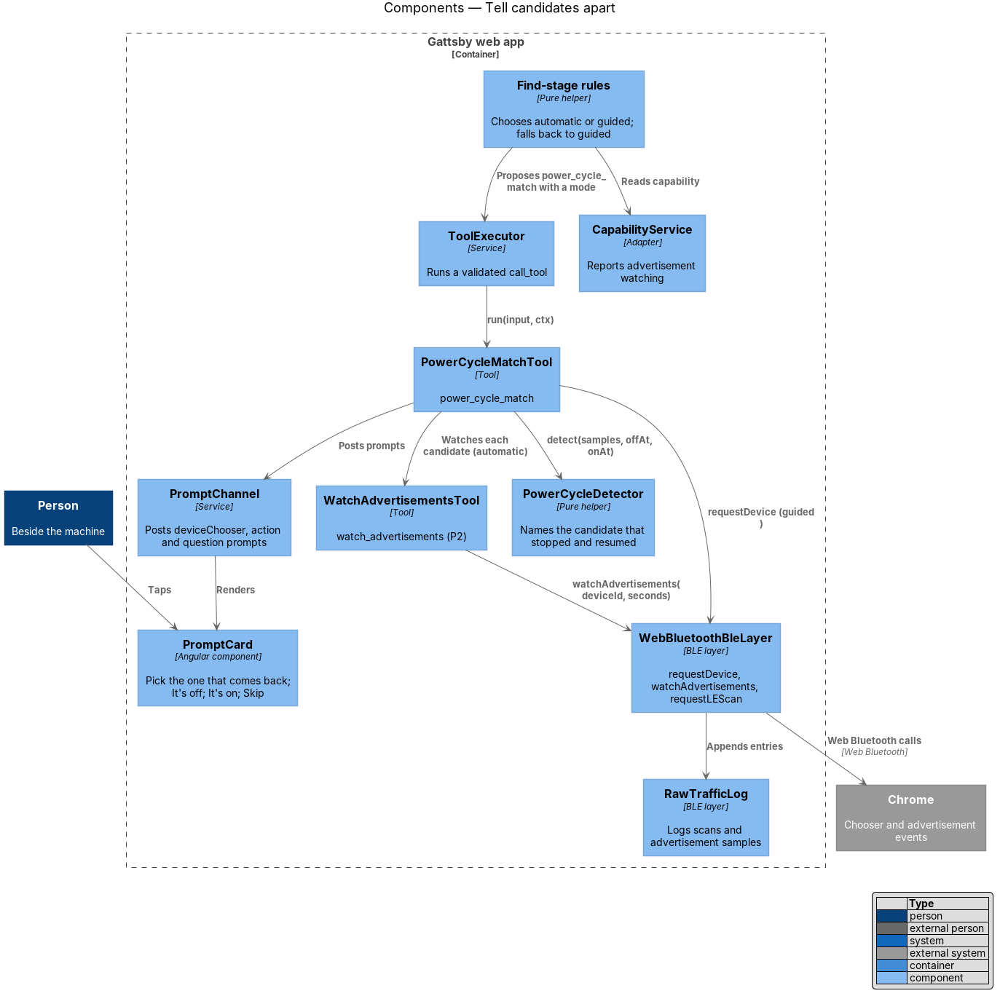
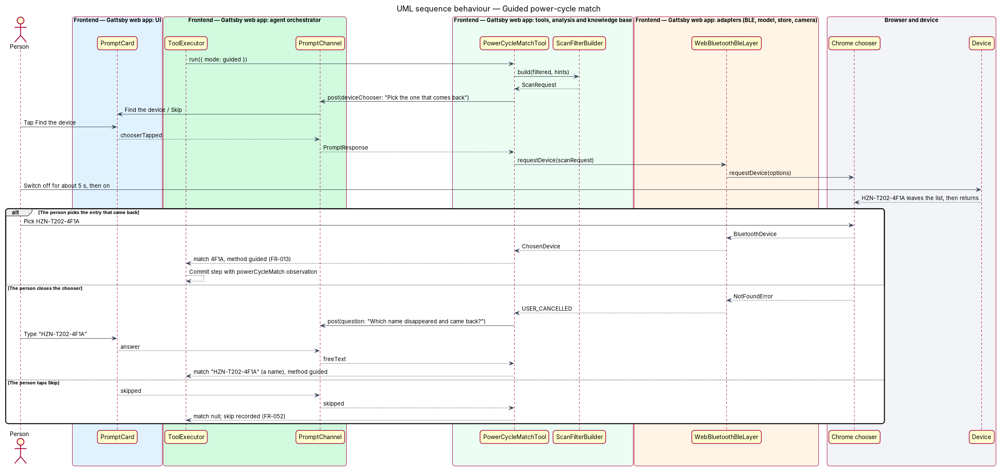

# Tell candidates apart

## Overview

On a store floor, a filtered scan often lists several machines of the same model with near-identical
names ("HZN-T202-4F1A", "HZN-T202-77C0"). A name alone does not say which one is the machine beside
the person. This feature tells the candidates apart by a power cycle: the machine the person switches
off and on is the one whose entry disappears and comes back. It belongs to the discovery subsystem
and runs in the Find stage of the playbook, after the [scan for the device](../scan-for-the-device/README.md)
design hands over because the person said several names look alike.

**candidate** — device in the chooser list, or in an advertisement scan, that may be the machine
under investigation

**power-cycle match** — identification of the one candidate whose advertisements stop while the
machine is switched off and resume when it is switched on

**guided match** — power-cycle match in which the person watches Chrome's chooser and picks the entry
that disappeared and came back (Phase MVP)

**automatic match** — power-cycle match in which Gattsby watches each candidate's advertisements and
names the one that stopped and resumed (Phase P2, `PD-ADV`)

**advertisement sample** — one received advertisement: time, RSSI, optional TX power, manufacturer
data and service data

The guided match follows the mock `docs/mocks/pages/investigation/find-candidates.html`. The agent
says "Let's tell them apart. Tap Find the device again and keep Chrome's list open. Switch the
treadmill off for about 5 seconds, then on. Pick the name that disappears and comes back." The prompt
"Pick the one that comes back" offers "Find the device" and "Skip". The chooser opens on the tap, the
person cycles the machine while watching it, and picks the returning name. The activity feed then
reads "You picked HZN-T202-4F1A after it disappeared and came back", marked *confirmed*
(`docs/mocks/pages/investigation/identify.html`).

Chrome draws the chooser and the page cannot read it (A-10), so the guided match relies on the
person. Where advertisement watching is available, the automatic match does the watching itself and
asks the person only to switch the machine off and on.

## Description

The design introduces these building blocks in the Angular (pending ADR 0001) workspace under
`frontend/src/app/`:

- **`PowerCycleMatchTool`** (`tools/discovery/power-cycle-match.tool.ts`) — the `power_cycle_match`
  tool, safety class `read`. In `guided` mode it posts the "Pick the one that comes back" prompt,
  reopens the chooser with the last filtered `ScanRequest` on the tap, and returns the picked device.
  In `automatic` mode it watches the candidates, asks the person to switch the machine off and on
  through two `action` prompts, and asks `PowerCycleDetector` for the match. It returns `UNSUPPORTED`
  in `automatic` mode when `CapabilityReport` lists no advertisement watching.
- **`WatchAdvertisementsTool`** (`tools/discovery/watch-advertisements.tool.ts`) — the
  `watch_advertisements` tool (Phase P2), safety class `read`. It validates `seconds` (1–60), calls
  `BleLayer.watchAdvertisements`, and returns the samples and their count.
- **`WebBluetoothBleLayer.watchAdvertisements`** (`ble/web-bluetooth-ble-layer.ts`) — the only code
  that calls `device.watchAdvertisements()` or, where only that exists, `navigator.bluetooth.requestLEScan()`.
  It listens for `advertisementreceived`, converts each event to an `AdvertisementSample`, and stops
  after `seconds` through an `AbortController`. It removes the listener and stops the LE scan when the
  watch ends, is aborted, or the investigation stops. Every sample goes to `RawTrafficLog` (FR-073).
- **`toHex`** (`ble/hex.ts`) — pure helper that renders a `DataView` as spaced upper-case hex. Company
  IDs are rendered as `0x` followed by 4 hex digits, for example `0x0102`.
- **`PowerCycleDetector`** (`analysis/power-cycle-detector.ts`) — pure helper with unit tests.
  `detect(samplesByCandidate, offAt, onAt)` returns the one candidate with samples before `offAt`, no
  sample between `offAt` and `onAt` plus the gap threshold, and samples again after `onAt`. When no
  candidate or more than one candidate fits, it returns `null`. The minimum silent gap is
  `<TO SUPPLY>`; the mock's guidance of "about 5 seconds" off is the person's instruction, not a
  detection threshold.
- **`PromptChannel`** (`agent/prompt-channel.ts`) — posts the guided prompt as kind `deviceChooser`,
  and the automatic "Switch it off" and "Switch it on" prompts as kind `action`.
- **Find-stage rules** (`agent/find-stage-rules.ts`, see the scan-for-the-device design) — choose the
  mode: `automatic` when `CapabilityReport` lists advertisement watching, `guided` otherwise, and
  `guided` again after an automatic match returns `UNSUPPORTED` or no match.

### Rules

1. The guided match is the MVP path (FR-013 AC1). The chooser tap rule of the scan-for-the-device
   design applies: the chooser opens only from the person's tap on "Find the device".
2. In the guided match, the device the person picks in the reopened chooser is the match, with
   `method: "guided"`. The person's pick is recorded as an `Observation` of kind `powerCycleMatch`,
   with the scan step's raw-log entry as evidence.
3. When the person closes the reopened chooser, the tool asks "Which name disappeared and came back?"
   with free text and "Don't know" (FR-050). A typed name becomes `match` (a name, not a device ID),
   and the next filtered scan's prompt names the entry to pick. "Don't know" returns `match: null`.
4. "Skip" records the skip as an observation (FR-052) and returns `match: null`. The Find-stage rules
   then reopen the filtered chooser and let the person pick without matching.
5. The automatic match needs every candidate to be visible to the page. `device.watchAdvertisements()`
   works only on devices this origin was permitted to use, so its candidates are the permitted
   devices of `get_permitted_devices` or the input `candidates`. `requestLEScan()` sees every
   advertiser but opens its own permission prompt, so it runs only from a tap (NFR-016).
6. The automatic match asks the person to tap "It's off" and then "It's on". These taps set `offAt`
   and `onAt` for `PowerCycleDetector`. The detector, not the model, names the match (FR-013 AC2).
7. When advertisement watching is absent, `power_cycle_match` in `automatic` mode returns
   `UNSUPPORTED`, and the Find-stage rules rerun it in `guided` mode (TOOL-005 AC2).
   `watch_advertisements` also returns `UNSUPPORTED`. On either result, the orchestrator records one
   missing-tool request for advertisement watching per investigation (TOOL-004 AC1), as the
   [record a missing tool](../../outcome/record-a-missing-tool/README.md) design describes.
8. Device names, manufacturer data and service data are byte-derived strings and are rendered as
   text, never as HTML.
9. The output's `confidence` comes from the hypothesis scoring rules of the
   [track the hypothesis](../../outcome/track-the-hypothesis/README.md) design. The values for a
   guided pick and an automatic detection are `<TO SUPPLY>`.

### Data shapes

| Type | Fields |
|---|---|
| `PowerCycleMatchInput` | `candidates?: string[]`, `mode` (`guided` \| `automatic`) |
| `PowerCycleMatch` (tool output) | `match` (device ID, name or `null`), `method` (`guided` \| `automatic`), `confidence` |
| `WatchAdvertisementsInput` | `deviceId`, `seconds` (1–60) |
| `AdvertisementSample` | `t`, `rssi`, `txPower?`, `manufacturerData` (company ID in hex → bytes in hex), `serviceData` (UUID → bytes in hex) |
| `AdvertisementWatch` (tool output) | `samples: AdvertisementSample[]`, `count` |

### Errors

| Code | Raised by | Meaning to the person |
|---|---|---|
| `UNSUPPORTED` | `PowerCycleMatchTool` (automatic), `WatchAdvertisementsTool` | Not shown; the match runs in guided mode instead. |
| `USER_CANCELLED` | `PowerCycleMatchTool` via the chooser | "Which name disappeared and came back?" (rule 3). |
| `TIMEOUT` | `PowerCycleMatchTool`, `WatchAdvertisementsTool` | After 2 minutes without a tap, the "Still there?" dialog of FR-051. |
| `PRECONDITION_FAILED` | `WatchAdvertisementsTool` | Never shown; the device is not permitted to this origin. |

### Mock conflict

The mocks' `scan_devices` entry lists the four candidate names, each tagged "FTMS"
(`docs/mocks/pages/investigation/find-candidates.html`). The page cannot read the chooser (A-10), and
`requestDevice` returns nothing when the person closes it. Without advertisement watching, the list
can hold only names the person typed. This design shows the list only when advertisement scanning or
the person supplied it. The mocks or A-10 are to be brought in line.

### Tests that prove it

The acceptance spec `e2e/discovery/tell-candidates-apart.spec.ts` uses the fake `navigator.bluetooth`
with three scripted FTMS treadmills and the `InvestigationPage` page object. In the guided spec the
fake chooser returns the treadmill the spec picks, and the spec checks the `powerCycleMatch`
observation and the feed line. In the automatic spec the fake exposes `watchAdvertisements`, stops one
treadmill's advertisements between the "It's off" and "It's on" taps, and checks that the feed names
that treadmill. A third spec removes `watchAdvertisements` and checks the fall-back to guided mode
and the missing-tool request. Unit tests cover `PowerCycleDetector` (one match, none, two) and `toHex`.

## Requirements

The feature realizes the following level-2 (L2) requirements; each refines the level-1 (L1)
requirement cited beside it.

| L2 ID | Refines (L1) | Requirement |
|-------|--------------|-------------|
| [`FR-013`](../../../specs/L2.md#fr-013-tell-several-candidates-apart) | `L1-004` | When the person cannot tell which listed device is theirs, Gattsby must run `power_cycle_match` ([TOOL-005](../../../specs/L2.md#tool-005-power_cycle_match)): ask the person to watch the list, turn the machine off, note which entry disappears, turn it on and confirm it returns. Where advertisement watching is available, Gattsby must do the matching itself. |
| [`TOOL-004`](../../../specs/L2.md#tool-004-watch_advertisements) | `L1-004` | Watches advertisements from a permitted device for a time, reporting RSSI, TX power, manufacturer data and service data. Uses `device.watchAdvertisements()`, or `requestLEScan()` where only that exists. |
| [`TOOL-005`](../../../specs/L2.md#tool-005-power_cycle_match) | `L1-004` | Tells candidates apart by asking the person to turn the machine off and on. Guided: the person watches the chooser list and says which entry vanished. Automatic: the tool watches each candidate's advertisements and names the one that stops and resumes. |

## Diagrams

### System context

The person switches the machine off and on while Gattsby either reopens Chrome's chooser for the
person to watch or watches the candidates' advertisements through Chrome itself.

### Containers

The web app reopens the chooser or watches advertisements through Chrome, and commits the match and
the raw advertisement samples to the investigation database.

### Components

`PowerCycleMatchTool` drives the prompts and the chooser for a guided match, and uses
`WatchAdvertisementsTool` and `PowerCycleDetector` for an automatic match; only the BLE layer touches
`watchAdvertisements` and `requestLEScan`.

### Class structure

`PowerCycleMatchTool` returns a `PowerCycleMatch`; `WatchAdvertisementsTool` returns
`AdvertisementSample`s that `PowerCycleDetector` reads with the off and on times.

### Behaviour — guided match

The person taps "Find the device", switches the treadmill off and on while watching the chooser, and
picks the entry that came back; a closed chooser leads to the question "Which name disappeared and
came back?".

### Behaviour — automatic match, or fall back to guided

With advertisement watching available, Gattsby watches three candidates, records the person's "It's
off" and "It's on" taps, and names the one candidate that stopped and resumed; without it, the tool
returns `UNSUPPORTED` and the guided match runs instead.

