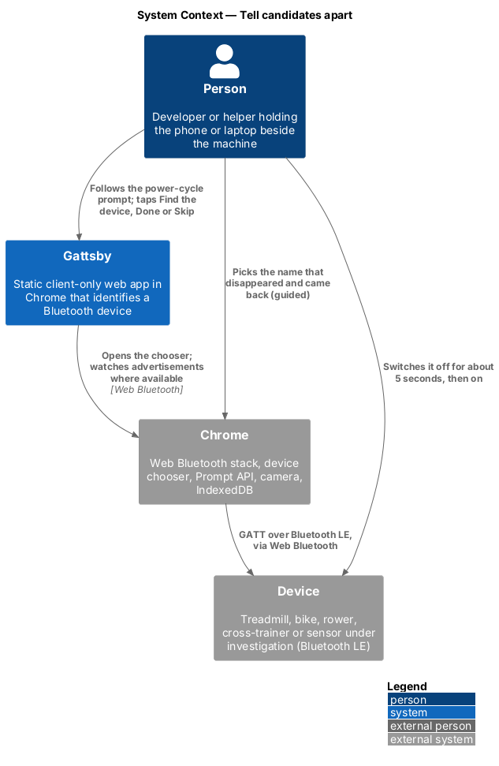
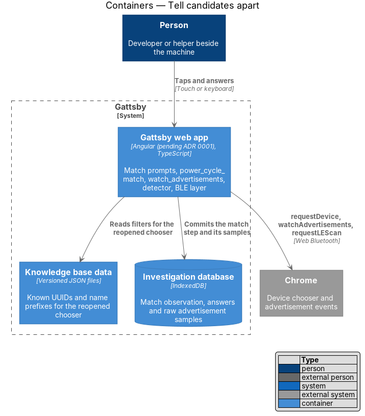
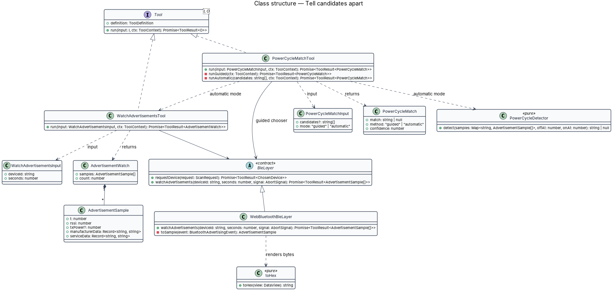
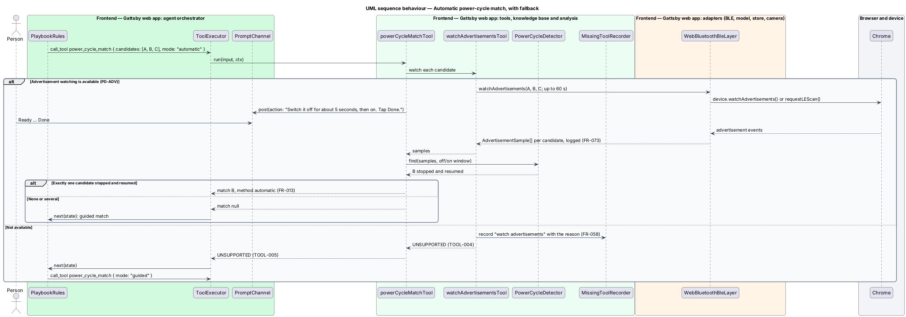

# Tell candidates apart

## Overview

A store or gym often holds a row of identical machines, each advertising a name such as
`HZN-T202-4F1A` or `HZN-T202-77C0`. A name alone does not tell the person which entry in Chrome's
device chooser is the machine in front of them. This feature settles that question inside the Find
stage of the playbook, after a scan and before the connect-to-the-device design runs.

**candidate** — entry in the device chooser that may be the device under investigation

**power-cycle match** — test that tells candidates apart by switching the machine off and on and
noting which candidate disappears and returns (`power_cycle_match`, TOOL-005)

**guided match** — power-cycle match in which the person watches the chooser and picks the returning
name (MVP)

**automatic match** — power-cycle match in which Gattsby watches each candidate's advertisements and
names the one that stopped and resumed (P2, `PD-ADV`)

**advertisement sample** — one observed advertisement of a permitted device: time, RSSI, TX power,
manufacturer data and service data (`watch_advertisements`, TOOL-004)

The person sees the Investigation page in state `find-candidates`
(`docs/mocks/pages/investigation/find-candidates.html`). The feed reads "Let's tell them apart. Tap
Find the device again and keep Chrome's list open. Switch the treadmill off for about 5 seconds, then
on. Pick the name that disappears and comes back." The prompt card "Pick the one that comes back"
offers "Find the device" and "Skip". The result appears in the feed of state `identify`
(`docs/mocks/pages/investigation/identify.html`): "You picked HZN-T202-4F1A after it disappeared and
came back", with the observation "Your machine is HZN-T202-4F1A" tagged `confirmed`.

The guided match is the MVP path because Chrome draws the chooser and the page cannot read it
(A-10). Advertisement watching is experimental and behind a flag, so the automatic match is P2 and
runs only where `CapabilityDetector` reports it. When it is missing, the orchestrator falls back to
the guided match and records a missing-tool request.

## Description

The design introduces these building blocks in the Angular (pending ADR 0001) workspace under
`frontend/src/app/`:

- **`powerCycleMatchTool`** (`tools/discovery/power-cycle-match.tool.ts`) — registry entry for
  `power_cycle_match` (TOOL-005), safety class `read`, stage `find`. Input
  `{ candidates?: [deviceId], mode: "guided" | "automatic" }`. Output
  `{ match: deviceId | name | null, method, confidence }`.
- **`watchAdvertisementsTool`** (`tools/discovery/watch-advertisements.tool.ts`) — registry entry for
  `watch_advertisements` (TOOL-004), safety class `read`, phase P2. Input `{ deviceId, seconds: 1–60 }`.
  Its `requiredCapabilities` keep it out of the model's tool list where the capability is missing
  (see the register-and-list-tools design).
- **`PowerCycleDetector`** (`tools/discovery/power-cycle-detector.ts`) — pure helper with unit tests.
  Given the samples per candidate and the off/on window the person marked, it returns the candidates
  whose advertisements stopped inside the window and resumed after it.
- **`WebBluetoothBleLayer`** (`ble/web-bluetooth-ble-layer.ts`) — `requestDevice(options)` for the
  guided match, and `watchAdvertisements(deviceId, seconds)` for the automatic match. The latter uses
  `device.watchAdvertisements()`, or `navigator.bluetooth.requestLEScan()` where only that exists,
  stops after `seconds` through an `AbortController`, and appends each sample to `RawTrafficLog` as an
  entry of kind `advertisement`.
- **`PromptChannel`** (`agent/prompt-channel.ts`) — posts the guided `tap` prompt, or the automatic
  `action` prompt with "Ready" and "Done" (see the ask-the-person design).
- **`PlaybookRules`** (`agent/playbook-rules.ts`), Find stage — decides `power_cycle_match` when the
  person says several names look alike or cannot tell which is theirs. It picks `automatic` only when
  `Capabilities` reports advertisement watching, and `guided` otherwise or after an automatic attempt
  names no single candidate.
- **`MissingToolRecorder`** (`outcome/missing-tool-recorder.ts`) — records "watch advertisements"
  with the reason when the capability is needed but absent (FR-058, TOOL-004).
- **`CapabilityDetector`** (`environment/capability-detector.ts`) — reports `watchAdvertisements` and
  `requestLEScan` availability; it never throws (NFR-021).

### Guided match (MVP)

1. The tool posts the tap prompt. The person taps "Find the device"; the tap opens the filtered
   chooser with the same options as the scan (see the scan-for-the-device design).
2. The person switches the machine off for about 5 seconds and on again, watching the chooser.
3. The person picks the name that disappeared and came back. That pick is the person's answer: the
   tool returns its `deviceId` as `match`, with `method: "guided"`, and the executor commits it as an
   observation (FR-013).
4. "Skip" returns `USER_CANCELLED`, records the step as skipped (FR-052), and the rules return to the
   Find prompt.
5. A device chosen after the guided instructions has confidence 1 for the person's selection. The
   observation names the guided method. It makes no claim that Gattsby watched the chooser.

### Automatic match (P2)

1. The candidates are devices the page can watch: devices permitted earlier in the
   investigation, or devices seen through `requestLEScan` where that API exists.
2. The tool starts watching every candidate, then asks the person to switch the machine off and on
   and to tap "Done" when it is back on. "Ready" and "Done" mark the off/on window.
3. `PowerCycleDetector` returns the candidates whose advertisements stopped inside the window and
   resumed after it. The gap length that counts as "stopped" is `<TO SUPPLY>`.
4. Exactly one such candidate is the `match`, with `method: "automatic"` (FR-013). None or more than
   one returns `match: null`, and the rules fall back to the guided match.
5. Watching ends when the tool returns, on stop, and on emergency stop; the BLE layer aborts every
   watch it started.

### Candidate names

The `find-candidates` mock lists four candidate names, each tagged FTMS, under the `scan_devices`
step. The page cannot read the chooser (A-10), so in the guided match those names are known only as
the person reports them, or from advertisement samples where watching is available. OQ-06 is
resolved with one optional field for comma-separated names. The feed attributes those names to
the person. Chrome still receives the actual selection in its chooser.

### Errors

| Code | Raised by | Meaning to the person |
|---|---|---|
| `UNSUPPORTED` | `watchAdvertisementsTool`, `powerCycleMatchTool` (automatic) | None shown; the guided match follows and a missing-tool request is recorded |
| `PRECONDITION_FAILED` | `watchAdvertisementsTool` | The device was not permitted; the guided match follows |
| `USER_CANCELLED` | `powerCycleMatchTool` (guided) | The step is skipped; the Find prompt returns |
| `TIMEOUT` | `powerCycleMatchTool` | No tap within 2 minutes; "Still there?" follows |

### Data shapes

| Type | Fields |
|---|---|
| `AdvertisementSample` (`store/model/advertisement-sample.ts`) | `t`, `rssi`, `txPower?`, `manufacturerData: { companyId: hex }`, `serviceData: { uuid: hex }` |
| `PowerCycleMatchOutput` | `match`, `method`, `confidence` |

Manufacturer data and service data are kept as hex strings, keyed by company ID (for example
`0x0102`) and service UUID. They also feed `vendor_signature_lookup` (see the match-known-profiles
design).

### Tests that prove it

The acceptance spec for the guided match uses the fake `navigator.bluetooth` with three FTMS
treadmills and asserts that the picked device becomes the observation. The automatic match is
covered by unit tests of `PowerCycleDetector` with three candidates on a fake clock, and by a spec
in which the fake reports no `watchAdvertisements`, asserting the fallback to guided and the recorded
missing-tool request.

## Requirements

The feature realizes the following level-2 (L2) requirements; each refines the level-1 (L1)
requirement cited beside it.

| L2 ID | Refines (L1) | Requirement |
|-------|--------------|-------------|
| [`FR-013`](../../../specs/L2.md#fr-013-tell-several-candidates-apart) | `L1-004` | When the person cannot tell which listed device is theirs, Gattsby must run `power_cycle_match` ([TOOL-005](../../../specs/L2.md#tool-005-power_cycle_match)): ask the person to watch the list, turn the machine off, note which entry disappears, turn it on and confirm it returns. Where advertisement watching is available, Gattsby must do the matching itself. |
| [`TOOL-004`](../../../specs/L2.md#tool-004-watch_advertisements) | `L1-004` | Watches advertisements from a permitted device for a time, reporting RSSI, TX power, manufacturer data and service data. Uses `device.watchAdvertisements()`, or `requestLEScan()` where only that exists. |
| [`TOOL-005`](../../../specs/L2.md#tool-005-power_cycle_match) | `L1-004` | Tells candidates apart by asking the person to turn the machine off and on. Guided: the person watches the chooser list and says which entry vanished. Automatic: the tool watches each candidate's advertisements and names the one that stops and resumes. |

## Diagrams

### System context

The person switches the machine off and on and watches Chrome's chooser; Gattsby opens the chooser
and, where Chrome allows it, watches advertisements itself.

### Containers

The web app runs the match through Web Bluetooth and commits the match, its advertisement evidence
and any missing-tool request to the investigation database.

### Components

`PlaybookRules` chooses the mode; `powerCycleMatchTool` either opens the chooser through the BLE
layer (guided) or samples advertisements through `watchAdvertisementsTool` and asks
`PowerCycleDetector` which candidate dropped out (automatic).

### Class structure

`powerCycleMatchTool` composes `watchAdvertisementsTool` and `PowerCycleDetector` for the automatic
mode and calls the `BleLayer` contract directly for the guided mode.

### Behaviour — guided power-cycle match

The person taps "Find the device", power-cycles the machine and picks the name that returns; "Skip"
records the step as skipped.

### Behaviour — automatic power-cycle match, with fallback

Where advertisement watching exists, Gattsby names the one candidate that stopped and resumed;
otherwise, or when the result is not a single candidate, the guided match runs and a missing-tool
request records the gap.

