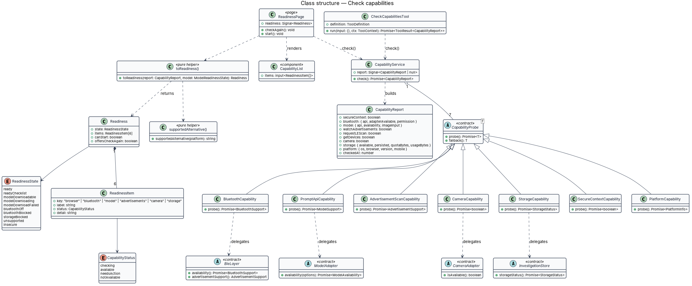
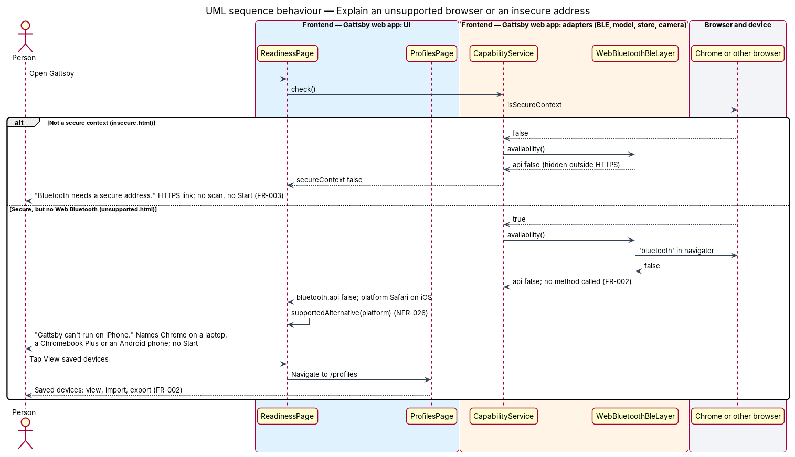

# Check capabilities

## Overview

Gattsby depends on browser capabilities that differ by browser, platform and machine: a secure
context, Web Bluetooth, Chrome's Prompt API and its on-device model, experimental advertisement
scanning, the camera and persistent storage. This feature finds out which of them are present, tells
the person in plain words what is missing and how to fix it, and refuses to offer an investigation
where one could not reach a device. It belongs to the environment subsystem and runs at two moments:
when the app opens, on the Readiness check page (route `/start`), and as the first step of the
Prepare stage of every investigation, as the `check_capabilities` tool.

**capability** — browser or platform feature Gattsby depends on, such as Web Bluetooth or the
on-device model

**capability report** — result of one capability check: one entry per capability, in the shape
`check_capabilities` (TOOL-001) returns

**capability adapter** — class that reports whether one browser API is present, without prompting and
without throwing, by asking the one part of the app allowed to touch that API

**readiness state** — single verdict on the report that decides the page's headline and whether
"Start" is offered; one per readiness mock

The Readiness check page shows six rows: Browser, Bluetooth, On-device model, Advertisement scanning,
Camera and Storage (`docs/mocks/pages/readiness/default.html`). Each row reads *Available*, *Needs
action* with the action, or *Not available* with what that limits, as a word and an icon, never by
colour alone. While the check runs, every row reads *Checking* (`loading.html`). The other states are
drawn one per problem: Bluetooth off (`bluetooth-off.html`), Bluetooth blocked for the site
(`permission-denied.html`), storage blocked (`error.html`), an unsupported browser
(`unsupported.html`) and an address that is not secure (`insecure.html`). The model rows' states
(`checklist.html`, `downloadable.html`, `downloading.html`, `download-failed.html`) belong to the
[prepare-the-model](../prepare-the-model/README.md) design; this feature supplies the report they read.

The check reads only. It never opens Chrome's device chooser, never asks for the camera and never
requests persistent storage, so a first visit shows no permission prompt (NFR-016).

## Description

The design introduces these building blocks in the Angular (pending ADR 0001) workspace under
`frontend/src/app/`:

- **`CapabilityService`** (`capabilities/capability.service.ts`) — runs every capability adapter in
  parallel under one 1-second deadline and assembles the `CapabilityReport`. An adapter that throws,
  rejects or misses the deadline contributes its `fallback()` value, which reports the capability as
  unavailable (TOOL-001: "a capability that cannot be checked is reported as unavailable").
  `check()` never rejects. The last report is kept in the `report` signal.
- **`CapabilityProbe<T>`** (`capabilities/capability-probe.ts`) — the contract every capability
  adapter implements: `probe()` and `fallback()`.
- **Capability adapters** (`capabilities/`) — one per API. Each delegates to the only code allowed to
  touch its API (NFR-021) and catches every error:
  - `SecureContextCapability` reads `window.isSecureContext`.
  - `PlatformCapability` reads `navigator.userAgentData` where present, and the user-agent string
    otherwise, into `{ os, browser, version, mobile }`.
  - `BluetoothCapability` calls `BleLayer.availability()`.
  - `AdvertisementScanCapability` calls `BleLayer.advertisementSupport()`.
  - `PromptApiCapability` imports the model adapter on demand and calls
    `ModelAdapter.availability(MODEL_SESSION_OPTIONS)`, then the same with image input for
    `imageInput` (`PD-PROMPT-IMAGE`).
  - `CameraCapability` calls `CameraAdapter.isAvailable()`, which tests that `getUserMedia` exists
    without calling it.
  - `StorageCapability` calls `InvestigationStore.storageStatus()`, which opens the investigation
    database and reads `navigator.storage.estimate()` and `persisted()`.
- **`WebBluetoothBleLayer.availability()`** (`ble/web-bluetooth-ble-layer.ts`) — tests
  `'bluetooth' in navigator` and, only when it is present, calls `getAvailability()`. In a browser
  without Web Bluetooth no Bluetooth method is called (FR-002). It also reports `getDevices` and the
  site permission, where Chrome exposes it.
- **`CheckCapabilitiesTool`** (`tools/environment/check-capabilities.tool.ts`) — the
  `check_capabilities` registry entry: group Environment, safety class `read`, input `{}`, no
  preconditions, output schema of TOOL-001. It calls `CapabilityService.check()`, always returns
  `ok: true`, and summarises the report in one line for the activity feed and the model, for example
  "Bluetooth on, model ready, advertisement scanning not available".
- **`toReadiness`** (`capabilities/readiness.ts`) — pure helper with unit tests. It maps a
  `CapabilityReport` and the model's `ModelReadinessState` to a `Readiness`: the readiness state, the
  six `ReadinessItem`s, whether "Start" is enabled and whether "Check again" is offered.
- **`supportedAlternative`** (`capabilities/supported-browsers.ts`) — pure helper over the support
  matrix of NFR-026. It names the supported browser for the person's platform: on iOS, Chrome on a
  laptop, a Chromebook Plus or an Android phone; on Firefox for Windows, Chrome on Windows.
- **`ReadinessPage`** (`pages/readiness/readiness.page.ts`) — the page at `/start`. It runs the check
  on entry and on "Check again", renders the result through `CapabilityList`, and offers "Start",
  "Use checklist mode instead" (see [choose-the-operating-mode](../choose-the-operating-mode/README.md)),
  "Copy link" or "View saved devices" as the readiness state allows.
- **`CapabilityList`** (`ui/capability-list/capability-list.ts`) — presentation component. Input: the
  six `ReadinessItem`s. It renders each status as a word and an icon, and every detail string as
  text.
- **`readinessGuard`** (`capabilities/readiness.guard.ts`) — route guard on `/`. In a page load where
  no check has passed yet, it sends the person to `/start`. It does not guard `/profiles`,
  `/investigations` or `/settings`, so saved devices and history stay reachable in an unsupported
  browser (FR-002).

### Rules the check follows

1. The check runs when the app opens and again before every investigation, through
   `check_capabilities` as the first step of Prepare (see
   [start-an-investigation](../../investigation/start-an-investigation/README.md)). The step's
   report is committed to the investigation record.
2. The check finishes within 1 second, excluding any model download, and raises no uncaught error.
   Each adapter is wrapped; a missing API is a value, never an exception (NFR-021).
3. `toReadiness` picks the first readiness state that matches, in this order: `insecure`,
   `unsupported`, `bluetoothOff`, `bluetoothBlocked`, `storageBlocked`, then the model states
   (`modelDownloadFailed`, `modelDownloading`, `modelDownloadable`, `readyChecklist`, `ready`). The
   secure context comes first because Chrome hides `navigator.bluetooth` outside one, and the person
   is to be told the real cause.
4. "Start" is enabled only when the context is secure, Web Bluetooth is present, the adapter is on,
   Bluetooth is not blocked for the site and storage opens. The model never blocks "Start": without a
   model the investigation runs as a checklist.
5. In the `unsupported` state the page says the browser cannot reach a device, names the supported
   browser for the platform, and shows no "Start". "View saved devices" leads to `/profiles`, where
   profiles and history can be viewed, imported and exported.
6. In the `insecure` state the page says Bluetooth needs a secure (HTTPS) address, shows the HTTPS
   address with "Copy link", and offers no scan and no "Start" (FR-003). Plain `http://localhost`
   counts as secure.
7. In `bluetoothOff`, `bluetoothBlocked` and `storageBlocked` the page lists the fix in numbered steps
   and offers "Check again"; "Start" stays disabled until a re-check passes (FR-001).
8. The check never prompts: it does not call `requestDevice`, `getUserMedia` or
   `navigator.storage.persist()` (NFR-016).

### Browser APIs and the one place each is used (NFR-021)

| API | Only touched by | Reported by |
|---|---|---|
| `navigator.bluetooth` | `WebBluetoothBleLayer` | `BluetoothCapability`, `AdvertisementScanCapability` |
| `LanguageModel` | `PromptApiModelAdapter` | `PromptApiCapability` |
| IndexedDB and `navigator.storage` | `IndexedDbInvestigationStore` | `StorageCapability` |
| `navigator.mediaDevices` | `MediaDevicesCameraAdapter` | `CameraCapability` |
| `isSecureContext`, `userAgentData` | `SecureContextCapability`, `PlatformCapability` | themselves |

### Data shapes

| Type | Fields |
|---|---|
| `CapabilityReport` | `secureContext`, `bluetooth { api, adapterAvailable, permission }`, `model { api, availability, imageInput }`, `watchAdvertisements`, `requestLEScan`, `getDevices`, `camera`, `storage { available, persisted, quotaBytes, usageBytes }`, `platform { os, browser, version, mobile }`, `checkedAt` |
| `ReadinessItem` | `key` (`browser`, `bluetooth`, `model`, `advertisements`, `camera`, `storage`), `label`, `status`, `detail` |
| `Readiness` | `state`, `items`, `canStart`, `offersCheckAgain` |
| `CapabilityStatus` | `checking`, `available`, `needsAction`, `notAvailable` |

`bluetooth.permission` and `storage.available` are not in TOOL-001's output. The mocks need them
(`permission-denied.html`, `error.html`), so the design adds them as optional fields. How Chrome
exposes a site-level Bluetooth block before any scan is `<TO SUPPLY>`; until it is known,
`permission` reads `unknown` and the blocked state is reached when a scan is refused.

### Readiness states

| Readiness state | Mock | Start | Other actions |
|---|---|---|---|
| `ready` | `default.html` | Enabled | Use checklist mode instead |
| `bluetoothOff` | `bluetooth-off.html` | Disabled | Check again |
| `bluetoothBlocked` | `permission-denied.html` | Disabled | Check again |
| `storageBlocked` | `error.html` | Not shown | Check again |
| `unsupported` | `unsupported.html` | Not shown | Copy link, View saved devices |
| `insecure` | `insecure.html` | Not shown | Copy link |

### Errors

`check_capabilities` has no error codes. A capability that cannot be checked is reported as *not
available*, and the row says what that limits. Every user-facing string is provisional until the
*Behavior Description* lands (`A-01`, `OQ-06`).

### Tests that prove it

The acceptance specs use the fake `navigator.bluetooth` (`e2e/fixtures/fake-bluetooth.ts`) and the
fake `LanguageModel` (`e2e/fixtures/fake-language-model.ts`) with the `ReadinessPage` page object
(`e2e/pages/readiness.page.ts`):

- With the fake adapter reporting `getAvailability()` false, Bluetooth reads *Needs action* with "Turn
  on Bluetooth" and "Start" is disabled; after the fake turns on and the person taps "Check again",
  "Start" is enabled.
- With `navigator.bluetooth` removed by an init script, the page names the supported browsers, shows
  no "Start", and the fake records no Bluetooth call; "View saved devices" opens the saved devices.
- With `isSecureContext` forced to false by an init script, the page says Bluetooth needs HTTPS and
  offers no scan.
- With `LanguageModel`, `watchAdvertisements` and `getUserMedia` all undefined, a full checklist
  investigation of the fake FTMS treadmill raises no page error (NFR-021).

Unit tests cover `toReadiness` for every readiness state and its precedence, `supportedAlternative`
for each platform, and `CapabilityService` with a fake clock: an adapter that never answers is
reported as unavailable at 1 second. NFR-026's support matrix is confirmed by a hardware smoke test
that a person runs on one desktop platform and on Android; behaviour specs run in Chromium only.

## Requirements

The feature realizes the following level-2 (L2) requirements; each refines the level-1 (L1)
requirement cited beside it.

| L2 ID | Refines (L1) | Requirement |
|-------|--------------|-------------|
| [`FR-001`](../../../specs/L2.md#fr-001-check-capabilities-on-start) | `L1-001` | When the app opens, and before every investigation, Gattsby must run `check_capabilities` ([TOOL-001](../../../specs/L2.md#tool-001-check_capabilities)) and show the result as a short list: Bluetooth, model, advertisement scanning, camera, storage. Each item is *available*, *needs action* (with the action) or *not available* (with what that limits). |
| [`FR-002`](../../../specs/L2.md#fr-002-explain-an-unsupported-browser) | `L1-001` | Where Web Bluetooth is absent (Safari, Firefox, any browser on iOS), Gattsby must say that it cannot reach a device in this browser and name the supported browsers and platforms. It must not offer to start an investigation. |
| [`FR-003`](../../../specs/L2.md#fr-003-require-a-secure-context) | `L1-001` | Gattsby must detect when it is not running in a secure context (HTTPS or `http://localhost`) and must say that Bluetooth needs HTTPS. |
| [`NFR-021`](../../../specs/L2.md#nfr-021-isolate-every-browser-api-behind-an-adapter) | `L1-022` | `navigator.bluetooth` is used only in the BLE layer, `LanguageModel` only in the model adapter, IndexedDB only in the investigation store, and the camera only in the photo adapter. Each adapter reports availability and never throws for a missing API. |
| [`NFR-026`](../../../specs/L2.md#nfr-026-supported-browsers) | `L1-001` | Gattsby must support Chrome 148 and later on Windows, macOS, Linux and ChromeOS (full agent mode where the model is available) and Chrome on Android (checklist mode). It must explain, not fail, on Safari, Firefox and iOS (FR-002). Behaviour specs run in Chromium only. |
| [`TOOL-001`](../../../specs/L2.md#tool-001-check_capabilities) | `L1-001` | Reports what this browser and platform can do. |

## Diagrams

### System context

The person opens Gattsby, which asks Chrome which capabilities exist; whether the static host serves
it over HTTPS decides whether Bluetooth can be offered at all.

### Containers

Inside Gattsby the web app probes each browser API and opens the investigation database once to prove
that storage works.

### Components

`ReadinessPage` and `CheckCapabilitiesTool` both call `CapabilityService`, which runs one capability
adapter per API; each adapter delegates to the only component allowed to touch that API, and
`toReadiness` turns the report into the page's state.

### Class structure

Seven capability adapters implement the `CapabilityProbe` contract and delegate to the BLE layer, the
model adapter, the camera adapter and the investigation store; `toReadiness` builds a `Readiness` of
six `ReadinessItem`s from the `CapabilityReport`.

### Behaviour — check when the app opens

Every adapter runs in parallel under a 1-second deadline; with Bluetooth off, "Start" stays disabled
until "Check again" finds the adapter on.

### Behaviour — explain an unsupported browser or an insecure address

An insecure address is reported as needing HTTPS; a browser without Web Bluetooth is told which
browser to use, no Bluetooth method is called, and saved devices stay reachable.

