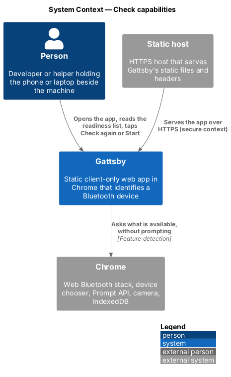
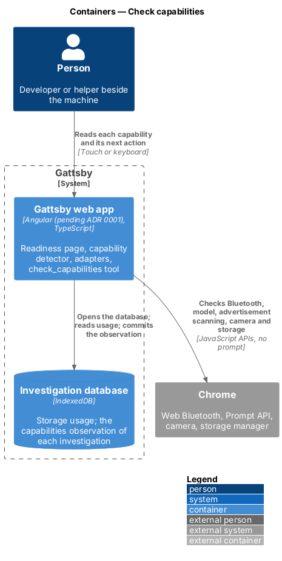
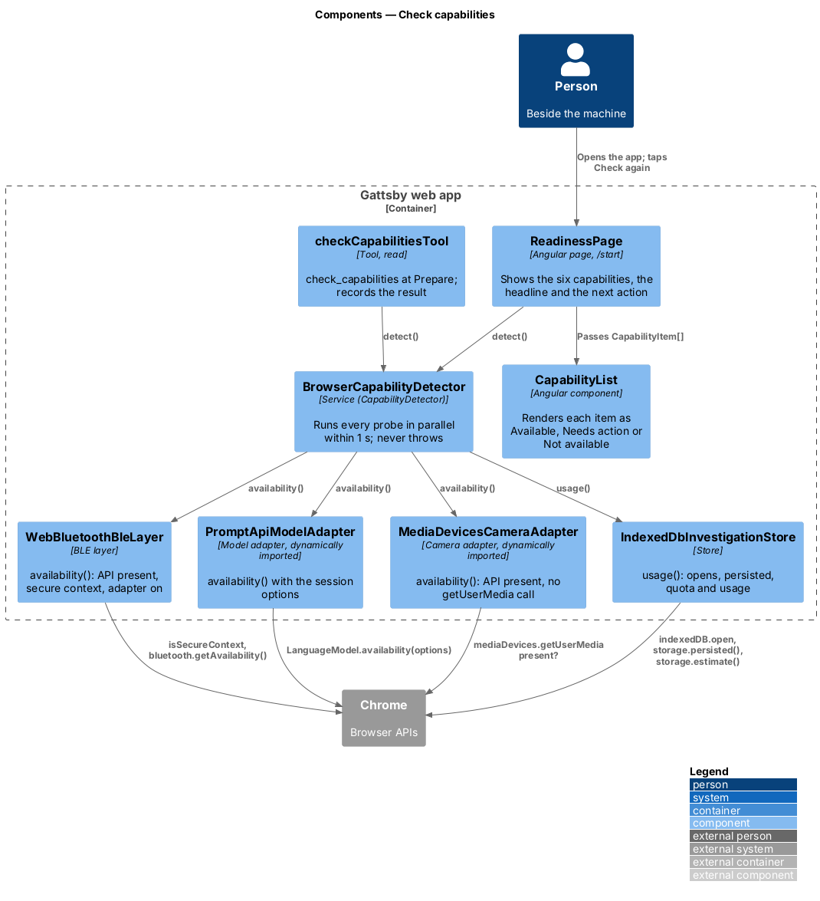
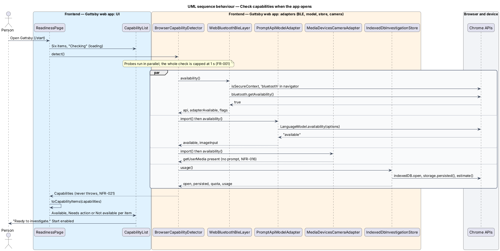
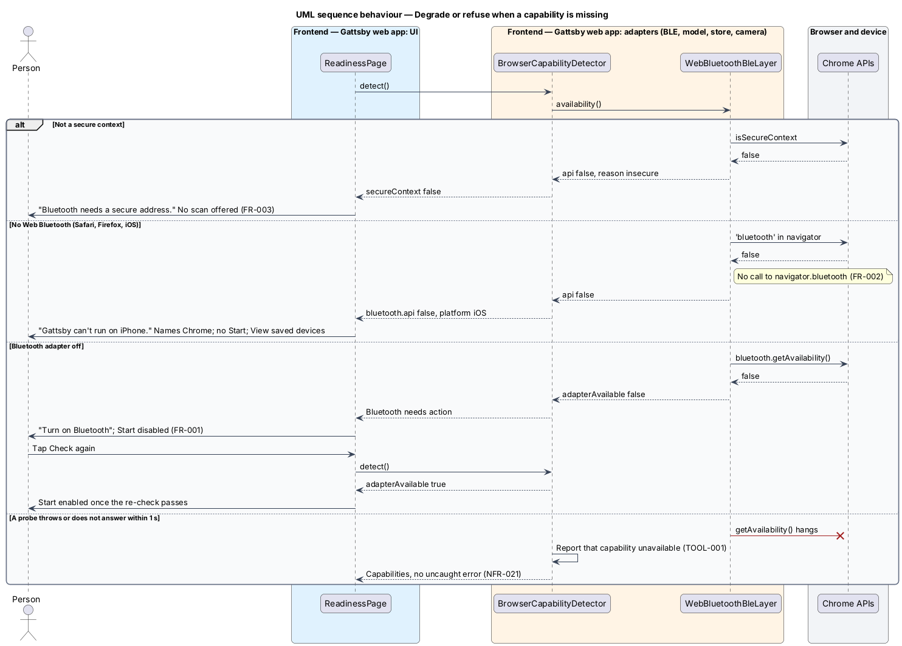

# Check capabilities

## Overview

Gattsby depends on browser capabilities that differ by browser, platform and flag: Web Bluetooth,
the Prompt API with Gemini Nano, advertisement scanning, the camera and persistent storage. This
feature finds out, without prompting the person, which of them this browser offers, and shows the
answer before anything else happens. It belongs to the environment subsystem and runs at two points:
when the app opens, on the Readiness page (`/start`), and again at the Prepare stage of every
investigation, as the `check_capabilities` tool.

**capability** — browser or platform feature that one or more tools need, reported as *Available*,
*Needs action* (with the action) or *Not available* (with what that limits)

**probe** — one non-prompting availability check that one adapter runs against one browser API

**secure context** — page served over HTTPS or from `http://localhost`, the only context in which
Chrome exposes Web Bluetooth

The Readiness page lists six items: Browser, Bluetooth, On-device model, Advertisement scanning,
Camera and Storage (`docs/mocks/pages/readiness/default.html`). While the probes run, every item
reads "Checking" (`loading.html`). When Bluetooth is off, the item reads "Turn on Bluetooth" and
Start stays disabled until "Check again" passes (`bluetooth-off.html`); when Chrome blocks Bluetooth
for the site, the page gives the steps to allow it (`permission-denied.html`). Safari, Firefox and
every browser on iOS get an explanation and no Start button (`unsupported.html`); a page served over
plain `http` from another host gets "Bluetooth needs a secure address." (`insecure.html`); a
browser that blocks storage gets "Gattsby can't save on this device." (`error.html`). The model's
own states (`downloadable`, `downloading`, `download-failed`, `checklist`) belong to the
choose-operating-mode design.

The check exists so that a missing capability degrades a feature instead of throwing at the person.
Each probe lives in the adapter that owns its API, so feature detection obeys the same isolation
rule as use: `navigator.bluetooth` only in the BLE layer, `LanguageModel` only in the model adapter,
the camera only in the camera adapter, IndexedDB only in the store.

## Description

The design introduces these building blocks in the Angular (pending ADR 0001) workspace under
`frontend/src/app/`:

- **`CapabilityDetector`** (`environment/capability-detector.ts`) — contract with one method,
  `detect(): Promise<Capabilities>`. Pages and the tool depend on it, never on the implementation.
- **`BrowserCapabilityDetector`** (`environment/browser-capability-detector.ts`) — asks each adapter
  for its availability, in parallel, and assembles `Capabilities`. Each probe is wrapped so that a
  rejection or a probe still pending after 1,000 ms reports that capability as unavailable. It never
  throws. It reads the platform (`os`, `browser`, `version`, `mobile`) from
  `navigator.userAgentData`, falling back to the user-agent string.
- **`Capabilities`** (`environment/capabilities.ts`) — the output shape of `check_capabilities`
  (TOOL-001): `secureContext`, `bluetooth`, `model`, `watchAdvertisements`, `requestLEScan`,
  `getDevices`, `camera`, `storage` and `platform`. The design adds two fields that TOOL-001 does
  not list, `bluetooth.blocked` and `storage.open`, because the `permission-denied` and `error`
  mocks need them; TOOL-001 should be brought in line with them.
- **`WebBluetoothBleLayer.availability()`** (`ble/web-bluetooth-ble-layer.ts`) — returns
  `BleAvailability`: `api` (`'bluetooth' in navigator` and `isSecureContext`), `adapterAvailable`
  (`navigator.bluetooth.getAvailability()`), `blocked`, and whether `watchAdvertisements`,
  `requestLEScan` and `getDevices` exist. It tests for presence with `in` and never calls a method
  of an absent API.
- **`PromptApiModelAdapter.availability()`** (`model/prompt-api-model-adapter.ts`) — calls
  `LanguageModel.availability()` with the session options (see the choose-operating-mode design) and
  reports `imageInput`. The detector loads it with a dynamic `import()`, so the model adapter stays
  out of the initial bundle (NFR-004).
- **`MediaDevicesCameraAdapter.availability()`** (`photo/media-devices-camera-adapter.ts`) — reports
  whether `navigator.mediaDevices.getUserMedia` exists. It never calls `getUserMedia` during the
  check. The detector loads it with a dynamic `import()`.
- **`IndexedDbInvestigationStore.usage()`** (`store/indexed-db-investigation-store.ts`) — opens the
  database and returns `StorageUsage`: `open`, `persisted` (`navigator.storage.persisted()`),
  `quotaBytes` and `usageBytes` (`navigator.storage.estimate()`). It never calls
  `navigator.storage.persist()`; the start-an-investigation design asks for persistence.
- **`checkCapabilitiesTool`** (`tools/environment/check-capabilities.tool.ts`) — the
  `check_capabilities` tool: safety class `read`, no preconditions, input `{}`, allowed at the
  Prepare stage. It calls `CapabilityDetector.detect()` and always returns `ok: true`; its summary
  lists what is unavailable, and the result is committed as an observation of the investigation.
- **`toCapabilityItems`** (`environment/capability-items.ts`) — pure helper that maps `Capabilities`
  to the six `CapabilityItem`s the page shows: `id`, `label`, `detail`, `status` and `action`.
- **`ReadinessPage`** (`pages/readiness/readiness.page.ts`) — lazy route `/start`. It runs the check
  on open and on "Check again", holds the result in a signal, decides the headline and whether Start
  is enabled, and offers "View saved devices" when Bluetooth is absent.
- **`CapabilityList`** (`ui/capability-list/capability-list.component.ts`) — presentation component.
  Input: `CapabilityItem[]`. Each status is a word and an icon, never colour alone (NFR-011).

### Readiness rules

| Condition | Item and page | Start |
|---|---|---|
| `secureContext` false | Browser and Bluetooth *Not available*; "Bluetooth needs a secure address." with the HTTPS link (FR-003) | Hidden; no scan offered |
| `bluetooth.api` false | "Gattsby can't run on iPhone." or the Firefox or Safari equivalent, naming Chrome on a laptop, a Chromebook Plus or Android (FR-002) | Hidden; "View saved devices" shown |
| `bluetooth.adapterAvailable` false | Bluetooth *Needs action*, "Turn on Bluetooth" (FR-001) | Disabled until a re-check passes |
| `bluetooth.blocked` true | Bluetooth *Needs action*, "Allow Bluetooth for this site" | Enabled; Chrome asks again at scan |
| `storage.open` false | Storage *Not available*, "Gattsby can't save on this device." | Hidden; "Check again" shown |
| `watchAdvertisements` and `requestLEScan` false | Advertisement scanning *Not available*, "Only in Chrome with experimental features turned on" | Unaffected |
| `camera` false | Camera *Not available* | Unaffected; the photo option is hidden |
| `model.availability` not `available` | See the choose-operating-mode design | Checklist offered |

How the check tells that Chrome blocks Bluetooth for the site is `<TO SUPPLY>`: a `denied` answer
from `navigator.permissions.query({ name: 'bluetooth' })` where Chrome supports it, or a
`requestDevice` refusal earlier in the session. The wording for Chrome older than version 148 is
`<TO SUPPLY>` (OQ-06).

### Supported browsers

The support matrix follows NFR-026: Chrome 148 and later on Windows, macOS, Linux and ChromeOS, in
full agent mode where the model is available, and Chrome on Android, in checklist mode (A-02). An
unsupported browser keeps the parts that need no Bluetooth: saved devices, history, import and
export (FR-002). Behaviour specs run in Chromium only. A person runs the hardware smoke test on one
desktop platform and on Android.

### Permissions

The check prompts for nothing (NFR-016). Each probe uses a call that cannot show a prompt:
`getAvailability()`, `LanguageModel.availability()`, a presence test for `getUserMedia`,
`storage.persisted()` and `storage.estimate()`. Bluetooth is requested only when the person taps to
scan (see the scan-for-the-device design); the camera only when the person chooses to take a photo
(see the read-a-model-plate-photo design); persistent storage only when the first investigation
starts (see the start-an-investigation design). No code calls the Geolocation, Notifications,
microphone or Contacts APIs, and the `Permissions-Policy` header refuses them (see the
serve-offline-and-private design).

### Limits and errors

- The whole check finishes within 1 s, excluding any model download (FR-001). Each probe has the
  same 1,000 ms ceiling and runs in parallel with the others.
- `check_capabilities` raises no error (TOOL-001). An unanswered or failing probe becomes
  `false` or `unavailable` for its capability, with the reason kept in the observation's evidence.
- A probe that fails is recorded with its capability, the error name and the time, as local
  diagnostics (NFR-025).

### Tests that prove it

The acceptance specs install the fake `navigator.bluetooth` and the fake `LanguageModel`
(`e2e/fixtures/fake-bluetooth.ts`, `e2e/fixtures/fake-language-model.ts`) in their absent,
adapter-off and available forms, and drive the Readiness page through its page object
(`e2e/pages/readiness.page.ts`). One spec removes `LanguageModel`, `watchAdvertisements` and
`getUserMedia` and runs a full checklist investigation with no page error (NFR-021). Unit tests
cover `BrowserCapabilityDetector` with a probe that rejects and one that never settles, on a fake
clock, and `toCapabilityItems` for each row of the readiness rules.

## Requirements

The feature realizes the following level-2 (L2) requirements; each refines the level-1 (L1)
requirement cited beside it.

| L2 ID | Refines (L1) | Requirement |
|-------|--------------|-------------|
| [`FR-001`](../../../specs/L2.md#fr-001-check-capabilities-on-start) | `L1-001` | When the app opens, and before every investigation, Gattsby must run `check_capabilities` ([TOOL-001](../../../specs/L2.md#tool-001-check_capabilities)) and show the result as a short list: Bluetooth, model, advertisement scanning, camera, storage. Each item is *available*, *needs action* (with the action) or *not available* (with what that limits). |
| [`FR-002`](../../../specs/L2.md#fr-002-explain-an-unsupported-browser) | `L1-001` | Where Web Bluetooth is absent (Safari, Firefox, any browser on iOS), Gattsby must say that it cannot reach a device in this browser and name the supported browsers and platforms. It must not offer to start an investigation. |
| [`FR-003`](../../../specs/L2.md#fr-003-require-a-secure-context) | `L1-001` | Gattsby must detect when it is not running in a secure context (HTTPS or `http://localhost`) and must say that Bluetooth needs HTTPS. |
| [`NFR-016`](../../../specs/L2.md#nfr-016-ask-only-for-the-permissions-needed-when-needed) | `L1-018` | Gattsby must ask for Bluetooth only when the person taps to scan, for the camera only when the person chooses to take a photo, and for persistent storage only when the first investigation starts. It must never ask for location, notifications, microphone or contacts. |
| [`NFR-021`](../../../specs/L2.md#nfr-021-isolate-every-browser-api-behind-an-adapter) | `L1-022` | `navigator.bluetooth` is used only in the BLE layer, `LanguageModel` only in the model adapter, IndexedDB only in the investigation store, and the camera only in the photo adapter. Each adapter reports availability and never throws for a missing API. |
| [`NFR-026`](../../../specs/L2.md#nfr-026-supported-browsers) | `L1-001` | Gattsby must support Chrome 148 and later on Windows, macOS, Linux and ChromeOS (full agent mode where the model is available) and Chrome on Android (checklist mode). It must explain, not fail, on Safari, Firefox and iOS (FR-002). Behaviour specs run in Chromium only. |
| [`TOOL-001`](../../../specs/L2.md#tool-001-check_capabilities) | `L1-001` | Reports what this browser and platform can do. |

## Diagrams

### System context

The person opens Gattsby from the static host and reads what Chrome can do; Gattsby asks Chrome
through feature detection that never shows a prompt.

### Containers

The web app checks each browser API and opens the investigation database to read its usage; the
capabilities become an observation of each investigation.

### Components

`BrowserCapabilityDetector` asks each adapter for its own availability, so each browser API is still
touched by one adapter only; the Readiness page and the `check_capabilities` tool share the
detector.

### Class structure

`BrowserCapabilityDetector` implements the `CapabilityDetector` contract and assembles
`Capabilities` from four adapter contracts; the page maps the result to `CapabilityItem`s for the
`CapabilityList`.

### Behaviour — check capabilities when the app opens

The four probes run in parallel within 1 s; the page shows each item as *Available*, *Needs action*
or *Not available* and enables Start.

### Behaviour — degrade or refuse when a capability is missing

An insecure address or a browser without Web Bluetooth gets an explanation and no Start; Bluetooth
turned off keeps Start disabled until a re-check passes; a probe that fails or hangs is reported as
unavailable, never thrown.

