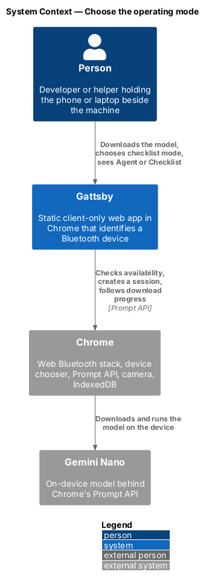
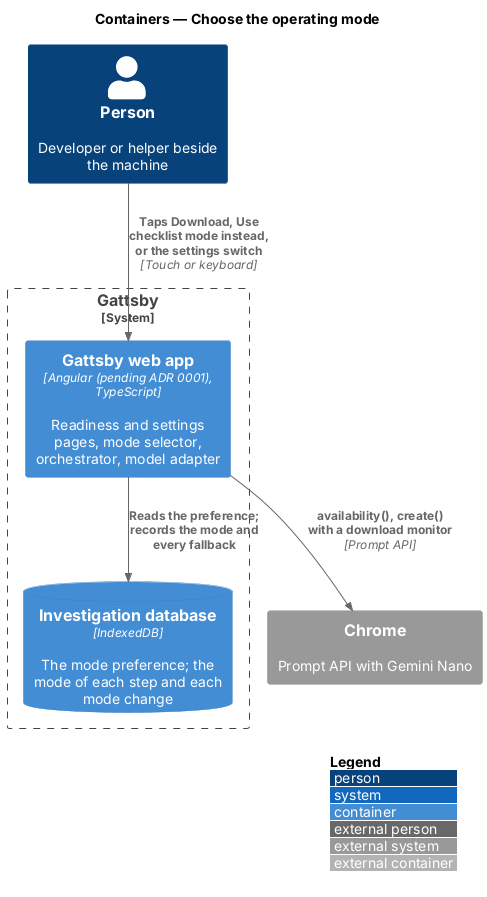
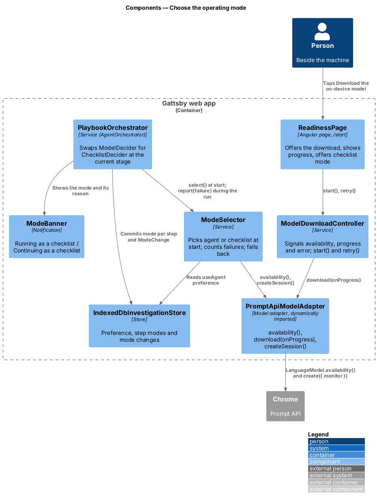
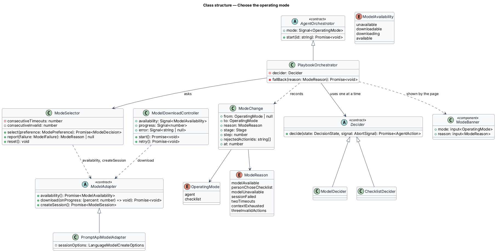
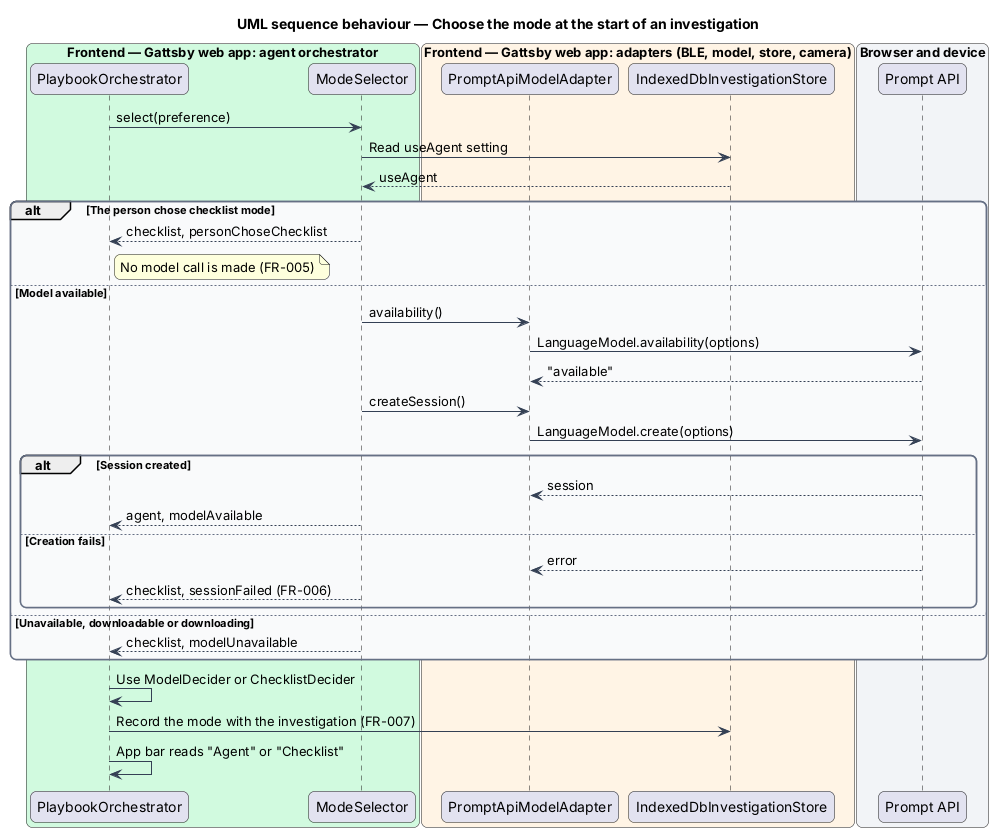
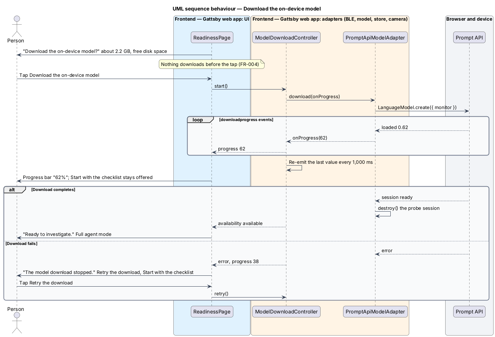
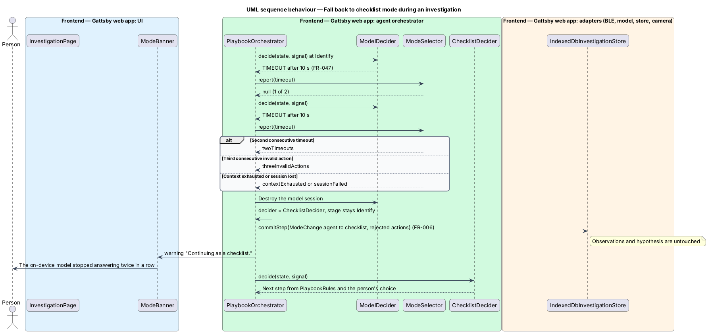

# Choose the operating mode

## Overview

Gattsby runs the same playbook in one of two modes. Where Chrome can create a Gemini Nano session,
the agent runs in full agent mode and the model chooses among ambiguous next steps. Where it cannot,
or where the person prefers it, the agent runs in checklist mode and deterministic rules and the
person's choices take the model's place. This feature decides the mode, gets the model ready when
the person asks for it, keeps the current mode visible, and falls back to checklist mode when the
model fails during an investigation. It belongs to the environment subsystem and acts before the
Prepare stage and at any stage after it.

**operating mode** — way an investigation chooses its next actions: `agent` (full agent mode,
through `ModelDecider`) or `checklist` (checklist mode, through `ChecklistDecider`)

**fallback** — switch from full agent mode to checklist mode during an investigation, at the current
playbook stage, without losing an observation or the hypothesis

**mode change** — record of one switch of operating mode, with its reason, stage and step

The Readiness page shows the model's state in its On-device model item. With the model ready, it
offers Start and "Use checklist mode instead" (`docs/mocks/pages/readiness/default.html`). With the
model downloadable, it offers "Download the on-device model" with the size and a disk-space warning,
and "Start with the checklist" (`downloadable.html`); during the download it shows a progress bar
(`downloading.html`); after a failure it offers "Retry the download" (`download-failed.html`); on
Chrome for Android it explains checklist mode (`checklist.html`). The Home page shows "Agent mode"
or "Checklist mode" (`docs/mocks/pages/home/default.html`, `checklist.html`). The Settings page holds
the switch "Use the agent when it's available" (`docs/mocks/pages/settings/default.html`). The
Investigation page's app bar reads "Agent · Identify" or "Checklist · Identify", and the mode banner
says "Running as a checklist." when the person chose it
(`docs/mocks/notifications/mode-banner/info.html`) or "Continuing as a checklist." after a fallback
(`warning.html`).

The feature exists because the model is the least available part of Gattsby: shipped on desktop
Chrome 148 only, downloaded separately, and able to time out or return invalid actions. The mode is
a property of each investigation and of each step, so the record shows which steps the model
decided.

## Description

The design introduces these building blocks in the Angular (pending ADR 0001) workspace under
`frontend/src/app/`:

- **`ModelAdapter`** / **`PromptApiModelAdapter`** (`model/model-adapter.ts`,
  `model/prompt-api-model-adapter.ts`) — the only code that touches `LanguageModel`. It holds one
  `sessionOptions` object (text input, English text output) and passes it to both
  `LanguageModel.availability()` and `LanguageModel.create()`, so availability describes the session
  Gattsby will create (FR-004). Image input is probed with its own options for the photo tool only,
  so a model without image input still allows full agent mode. `download(onProgress)` calls
  `create()` with a `monitor` and forwards each `downloadprogress` event as a percentage, then
  destroys that first session. The module is imported dynamically.
- **`ModelDownloadController`** (`model/model-download-controller.ts`) — signals `availability`,
  `progress` (0–100) and `error`; `start()` and `retry()`. It starts nothing until the person taps
  (FR-004). It re-emits the latest progress every 1,000 ms, so the progress bar and its accessible
  value change at least once a second. A rejected download sets `error` and keeps the last percentage
  ("Download failed at 38%").
- **`ModeSelector`** (`agent/mode-selector.ts`) — `select(preference)` returns a `ModeDecision`
  (`mode`, `reason`). It reads the person's preference, then availability, then tries
  `createSession()`; only a created session gives `agent`. During the run, `report(failure)` counts
  consecutive failures and returns a `ModeReason` when a fallback trigger is reached.
- **`PlaybookOrchestrator`** (`agent/playbook-orchestrator.ts`) — exposes the `mode` signal. At start
  it asks `ModeSelector` and uses `ModelDecider` or `ChecklistDecider`. On a fallback it aborts and
  destroys the model session, swaps in `ChecklistDecider` at the current stage, and commits a
  `ModeChange` with the step.
- **`ModelDecider`** and **`ChecklistDecider`** (`agent/model-decider.ts`,
  `agent/checklist-decider.ts`) — the two implementations of `Decider`. The orchestrator, tools,
  hypothesis tracker and verdict builder are the same in both modes (see the run-checklist-mode
  design).
- **`ModeChange`** (`store/model/mode-change.ts`) — `from`, `to`, `reason`, `stage`, `step`,
  `rejectedActionIds` and `at`. Each `Step` also carries its `mode`, so an export states the mode of
  every step (FR-005).
- **`ReadinessPage`** (`pages/readiness/readiness.page.ts`) — reads `ModelDownloadController` and
  shows the four model states; "Use checklist mode instead" sets the preference for this session.
- **`SettingsPage`** (`pages/settings/settings.page.ts`) — the switch "Use the agent when it's
  available", stored in the `settings` object store as `useAgentWhenAvailable` (default on).
- **`ModeBanner`** (`notifications/mode-banner/mode-banner.component.ts`) — presentation component.
  Inputs: `mode` and `reason`. The `info` variant explains a chosen checklist mode; the `warning`
  variant explains a fallback.

### Choosing the mode at start

| Preference | Model availability | `createSession()` | Mode | Reason |
|---|---|---|---|---|
| Checklist chosen | any | not called | `checklist` | `personChoseChecklist` |
| Agent when available | `available` | succeeds | `agent` | `modelAvailable` |
| Agent when available | `available` | fails | `checklist` | `sessionFailed` |
| Agent when available | `downloadable`, `downloading` or `unavailable` | not called | `checklist` | `modelUnavailable` |

In checklist mode no call reaches `LanguageModel` at all, which the fake model in the acceptance
specs records (FR-005). An investigation keeps the mode it started with when a download finishes
during it; the next investigation starts in full agent mode. Whether a running checklist
investigation should offer to switch to the agent is resolved for MVP by keeping its initial
mode for the duration. A later investigation can use a newly available model.

### Fallback triggers

`ModeSelector.report()` returns a reason, and the orchestrator falls back, on the first of these
(FR-006):

| Trigger | Count | Reason |
|---|---|---|
| Session creation fails mid-investigation (for example after a resume) | 1 | `sessionFailed` |
| A model call times out after 10 s (FR-047, A-05) | 2 in a row | `twoTimeouts` |
| The prompt no longer fits the context window | 1 | `contextExhausted` |
| An action fails validation (FR-043) | 3 in a row | `threeInvalidActions` |

A valid action resets the timeout and validation counters. The three rejected actions are kept in
the record with the `ModeChange` (FR-006). After a fallback the verdict and profile are built by
the same `VerdictBuilder` and `ProfileBuilder` as in an investigation that started in checklist
mode.

### Download size

The Prompt API does not report the size before download. Readiness says that it is a large
download and that Chrome needs free disk space. Chrome documents that the model size can
change and currently asks for at least 22 GB free before downloading. The app does not
estimate the person's available disk space from its origin quota.
[Chrome Prompt API](https://developer.chrome.com/docs/ai/prompt-api#review_the_hardware_requirements)

### Errors

| Situation | Person sees | Effect |
|---|---|---|
| Download rejected | "The model download stopped." with "Retry the download" | Checklist mode stays usable (FR-004) |
| Availability `unavailable` | "Not available on Android yet" and the checklist explanation | Checklist mode |
| Fallback | "Continuing as a checklist." | Investigation continues at the same stage |

### Tests that prove it

The acceptance specs script the fake `LanguageModel` (`e2e/fixtures/fake-language-model.ts`) as
`available`, `downloadable` with scripted progress events, a failing download, absent, and a model
that never answers. The fallback spec advances Playwright's clock past two 10-second timeouts and
checks the banner, the stage and the kept observations. Unit tests cover `ModeSelector`'s counters
and `ModelDownloadController`'s 1-second re-emission on a fake clock.

## Requirements

The feature realizes the following level-2 (L2) requirements; each refines the level-1 (L1)
requirement cited beside it.

| L2 ID | Refines (L1) | Requirement |
|-------|--------------|-------------|
| [`FR-004`](../../../specs/L2.md#fr-004-report-model-availability-and-download-progress) | `L1-002` | Gattsby must call `LanguageModel.availability()` with the same options it will use to create a session, and must reflect each state: *available*, *downloadable* (offer the download, warn about size and disk space), *downloading* (show progress as a percentage), and *unavailable* (say why, and that checklist mode will be used). |
| [`FR-005`](../../../specs/L2.md#fr-005-choose-the-operating-mode) | `L1-002` | At the start of each investigation Gattsby must use full agent mode when a model session can be created and checklist mode otherwise. The person must be able to choose checklist mode even when a model is available. The current mode must be visible throughout the investigation and recorded in the investigation record. |
| [`FR-006`](../../../specs/L2.md#fr-006-fall-back-to-checklist-mode-during-an-investigation) | `L1-002` | If the model fails during an investigation (session creation fails, a call times out twice in a row, the context is exhausted, or three consecutive actions fail validation), Gattsby must switch to checklist mode at the current playbook stage without losing observations, and tell the person. |

## Diagrams

### System context

The person decides when the model downloads and may choose checklist mode; Gattsby asks Chrome's
Prompt API for availability and a session, and Chrome runs Gemini Nano on the device.

### Containers

The web app talks to the Prompt API and records the preference, the mode of each step and every
mode change in the investigation database.

### Components

`ModeSelector` decides the mode from the preference and the model adapter;
`ModelDownloadController` drives the download for the Readiness page; the orchestrator swaps
deciders and shows the `ModeBanner`.

### Class structure

`PlaybookOrchestrator` uses one `Decider` at a time and records each `ModeChange`; `ModeSelector`
and `ModelDownloadController` depend on the `ModelAdapter` contract only.

### Behaviour — choose the mode at the start of an investigation

A chosen checklist, an unavailable model or a failed session gives checklist mode; only a created
session gives full agent mode. The mode is stored with the investigation.

### Behaviour — download the on-device model

Nothing downloads before the tap; progress refreshes at least once a second; a failure offers a retry
while the checklist stays available.

### Behaviour — fall back to checklist mode during an investigation

Two consecutive timeouts, three invalid actions in a row, an exhausted context or a lost session
swap in `ChecklistDecider` at the current stage; the mode change is committed and the banner tells
the person.

