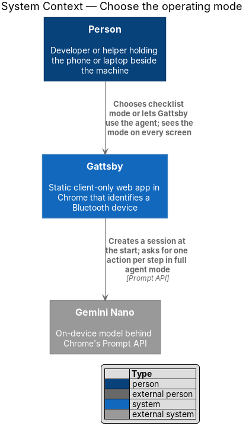
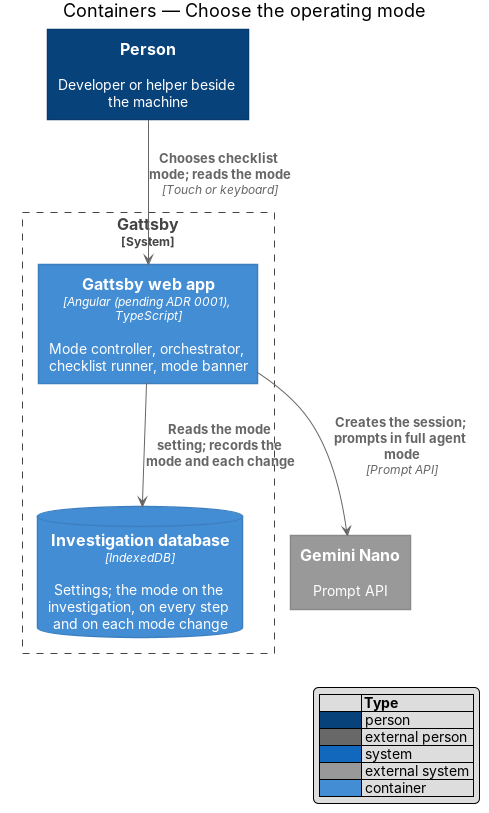
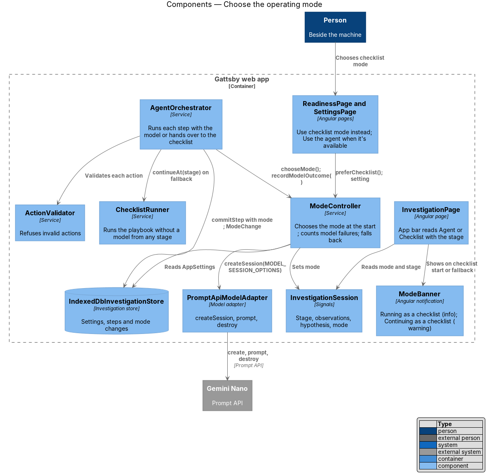
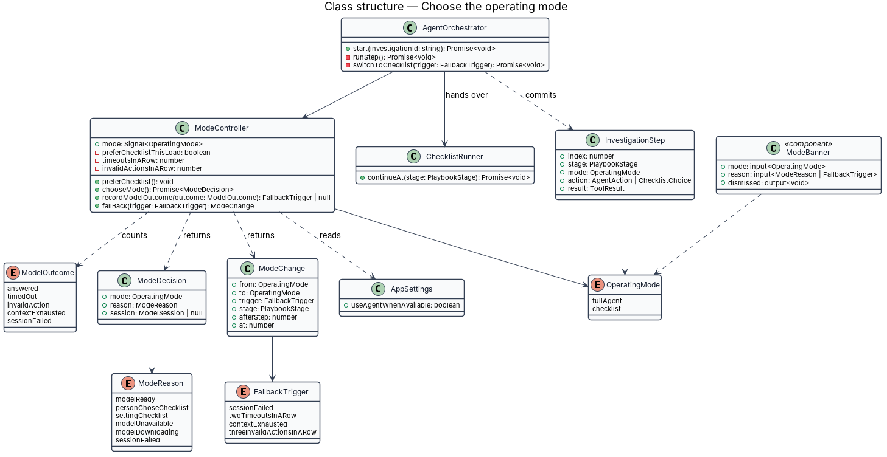
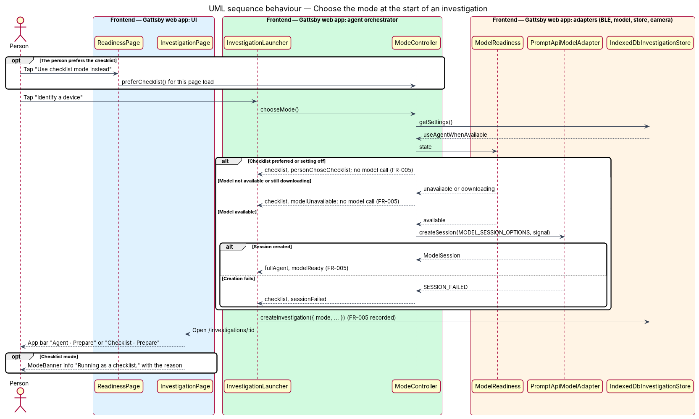
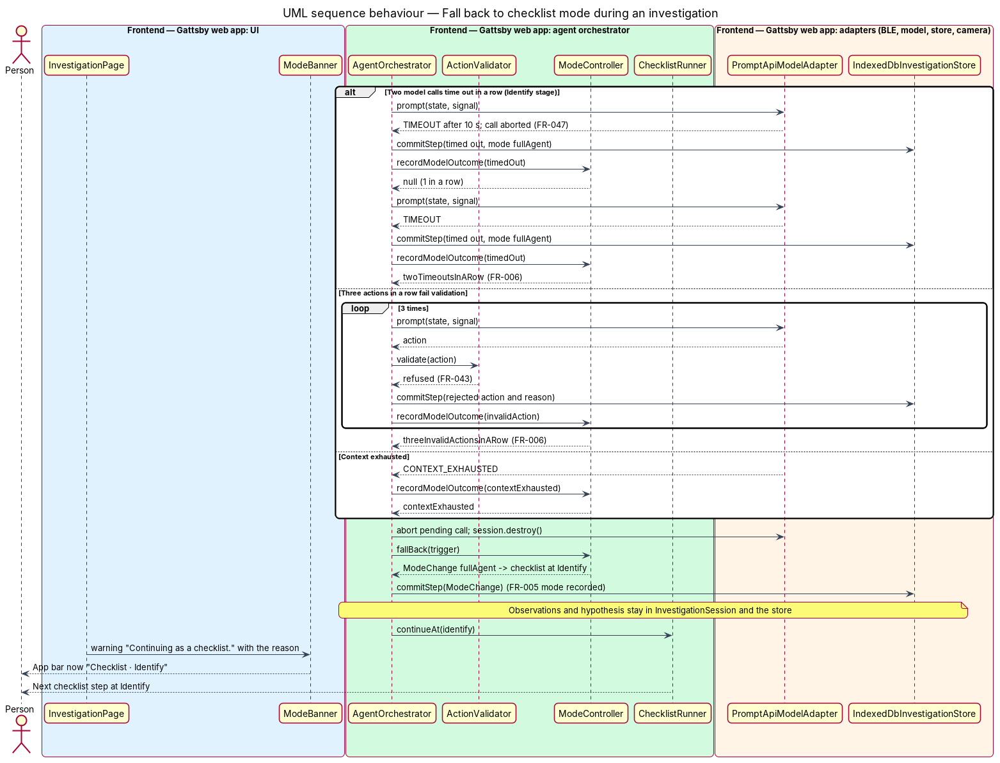

# Choose the operating mode

## Overview

Gattsby runs the same diagnostic playbook in two ways. In full agent mode the on-device model chooses
each next action; in checklist mode deterministic rules and the person's choices do, and no model is
called. This feature decides which mode an investigation starts in, lets the person choose checklist
mode even when a model is ready, keeps the mode visible and recorded, and moves a running
investigation to checklist mode when the model fails, without losing what was found. It belongs to
the environment subsystem; it runs once when an investigation starts and then watches every model
call until the investigation ends.

**operating mode** — how the playbook's next step is chosen: `fullAgent` (the model chooses) or
`checklist` (rules and the person choose)

**fallback** — switch from full agent mode to checklist mode during an investigation, at the current
playbook stage, after the model fails

**mode change** — entry in the investigation record that states a fallback: from which mode, to which,
why, at which stage and after which step

The mode is shown in four places in the mocks. The home screen's chip reads "Agent mode" or "Checklist
mode" (`docs/mocks/pages/home/default.html`, `home/checklist.html`). The investigation's app bar reads
"Agent · Prepare" or "Checklist · Identify", and the activity feed labels each line "Agent:" or
"Checklist:" (`pages/investigation/prepare.html`, `investigation/checklist.html`). The mode banner
says "Running as a checklist." when the investigation starts in checklist mode
(`notifications/mode-banner/info.html`) and "Continuing as a checklist." after a fallback
(`notifications/mode-banner/warning.html`). The person chooses checklist mode with "Use checklist mode
instead" on the readiness page (`pages/readiness/default.html`), or for every investigation with the
Settings switch "Use the agent when it's available" (`pages/settings/default.html`).

The mode never moves back from checklist to full agent mode within one investigation: a model that
becomes ready later serves the next investigation.

## Description

The design introduces these building blocks in the Angular (pending ADR 0001) workspace under
`frontend/src/app/`:

- **`ModeController`** (`agent/mode-controller.ts`) — decides and holds the mode.
  - `preferChecklist()` records the person's "Use checklist mode instead" for the rest of the page
    load.
  - `chooseMode()` returns a `ModeDecision`. It reads `AppSettings` and the person's preference, then
    `ModelReadiness`, and only when all allow it creates the model session with
    `MODEL_SESSION_OPTIONS` (see [prepare-the-model](../prepare-the-model/README.md)).
  - `recordModelOutcome(outcome)` counts consecutive timeouts and consecutive invalid actions, and
    returns a `FallbackTrigger` when one of FR-006's conditions is met.
  - `fallBack(trigger)` sets the mode to `checklist` and returns the `ModeChange`.
  - `mode` is a signal that the investigation page, the activity feed and the home chip read.
- **`AppSettings`** (`store/model/app-settings.ts`) — persisted settings; this feature reads
  `useAgentWhenAvailable`, which the Settings page writes. `InvestigationStore.getSettings()` and
  `saveSettings()` read and write it, so the store stays the only code that touches IndexedDB.
- **`AgentOrchestrator`** (`agent/agent-orchestrator.ts`) — reports each model call's outcome to
  `ModeController`. On a trigger it aborts any pending call with its `AbortController`, destroys the
  model session, commits the `ModeChange`, and hands the loop to `ChecklistRunner` at the current
  stage.
- **`ChecklistRunner`** (`agent/checklist-runner.ts`) — `continueAt(stage)` runs the playbook without
  a model from the given stage, reading the observations and hypothesis already in
  `InvestigationSession` (see [run-the-checklist](../../agent/run-the-checklist/README.md)).
- **`InvestigationStep.mode`** (`store/model/investigation-step.ts`) — each committed step carries the
  mode it ran in, so an export states the mode for every step (FR-005).
- **`ModeBanner`** (`notifications/mode-banner/mode-banner.ts`) — presentation component. Inputs: the
  mode and the reason. It renders the info state when an investigation starts in checklist mode and
  the warning state after a fallback, in a polite live region.

### Rules the mode follows

1. At the start of each investigation the mode is `fullAgent` only when the person has not chosen
   checklist mode, the Settings switch is on, the model is `available`, and `createSession()`
   succeeds. Otherwise it is `checklist` (FR-005).
2. In checklist mode no model session is created and no prompt is sent. Where the person chose
   checklist mode or the model is not available, `createSession()` is never called (FR-005).
3. The mode is recorded on the investigation at creation, on every committed step, and in each
   `ModeChange` (FR-005).
4. A fallback happens on the first of these (FR-006): session creation fails (`sessionFailed`); two
   consecutive model calls time out (`twoTimeoutsInARow`); the model reports its context is exhausted
   (`contextExhausted`); three consecutive actions fail validation (`threeInvalidActionsInARow`). An
   answered call resets the timeout count; a valid action resets the invalid-action count.
5. A fallback keeps the current playbook stage, every observation, the hypothesis, the raw log and
   each rejected action, which `ActionValidator` already committed as refused steps. Nothing is
   discarded or re-run.
6. Approvals do not depend on the mode: a `write` or `control` call needs its own approval in
   checklist mode as in full agent mode, before and after a fallback (FR-034).
7. The verdict and the device profile do not depend on the mode. `VerdictService` and
   `DeviceProfileBuilder` read observations, hypotheses and evidence only, so an investigation that
   fell back ends like one that started as a checklist (FR-006).
8. Within one investigation the mode moves only from `fullAgent` to `checklist`, never back.

### Data shapes

| Type | Fields |
|---|---|
| `ModeDecision` | `mode`, `reason`, `session` |
| `ModeChange` | `from`, `to`, `trigger`, `stage`, `afterStep`, `at` |
| `AppSettings` | `useAgentWhenAvailable` |
| `ModeReason` | `modelReady`, `personChoseChecklist`, `settingChecklist`, `modelUnavailable`, `modelDownloading`, `sessionFailed` |
| `FallbackTrigger` | `sessionFailed`, `twoTimeoutsInARow`, `contextExhausted`, `threeInvalidActionsInARow` |

### What the person is told

| Situation | Banner | Text |
|---|---|---|
| Started in checklist mode by choice | Info | "Running as a checklist." and that no model is used (`mode-banner/info.html`) |
| Started in checklist mode, model unavailable | Info | `<TO SUPPLY>` (OQ-06) |
| Fallback after two timeouts | Warning | "Continuing as a checklist." "The on-device model stopped answering twice in a row. Everything found so far is kept." (`mode-banner/warning.html`) |
| Fallback for another trigger | Warning | "Continuing as a checklist." with a reason line `<TO SUPPLY>` (OQ-06) |

### Errors

The mode never fails an investigation. Every model failure ends in checklist mode. `SESSION_FAILED`,
`TIMEOUT` and `CONTEXT_EXHAUSTED` come from the model adapter's `ModelErrorCode`; each is recorded in
the step with its stage (NFR-025).

### Tests that prove it

The acceptance specs use the fake `LanguageModel` (`e2e/fixtures/fake-language-model.ts`) and the
fake `navigator.bluetooth` playing the FTMS treadmill, with the `InvestigationPage` and `ModeBanner`
page objects:

- With the model available, an investigation's app bar reads "Agent"; after "Use checklist mode
  instead", it reads "Checklist" and the fake records no `create()` or `prompt()` call.
- With the fake scripted to hang twice at Identify, the app bar changes to "Checklist · Identify",
  the warning banner reads "Continuing as a checklist.", and the hypothesis and observations shown
  before the fallback are still shown.
- With the fake scripted to return three invalid actions, the exported record holds the three
  rejected actions and a mode change, and every step states its mode.
- After a fallback, the FTMS treadmill still reaches "Connected — FTMS".

Unit tests cover `ModeController.chooseMode()` for each `ModeReason`, and `recordModelOutcome()` for
each trigger and for the counters' resets. Timeouts use a fake clock.

## Requirements

The feature realizes the following level-2 (L2) requirements; each refines the level-1 (L1)
requirement cited beside it.

| L2 ID | Refines (L1) | Requirement |
|-------|--------------|-------------|
| [`FR-005`](../../../specs/L2.md#fr-005-choose-the-operating-mode) | `L1-002` | At the start of each investigation Gattsby must use full agent mode when a model session can be created and checklist mode otherwise. The person must be able to choose checklist mode even when a model is available. The current mode must be visible throughout the investigation and recorded in the investigation record. |
| [`FR-006`](../../../specs/L2.md#fr-006-fall-back-to-checklist-mode-during-an-investigation) | `L1-002` | If the model fails during an investigation (session creation fails, a call times out twice in a row, the context is exhausted, or three consecutive actions fail validation), Gattsby must switch to checklist mode at the current playbook stage without losing observations, and tell the person. |

## Diagrams

### System context

The person chooses checklist mode or lets Gattsby use the agent; in full agent mode Gattsby creates a
session with Gemini Nano and asks it for one action per step.

### Containers

The web app reads the mode setting from the investigation database and records the mode on the
investigation, on each step and on each mode change.

### Components

`ModeController` decides the mode from the settings, the person's choice and the model's readiness;
`AgentOrchestrator` reports each model outcome to it and hands the loop to `ChecklistRunner` on a
fallback, while `ModeBanner` tells the person.

### Class structure

`ModeController` returns a `ModeDecision` at the start and a `ModeChange` on a fallback; every
`InvestigationStep` carries its `OperatingMode`.

### Behaviour — choose the mode at the start

The person's choice and the Settings switch are read first; only when both allow it, and the model is
available, is a session created, and a failed creation also leads to checklist mode.

### Behaviour — fall back to checklist mode

Two timeouts in a row, three invalid actions in a row or an exhausted context end the model session;
the mode change is committed and `ChecklistRunner` continues at the same stage with everything kept.

