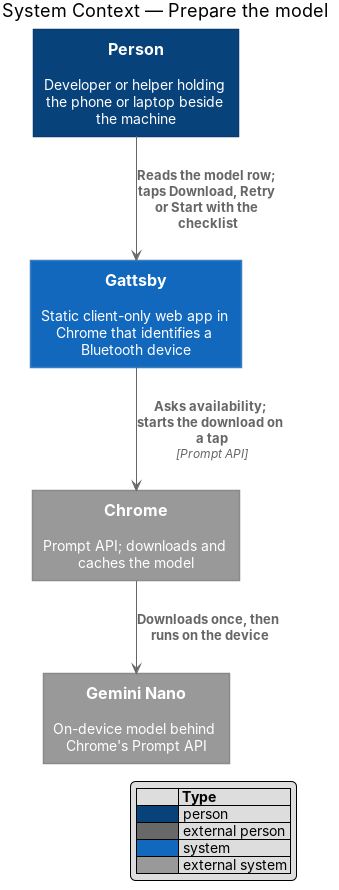
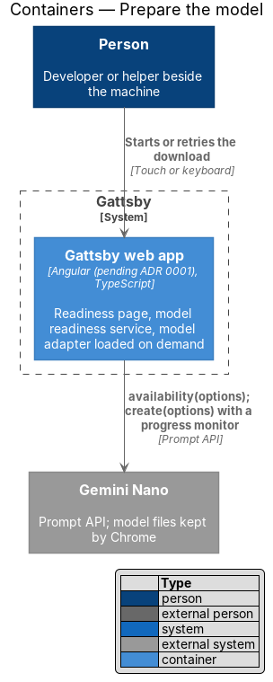
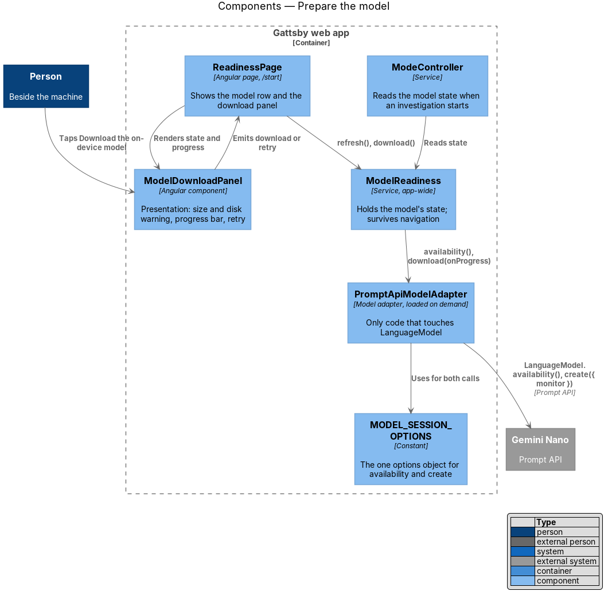
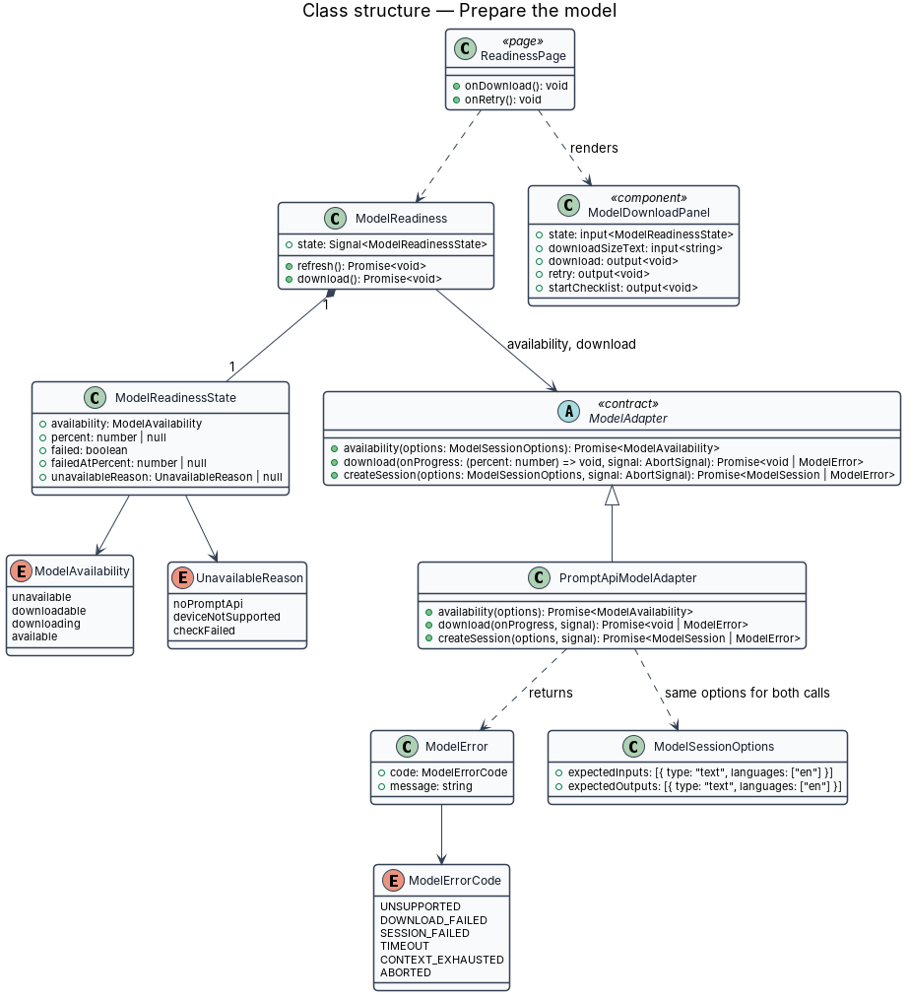
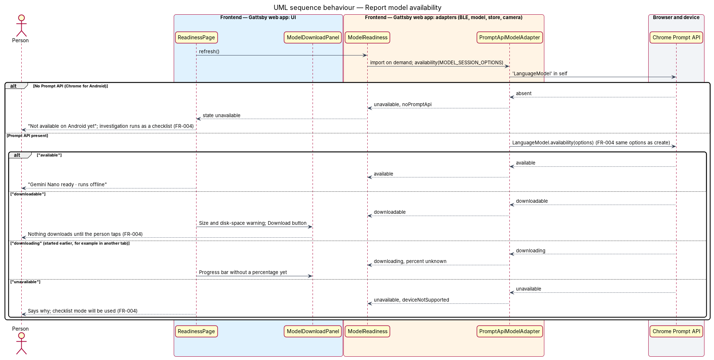
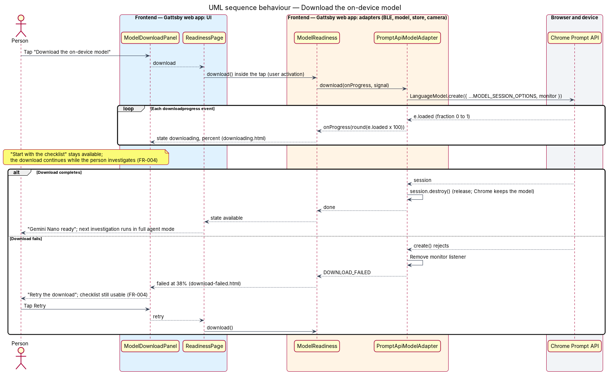

# Prepare the model

## Overview

Full agent mode needs Chrome's on-device model, Gemini Nano, reached through the Prompt API
(`LanguageModel`). The model ships only with Chrome 148 on Windows, macOS, Linux and Chromebook Plus,
is downloaded separately on first use, and needs significant free disk space (`PD-PROMPT`). This
feature reports whether the model can be used, offers the download where Chrome allows it, shows the
download's progress, and says plainly when the model cannot be used and the investigation will run as
a checklist. It belongs to the environment subsystem and is drawn on the Readiness check page
(route `/start`) as the On-device model row and the panel beneath it.

**model availability** — one of the four states `LanguageModel.availability()` returns:
`available`, `downloadable`, `downloading` or `unavailable`

**model session options** — the one options object Gattsby passes both to
`LanguageModel.availability()` and to `LanguageModel.create()`, so the answer describes the session
Gattsby will actually create

**model readiness** — Gattsby's own view of the model for the person: the availability, plus the
download's percentage, a failed download, or the reason the model is unavailable

The mocks show one state per availability. `docs/mocks/pages/readiness/default.html` shows the model
ready. `downloadable.html` offers "Download the on-device model" with a size and disk-space warning,
and "Start with the checklist" beside it. `downloading.html` shows a progress bar with a percentage.
`download-failed.html` shows where the download stopped and offers "Retry the download".
`checklist.html` shows Chrome for Android, where the model is not available and the investigation
runs as a checklist. In every state the person can start at once; only the mode differs (see
[choose-the-operating-mode](../choose-the-operating-mode/README.md)).

## Description

The design introduces these building blocks in the Angular (pending ADR 0001) workspace under
`frontend/src/app/`:

- **`ModelAdapter`** (`model/model-adapter.ts`) — the contract over any in-browser model:
  `availability(options)`, `download(onProgress, signal)` and `createSession(options, signal)`. A
  refusal is a `ModelError` whose `code` a screen branches on.
- **`PromptApiModelAdapter`** (`model/prompt-api-model-adapter.ts`) — the only code that touches
  `LanguageModel` (NFR-021). It is imported on demand, never in the initial bundle (NFR-004). It
  reports `unavailable` with the reason `noPromptApi` when `LanguageModel` is absent, and never
  throws.
- **`MODEL_SESSION_OPTIONS`** (`model/model-session-options.ts`) — the session options: text in and
  text out, in English (`A-14`). `availability()` and `create()` both receive this object (FR-004).
  Image input for photo reading (FR-022, `PD-PROMPT-IMAGE`) is checked with its own options so a
  missing image capability never makes text sessions unavailable.
- **`ModelReadiness`** (`model/model-readiness.service.ts`) — app-wide service that holds the
  `ModelReadinessState` signal. `refresh()` asks the adapter for availability; `download()` starts the
  download and turns each progress event into a whole percentage. It lives for the whole page, so the
  download continues when the person moves on to an investigation.
- **`ModelDownloadPanel`** (`ui/model-download-panel/model-download-panel.ts`) — presentation
  component. Inputs: the `ModelReadinessState` and the size text. Outputs: `download`, `retry`,
  `startChecklist`. The progress bar is a `progressbar` with its value and a text percentage, so the
  state is never carried by the bar's colour or length alone.
- **`ReadinessPage`** (`pages/readiness/readiness.page.ts`) — calls `ModelReadiness.refresh()` with
  the capability check (see [check-capabilities](../check-capabilities/README.md)) and calls
  `download()` from the panel's tap handler.

### Rules the model readiness follows

1. Availability is asked with `MODEL_SESSION_OPTIONS`, the same options the investigation's session is
   created with (FR-004).
2. Nothing downloads until the person taps "Download the on-device model". `download()` calls
   `LanguageModel.create()` inside that tap, which also gives Chrome the user activation it needs to
   start a download.
3. Each `downloadprogress` event from the `create()` monitor sets the percentage, rounded to a whole
   number. The page renders every change. Whether Chrome emits an event at least once a second on a
   slow network is not documented (`A-13`); the acceptance spec drives the fake model at that rate.
4. The session `create()` returns once the download completes is destroyed at once; the model stays
   cached by Chrome, and each investigation creates its own session. The monitor's listener is
   removed on completion and on failure.
5. A failed download is reported with the percentage reached and a "Retry the download" action.
   Retrying is a new tap. Checklist mode stays usable throughout (FR-004).
6. An unavailable model is reported with its reason: `noPromptApi` (Chrome for Android, for example),
   `deviceNotSupported` (`availability()` returned `unavailable`) or `checkFailed` (the call failed or
   missed the capability check's 1-second deadline). Each reason's row says that the investigation
   runs as a checklist.
7. A download that finishes while an investigation runs does not change that investigation's mode.
   The next investigation picks up full agent mode (see
   [choose-the-operating-mode](../choose-the-operating-mode/README.md)).
8. Once downloaded, the model works offline; Chrome caches it (NFR-006).

### Data shapes

| Type | Fields |
|---|---|
| `ModelReadinessState` | `availability`, `percent`, `failed`, `failedAtPercent`, `unavailableReason` |
| `ModelSessionOptions` | `expectedInputs`, `expectedOutputs` |
| `ModelError` | `code`, `message` |

The download's size is not reported by the Prompt API before the download starts. The mocks show
"about 2.2 GB", taken from the designs; the size text is configuration whose value is `<TO SUPPLY>`.
"1.4 of 2.2 GB" in `downloading.html` derives from that text and the percentage.

### Errors

| Code | Raised by | Meaning to the person |
|---|---|---|
| `UNSUPPORTED` | `PromptApiModelAdapter` | "Not available" on this device; the investigation runs as a checklist. |
| `DOWNLOAD_FAILED` | `PromptApiModelAdapter.download` | "The model download stopped." Free disk space, stay on Wi-Fi, retry; the checklist works meanwhile. |
| `ABORTED` | `PromptApiModelAdapter.download` | The page was closed during the download; Chrome resumes or restarts it on the next tap. |

`SESSION_FAILED`, `TIMEOUT` and `CONTEXT_EXHAUSTED` belong to the same `ModelErrorCode` type and are
used by [choose-the-operating-mode](../choose-the-operating-mode/README.md) and
[decide-the-next-action](../../agent/decide-the-next-action/README.md).

### Tests that prove it

The acceptance specs use the fake `LanguageModel` (`e2e/fixtures/fake-language-model.ts`), scripted
for each availability and for download progress, with the `ReadinessPage` page object:

- With availability `downloadable`, the page offers "Download the on-device model" with the size and
  disk-space note, and the fake records no `create()` call until the button is tapped.
- After the tap, the fake emits progress every 500 ms; the bar's value and percentage text follow, and
  "Start with the checklist" opens a checklist investigation while the download continues.
- With `LanguageModel` undefined, the model row says the model is not available on this device and
  that the investigation runs as a checklist.
- With `create()` rejecting at 38%, the page says the download stopped, offers a retry, and a
  checklist investigation still starts.

Unit tests cover `ModelReadiness` state transitions and the rounding of progress fractions.

## Requirements

The feature realizes the following level-2 (L2) requirements; each refines the level-1 (L1)
requirement cited beside it.

| L2 ID | Refines (L1) | Requirement |
|-------|--------------|-------------|
| [`FR-004`](../../../specs/L2.md#fr-004-report-model-availability-and-download-progress) | `L1-002` | Gattsby must call `LanguageModel.availability()` with the same options it will use to create a session, and must reflect each state: *available*, *downloadable* (offer the download, warn about size and disk space), *downloading* (show progress as a percentage), and *unavailable* (say why, and that checklist mode will be used). |

## Diagrams

### System context

The person decides whether to download the model; Gattsby asks Chrome for availability and starts the
download only on that tap, and Chrome keeps the model on the device.

### Containers

The web app is the only container involved: it talks to Gemini Nano through the Prompt API and stores
nothing of the model itself.

### Components

`ReadinessPage` drives `ModelReadiness`, which calls `PromptApiModelAdapter` with
`MODEL_SESSION_OPTIONS`; `ModeController` reads the same state when an investigation starts.

### Class structure

`ModelReadiness` owns one `ModelReadinessState` and depends on the `ModelAdapter` contract, which
`PromptApiModelAdapter` implements and which refuses with a `ModelError`.

### Behaviour — report model availability

Without the Prompt API the model is reported unavailable at once; otherwise each of the four
availability values maps to its own row and panel.

### Behaviour — download the on-device model

The person's tap starts `create()` with a progress monitor; each event updates the percentage, a
completed download frees its session, and a failed one offers a retry while the checklist stays
usable.

