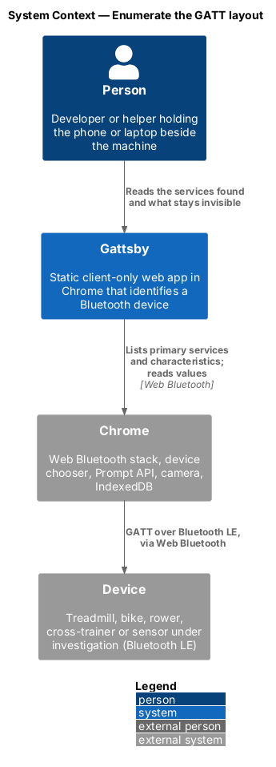
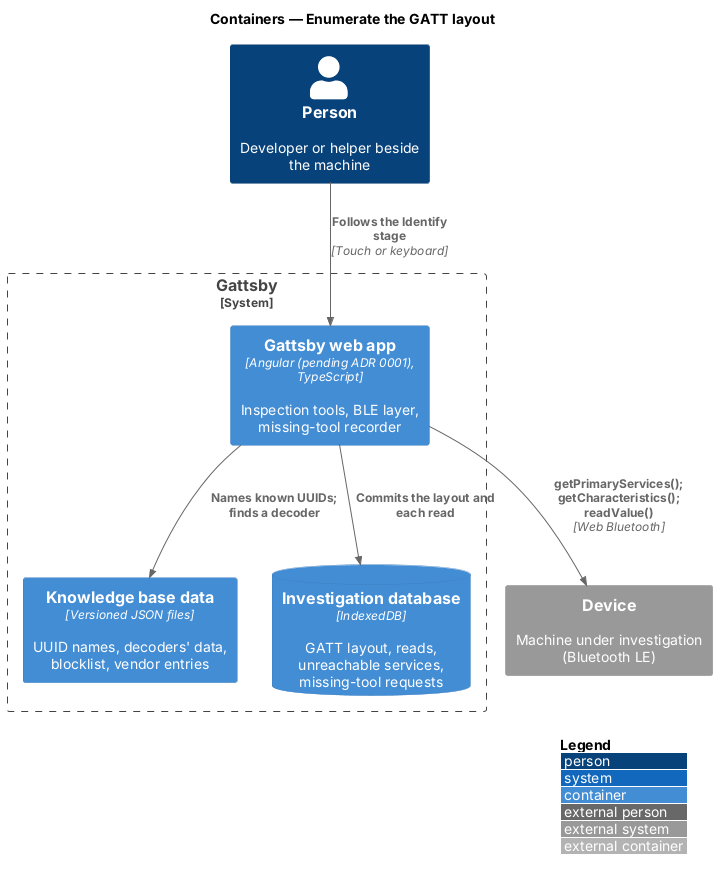
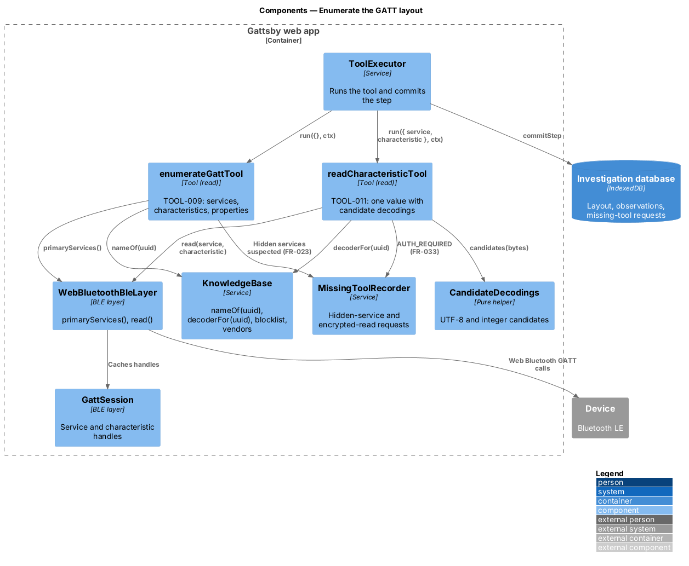
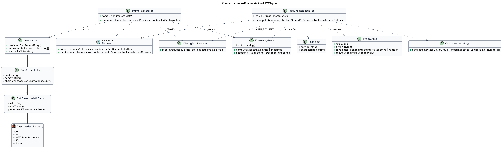
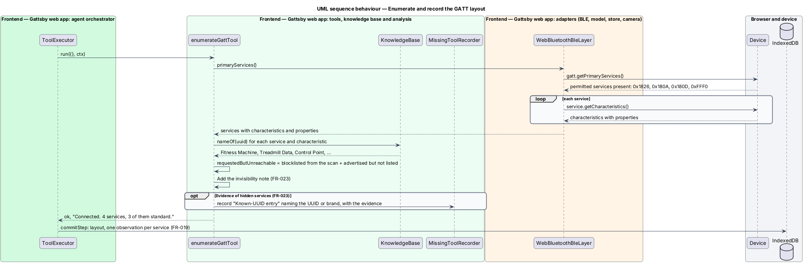
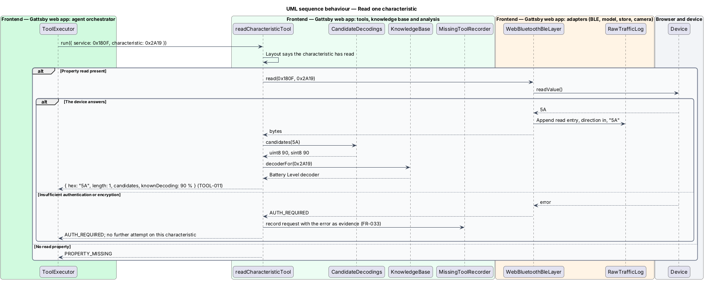

# Enumerate the GATT layout

## Overview

Once connected, the first question is what the device exposes. This feature lists every primary
service the browser can reach, each service's characteristics and their properties, names the known
ones from the knowledge base, and records the whole as the device's GATT layout. It also reads single
values on request, and it states plainly what the browser cannot see. It opens the Identify stage of
the playbook, straight after the connect-to-the-device design, and every later stage plans from the
layout it records.

**GATT layout** — list of the device's reachable primary services, their characteristics and each
characteristic's properties, as recorded in the investigation

**characteristic property** — operation a characteristic supports: `read`, `write`,
`writeWithoutResponse`, `notify` or `indicate`

**unreachable service** — service Gattsby asked for, or saw advertised, that the browser does not
expose: a UUID on Chrome's GATT blocklist, or an advertised UUID missing from the layout

**invisible service** — service the browser hides because its UUID is not in the scan's
optional-service list; Gattsby cannot list it, only suspect it

The person sees the result on the Investigation page in state `identify`
(`docs/mocks/pages/investigation/identify.html`): the step card "Connect and list everything it
exposes" with the summary "Connected. 4 services, 3 of them standard." and one line per service
("Fitness Machine 0x1826" tagged `confirmed`, "Vendor service 0xFFF0" tagged `guess`). The device
panel's "Services" row lists the UUIDs. The device profile (`docs/mocks/pages/device-profile/default.html`)
carries the "Not reachable" row, "services outside the known list".

Web Bluetooth only exposes services named at scan time (`PD-BLE-SERVICES`), so the layout is never a
full picture of the device. Saying so in the record and the profile, and raising a missing-tool
request when the evidence points at hidden services, keeps the verdict honest (FR-023).

## Description

The design introduces these building blocks in the Angular (pending ADR 0001) workspace under
`frontend/src/app/`:

- **`enumerateGattTool`** (`tools/inspection/enumerate-gatt.tool.ts`) — registry entry for
  `enumerate_gatt` (TOOL-009), safety class `read`, stage `identify`. Precondition: connected, else
  `NOT_CONNECTED`. Output `{ services, requestedButUnreachable }` as a `GattLayout`.
- **`readCharacteristicTool`** (`tools/inspection/read-characteristic.tool.ts`) — registry entry for
  `read_characteristic` (TOOL-011), safety class `read`. Input `{ service, characteristic }`. Output
  `{ hex, length, candidates, knownDecoding? }`.
- **`CandidateDecodings`** (`tools/inspection/candidate-decodings.ts`) — pure helper with unit tests
  that lists the candidate readings of a value (below).
- **`WebBluetoothBleLayer`** (`ble/web-bluetooth-ble-layer.ts`) — `primaryServices()` calls
  `gatt.getPrimaryServices()` and `getCharacteristics()` on each, and maps
  `BluetoothCharacteristicProperties` to the five properties of TOOL-009. `read(service,
  characteristic)` calls `readValue()` and appends a `read` entry to `RawTrafficLog`.
- **`GattSession`** (`ble/gatt-session.ts`) — caches the service and characteristic handles for later
  reads and subscriptions.
- **`KnowledgeBase`** (`knowledge-base/knowledge-base.ts`) — `nameOf(uuid)` names services and
  characteristics; `decoderFor(uuid)` returns a `Decoder` for `knownDecoding`; `vendors` tells whether
  a brand has known UUIDs.
- **`MissingToolRecorder`** (`outcome/missing-tool-recorder.ts`) — records the hidden-service request
  of FR-023 and the encrypted-read request of FR-033.
- **`GattLayout`** (`store/model/gatt-layout.ts`) — the data shape below, committed with the step and
  read by the device profile (see the build-the-device-profile design).

### Enumeration rules

1. Every reachable primary service and every characteristic is listed, with its properties and,
   where known, its name (FR-019). For an FTMS treadmill the record holds `0x1826` with Treadmill
   Data (`0x2ACD`), Fitness Machine Feature (`0x2ACC`) and Fitness Machine Control Point (`0x2AD9`).
2. A known UUID that was requested but that the device does not have is absent from the layout; the actual
   layout is unaffected (TOOL-009).
3. `requestedButUnreachable` holds the known UUIDs left out of the scan for the blocklist (see the
   scan-for-the-device design) and any advertised UUID the layout does not list.
4. Every layout carries the invisibility note: services not in the known-UUID list, and services on
   Chrome's blocklist, are invisible to the browser (FR-023). The device profile repeats it with the
   unreachable list.
5. A service whose characteristics cannot be listed is recorded with no characteristics, and the
   step's summary names the error.
6. Each service becomes an observation tagged `confirmed`; an unnamed vendor UUID is tagged `guess`
   as to its purpose.

### Hidden services (FR-023)

`enumerateGattTool` raises a missing-tool request when:

| Evidence | Request |
|---|---|
| An advertised 128-bit service UUID is not in the knowledge base | Names the UUID, with the advertisement as evidence |
| The brand given in Prepare has no vendor entry with known UUIDs | Names the brand, with the Prepare answer as evidence |

Advertised UUIDs come only from advertisement samples (P2, `PD-ADV`; see the tell-candidates-apart
design), because `requestDevice` does not report them. Without advertisement watching, the brand row
is the only trigger available.

### Reading one value

- Precondition: connected and the characteristic has `read`, else `NOT_CONNECTED` or
  `PROPERTY_MISSING`.
- `CandidateDecodings` returns UTF-8 text when every byte is printable, and unsigned and signed
  integers at 8, 16 and 32 bits in little- and big-endian order (TOOL-011). For a value of length n,
  integers are read from offset 0 at every width not above n.
- `knownDecoding` comes from the knowledge base's decoder for that UUID: Battery Level `5A` decodes
  to 90 % (TOOL-011).
- A read refused for insufficient authentication or encryption returns `AUTH_REQUIRED`. A
  missing-tool request is raised with the error as evidence, and no other attempt is made on that
  characteristic (FR-033; see the unlock-vendor-data-safely design).
- A service not in the optional-service list returns `SERVICE_NOT_PERMITTED`.

### Errors

| Code | Raised by | Meaning to the person |
|---|---|---|
| `NOT_CONNECTED` | Both tools | None shown; the agent reconnects or stops |
| `GATT_ERROR` | Both tools | The device returned an ATT error; the code is in the message (NFR-025) |
| `PROPERTY_MISSING` | `readCharacteristicTool` | None shown; the characteristic cannot be read |
| `SERVICE_NOT_PERMITTED` | `readCharacteristicTool` | None shown; the browser hides the service |
| `AUTH_REQUIRED` | `readCharacteristicTool` | The value is protected; Gattsby does not try to bypass it |

All UUIDs, names and decoded text are rendered as text (NFR-013).

### Tests that prove it

Acceptance specs use the fake `navigator.bluetooth`: the FTMS treadmill for the `0x1826` layout and
its three characteristics, the FTMS bike for Indoor Bike Data (`0x2AD2`) with `notify`, and the
unknown-services device for the invisibility note. The encrypted device scripts an
insufficient-encryption read for `AUTH_REQUIRED`. Unit tests cover `CandidateDecodings` and the
Battery Level decoding.

## Requirements

The feature realizes the following level-2 (L2) requirements; each refines the level-1 (L1)
requirement cited beside it.

| L2 ID | Refines (L1) | Requirement |
|-------|--------------|-------------|
| [`FR-019`](../../../specs/L2.md#fr-019-enumerate-and-record-the-gatt-layout) | `L1-006` | Once connected, Gattsby must list every reachable primary service and its characteristics with their properties, name the known ones from the knowledge base, and record the layout in the investigation. |
| [`FR-023`](../../../specs/L2.md#fr-023-report-services-the-browser-cannot-see) | `L1-006` | Gattsby must state, in the investigation and in the profile, that services not in its known-UUID list, and services on Chrome's blocklist, are invisible to the browser, and must raise a missing-tool request when the evidence (advertised UUIDs not reachable, a brand with no known UUIDs) suggests there are hidden services. |
| [`TOOL-009`](../../../specs/L2.md#tool-009-enumerate_gatt) | `L1-006` | Lists every reachable primary service, its characteristics and their properties, named from the knowledge base where known. |
| [`TOOL-011`](../../../specs/L2.md#tool-011-read_characteristic) | `L1-006` | Reads one value and returns it in hex with candidate decodings (UTF-8 text when printable, unsigned and signed integers at 8, 16 and 32 bits in both byte orders, and the knowledge base's decoder if the UUID is known). |

## Diagrams

### System context

Gattsby lists the device's services and reads values through Chrome's Web Bluetooth stack, and tells
the person what the browser cannot see.

### Containers

The web app enumerates the device, names what it finds from the knowledge base, and commits the
layout and each read to the investigation database.

### Components

The two inspection tools call the BLE layer, name and decode through `KnowledgeBase` and
`CandidateDecodings`, and raise missing-tool requests for hidden services and protected reads.

### Class structure

A `GattLayout` composes `GattServiceEntry`s, which compose `GattCharacteristicEntry`s with their
properties; both tools depend on the `BleLayer` contract and `KnowledgeBase`.

### Behaviour — enumerate and record the GATT layout

The tool lists services and characteristics, names them, works out the unreachable list, adds the
invisibility note, raises a request on evidence of hidden services, and the step is committed.

### Behaviour — read one characteristic

A readable value returns its hex, its candidate decodings and its known decoding; a protected value
returns `AUTH_REQUIRED` and a missing-tool request; a characteristic without `read` returns
`PROPERTY_MISSING`.

