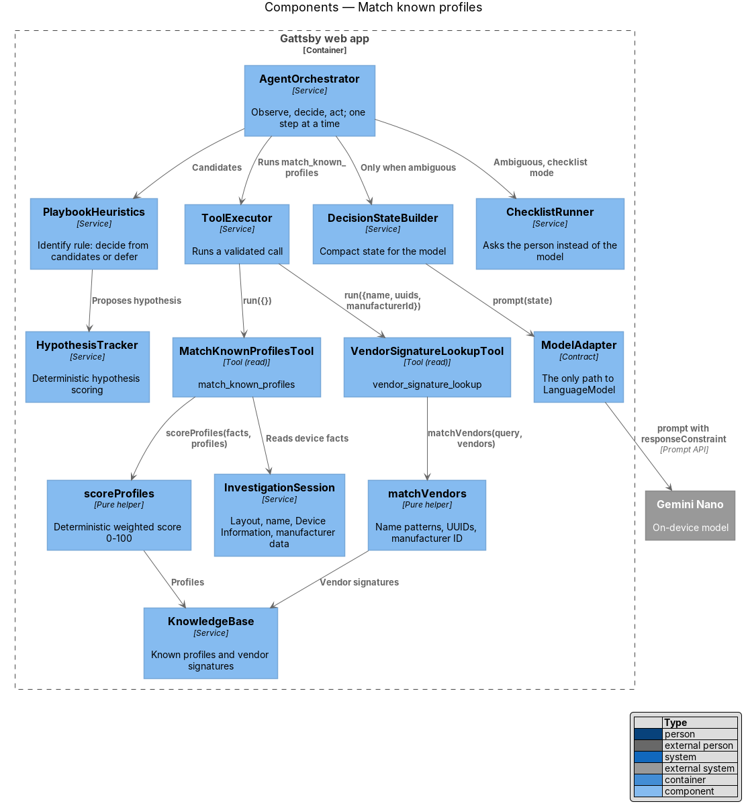
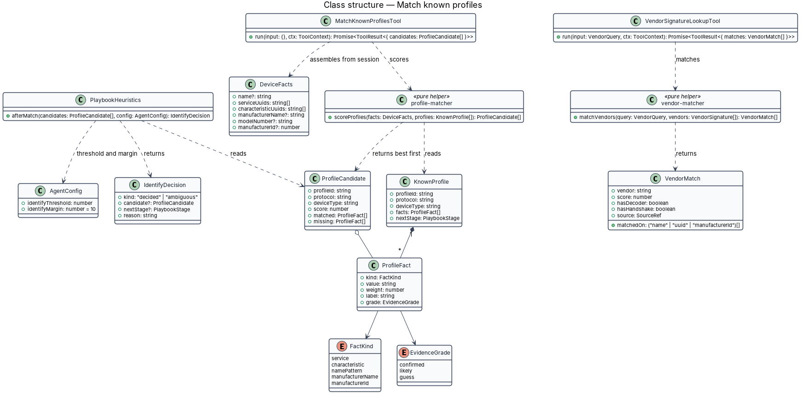
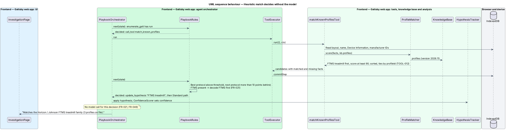

# Match known profiles

## Overview

After the GATT layout and Device Information are read, Gattsby compares what it has seen with what
it already knows. This feature scores the layout, the advertised name, the Device Information and any
manufacturer data against every profile in the knowledge base, and matches names, UUIDs and
manufacturer IDs against vendor signatures. The scoring is deterministic code, and it runs before the
model is asked anything. Only when the scores leave the next step open does the agent consult the
model in full agent mode, or the person in checklist mode. It closes the Identify stage and decides
which path comes next: Standard or Proprietary.

**known profile** — knowledge-base entry describing a device family: protocol, device type, and the
services, characteristics, name patterns, makers and manufacturer IDs that identify it

**vendor signature** — knowledge-base entry for one maker: name patterns, service UUIDs, manufacturer
IDs, whether a decoder or handshake exists, and the public source of each fact (A-11)

**heuristic threshold** — score above which the playbook rules accept a profile without consulting
the model

**ambiguous match** — scoring result in which no protocol scores above the heuristic threshold, or
the two best protocols are within 10 points of each other

The person sees the Investigation page in the Identify stage. In full agent mode the feed shows the
step "Compare against known protocols and brands" with "Matches the Horizon / Johnson FTMS treadmill
family (3 profiles on file).", three facts tagged `confirmed`, `likely` and `guess`, and the
hypothesis moving from 35 % to 65 % (`docs/mocks/notifications/connection-banner/info.html` and its
siblings show the full feed). In checklist mode the page in state `checklist`
(`docs/mocks/pages/investigation/checklist.html`) offers "Pick the next step", with the recommended
step first and its reason.

## Description

The design introduces these building blocks in the Angular (pending ADR 0001) workspace under
`frontend/src/app/`:

- **`matchKnownProfilesTool`** (`tools/inspection/match-known-profiles.tool.ts`) — registry entry for
  `match_known_profiles` (TOOL-012), safety class `read`, stage `identify`. Precondition:
  `enumerate_gatt` has run, else `PRECONDITION_FAILED`. It builds `DeviceFacts` from the record and
  returns `{ candidates }`, best first.
- **`vendorSignatureLookupTool`** (`tools/analysis/vendor-signature-lookup.tool.ts`) — registry entry
  for `vendor_signature_lookup` (TOOL-020), safety class `read`. Input `{ name?, uuids?,
  manufacturerId? }`; with none given it returns `INVALID_INPUT`. Output `{ matches }`; an empty list
  is `ok: true`.
- **`ProfileMatcher`** (`knowledge-base/profile-matcher.ts`) — pure helper with unit tests. It scores
  each profile from 0 to 100 and lists the facts matched and missing.
- **`VendorSignatureMatcher`** (`knowledge-base/vendor-signature-matcher.ts`) — pure helper with unit
  tests. It matches the name against each vendor's name patterns, the UUIDs against its service
  UUIDs, and the manufacturer ID against its company IDs.
- **`KnowledgeBase`** (`knowledge-base/knowledge-base.ts`) — supplies `profiles` and `vendors`, and its
  `version`, which each result records.
- **`PlaybookRules`** (`agent/playbook-rules.ts`), Identify stage — turns the candidates into a
  `RuleOutcome`: `decided` with the hypothesis and the next path, or `ambiguous` with the options.
- **`Decider`** (`agent/decider.ts`) — receives the ambiguous cases only: `ModelDecider` in full agent
  mode, `ChecklistDecider` in checklist mode (see the apply-heuristics-first and run-checklist-mode
  designs).
- **`HypothesisTracker`** (`outcome/hypothesis-tracker.ts`) and **`ConfidenceScorer`**
  (`outcome/confidence-scorer.ts`) — apply the top candidate as the hypothesis; the confidence comes
  from the scorer, not the match score (see the track-the-hypothesis design).

### Scoring rules

1. Facts scored: the service and characteristic UUIDs in the layout, the advertised name, the Device
   Information manufacturer and model, and any manufacturer IDs from advertisement samples (FR-021).
2. Each profile's weights are knowledge-base data (FR-066). Journey 2 proposes: a required
   characteristic present 60 (shared across `requires`), each expected characteristic 10 (at most
   20), the protocol's service present 15, a name pattern or Device Information maker agreeing with a
   vendor signature 5; the sum is capped at 100. A layout
   with `0x1826` and Treadmill Data (`0x2ACD`) scores at least 90 for "FTMS treadmill" (TOOL-012).
3. The same input always gives the same output (TOOL-012): candidates sort by score, highest first,
   and then by `profileId`; no clock, random value or map order enters the result.
4. Name patterns are knowledge-base data, validated at build by
   `frontend/scripts/validate-knowledge-base.ts` and compiled once when the knowledge base loads. The
   device name is matched as data and never interpreted as a pattern.
5. Each vendor match carries `source`, the public citation for the fact it matched (A-11).

### Decision rules (FR-021)

| Scores | Outcome | Who decides |
|---|---|---|
| Best protocol above the heuristic threshold and more than 10 points ahead of the next protocol | `decided`: hypothesis = top candidate; next path from its protocol ("FTMS present → decode FTMS first") | `PlaybookRules`; no model call |
| No protocol above the threshold | `ambiguous` | `ModelDecider` or the person through `ChecklistDecider` |
| Two protocols within 10 points of each other | `ambiguous` | As above |

- The 10-point margin compares the best candidate of each protocol. Profiles that share a protocol and
  device type, such as a generic FTMS treadmill and a Horizon FTMS treadmill, lead to the same next
  step and do not make the match ambiguous.
- The heuristic threshold is 70 (`LoopConfig.profileThreshold`, journey 2); it shall be below 90, so that an FTMS treadmill is
  decided by the rules alone (FR-021, TOOL-012).
- A device exposing only unknown services is always ambiguous: the model, or in checklist mode the
  checklist, chooses the next step (FR-021).
- Before an ambiguous outcome, the rules run `vendor_signature_lookup` when a name, a non-standard
  UUID or a manufacturer ID is known, so the decider sees its matches.

### Errors

| Code | Raised by | Meaning to the person |
|---|---|---|
| `PRECONDITION_FAILED` | `matchKnownProfilesTool` | None shown; the layout has not been read |
| `INVALID_INPUT` | `vendorSignatureLookupTool` | None shown; counts against the step budget |

### Tests that prove it

Acceptance specs run the FTMS treadmill in full agent mode with the fake `LanguageModel`
(`e2e/fixtures/fake-language-model.ts`) and assert that the hypothesis becomes "FTMS treadmill" and
the Standard path starts with no model call for that decision; the unknown-services device asserts a
model call in full agent mode and the "Pick the next step" options in checklist mode. Unit tests run
`ProfileMatcher` twice on the same input and compare the outputs, and run `VendorSignatureMatcher`
on an Echelon name pattern and on a name that matches nothing.

## Requirements

The feature realizes the following level-2 (L2) requirements; each refines the level-1 (L1)
requirement cited beside it.

| L2 ID | Refines (L1) | Requirement |
|-------|--------------|-------------|
| [`FR-021`](../../../specs/L2.md#fr-021-match-against-known-profiles-before-asking-the-model) | `L1-006` | Gattsby must score the GATT layout, the device name and any manufacturer data against the knowledge base with deterministic code, and must apply its heuristics (for example "FTMS present → decode FTMS first") before the model is consulted. The model is consulted only when no candidate scores above the heuristic threshold or two candidates are within 10 points of each other. |
| [`TOOL-012`](../../../specs/L2.md#tool-012-match_known_profiles) | `L1-006` | Scores the GATT layout, the name, Device Information and any manufacturer data against every knowledge base profile, deterministically. |
| [`TOOL-020`](../../../specs/L2.md#tool-020-vendor_signature_lookup) | `L1-006` | Matches UUIDs, the name and the manufacturer ID to the knowledge base's vendor signatures. |

## Diagrams

### System context

Gattsby matches the device against its own knowledge and asks the on-device model only when the
match is ambiguous.

### Containers

The web app reads profiles and vendor signatures from the knowledge base, reads the device facts from
the investigation database, and commits the candidates and the hypothesis.

### Components

The two tools score through `ProfileMatcher` and `VendorSignatureMatcher`; `PlaybookRules` either
decides and updates `HypothesisTracker`, or hands the options to the `Decider`.

### Class structure

`ProfileMatcher` turns `DeviceFacts` into sorted `ProfileCandidate`s, `VendorSignatureMatcher`
returns `VendorMatch`es, and `PlaybookRules` turns the candidates into a `RuleOutcome` that only goes
to a `Decider` when ambiguous.

### Behaviour — heuristic match decides without the model

An FTMS treadmill scores at least 90; the rules set the hypothesis and choose the Standard path with
no model call.

### Behaviour — ambiguous match goes to the decider

With no clear winner, the rules run the vendor lookup and pass the options to the model in full agent
mode, or to the person as "Pick the next step" in checklist mode.

