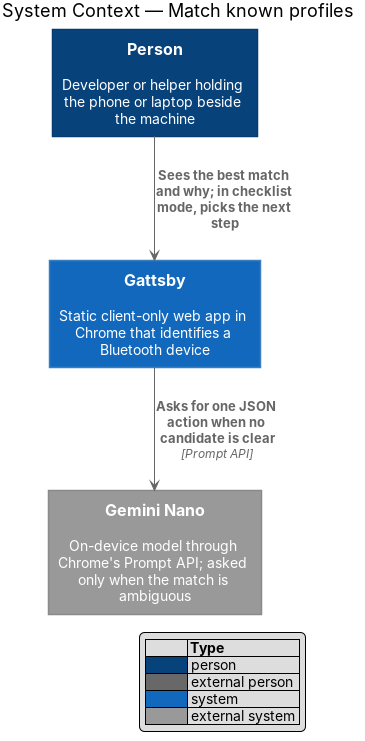
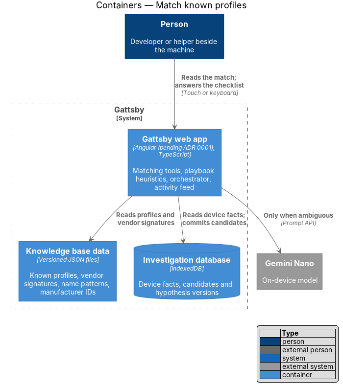
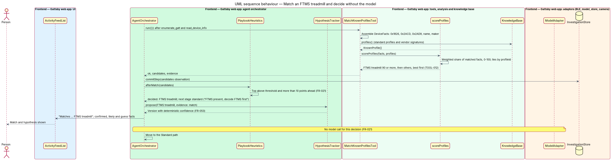
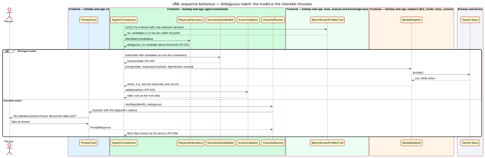
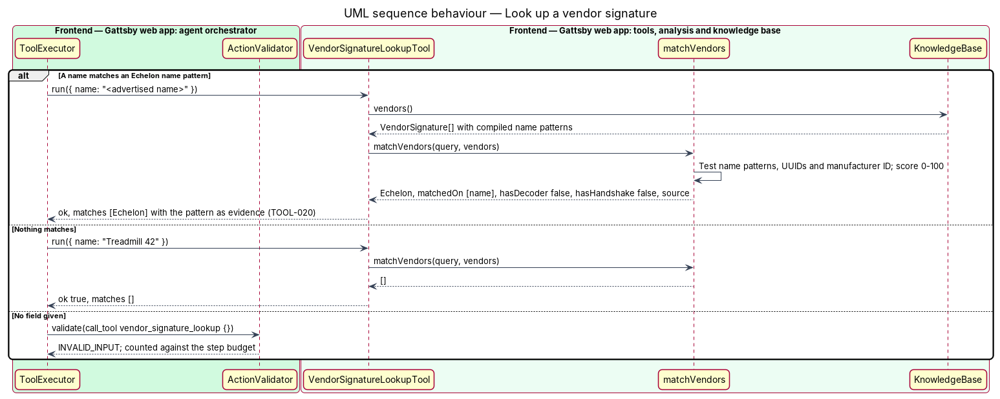

# Match known profiles

## Overview

After Gattsby has read a device's GATT layout and Device Information, it has facts but no conclusion.
This feature turns those facts into ranked candidates, using deterministic code only, and decides
whether the playbook can move on without asking the model. It belongs to the identification subsystem
and runs in the Identify stage, after the [read-the-gatt-layout
design](../read-the-gatt-layout/README.md) and before the Standard or Proprietary path. The vendor
lookup can also run in the Find stage, from the advertised name alone.

**known profile** — knowledge-base entry describing one protocol on one kind of device (for example
FTMS treadmill, FTMS bike, Heart Rate strap, or one vendor's family), as weighted facts

**device facts** — what the investigation has established about the device so far: advertised name,
service and characteristic UUIDs, manufacturer and model from Device Information, and manufacturer ID
from advertisement data where it was seen

**candidate** — known profile scored against the device facts, with a score from 0 to 100, the facts
it matched and the facts it lacks

**vendor signature** — knowledge-base entry for one brand: its UUIDs, name patterns, manufacturer ID,
decoders, limits and handshakes, each with a source (see the [add-a-vendor-signature
design](../../knowledge-base/add-a-vendor-signature/README.md))

**identify threshold** — score a candidate exceeds for the heuristics to decide alone

The feature contributes two `read` tools. `match_known_profiles` (TOOL-012) scores the device facts
against every known profile, including one profile per vendor signature. `vendor_signature_lookup`
(TOOL-020) is the narrower lookup of a name, a UUID list or a manufacturer ID against the vendor
signatures, usable before a connection exists. The model never scores: it is asked only when the
deterministic result leaves more than one reasonable next step (FR-021, FR-046).

In the activity feed the match is one entry, "Compare against known protocols and brands", whose
result line names the best family and whose fact rows carry a badge each: "confirmed Treadmill Data
present (0x2ACD)", "likely Control point present (0x2AD9) — may accept commands", "guess Vendor service
0xFFF0 is used by the console app" (`docs/mocks/dialogs/photo-read/default.html`, behind the dialog).
The hypothesis meter then moves from 35 % to 65 % "likely". For a device with no standard service the
entry reads "No standard service. The name prefix “KS-” matches the Kingsmith / WalkingPad family,
which has no decoder yet." (`docs/mocks/pages/investigation/proprietary.html`).

## Description

The design introduces these building blocks in the Angular (pending ADR 0001) workspace under
`frontend/src/app/`:

- **`MatchKnownProfilesTool`** (`tools/inspection/match-known-profiles.tool.ts`) — the
  `match_known_profiles` tool, safety class `read`, allowed at stage `identify`, precondition "a
  `GattLayout` is recorded". It assembles `DeviceFacts` from `InvestigationSession`, takes the known
  profiles from `KnowledgeBase.profiles()`, and returns the candidates from `scoreProfiles`, best
  first.
- **`scoreProfiles`** (`knowledge-base/profile-matcher.ts`) — pure helper. For each known profile it
  sums the weights of the facts the device has and divides by the sum of all the profile's weights,
  giving an integer from 0 to 100. It omits profiles that match no fact. It sorts by score, then by
  `profileId`, so the same input gives byte-identical output (TOOL-012, criterion 2). It reads no clock
  and no random source.
- **`VendorSignatureLookupTool`** (`tools/analysis/vendor-signature-lookup.tool.ts`) — the
  `vendor_signature_lookup` tool, group Analysis, safety class `read`, allowed at stages `find`,
  `identify` and `proprietary`. Its input schema requires at least one of `name`, `uuids` and
  `manufacturerId`, so `ActionValidator` refuses an empty input with `INVALID_INPUT`.
- **`matchVendors`** (`knowledge-base/vendor-matcher.ts`) — pure helper. It tests the name against each
  vendor's name patterns, the UUIDs against its service UUIDs, and the manufacturer ID against its
  company identifier. It returns each vendor that matched at least once, with `matchedOn`, a score, the
  `hasDecoder` and `hasHandshake` flags and the source of the fact that matched.
- **`KnowledgeBase`** (`knowledge-base/knowledge-base.ts`) — `profiles()` returns the standard profiles
  from `profiles.json` together with one profile derived from each vendor signature, so brands are
  scored alongside protocols. `vendors()` returns the signatures with their name patterns compiled once
  at load (see the [load-the-knowledge-base
  design](../../knowledge-base/load-the-knowledge-base/README.md)).
- **`PlaybookHeuristics`** (`agent/playbook-heuristics.ts`) — its Identify rule, `afterMatch`, returns
  an `IdentifyDecision`: `decided`, with the candidate and the next stage the profile names, or
  `ambiguous`, with the reason. The general rule engine is described in the [apply-heuristics-first
  design](../../agent/apply-heuristics-first/README.md).
- **`AgentConfig`** (`agent/agent-config.ts`) — holds `identifyThreshold` (`<TO SUPPLY>`; FR-021 names
  "the heuristic threshold" without a value, and A-05 does not cover it) and `identifyMargin`, 10 points
  (FR-021).
- **`HypothesisTracker`** (`outcome/hypothesis-tracker.ts`) — receives the decided candidate as a
  proposal with the match as evidence. It computes confidence itself; the candidate's score is not the
  hypothesis's confidence (FR-053).
- **`DecisionStateBuilder`**, **`ModelAdapter`**, **`ActionValidator`** and **`ChecklistRunner`** —
  used only on the ambiguous path: the candidates go into the compact state as one-line summaries
  (FR-041), the model returns one action, and the validator checks it; in checklist mode the checklist
  asks the person instead (FR-049).

### Rules

1. Matching runs before any model call at Identify, in both modes (FR-021, FR-046).
2. The heuristics decide alone when the top candidate scores above `identifyThreshold` and leads the
   second by more than 10 points. Otherwise the decision is `ambiguous`. A device with no candidate at
   all is `ambiguous`.
3. A decided FTMS, Cycling Power, Cycling Speed and Cadence, Heart Rate or Running Speed and Cadence
   candidate moves the playbook to the Standard path ("FTMS present → decode FTMS first"). A decided
   vendor candidate whose signature has a decoder moves to the Proprietary path with that decoder; one
   without a decoder moves to the Proprietary path to record data.
4. The known profile for an FTMS treadmill (`0x1826` with Treadmill Data `0x2ACD`) carries weights that
   give it a score of at least 90 (TOOL-012, criterion 1). Every other weight is data in
   `profiles.json` or the vendor file, `<TO SUPPLY>` with the knowledge base's content.
5. Each profile fact carries its own label and evidence grade (`confirmed`, `likely`, `guess`), which
   the feed shows as the fact's badge. The grade describes what the fact means, not the score.
6. Name patterns run against an untrusted name. The matcher truncates the name to 248 bytes, the
   longest Bluetooth device name, before testing it; the patterns were checked at build time.
7. Advertisement manufacturer data is available only when `watch_advertisements` ran (`PD-ADV`, P2). At
   MVP the manufacturer ID is usually absent, and matching uses the layout, the name and Device
   Information.
8. The candidates are committed as one observation with the step, so the evidence page and the profile
   can cite them.

### Data shapes

| Type | Fields |
|---|---|
| `DeviceFacts` | `name?`, `serviceUuids`, `characteristicUuids`, `manufacturerName?`, `modelNumber?`, `manufacturerId?` |
| `KnownProfile` | `profileId`, `protocol`, `deviceType`, `facts: ProfileFact[]`, `nextStage` |
| `ProfileFact` | `kind` (`service`, `characteristic`, `namePattern`, `manufacturerName`, `manufacturerId`), `value`, `weight`, `label`, `grade` |
| `ProfileCandidate` | `profileId`, `protocol`, `deviceType`, `score`, `matched`, `missing` (TOOL-012 output) |
| `VendorMatch` | `vendor`, `matchedOn`, `score`, `hasDecoder`, `hasHandshake`, `source` (TOOL-020 output) |
| `IdentifyDecision` | `kind` (`decided`, `ambiguous`), `candidate?`, `nextStage?`, `reason` |

### Errors

| Code | Raised by | Meaning to the person |
|---|---|---|
| `PRECONDITION_FAILED` | `match_known_profiles` | Never shown in use: the playbook runs `enumerate_gatt` first. A model action that calls it early is refused and counted against the step budget. |
| `INVALID_INPUT` | `vendor_signature_lookup` (through `ActionValidator`) | Never shown; the model's action named no name, UUID or manufacturer ID. |

An empty `matches` list is not an error: the tool returns `ok: true` (TOOL-020, criterion 2).

### Tests that prove it

Acceptance specs use the fake `navigator.bluetooth` (`e2e/fixtures/fake-bluetooth.ts`), the fake
`LanguageModel` (`e2e/fixtures/fake-language-model.ts`), which records every prompt, and the
`InvestigationPage` page object. With the scripted FTMS treadmill in full agent mode, the hypothesis
becomes "FTMS treadmill" and the next step is on the Standard path with no prompt recorded for that
decision (FR-021, criterion 1). With the unknown-services device, the fake model's scripted action is
the next step; in checklist mode the person's answer is (FR-021, criterion 2). Unit tests cover
`scoreProfiles` (FTMS treadmill scores at least 90; the same input twice gives identical output; ties
sort by `profileId`), `matchVendors` (an Echelon name pattern matches on `name` with its source;
nothing matches gives an empty list), and `afterMatch` at the threshold and at a 10-point margin.

## Requirements

The feature realizes the following level-2 (L2) requirements; each refines the level-1 (L1)
requirement cited beside it.

| L2 ID | Refines (L1) | Requirement |
|-------|--------------|-------------|
| [`FR-021`](../../../specs/L2.md#fr-021-match-against-known-profiles-before-asking-the-model) | `L1-006` | Gattsby must score the GATT layout, the device name and any manufacturer data against the knowledge base with deterministic code, and must apply its heuristics (for example "FTMS present → decode FTMS first") before the model is consulted. The model is consulted only when no candidate scores above the heuristic threshold or two candidates are within 10 points of each other. |
| [`TOOL-012`](../../../specs/L2.md#tool-012-match_known_profiles) | `L1-006` | Scores the GATT layout, the name, Device Information and any manufacturer data against every knowledge base profile, deterministically. |
| [`TOOL-020`](../../../specs/L2.md#tool-020-vendor_signature_lookup) | `L1-006` | Matches UUIDs, the name and the manufacturer ID to the knowledge base's vendor signatures. |

## Diagrams

### System context

The person sees the best match and its reasons in Gattsby; Gemini Nano is asked for the next action
only when the match is ambiguous.

### Containers

The web app reads known profiles and vendor signatures from the knowledge base data, reads the device
facts and commits the candidates to the investigation database, and calls the model only on the
ambiguous path.

### Components

The two tools delegate scoring to pure helpers over the knowledge base; `PlaybookHeuristics` decides
from the candidates, and only an ambiguous result reaches `DecisionStateBuilder` and `ModelAdapter`, or
`ChecklistRunner` in checklist mode.

### Class structure

A `KnownProfile` owns weighted `ProfileFact`s; `scoreProfiles` turns `DeviceFacts` into
`ProfileCandidate`s, `matchVendors` returns `VendorMatch`es, and `PlaybookHeuristics` turns candidates
into an `IdentifyDecision` using `AgentConfig`.

### Behaviour — match an FTMS treadmill and decide without the model

The FTMS treadmill profile scores at least 90 and leads by more than 10 points, so the heuristics
decide, the hypothesis tracker records "FTMS treadmill" with its own confidence, and the playbook moves
to the Standard path with no model call.

### Behaviour — ambiguous match

For a device with only unknown services no candidate passes the threshold. In full agent mode the model
returns one validated action; in checklist mode the person picks the next step. The checklist question
shown is provisional wording (A-01).

### Behaviour — look up a vendor signature

A name that matches an Echelon name pattern returns Echelon with the pattern's source; no match returns
an empty list with `ok: true`; an action with no field is refused before the tool runs.

