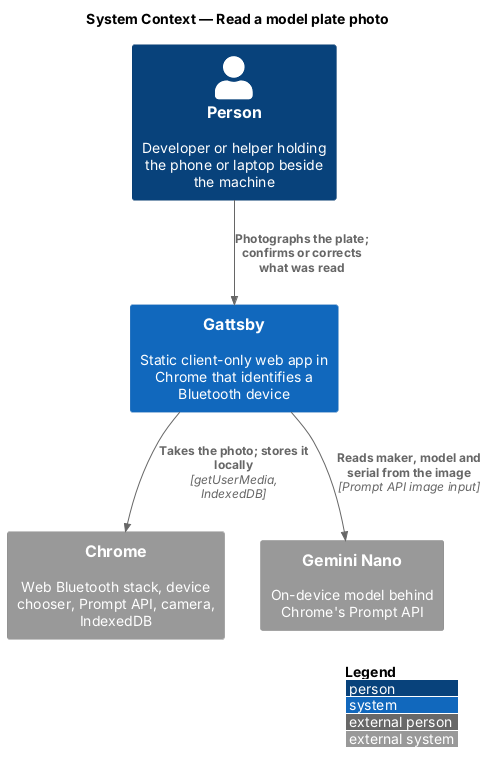
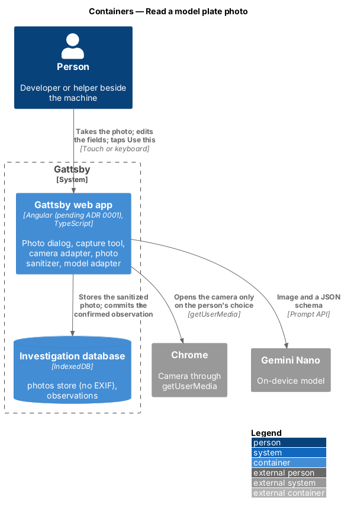
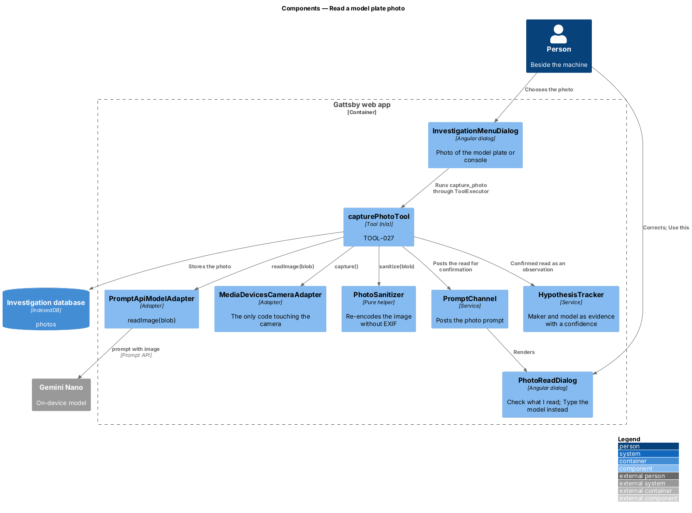
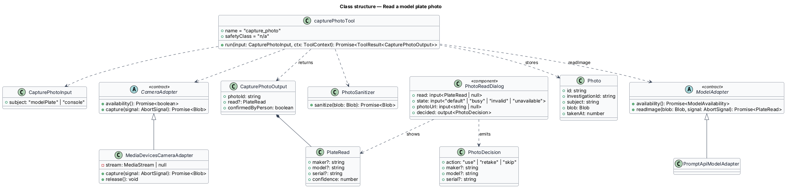
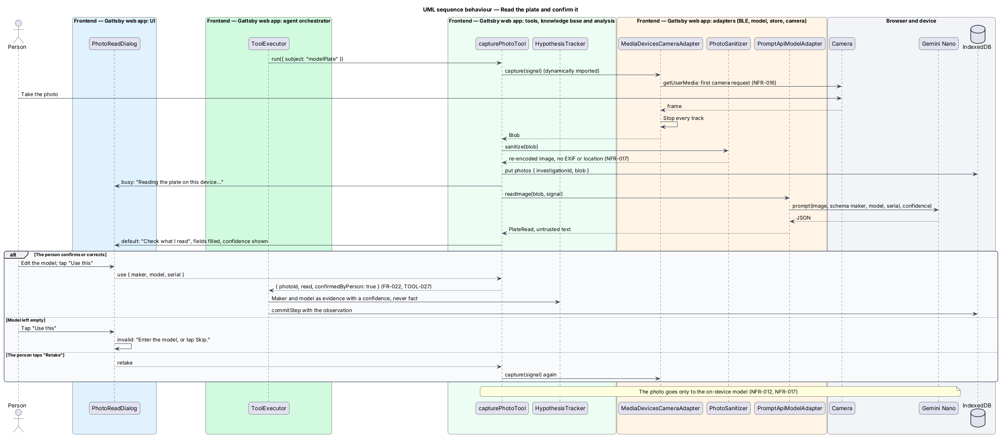
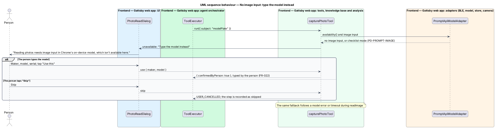

# Read a model plate photo

## Overview

Many machines print their maker, model and serial number on a plate or sticker, even when their
Bluetooth data says nothing useful. This feature lets the person photograph that plate or the console
and, in full agent mode with image input available, asks the on-device model to read the text. What
the model reads is evidence with a confidence, never fact: the person checks it and corrects it
before it is recorded. Where image input is missing, the person types what the plate says instead.
The feature belongs to the Identify stage and is P2.

**model plate** — label on the machine that states its maker, model and serial number

**plate read** — maker, model and serial text the model read from a photo, with the model's
confidence (`capture_photo`, TOOL-027)

**sanitized photo** — photo re-encoded without its EXIF metadata, location included, before it is
stored (NFR-017)

The photo step starts in one of two ways. The playbook rules may propose it when the maker or model
is still unknown after Device Information (see the read-device-information design), or the person
chooses "Photo of the model plate or console" in the Investigation options dialog
(`docs/mocks/dialogs/investigation-menu/default.html`). The Read the model plate dialog
(`docs/mocks/dialogs/photo-read/`) then has four states. `busy` reads "Reading the plate on this
device…" and "The photo stays on this device and goes only to the on-device model." `default` reads
"Check what I read" with editable Maker, Model and "Serial number (optional)" fields, a confidence
meter, "Retake" and "Use this". `invalid` reads "Enter the model, or tap Skip." `unavailable` reads
"Type the model instead".

## Description

The design introduces these building blocks in the Angular (pending ADR 0001) workspace under
`frontend/src/app/`:

- **`capturePhotoTool`** (`tools/person/capture-photo.tool.ts`) — registry entry for `capture_photo`
  (TOOL-027), safety class `n/a`, stage `identify`, phase P2. Input `{ subject: "modelPlate" |
  "console" }`. Output `{ photoId, read?, confirmedByPerson }`. Precondition: a camera, or the file
  picker as a fallback.
- **`CameraAdapter`** (`photo/camera-adapter.ts`) / **`MediaDevicesCameraAdapter`**
  (`photo/media-devices-camera-adapter.ts`) — the only code that touches the camera, dynamically
  imported (NFR-004, NFR-021). `capture(signal)` opens `getUserMedia` with the rear camera preferred,
  returns one frame as a `Blob`, and stops every track on capture, cancel or abort.
- **`PhotoSanitizer`** (`photo/photo-sanitizer.ts`) — pure helper with unit tests. It decodes the
  image with `createImageBitmap` (honouring the EXIF orientation), draws it to a canvas and re-encodes
  it, which writes no EXIF. The output format, quality and maximum size are `<TO SUPPLY>`.
- **`ModelAdapter`** (`model/model-adapter.ts`) / **`PromptApiModelAdapter`** — `readImage(blob,
  signal)` sends the image to a model session with a JSON schema for `{ maker?, model?, serial?,
  confidence }` as `responseConstraint`, and destroys the session afterwards.
- **`PhotoReadDialog`** (`dialogs/photo-read/photo-read.dialog.ts`) — presentation component. Inputs:
  the plate read, the state and the photo's object URL. Output: `PhotoDecision` (`use`, `retake` or
  `skip`, with the edited fields). The `EmergencyStopButton` stays reachable while a device is
  connected.
- **`InvestigationMenuDialog`** (`dialogs/investigation-menu/investigation-menu.dialog.ts`) — offers
  the photo as a person-started step.
- **`PromptChannel`** (`agent/prompt-channel.ts`) — posts the prompt of kind `photo`.
- **`InvestigationStore`** (`store/investigation-store.ts`) — stores the sanitized photo in the
  `photos` object store with its investigation ID; it is deleted with its investigation (see the
  browse-and-delete-history design).
- **`HypothesisTracker`** (`outcome/hypothesis-tracker.ts`) — applies the confirmed maker and model
  as evidence; `ConfidenceScorer` caps the confidence (see the track-the-hypothesis design).

### Reading rules

1. The camera permission is requested only when the person chooses to take a photo (NFR-016). With
   no camera, a file input (`accept="image/*"`, `capture="environment"`) is the fallback.
2. The photo is sanitized before it is stored or read; the stored image holds no EXIF metadata
   (NFR-017).
3. The photo is stored only in IndexedDB and passed only to the on-device model; it is never sent
   over the network (NFR-012, NFR-017).
4. The model is asked only in full agent mode with image input reported available by
   `ModelAdapter.availability()` (`PD-PROMPT-IMAGE`); image input is detected, not assumed.
5. The plate read is untrusted text. It fills the dialog's input fields as values and is never
   rendered as HTML (NFR-013).
6. The person confirms or corrects the read before it becomes an observation (FR-022, TOOL-027). The
   observation records the photo ID, the model's read, the person's final values and
   `confirmedByPerson: true`.
7. "Use this" with an empty Model field shows the `invalid` state; "Skip" ends the step with
   `USER_CANCELLED` and records it as skipped (FR-052).
8. Without image input, or in checklist mode, the dialog opens in `unavailable` and the person types
   the model (FR-022). A model error, or a read that exceeds its time limit (`<TO SUPPLY>`), leads to
   the same state.
9. Object URLs made for the preview are revoked when the dialog closes, and the camera stream and the
   model session are released (AGENTS.md, "Load only what is needed now").

### Errors

| Code | Raised by | Meaning to the person |
|---|---|---|
| `UNSUPPORTED` | `capturePhotoTool` | Neither camera nor file picker is available; the step is skipped |
| `USER_CANCELLED` | `capturePhotoTool` | The person closed the camera or tapped "Skip" |
| `STORAGE_FULL` | `InvestigationStore` | The photo was not stored; the person is told to free space (NFR-008) |

### Tests that prove it

Acceptance specs stub the camera with a fixed image and use the fake `LanguageModel` with image input
scripted to read "T100"; they assert that the dialog shows the read, that nothing is recorded until
"Use this", and that a corrected value is what the observation holds. A second spec reports no image
input and asserts the `unavailable` state. A unit test feeds `PhotoSanitizer` a JPEG with GPS EXIF
data and asserts the output has none.

## Requirements

The feature realizes the following level-2 (L2) requirements; each refines the level-1 (L1)
requirement cited beside it.

| L2 ID | Refines (L1) | Requirement |
|-------|--------------|-------------|
| [`FR-022`](../../../specs/L2.md#fr-022-read-a-photo-of-the-model-plate-or-console) | `L1-006` | When the maker or model is still unknown after Device Information, Gattsby may ask the person for a photo of the model plate or console and pass it to the on-device model to read the maker, model and serial text. The text read is evidence with a confidence, never fact. |
| [`NFR-017`](../../../specs/L2.md#nfr-017-keep-photos-local) | `L1-018` | Photos must be stored only in IndexedDB, passed only to the on-device model, stripped of EXIF metadata (including location) before storage, and deleted with their investigation. |
| [`TOOL-027`](../../../specs/L2.md#tool-027-capture_photo) | `L1-006` | Takes a photo of the model plate or console, stores it locally without EXIF, and, in full agent mode with image input, asks the model to read the maker, model and serial text. |

## Diagrams

### System context

The person photographs the plate in Gattsby; Chrome supplies the camera and the storage, and Gemini
Nano reads the text on the device.

### Containers

The web app takes and sanitizes the photo, stores it in the investigation database, and sends it only
to the on-device model.

### Components

`capturePhotoTool` takes the photo through the camera adapter, strips its metadata with
`PhotoSanitizer`, stores it, asks `PromptApiModelAdapter` to read it, and posts the read to
`PhotoReadDialog` for the person to confirm.

### Class structure

`capturePhotoTool` depends on the `CameraAdapter` and `ModelAdapter` contracts and on
`PhotoSanitizer`; its output composes a `PlateRead`, and `PhotoReadDialog` emits a `PhotoDecision`.

### Behaviour — read the plate and confirm it

The photo is taken, sanitized and stored, the model reads it on the device, and the person confirms
or corrects the fields before the observation is committed; an empty model shows the `invalid` state.

### Behaviour — no image input: type the model instead

Without image input, in checklist mode, or after a model error, the dialog asks the person to type
the model, or to skip.

