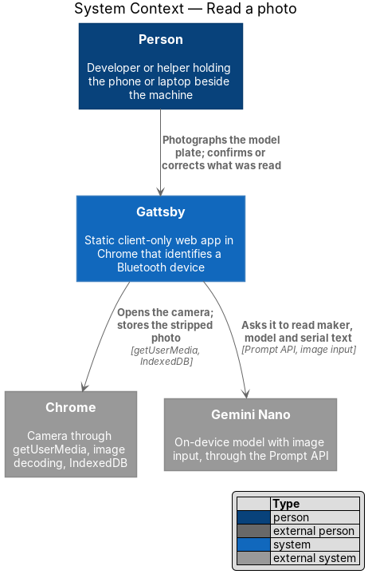
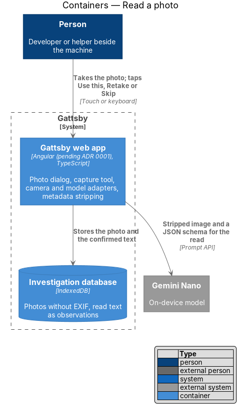
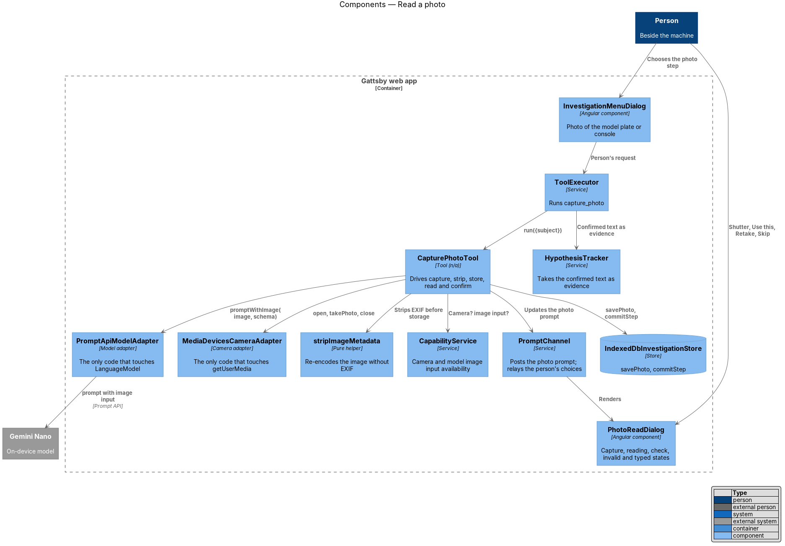
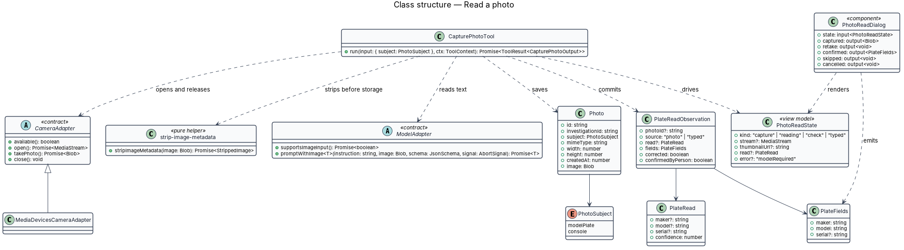
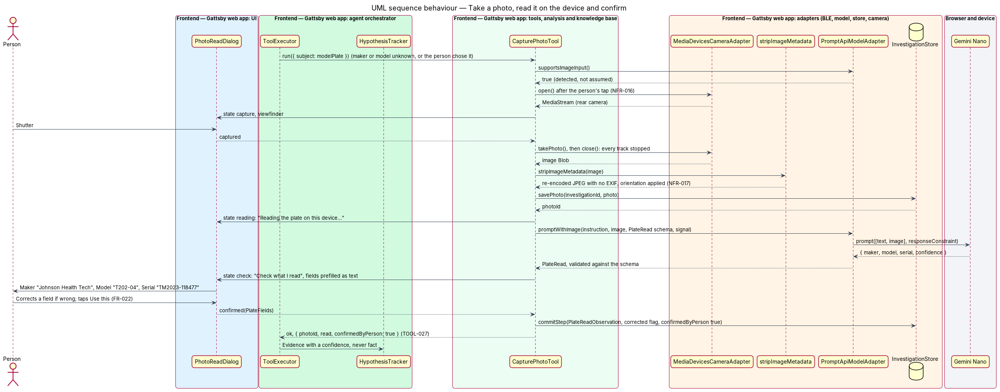
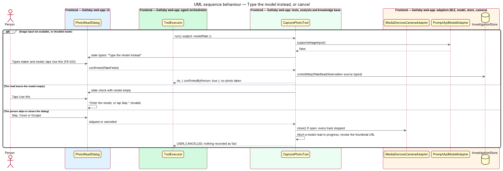

# Read a photo

## Overview

Many machines do not say who made them over Bluetooth: Device Information is absent, or gives a
board maker's name rather than the brand on the console. The model plate on the frame or the console
usually does. This feature lets the person photograph that plate or the console, has the on-device
model read the maker, model and serial text, and asks the person to confirm or correct the text before
it is recorded. It belongs to the identification subsystem, is a P2 feature, and depends on the camera
(`PD-CAMERA`) and on the Prompt API's image input (`PD-PROMPT-IMAGE`).

**model plate** — label on a machine's frame or console that prints its maker, model and serial
number

**plate read** — maker, model and serial text the on-device model read from a photo, with the
confidence the model reported

**metadata stripping** — re-encoding an image so that it carries no EXIF or other metadata, including
GPS location, camera make and capture time

**image input** — Prompt API feature that accepts an image in a prompt; its availability is detected
per platform and model version, never assumed

The photo step starts in two ways. The agent (or the checklist) calls `capture_photo` when the maker or
model is still unknown after Device Information (FR-022). The person can also start it at any stage
after connecting, from the investigation menu's "Photo of the model plate or console"
(`docs/mocks/dialogs/investigation-menu/default.html`); the mocks show it opened during the Standard
path.

The Read the model plate dialog has four mocked states. While the model reads, it shows "Reading the
photo", "The photo stays on this device and goes only to the on-device model.", the thumbnail and
"Reading the plate on this device…" (`docs/mocks/dialogs/photo-read/busy.html`). It then shows "Check
what I read" with editable Maker, Model and optional Serial number fields prefilled from the read, and
"Here’s what I read. Check it against the plate and correct anything wrong — it’s recorded as evidence,
not fact." (`default.html`). An empty model gives the error summary "One thing to fix" and "Enter the
model, or tap Skip." (`invalid.html`). Without image input the dialog becomes "Type the model instead"
with empty fields, Skip and Use this (`unavailable.html`). Every state keeps "Emergency stop" in its
toolbar.

A photo is the most personal data Gattsby holds. It is stripped of metadata before it is stored,
stored only in IndexedDB, passed only to the on-device model, and deleted with its investigation
(NFR-017). A full-record export includes it only if the person chooses to; the default is not to
(FR-063, see the [export-a-profile-or-record design](../../persistence/export-a-profile-or-record/README.md)).

## Description

The design introduces these building blocks in the Angular (pending ADR 0001) workspace under
`frontend/src/app/`. The tool, the dialog, the camera adapter and the stripping helper are imported
dynamically, on first use.

- **`CapturePhotoTool`** (`tools/person/capture-photo.tool.ts`) — the `capture_photo` tool (TOOL-027),
  group Person, safety class `n/a`, phase P2. It asks `ModelAdapter` whether image input is supported,
  opens the camera only after the person's tap, takes the photo, strips it, stores it, asks the model
  to read it, and posts the result for confirmation. It drives the dialog through a `PhotoReadState`
  posted on `PromptChannel` as a prompt of kind `photo`.
- **`PhotoReadDialog`** (`dialogs/photo-read/photo-read.dialog.ts`) — presentation component. Input:
  `PhotoReadState` (`capture`, `reading`, `check`, `typed`). Outputs: `captured`, `retake`,
  `confirmed(PlateFields)`, `skipped`, `cancelled` (Close or Escape). It binds every read value as text
  in an input's value (NFR-013). It refuses "Use this" with an empty model and shows the error summary
  linked to the field. When the camera is unavailable it offers a file input (`accept="image/*"`) in the
  capture state.
- **`CameraAdapter`** (`camera/camera-adapter.ts`) and **`MediaDevicesCameraAdapter`**
  (`camera/media-devices-camera-adapter.ts`) — the only code that touches `getUserMedia`. `open()`
  requests the rear camera (`facingMode: "environment"`), `takePhoto()` returns one frame as a `Blob`,
  and `close()` stops every track. `available()` reports the camera without throwing when the API is
  absent (NFR-021).
- **`stripImageMetadata`** (`camera/strip-image-metadata.ts`) — decodes the image with
  `createImageBitmap(image, { imageOrientation: "from-image" })`, draws it on an `OffscreenCanvas`, and
  re-encodes it with `convertToBlob({ type: "image/jpeg" })`. The canvas encoder writes no EXIF, so the
  stored image has none, and the orientation is already applied to the pixels. The JPEG quality and any
  maximum stored dimension are `<TO SUPPLY>`.
- **`ModelAdapter`** (`model/model-adapter.ts`) — two members serve this feature.
  `supportsImageInput()` asks `LanguageModel.availability()` with an expected image input.
  `promptWithImage(instruction, image, schema, signal)` creates a session that expects image input,
  sends the instruction and the stripped image, constrains the answer to the `PlateRead` JSON schema
  (`responseConstraint`), and destroys the session afterwards. Only `PromptApiModelAdapter` touches
  `LanguageModel`. The call honours the model timeout (FR-047; 10 seconds by A-05).
- **`InvestigationStore`** (`store/investigation-store.ts`) — `savePhoto(investigationId, photo)`
  stores the stripped image; `deleteInvestigation` and `deleteAll` delete photos in the same
  transaction as their investigation.
- **`HypothesisTracker`** (`outcome/hypothesis-tracker.ts`) — takes the confirmed text as evidence for
  maker and model. The weight a photo read carries in the deterministic score is `<TO SUPPLY>` in the
  [track-the-hypothesis design](../../outcome/track-the-hypothesis/README.md); the model's own
  `confidence` is stored with the evidence but never sets the hypothesis's confidence (FR-053).
- **`InvestigationMenuDialog`** (`dialogs/investigation-menu/investigation-menu.dialog.ts`) — emits the
  person's choice of the photo step; the page passes it to the orchestrator, which runs `capture_photo`
  as the next step.

### Rules

1. The camera permission is asked for only when the person taps to take a photo (NFR-016). The agent's
   call shows the prompt first; it never opens the camera on its own.
2. The image is stripped before it is stored and before the model sees it. No unstripped image is
   written anywhere, and the unstripped `Blob` is released after stripping.
3. The photo goes only to `PromptApiModelAdapter`, which runs on the device. No other code path
   receives the image, and the app makes no network request with it (NFR-012).
4. The text read is evidence with a confidence, never fact. Nothing from the read becomes an
   observation until the person taps "Use this" (TOOL-027, criterion 1). The observation records
   whether the person changed any field.
5. The model's answer is untrusted. The adapter validates it against the `PlateRead` schema; a field
   that fails the schema is dropped and shown empty for the person to type.
6. Image input is detected, not assumed. When `supportsImageInput()` is false, or in checklist mode, the
   dialog opens in the `typed` state and no photo is taken (FR-022, criterion 2).
7. When the model read fails or times out, the dialog moves to `check` with empty fields, so the person
   can type the text; the photo stays stored.
8. Closing the dialog, Skip, Stop or emergency stop stops the camera tracks, aborts the model call,
   destroys the model session and revokes the thumbnail's object URL.
9. The model field is required to record a read; maker and serial are optional. Skip records nothing
   and returns `USER_CANCELLED`.

### Data shapes

| Type | Fields |
|---|---|
| `Photo` | `id`, `investigationId`, `subject` (`modelPlate`, `console`), `mimeType`, `width`, `height`, `createdAt`, `image` |
| `PlateRead` | `maker?`, `model?`, `serial?`, `confidence` (0 to 1, as the model reported it) |
| `PlateFields` | `maker`, `model`, `serial?` (as the person confirmed them) |
| `PlateReadObservation` | `photoId?`, `source` (`photo`, `typed`), `read?`, `fields`, `corrected`, `confirmedByPerson` |
| `PhotoReadState` | `kind` (`capture`, `reading`, `check`, `typed`), `stream?`, `thumbnailUrl?`, `read?`, `error?` |

The tool's output is TOOL-027's `{ photoId, read?, confirmedByPerson }`. On the typed path no photo
exists, so `photoId` is absent; TOOL-027's output schema lists it as always present, which the typed path cannot meet.

### Errors

| Code | Raised by | Meaning to the person |
|---|---|---|
| `UNSUPPORTED` | `CapturePhotoTool` | Neither a camera nor a file picker is available. The agent continues without the photo. |
| `USER_CANCELLED` | `CapturePhotoTool` | The person closed the dialog, skipped, or refused the camera permission. Nothing is recorded as fact. |
| `TIMEOUT` | `ModelAdapter` | Not shown as an error: the fields open empty for the person to type. |

The capture state (viewfinder and shutter, or the file picker) and the failed-read state have no mock
yet; their layout is `<TO SUPPLY>` until they are drawn in `docs/mocks/dialogs/photo-read/`. The
`invalid` mock tells the person to "tap Skip", but its footer offers only Retake and Use this; the
design assumes the `check` state also offers Skip, pending a mock change.

### Tests that prove it

Acceptance specs use the `PhotoReadDialog` page object (`e2e/pages/photo-read.dialog.ts`), the fake
`LanguageModel` (`e2e/fixtures/fake-language-model.ts`) scripted with image input on and off, and a
fake camera that returns a fixture JPEG holding GPS EXIF data. With image input on, the read text is
shown in the fields and becomes an observation only after "Use this", with the corrected value when
the person edits it (FR-022, criterion 1; TOOL-027). With image input off, the dialog asks the person to
type the model (FR-022, criterion 2). The stored photo, read back from IndexedDB in the spec, holds no
APP1 Exif segment (NFR-017). Deleting the investigation deletes its photo. A spec fails on any request
off localhost.

## Requirements

The feature realizes the following level-2 (L2) requirements; each refines the level-1 (L1)
requirement cited beside it.

| L2 ID | Refines (L1) | Requirement |
|-------|--------------|-------------|
| [`FR-022`](../../../specs/L2.md#fr-022-read-a-photo-of-the-model-plate-or-console) | `L1-006` | When the maker or model is still unknown after Device Information, Gattsby may ask the person for a photo of the model plate or console and pass it to the on-device model to read the maker, model and serial text. The text read is evidence with a confidence, never fact. |
| [`NFR-017`](../../../specs/L2.md#nfr-017-keep-photos-local) | `L1-018` | Photos must be stored only in IndexedDB, passed only to the on-device model, stripped of EXIF metadata (including location) before storage, and deleted with their investigation. |
| [`TOOL-027`](../../../specs/L2.md#tool-027-capture_photo) | `L1-006` | Takes a photo of the model plate or console, stores it locally without EXIF, and, in full agent mode with image input, asks the model to read the maker, model and serial text. |

## Diagrams

### System context

The person photographs the plate and confirms the text in Gattsby, which uses Chrome's camera and
storage and asks the on-device Gemini Nano to read the image.

### Containers

The web app strips the photo, stores it and the confirmed text in the investigation database, and sends
the stripped image only to the on-device model.

### Components

`CapturePhotoTool` drives the flow: the camera adapter takes the photo, `stripImageMetadata` removes its
metadata, the store saves it, the model adapter reads it, and `PhotoReadDialog` collects the person's
confirmation through `PromptChannel`.

### Class structure

`CapturePhotoTool` depends on the `CameraAdapter` and `ModelAdapter` contracts and the stripping
helper; it saves a `Photo` and commits a `PlateReadObservation` that holds both the model's
`PlateRead` and the person's `PlateFields`.

### Behaviour — take a photo, read it on the device and confirm

The person takes the photo; the tool closes the camera, strips and stores the image, has the model read
it, and shows the text to confirm. Only the person's confirmed fields become an observation.

### Behaviour — type the model instead, or cancel

Without image input, or in checklist mode, the person types the text and no photo is taken. An empty
model is refused in place. Skip or Close releases the camera and the model session and records nothing.

