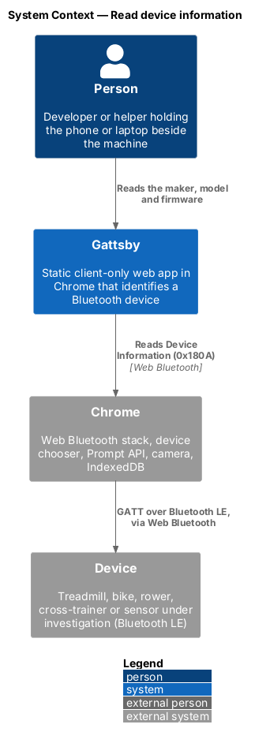
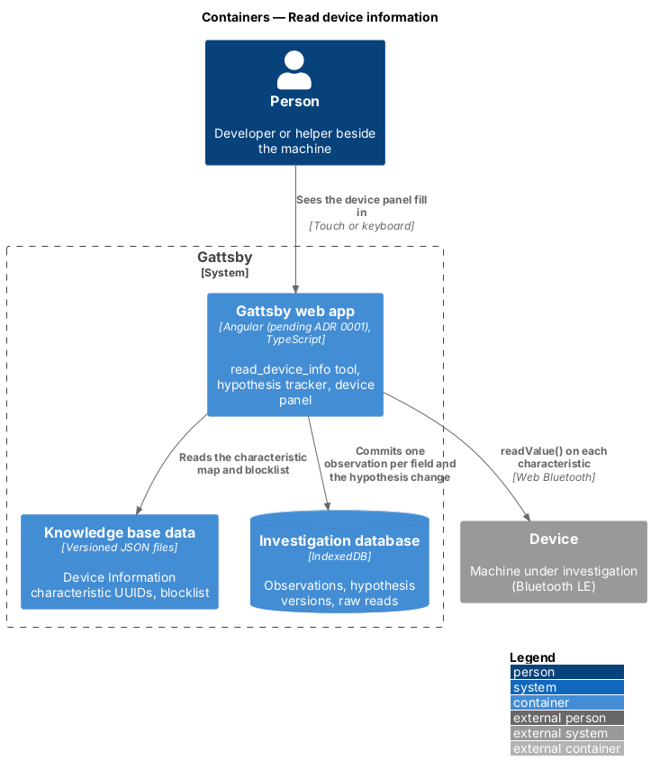
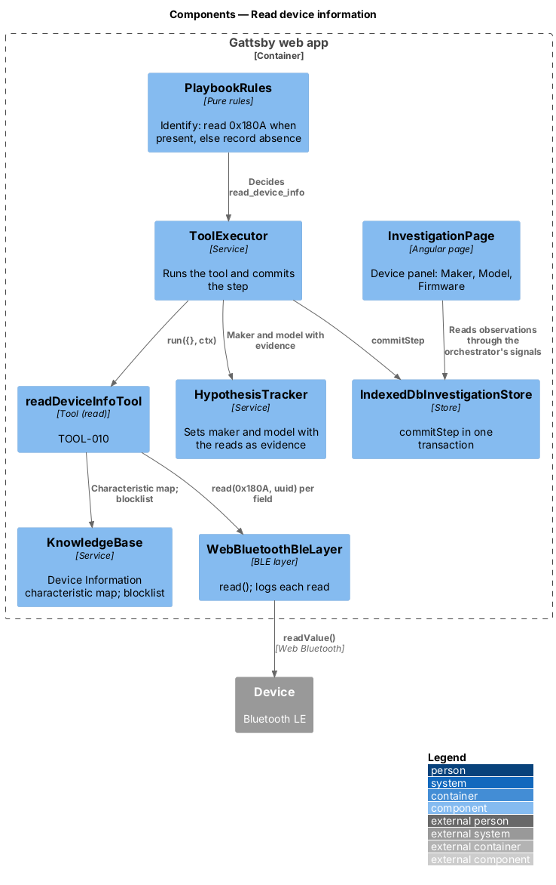
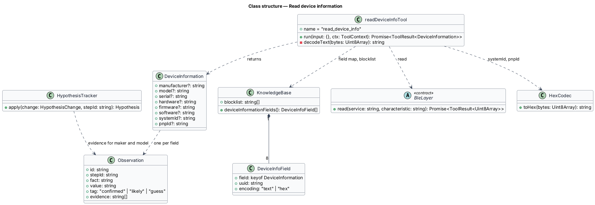
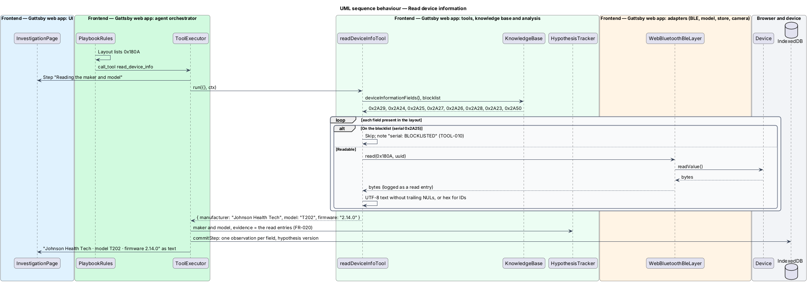
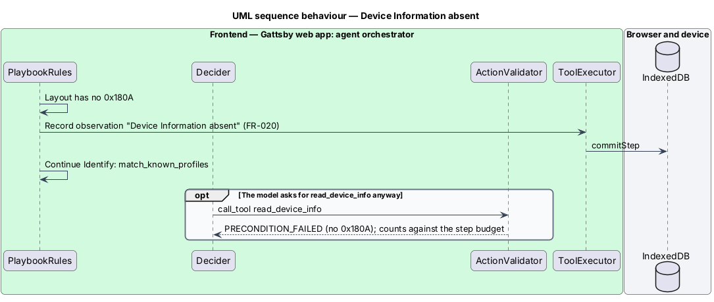

# Read device information

## Overview

Almost every Bluetooth Low Energy device carries the Device Information Service (`0x180A`), a
standard service whose characteristics state the maker, the model, the serial number and the
hardware, firmware and software revisions. Reading it is the quickest, read-only way to learn who made
the device. This feature reads whatever the device offers, records each field as an observation, and
sets the hypothesis's maker and model from it. It runs in the Identify stage, after the
enumerate-the-gatt-layout design and before the match-known-profiles design.

**Device Information Service** — standard Bluetooth service `0x180A` holding the device's maker,
model, serial number, revisions, System ID and PnP ID

**field** — one Device Information characteristic, read as text or, for the two IDs, as hex

The person sees the Investigation page in state `identify`
(`docs/mocks/pages/investigation/identify.html`): the stage step reads "Reading the maker and model",
with "Read-only, takes about a second. Nothing for you to do." The result appears in the feed as
"Johnson Health Tech · model T202 · firmware 2.14.0"
(`docs/mocks/notifications/connection-banner/info.html` shows the same feed further on), and the
device panel fills its "Maker", "Model" and "Firmware" rows. The Evidence log shows the raw read,
"0x180A / 0x2A29 read", with its bytes and the decoded text "Johnson Health Tech"
(`docs/mocks/pages/evidence/default.html`).

The maker on the plate can differ from the brand the person named in Prepare: a Horizon treadmill
reports "Johnson Health Tech". Reconciling the two belongs to the match-known-profiles design.

## Description

The design introduces these building blocks in the Angular (pending ADR 0001) workspace under
`frontend/src/app/`:

- **`readDeviceInfoTool`** (`tools/inspection/read-device-info.tool.ts`) — registry entry for
  `read_device_info` (TOOL-010), safety class `read`, stage `identify`. Preconditions: connected, and
  `0x180A` in the layout. Output `DeviceInformation`.
- **`KnowledgeBase`** (`knowledge-base/knowledge-base.ts`) — `deviceInformationFields()` returns the
  field map below as data, and `blocklist` names the characteristics Chrome excludes.
- **`WebBluetoothBleLayer.read(service, characteristic)`** (`ble/web-bluetooth-ble-layer.ts`) — reads
  one value and appends a `read` entry to `RawTrafficLog` (see the log-raw-traffic design).
- **`HexCodec`** (`ble/hex-codec.ts`) — formats System ID and PnP ID as hex.
- **`HypothesisTracker`** (`outcome/hypothesis-tracker.ts`) — applies the maker and model to the
  current hypothesis with the read entries as evidence; `ConfidenceScorer` sets the confidence (see
  the track-the-hypothesis design).
- **`PlaybookRules`** (`agent/playbook-rules.ts`), Identify stage — decides `read_device_info` when the
  layout lists `0x180A`, and otherwise records the service's absence and moves on (FR-020).
- **`DeviceInformation`** (`store/model/device-information.ts`) — the output shape.
- **`InvestigationPage`** (`pages/investigation/investigation.page.ts`) — shows the fields in the
  device panel, as text.

### Field map

| Field | Characteristic | Read as |
|---|---|---|
| `manufacturer` | Manufacturer Name String `0x2A29` | text |
| `model` | Model Number String `0x2A24` | text |
| `serial` | Serial Number String `0x2A25` | text |
| `hardware` | Hardware Revision String `0x2A27` | text |
| `firmware` | Firmware Revision String `0x2A26` | text |
| `software` | Software Revision String `0x2A28` | text |
| `systemId` | System ID `0x2A23` | hex |
| `pnpId` | PnP ID `0x2A50` | hex |

### Reading rules

1. Only the fields present in the layout are read; an absent field is omitted from the output
   (TOOL-010).
2. Text fields are decoded as UTF-8 with trailing NUL bytes and whitespace removed. They are untrusted
   device text and are rendered as text, never as HTML (NFR-013).
3. A field on the blocklist is not read. The other fields are returned, and the summary reports that
   field as `BLOCKLISTED`; Chrome's blocklist holds the Serial Number String (TOOL-010).
4. A field whose read fails with a GATT error is omitted and named in the summary. The tool returns
   `GATT_ERROR` only when no field could be read.
5. Each field returned becomes one observation tagged `confirmed`, with its read entry as evidence
   (FR-020).
6. The manufacturer and model set the hypothesis's maker and model, with the reads as evidence
   (FR-020). The change is deterministic; the model is not asked.
7. When `0x180A` is absent, the rules record the observation "Device Information absent" and continue
   with the next Identify step (FR-020). A model action that calls the tool anyway is refused by
   `ActionValidator` with `PRECONDITION_FAILED`.
8. When the maker or model is still unknown afterwards, the read-a-model-plate-photo design may
   follow (P2).

### Errors

| Code | Raised by | Meaning to the person |
|---|---|---|
| `NOT_CONNECTED` | `readDeviceInfoTool` | None shown; the recover-a-dropped-connection design runs |
| `PRECONDITION_FAILED` | `ActionValidator` | None shown; the device has no Device Information |
| `GATT_ERROR` | `readDeviceInfoTool` | A plain message that says what to try; wording `<TO SUPPLY>` (OQ-06, NFR-025) |
| `BLOCKLISTED` | Summary only | None shown; the field is listed as hidden by the browser |

### Tests that prove it

Acceptance specs use the fake `navigator.bluetooth` with a Device Information Service scripted to
give manufacturer "Acme" and model "T100", and assert the hypothesis's maker and model and their
evidence. Further scripts give manufacturer and firmware only, a blocklisted serial number, and no
`0x180A` at all, and assert the omitted fields, the `BLOCKLISTED` summary and the recorded absence.

### Built in journey 2

Built as described. A device without `0x180A` records "Device Information absent" in the `enumerate_gatt` step, and the rules move on to the match.

## Requirements

The feature realizes the following level-2 (L2) requirements; each refines the level-1 (L1)
requirement cited beside it.

| L2 ID | Refines (L1) | Requirement |
|-------|--------------|-------------|
| [`FR-020`](../../../specs/L2.md#fr-020-read-device-information) | `L1-006` | Where the Device Information Service (`0x180A`) is present, Gattsby must read the manufacturer name, model number, serial number, hardware, firmware and software revisions that exist, and record each as an observation. |
| [`TOOL-010`](../../../specs/L2.md#tool-010-read_device_info) | `L1-006` | Reads the Device Information Service's string characteristics. |

## Diagrams

### System context

Gattsby reads the device's Device Information Service through Chrome's Web Bluetooth stack and shows
the person who made the device.

### Containers

The web app reads the field map and blocklist from the knowledge base, reads the device, and commits
one observation per field and the hypothesis change.

### Components

`PlaybookRules` decides the read; `readDeviceInfoTool` reads each field through the BLE layer, and the
executor hands maker and model to `HypothesisTracker` and commits the step.

### Class structure

`readDeviceInfoTool` reads the `DeviceInfoField` map from `KnowledgeBase` and returns a
`DeviceInformation`, whose fields become `Observation`s that `HypothesisTracker` cites as evidence.

### Behaviour — read device information

Each present field is read, except a blocklisted one; the maker and model set the hypothesis, and the
step commits one observation per field.

### Behaviour — Device Information absent

Without `0x180A` the rules record the absence and move on; a model action that asks for the read
anyway is refused.

