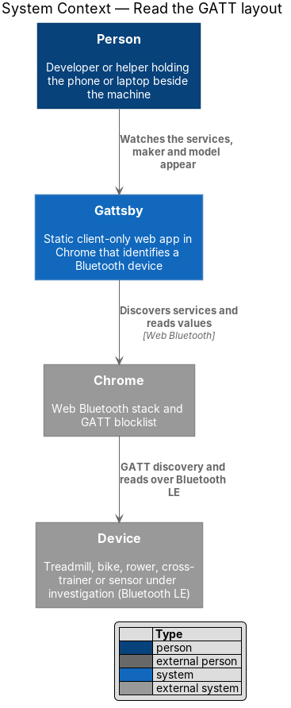
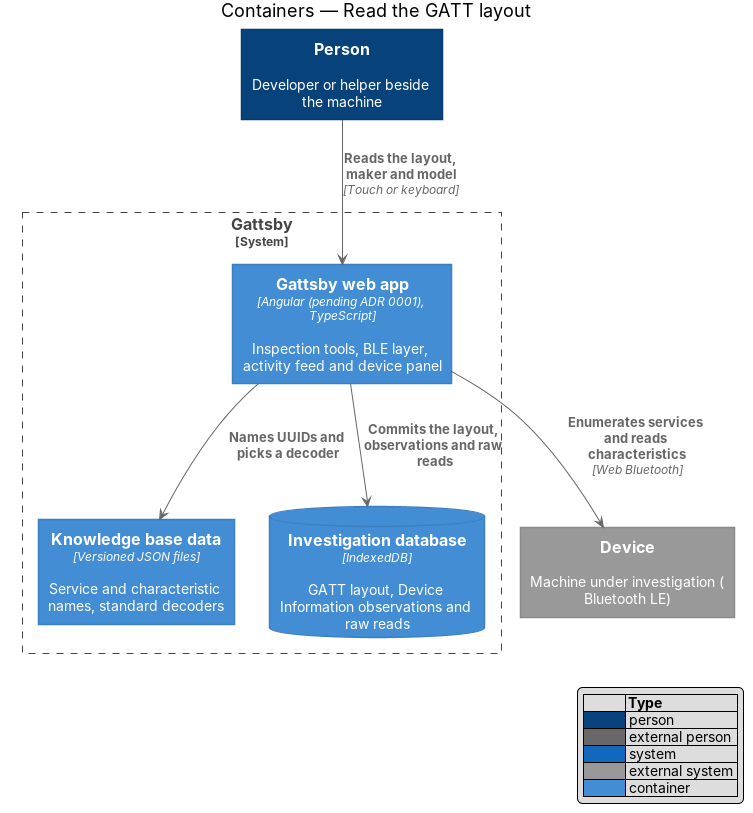
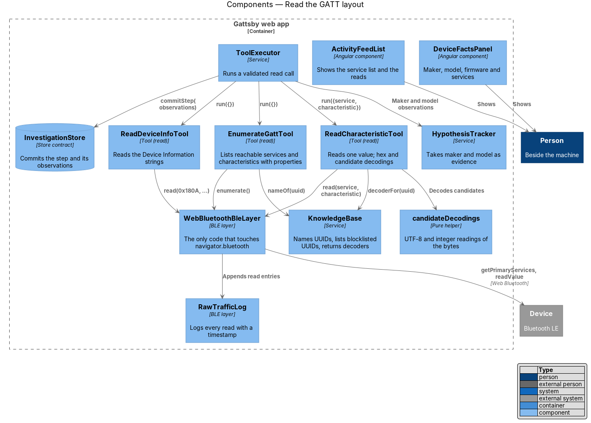
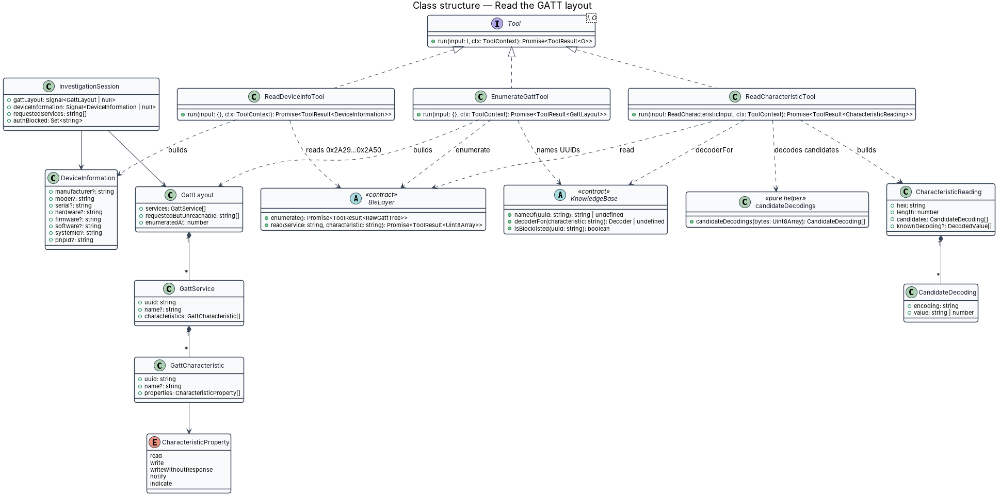
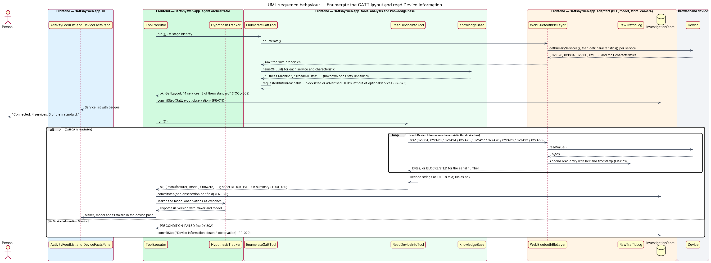
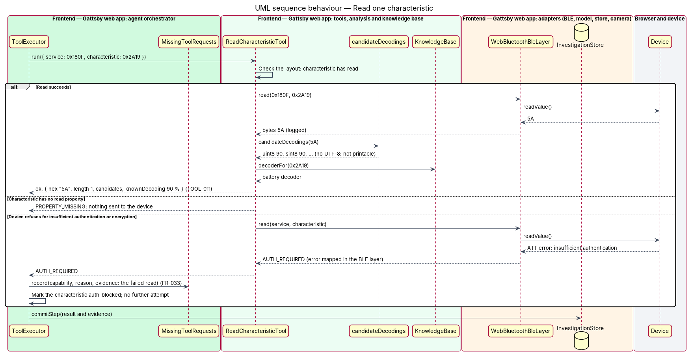

# Read the GATT layout

## Overview

Once Gattsby is connected to a device, the first thing it needs is a map of what the device exposes
and who made it. This feature produces that map. It belongs to the identification subsystem and runs
in the Identify stage of the playbook, straight after the connection (see the
[connect-to-the-device design](../../connection/connect-to-the-device/README.md)) and before any
matching, decoding or listening.

**GATT layout** — list of the primary services a connected device exposes to the browser, each with
its characteristics and their properties, as one investigation saw it

**property** — operation a characteristic supports: `read`, `write`, `writeWithoutResponse`,
`notify` or `indicate`

**Device Information** — standard Bluetooth service `0x180A` whose characteristics hold the
manufacturer name, model number, serial number, hardware, firmware and software revisions, system ID
and PnP ID

**candidate decoding** — one plausible reading of a value's bytes (UTF-8 text, or a signed or unsigned
integer of a given width and byte order), offered for a person or the agent to weigh, never asserted

The feature contributes three `read` tools to the tool registry. `enumerate_gatt` lists the layout
and names the services and characteristics the knowledge base knows. `read_device_info` reads the
Device Information strings. `read_characteristic` reads any single readable value and returns its hex
with candidate decodings. Each result is committed to the investigation record as observations, so the
later stages (matching, the Standard path, the Proprietary path, the profile) work from recorded facts
rather than from the live device.

The person sees the layout as an activity-feed entry: "Connected. 4 services, 3 of them standard.",
with one row per service and its UUID, badged `confirmed` for a standard service and `guess` for a
vendor service (`docs/mocks/pages/investigation/identify.html`). While Device Information is being
read, the current step reads "Reading the maker and model" and the device panel shows "—" for Maker,
Model and Firmware. Once read, the feed shows "Johnson Health Tech · model T202 · firmware 2.14.0" and
the panel fills in (`docs/mocks/dialogs/photo-read/default.html`, behind the dialog). For a device with
no standard service the entry reads "Connected. 1 service, not a standard one." and lists the
characteristics by what they do: "Notifies 0xFE01", "Accepts writes 0xFE02"
(`docs/mocks/pages/investigation/proprietary.html`). In checklist mode the same entries appear
(`docs/mocks/pages/investigation/checklist.html`).

Only services named in the scan's filters or `optionalServices` are visible to the browser, and
Chrome's GATT blocklist hides some UUIDs entirely (`PD-BLE-SERVICES`). The layout is therefore what the
browser could see, not necessarily all the device has. The [report-hidden-services
design](../report-hidden-services/README.md) states that limit and raises missing-tool requests when the
evidence points to hidden services; this feature supplies its input, `requestedButUnreachable`.

## Description

The design introduces these building blocks in the Angular (pending ADR 0001) workspace under
`frontend/src/app/`:

- **`EnumerateGattTool`** (`tools/inspection/enumerate-gatt.tool.ts`) — the `enumerate_gatt` tool
  (TOOL-009), safety class `read`, allowed at stage `identify`. It calls `BleLayer.enumerate()`, names
  each service and characteristic with `KnowledgeBase.nameOf(uuid)`, and builds a `GattLayout`. It
  computes `requestedButUnreachable` from the scan's request held in `InvestigationSession` (see Rules).
  Its summary counts services and standard services.
- **`ReadDeviceInfoTool`** (`tools/inspection/read-device-info.tool.ts`) — the `read_device_info` tool
  (TOOL-010), safety class `read`. It reads, of Manufacturer Name (`0x2A29`), Model Number (`0x2A24`),
  Serial Number (`0x2A25`), Hardware Revision (`0x2A27`), Firmware Revision (`0x2A26`), Software
  Revision (`0x2A28`), System ID (`0x2A23`) and PnP ID (`0x2A50`), only those the layout lists. It
  decodes the six strings as UTF-8 text, strips trailing NUL bytes, and returns System ID and PnP ID as
  hex. One failed field does not fail the others.
- **`ReadCharacteristicTool`** (`tools/inspection/read-characteristic.tool.ts`) — the
  `read_characteristic` tool (TOOL-011), safety class `read`. It checks the layout for the `read`
  property before it touches the device, reads the value, and returns the hex, the length, the
  candidate decodings and, where the knowledge base has a decoder for the UUID, `knownDecoding`.
- **`candidateDecodings`** (`analysis/candidate-decodings.ts`) — pure helper. Given bytes, it returns
  UTF-8 text when every byte decodes to a printable character, and unsigned and signed integers at 8,
  16 and 32 bits in little- and big-endian order where the length allows. It never chooses one.
- **`WebBluetoothBleLayer`** (`ble/web-bluetooth-ble-layer.ts`) — `enumerate()` calls
  `getPrimaryServices()` and `getCharacteristics()` and copies each `BluetoothCharacteristicProperties`
  flag; `read(service, characteristic)` calls `readValue()`. Both map Web Bluetooth `DOMException`s to
  the shared error codes in one place (`BleErrorMapper`, `ble/ble-error-mapper.ts`): a disconnected device to
  `NOT_CONNECTED`, a blocklisted UUID to `BLOCKLISTED`, a service outside `optionalServices` to
  `SERVICE_NOT_PERMITTED`, an insufficient-authentication or insufficient-encryption ATT error to
  `AUTH_REQUIRED`, and any other ATT error to `GATT_ERROR` with the ATT code in the message.
- **`RawTrafficLog`** (`ble/raw-traffic-log.ts`) — appends each read with its hex and timestamp
  (FR-073); the tool's `evidence` holds those entry IDs.
- **`KnowledgeBase`** (`knowledge-base/knowledge-base.ts`) — supplies `nameOf(uuid)`,
  `decoderFor(characteristic)` and `isBlocklisted(uuid)` (see the
  [load-the-knowledge-base design](../../knowledge-base/load-the-knowledge-base/README.md)).
- **`InvestigationSession`** (`agent/investigation-session.ts`) — holds the `gattLayout` and
  `deviceInformation` signals that the device panel and the later stages read, the scan's requested
  service UUIDs, and the set of characteristics blocked by an `AUTH_REQUIRED` refusal.
- **`HypothesisTracker`** (`outcome/hypothesis-tracker.ts`) — takes the manufacturer and model
  observations as evidence for the hypothesis's maker and model (FR-020; see the
  [track-the-hypothesis design](../../outcome/track-the-hypothesis/README.md)).
- **`DeviceFactsPanel`** (`ui/device-facts-panel/device-facts-panel.ts`) — presentation component.
  Inputs: advertised name, `DeviceInformation`, service UUIDs. It shows "—" for a field not yet read
  and renders every value as text.
- **`ActivityFeedList`** (`ui/activity-feed-list/activity-feed-list.ts`) — shows the tool's entry, the
  service rows and their badges (FR-048; see the [show-agent-activity
  design](../../agent/show-agent-activity/README.md)).

### Rules

1. All three tools are `read`; none writes to the device. They need a connection and return
   `NOT_CONNECTED` without one.
2. `enumerate_gatt` lists only primary services the browser returned. A UUID that was in
   `optionalServices` but that the device does not have is neither in `services` nor in
   `requestedButUnreachable`; the layout reflects the device (TOOL-009, criterion 2).
3. `requestedButUnreachable` holds the UUIDs Gattsby wanted but the browser would not give: known UUIDs
   left out of the scan because they are on Chrome's blocklist (FR-067), and advertised service UUIDs
   that were not in `optionalServices`. The [report-hidden-services
   design](../report-hidden-services/README.md) uses both.
4. A UUID is shown in short form (`0x1826`) when it is on the Bluetooth base UUID, and in full
   lowercase 128-bit form otherwise. Names come only from the knowledge base; an unknown UUID has no
   name and is labelled "Vendor service".
5. The layout is committed once per enumeration with `InvestigationStore.commitStep`. A later
   enumeration (after a reconnect) adds a new observation and does not overwrite the first.
6. `read_device_info` records one observation per field read, and one observation "Device Information
   absent" when `0x180A` is not in the layout (FR-020, criterion 2). The tool returns
   `PRECONDITION_FAILED` in that case, and the playbook continues with matching.
7. The Serial Number characteristic is blocklisted for reads in Chrome. `read_device_info` reports
   `serial` as `BLOCKLISTED` in its summary and returns the other fields (TOOL-010, criterion 2).
8. An `AUTH_REQUIRED` refusal raises a missing-tool request with the failed read as evidence, and the
   characteristic is not read again in that investigation (FR-033; see the [try-a-vendor-handshake
   design](../../proprietary-analysis/try-a-vendor-handshake/README.md)). Gattsby never asks for
   pairing to get past it.
9. Device strings are untrusted (NFR-013). They are bound as text, never as HTML, and the model sees
   them only inside the compact state's quoted facts.

### Data shapes

| Type | Fields |
|---|---|
| `GattLayout` | `services: GattService[]`, `requestedButUnreachable: string[]`, `enumeratedAt` |
| `GattService` | `uuid`, `name?`, `characteristics: GattCharacteristic[]` |
| `GattCharacteristic` | `uuid`, `name?`, `properties: CharacteristicProperty[]` |
| `DeviceInformation` | `manufacturer?`, `model?`, `serial?`, `hardware?`, `firmware?`, `software?`, `systemId?`, `pnpId?` |
| `CharacteristicReading` | `hex`, `length`, `candidates: { encoding, value }[]`, `knownDecoding?: DecodedValue[]` |

The tool outputs follow TOOL-009, TOOL-010 and TOOL-011 field for field; the types live in
`store/model/` because they are stored as observations.

### Errors

| Code | Raised by | Meaning to the person |
|---|---|---|
| `NOT_CONNECTED` | All three tools | The connection banner shows the drop; the [recover-a-dropped-connection design](../../connection/recover-a-dropped-connection/README.md) reconnects. |
| `GATT_ERROR` | All three tools | "The machine refused that read." The ATT code is kept in the record. |
| `PRECONDITION_FAILED` | `read_device_info` | No Device Information on this device; the investigation continues without it. |
| `BLOCKLISTED` | `read_device_info` | "Chrome hides the serial number." Shown in the summary; not a failure of the step. |
| `PROPERTY_MISSING` | `read_characteristic` | The characteristic cannot be read; nothing was sent. |
| `SERVICE_NOT_PERMITTED` | `read_characteristic` | The service was not requested at scan time, so the browser hides it. |
| `AUTH_REQUIRED` | `read_characteristic` | "This value is locked behind pairing or encryption. I won't try to get around it." A missing-tool request is raised. |

No mock shows these messages yet; their wording is provisional (A-01).

### Tests that prove it

Acceptance specs use the fake `navigator.bluetooth` (`e2e/fixtures/fake-bluetooth.ts`) and the
`InvestigationPage` page object (`e2e/pages/investigation.page.ts`). With the scripted FTMS treadmill,
the feed lists `0x1826` with Treadmill Data (`0x2ACD`), Fitness Machine Feature (`0x2ACC`) and Fitness
Machine Control Point (`0x2AD9`) and their properties, and the exported record holds the layout
(FR-019). With the FTMS bike, Indoor Bike Data (`0x2AD2`) is listed with `notify` (TOOL-009). A
scripted device whose Device Information gives "Acme" and "T100" shows them in the device panel and in
the hypothesis (FR-020); a device without `0x180A` continues to matching. Unit tests cover
`candidateDecodings` (Battery Level `5A`, printable and non-printable bytes, lengths 1 to 4), the
`DOMException` mapping, and `ReadDeviceInfoTool` with only manufacturer and firmware present and with a
blocklisted serial (TOOL-010).

## Requirements

The feature realizes the following level-2 (L2) requirements; each refines the level-1 (L1)
requirement cited beside it.

| L2 ID | Refines (L1) | Requirement |
|-------|--------------|-------------|
| [`FR-019`](../../../specs/L2.md#fr-019-enumerate-and-record-the-gatt-layout) | `L1-006` | Once connected, Gattsby must list every reachable primary service and its characteristics with their properties, name the known ones from the knowledge base, and record the layout in the investigation. |
| [`FR-020`](../../../specs/L2.md#fr-020-read-device-information) | `L1-006` | Where the Device Information Service (`0x180A`) is present, Gattsby must read the manufacturer name, model number, serial number, hardware, firmware and software revisions that exist, and record each as an observation. |
| [`TOOL-009`](../../../specs/L2.md#tool-009-enumerate_gatt) | `L1-006` | Lists every reachable primary service, its characteristics and their properties, named from the knowledge base where known. |
| [`TOOL-010`](../../../specs/L2.md#tool-010-read_device_info) | `L1-006` | Reads the Device Information Service's string characteristics. |
| [`TOOL-011`](../../../specs/L2.md#tool-011-read_characteristic) | `L1-006` | Reads one value and returns it in hex with candidate decodings (UTF-8 text when printable, unsigned and signed integers at 8, 16 and 32 bits in both byte orders, and the knowledge base's decoder if the UUID is known). |

## Diagrams

### System context

The person watches the services, maker and model appear in Gattsby, which discovers and reads them
through Chrome's Web Bluetooth stack.

### Containers

Inside Gattsby the web app names UUIDs from the knowledge base data, reads the device, and commits the
layout and each Device Information field to the investigation database.

### Components

`ToolExecutor` runs the three inspection tools; only `WebBluetoothBleLayer` touches the device, and it
logs every read in `RawTrafficLog`. `KnowledgeBase` names UUIDs and supplies decoders, and the device
panel and activity feed show the result.

### Class structure

A `GattLayout` owns its services, which own their characteristics and properties; the three tools
implement `Tool<I, O>` and build the layout, the `DeviceInformation` and a `CharacteristicReading`.

### Behaviour — enumerate the layout and read Device Information

`enumerate_gatt` lists and names four services on a Horizon treadmill and commits the layout; then
`read_device_info` reads the fields present, reports the blocklisted serial in its summary, and feeds
maker and model to the hypothesis. A device without `0x180A` records the absence and continues.

### Behaviour — read one characteristic

`read_characteristic` reads Battery Level `5A` and returns 90 % from the knowledge base's decoder,
alongside the candidate decodings. A characteristic without `read` is refused before the device is
touched, and an authentication refusal raises a missing-tool request and blocks further attempts.

