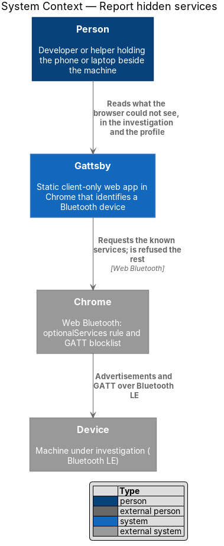
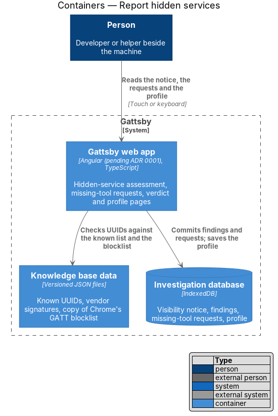
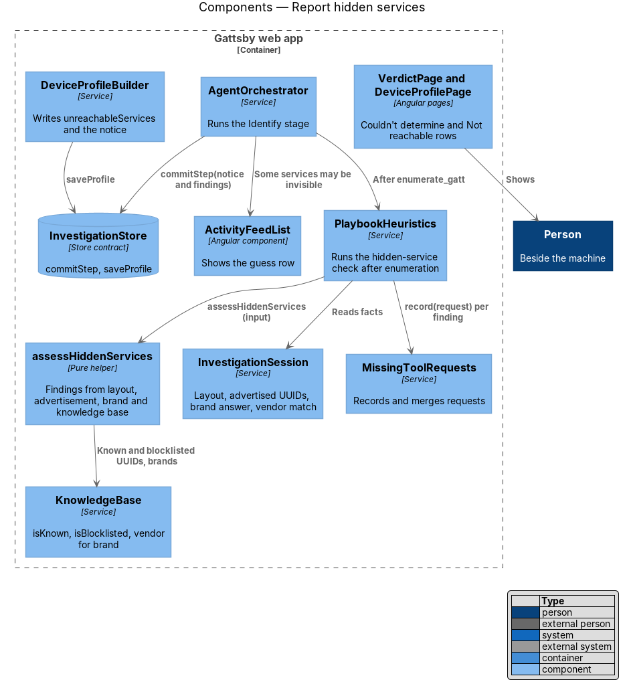
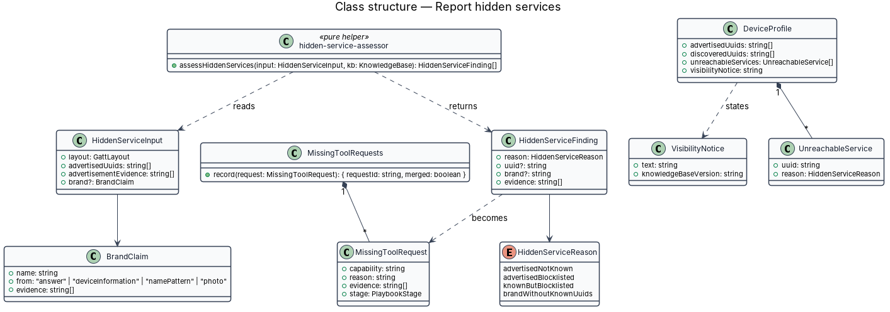
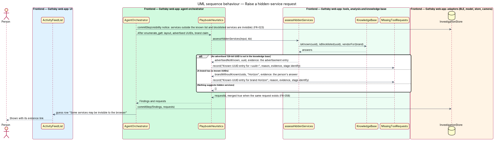
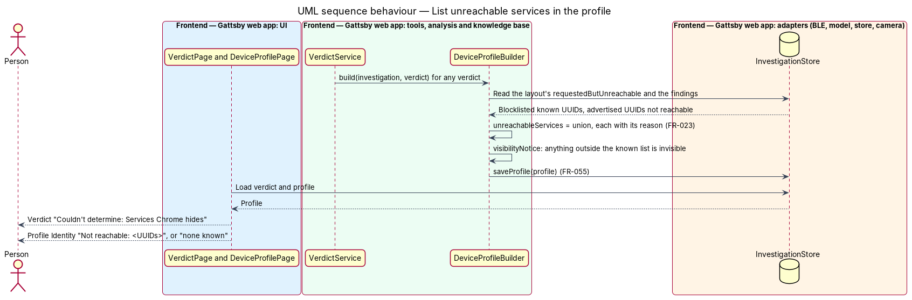

# Report hidden services

## Overview

Web Bluetooth shows a page only the services the page named when it asked for the device, in the
scan's `filters` or `optionalServices`, and Chrome's GATT blocklist hides some UUIDs from every page
(`PD-BLE-SERVICES`). A device can therefore have services that Gattsby cannot see at all, and a GATT
layout that looks complete may not be. This feature makes that limit explicit. It states the limit in
every investigation and every profile, lists the services Gattsby wanted but could not reach, and
raises a missing-tool request when the evidence suggests a device has services Gattsby cannot see. It
belongs to the identification subsystem and runs in the Identify stage, after the [read-the-gatt-layout
design](../read-the-gatt-layout/README.md) has recorded the layout.

**known-UUID list** — every service UUID the knowledge base holds, standard and vendor, which every
scan passes as `optionalServices` unless it is blocklisted (FR-067)

**GATT blocklist** — Chrome's list of UUIDs that no page may access, or may not read or write; the
knowledge base holds a dated copy

**hidden service** — service a device has that the browser does not expose to Gattsby, because it was
not in the known-UUID list or because it is blocklisted

**visibility notice** — fixed statement, recorded in each investigation and profile, that services
outside the known-UUID list and blocklisted services are invisible to the browser

**unreachable service** — UUID Gattsby has evidence of but could not reach: a known UUID left out of the
scan because it is blocklisted, or an advertised UUID that was not in `optionalServices`

Two pieces of evidence point to hidden services (FR-023). An advertised service UUID that is not
reachable shows the device has a service Gattsby could not open. A brand with no known UUIDs in the
knowledge base (from the person's answer to "Is there a brand on it?", from Device Information, from a
name pattern or from a photo) shows that any vendor service it has was never requested. Each raises a
missing-tool request, so the knowledge base can gain the entry that makes the service visible (see the
[add-a-vendor-signature design](../../knowledge-base/add-a-vendor-signature/README.md)).

The person sees the finding as a `guess` row, "Some services may be invisible to the browser", under
the match entry in the feed (`docs/mocks/pages/investigation/proprietary.html`). The verdict page lists
"Services Chrome hides — anything outside the known list is invisible" under "Couldn't determine"
(`docs/mocks/pages/verdict/default.html`). The device profile's Identity section has a "Not reachable"
row (`docs/mocks/pages/device-profile/default.html`, `partial.html`). The request itself appears on the
Missing tools page (`docs/mocks/pages/missing-tools/default.html`).

## Description

The design introduces these building blocks in the Angular (pending ADR 0001) workspace under
`frontend/src/app/`:

- **`assessHiddenServices`** (`outcome/hidden-service-assessor.ts`) — pure helper. Input: the
  `GattLayout`, the advertised service UUIDs with the raw-log IDs of the advertisements they came from,
  and the brand claim, if any. With the knowledge base it returns `HiddenServiceFinding`s, each with a
  reason, the UUID or brand, and its evidence IDs. It never reads the device.
- **`PlaybookHeuristics`** (`agent/playbook-heuristics.ts`) — runs `assessHiddenServices` after
  `enumerate_gatt` at Identify and again when a new brand claim or advertisement arrives, in both
  modes. It turns each finding into a missing-tool request. No model call is involved.
- **`MissingToolRequests`** (`outcome/missing-tool-requests.ts`) — records each request with its
  capability, reason, evidence and stage, and merges an identical request in the same investigation
  (FR-058; see the [record-a-missing-tool design](../../outcome/record-a-missing-tool/README.md)).
- **`KnowledgeBase`** (`knowledge-base/knowledge-base.ts`) — answers `isKnown(uuid)`,
  `isBlocklisted(uuid)` and `vendorForBrand(name)` from the known-UUID list, the blocklist copy and the
  vendor signatures.
- **`InvestigationSession`** (`agent/investigation-session.ts`) — supplies the layout, the advertised
  UUIDs (from `scan_devices`'s `advertisedServices` and, where it ran, `watch_advertisements`), and the
  brand claim.
- **`AgentOrchestrator`** (`agent/agent-orchestrator.ts`) — commits the visibility notice as an
  observation when the layout is first recorded, and commits the findings with their step.
- **`DeviceProfileBuilder`** (`outcome/device-profile-builder.ts`) — fills the profile's
  `unreachableServices` (each UUID with its reason) and `visibilityNotice` for every verdict (FR-023,
  criterion 2; FR-055; see the [build-the-device-profile
  design](../../outcome/build-the-device-profile/README.md)).
- **`VerdictPage`** (`pages/verdict/verdict.page.ts`) and **`DeviceProfilePage`**
  (`pages/device-profile/device-profile.page.ts`) — show the notice under "Couldn't determine" and the
  "Not reachable" row; UUIDs are rendered as text.

### Rules

1. Every investigation records the visibility notice once, at Identify, and every profile carries it,
   whatever the verdict. The statement does not depend on the device.
2. `unreachableServices` is the union of the layout's `requestedButUnreachable` (blocklisted known UUIDs
   and advertised UUIDs outside `optionalServices`) and the findings' UUIDs. A UUID in the known list
   that the device does not have is not unreachable and is not listed.
3. An advertised service UUID that is neither in the layout nor known raises a request "Known-UUID entry
   for `<uuid>`" with the advertisement's raw-log entry as evidence (FR-023, criterion 1). An advertised
   UUID that is blocklisted raises a request naming the UUID and the blocklist; Gattsby cannot reach it
   by any means, and does not try.
4. A brand claim for which the knowledge base has no vendor signature with service UUIDs raises a
   request "Known-UUID entry for brand `<brand>`" with the claim's evidence (an answer, a Device
   Information read, a name-pattern match or a confirmed photo read).
5. Requests are merged by capability within an investigation, so a repeated check does not duplicate
   them (FR-058).
6. When `unreachableServices` is empty, the profile's "Not reachable" row shows the notice "services
   outside the known list", as `default.html` shows.
7. Advertised UUIDs come mainly from advertisement data, which needs `watch_advertisements` (`PD-ADV`,
   P2). A filtered scan only ever matches known UUIDs, so at MVP the brand evidence is the usual
   trigger.

### Data shapes

| Type | Fields |
|---|---|
| `HiddenServiceInput` | `layout`, `advertisedUuids`, `advertisementEvidence`, `brand?: BrandClaim` |
| `BrandClaim` | `name`, `from` (`answer`, `deviceInformation`, `namePattern`, `photo`), `evidence` |
| `HiddenServiceFinding` | `reason` (`advertisedNotKnown`, `advertisedBlocklisted`, `knownButBlocklisted`, `brandWithoutKnownUuids`), `uuid?`, `brand?`, `evidence` |
| `UnreachableService` | `uuid`, `reason` |
| `DeviceProfile` (fields this feature fills) | `unreachableServices`, `visibilityNotice` |

### Errors

The feature raises no error code. A finding is an observation and a missing-tool request, not a
failure; the investigation continues on the services it can see.

### Tests that prove it

Acceptance specs use the fake `navigator.bluetooth` (`e2e/fixtures/fake-bluetooth.ts`) and the
`InvestigationPage`, `VerdictPage`, `DeviceProfilePage` and `MissingToolsPage` page objects. A scripted
device that advertises a 128-bit service UUID absent from the knowledge base raises a missing-tool
request naming the UUID, with the advertisement as evidence (FR-023, criterion 1); the fake plays the
advertisement through `watchAdvertisements`. For each scripted device, the finished profile lists its
unreachable services and carries the notice (FR-023, criterion 2). Unit tests cover
`assessHiddenServices` for each reason, for a known UUID the device lacks (no finding), and for a brand
that has a vendor signature (no finding).

## Requirements

The feature realizes the following level-2 (L2) requirement; it refines the level-1 (L1) requirement
cited beside it.

| L2 ID | Refines (L1) | Requirement |
|-------|--------------|-------------|
| [`FR-023`](../../../specs/L2.md#fr-023-report-services-the-browser-cannot-see) | `L1-006` | Gattsby must state, in the investigation and in the profile, that services not in its known-UUID list, and services on Chrome's blocklist, are invisible to the browser, and must raise a missing-tool request when the evidence (advertised UUIDs not reachable, a brand with no known UUIDs) suggests there are hidden services. |

## Diagrams

### System context

The person reads in Gattsby what the browser could not see; Chrome's `optionalServices` rule and GATT
blocklist decide what Gattsby can reach on the device.

### Containers

The web app checks UUIDs and brands against the knowledge base data, including its copy of the
blocklist, and commits the notice, the findings, the requests and the profile to the investigation
database.

### Components

`PlaybookHeuristics` runs `assessHiddenServices` over the session's facts and the knowledge base and
records a request per finding in `MissingToolRequests`; `DeviceProfileBuilder` writes the unreachable
services and the notice into the profile that the verdict and profile pages show.

### Class structure

`assessHiddenServices` turns a `HiddenServiceInput` into `HiddenServiceFinding`s, each of which becomes
a `MissingToolRequest`; the `DeviceProfile` owns its `UnreachableService`s and states the visibility
notice.

### Behaviour — raise a hidden-service request

After the layout is recorded, the notice is committed and the assessor runs. An unknown advertised UUID
or a brand without known UUIDs raises a merged-by-capability missing-tool request, and the feed shows
the `guess` row.

### Behaviour — list unreachable services in the profile

For any verdict, the profile builder lists the unreachable services with their reasons and the notice;
the verdict and profile pages show them.

