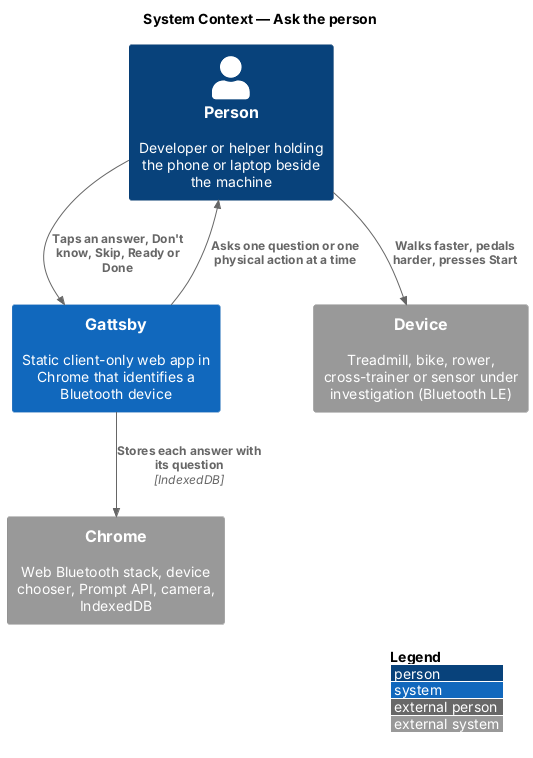
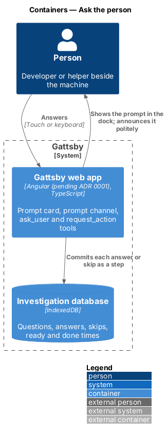
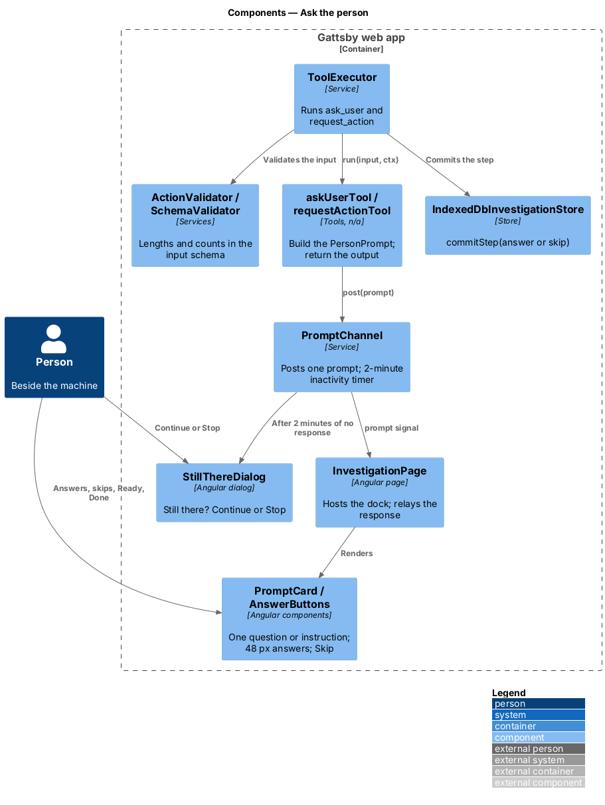
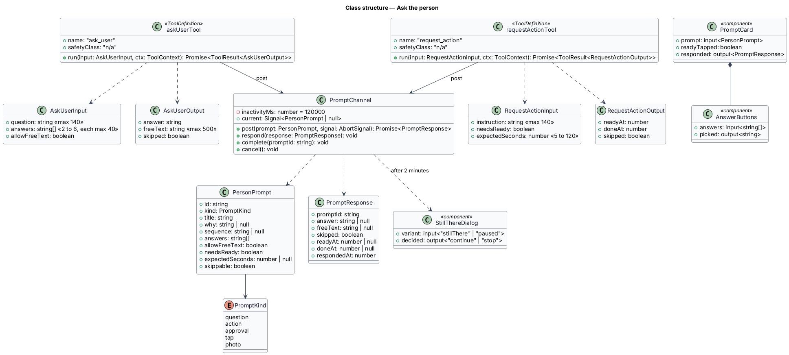
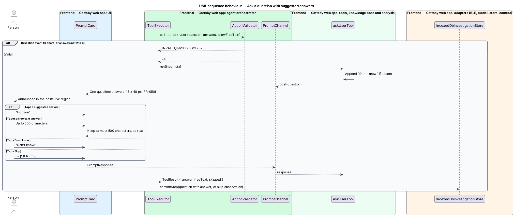
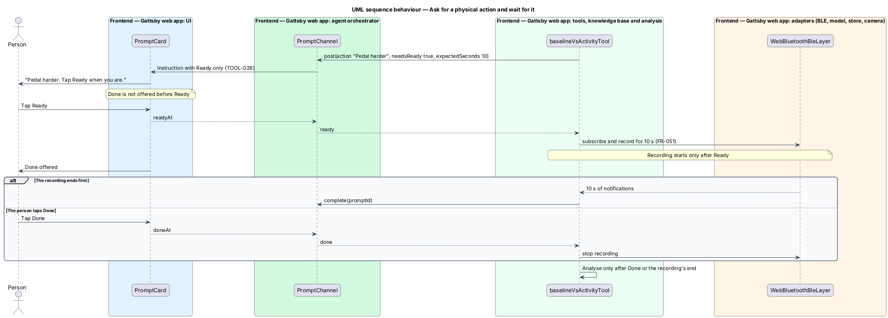
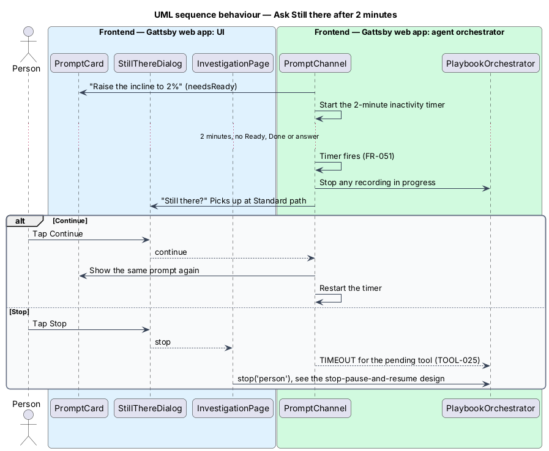

# Ask the person

## Overview

Gattsby cannot see the machine; the person beside it can. The agent therefore asks the person for
what only they can give: the machine type and brand, a physical action such as "Walk faster" or
"Pedal harder", or confirmation that something happened. This feature is the one channel for those
requests: the `ask_user` and `request_action` tools, the prompt they show, the 2-minute wait, and the
person's right to skip. It belongs to the investigation subsystem and is used at every playbook
stage, in both full agent mode and checklist mode.

**prompt** — one question or one instruction shown to the person in the Investigation page's dock,
with the answers it accepts

**suggested answer** — one of two to six short answers offered as large buttons, to which Gattsby
always adds "Don't know"

**physical action** — something the person does to the device, such as walking faster or raising the
incline, which a recording or an analysis waits for

**skip** — person's choice not to answer a question, perform an action or run an optional stage,
recorded as an observation

A question appears in the dock with its count ("Question 1 of 3"), its title, a line of help and its
answers ("Treadmill", "Bike", …, "Don't know") (`docs/mocks/pages/investigation/prepare.html`). A
physical action appears as an instruction with its own answers, for example "Raise the incline to 2%"
with "Incline is at 2%" and "It didn't change"
(`docs/mocks/dialogs/still-there/default.html`, behind the dialog). After 2 minutes with no response,
"Still there?" offers "Continue" and "Stop" (`docs/mocks/dialogs/still-there/default.html`).

The feature exists so that every request to the person reads the same way, is readable at arm's
length and usable one-handed, and is recorded with its answer in the investigation record.

## Description

The design introduces these building blocks in the Angular (pending ADR 0001) workspace under
`frontend/src/app/`:

- **`askUserTool`** (`tools/person/ask-user.tool.ts`) — the `ask_user` tool (TOOL-025), safety class
  `n/a`, no preconditions, allowed at every stage. Input `{ question, answers, allowFreeText? }`;
  output `{ answer, freeText?, skipped }`. It appends "Don't know" when the answers lack it, posts a
  `PersonPrompt` of kind `question` and returns the response.
- **`requestActionTool`** (`tools/person/request-action.tool.ts`) — the `request_action` tool
  (TOOL-026). Input `{ instruction, needsReady, expectedSeconds? }`; output
  `{ readyAt?, doneAt, skipped }`. With `needsReady` true, "Done" is not offered until "Ready" is
  tapped.
- **`PromptChannel`** (`agent/prompt-channel.ts`) — posts one `PersonPrompt` at a time through its
  `current` signal and resolves the `PromptResponse`. It owns the 2-minute inactivity timer for
  `question` and `action` prompts; an `approval` prompt has no timer (see the approve-a-command
  design). `complete(promptId)` ends an action prompt when its recording ends; `cancel()` ends the
  pending prompt on stop. Tools that need an action inside their own run, such as
  `baseline_vs_activity`, post through `ToolContext.prompts`, which is this channel.
- **`ActionValidator`** and **`SchemaValidator`** (`agent/action-validator.ts`,
  `tools/schema-validator.ts`) — refuse an input that breaks the limits below with `INVALID_INPUT`
  before the tool runs (FR-043).
- **`PersonPrompt`** and **`PromptResponse`** (`store/model/person-prompt.ts`,
  `store/model/prompt-response.ts`) — the shapes below.
- **`PromptCard`** (`ui/prompt-card/prompt-card.component.ts`) — presentation component. Input: the
  `PersonPrompt`. Output: the `PromptResponse`. It shows the count, title, "why" line, answers, the
  optional free-text field and "Skip", and keeps "Done" hidden until "Ready" for an action that needs
  it.
- **`AnswerButtons`** (`ui/answer-buttons/answer-buttons.component.ts`) — presentation component that
  lays out the answers as buttons at least 48 × 48 px with at least 8 px between them (NFR-009).
- **`StillThereDialog`** (`dialogs/still-there/still-there.dialog.ts`) — the `stillThere` variant:
  "Nothing has happened for 2 minutes, so I've stopped listening. Everything so far is saved." with
  "Continue" and "Stop". The `paused` variant belongs to the stop-pause-and-resume design.
- **`InvestigationPage`** (`pages/investigation/investigation.page.ts`) — hosts the dock as a polite
  live region and passes the card's output to `PromptChannel.respond()`.

### Limits

| Field | Limit | On breach |
|---|---|---|
| `question`, `instruction` | At most 140 characters | `INVALID_INPUT` (TOOL-025, TOOL-026) |
| `answers` | 2 to 6, each at most 40 characters | `INVALID_INPUT` |
| `expectedSeconds` | 5 to 120 | `INVALID_INPUT` |
| Free-text answer | At most 500 characters kept, stored as text | Input stops at 500; longer pasted text is cut to 500 (FR-050) |
| Inactivity | 2 minutes without an answer, "Ready" or "Done" | "Still there?" (FR-051) |

### Rules

1. One prompt at a time. `PromptChannel` refuses a second `post` while one is pending; the
   orchestrator awaits each prompt before its next action. The dock shows one question or
   instruction per screen (NFR-009).
2. "Don't know" is always an answer, and the person may type their own answer where
   `allowFreeText` is true. Each answer is committed with its question in the same step (FR-050).
3. For an action with `needsReady`, the tool that records starts only after "Ready", and analysis
   starts only after "Done" or the end of the recording (FR-051).
4. After 2 minutes without a response, the channel stops any recording in progress and opens
   "Still there?". "Continue" shows the same prompt again and restarts the timer. "Stop" ends the
   pending tool with `TIMEOUT` and stops the investigation (see the stop-pause-and-resume design).
5. Every question and action offers "Skip". A skip returns `skipped: true`, is committed as an
   observation, and the agent continues with what it has; for example a skipped brand leaves the
   hypothesis's maker unknown (FR-052).
6. An optional stage (the Control stage, drawn as optional and skippable in the mocks; OQ-08) is
   offered with "Skip this stage"; the skip is an observation, and the orchestrator moves to the
   next stage. Which stages are optional is data in `Playbook`; the wording of the skip control is
   `<TO SUPPLY>` (OQ-06).
7. Prompt text, answers and the person's free text are rendered as text, never as HTML (see the
   render-untrusted-text design).

### Data shapes

| Type | Fields |
|---|---|
| `PersonPrompt` | `id`, `kind` (`question`, `action`, `approval`, `tap`, `photo`), `title`, `why`, `sequence`, `answers`, `allowFreeText`, `needsReady`, `expectedSeconds`, `skippable` |
| `PromptResponse` | `promptId`, `answer`, `freeText`, `skipped`, `readyAt`, `doneAt`, `respondedAt` |

### Errors

| Code | Raised by | Meaning to the person |
|---|---|---|
| `INVALID_INPUT` | `ActionValidator` | Nothing shown; the step counts against the step budget (FR-043) |
| `TIMEOUT` | `PromptChannel` after "Still there?" and "Stop" | The investigation stops with what is known |
| `ABORTED` | `PromptChannel.cancel()` on stop or emergency stop | The prompt closes |

### Tests that prove it

The acceptance specs drive the dock through the Investigation page object at a 390 × 844 viewport
and check the size and position of the answers. The inactivity spec advances Playwright's clock by
2 minutes instead of waiting. Unit tests cover `askUserTool`'s "Don't know" rule and the 500-character
cut, and `PromptChannel`'s timer on a fake clock.

## Requirements

The feature realizes the following level-2 (L2) requirements; each refines the level-1 (L1)
requirement cited beside it.

| L2 ID | Refines (L1) | Requirement |
|-------|--------------|-------------|
| [`FR-050`](../../../specs/L2.md#fr-050-ask-questions-with-suggested-answers) | `L1-011` | Gattsby must ask one question at a time, with two to six suggested answers as large buttons, an optional free-text answer, and always a "Don't know" answer. Answers are recorded with the question. |
| [`FR-051`](../../../specs/L2.md#fr-051-ask-for-a-physical-action-and-wait-for-it) | `L1-011` | For a physical action (for example "Walk faster"), Gattsby must show the instruction, wait for "Ready" before recording starts where a recording is involved, and for "Done" (or the recording's end) before analysis. If nothing happens within 2 minutes it must ask whether to continue. |
| [`FR-052`](../../../specs/L2.md#fr-052-let-the-person-skip-a-step) | `L1-011` | The person must be able to skip any question, action or optional stage. A skip is recorded as an observation, and the agent continues with what it has. |
| [`TOOL-025`](../../../specs/L2.md#tool-025-ask_user) | `L1-011` | Asks one question with suggested answers (FR-050). |
| [`TOOL-026`](../../../specs/L2.md#tool-026-request_action) | `L1-011` | Asks for a physical action and waits for "Ready" and then "Done" (FR-051). |

## Diagrams

### System context

Gattsby asks the person one thing at a time; the person answers in Gattsby and acts on the device,
and Gattsby stores each answer with its question.

### Containers

The web app shows the prompt, announces it, and commits each answer or skip as a step in the
investigation database.

### Components

`ToolExecutor` validates and runs the two person tools, which post through `PromptChannel`; the page
renders the prompt in `PromptCard` and the channel opens `StillThereDialog` after 2 minutes.

### Class structure

The two tools take schema-limited inputs and post `PersonPrompt`s through `PromptChannel`, which
resolves `PromptResponse`s from `PromptCard` and owns the inactivity timer.

### Behaviour — ask a question with suggested answers

An oversized question is refused before it shows; a valid one gains "Don't know", and the person's
answer, free text or skip is committed with the question.

### Behaviour — ask for a physical action and wait for it

The recording starts only after "Ready"; analysis waits for "Done" or the end of the recording.

### Behaviour — ask "Still there?" after 2 minutes

With no response for 2 minutes, recording stops and "Still there?" offers "Continue", which shows the
prompt again, or "Stop", which ends the investigation.

